# 中英-•-C++和C语言ACCU大会2024｜人工智能｜架构｜函数编程｜静态分析｜安全｜编译器｜开发者｜垃圾回收｜链接器｜代码生成｜cmake-p19-P21-Keynote---Safety,-Security,-Safety-and-C---C++---C++-Evolution---Herb-Sutter--BV1pNotYYELk_p19-

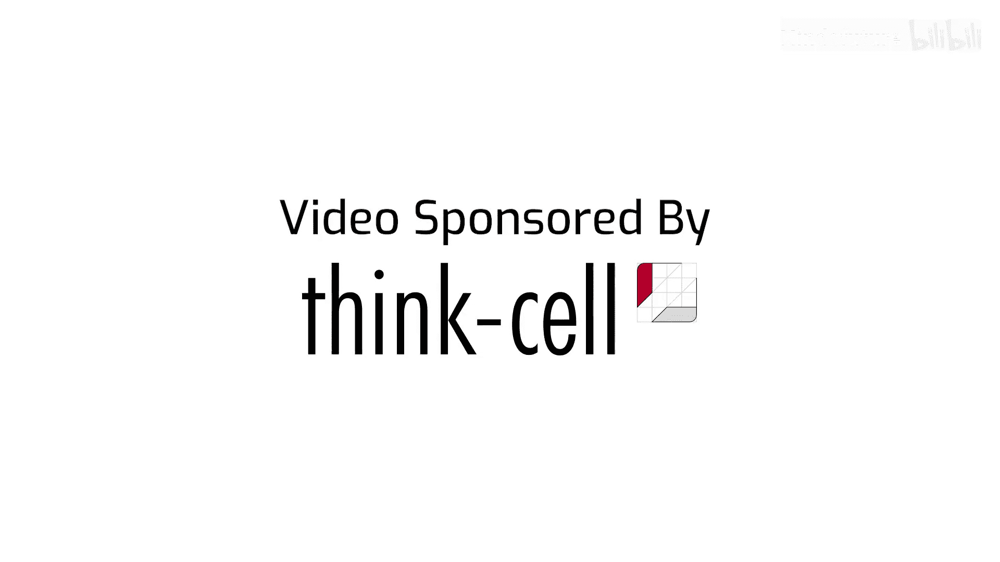

So thank you again for having me back at ACCU。 It is。 I mean。

 it still feels new and great to see everybody in 3D again。 So， yeah， so thank you for that。

 And for coming， I'm sure you'll have a wonderful conference。

 I get to talk in Na are on a little bit about safety， security and safety。 And that's not a typo。😊。

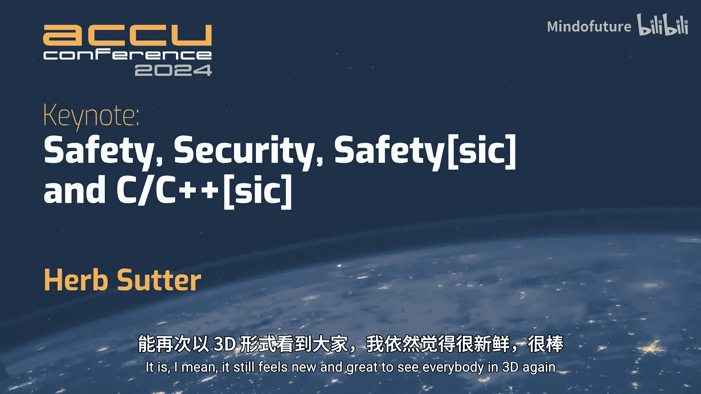

And C slash C plus plus。Which is also not a typo， but might bring down a lightning bolt on me。

 So sorry to those of you in the front row who might get the lightning bolt splash。

We're in this together。I'm mostly going to talk about one specific area of safety that's been in the news a lot and that we care about improving N CNNC plus plus。

 which is type of memory safety。But it's impossible to to do that well without the context of all of the attacks。

 not just that one on our software。My software， your software。

 your systems are under attack right now while we're in this room。

 or they will be tomorrow or were yesterday。And it's not just about attackers。

 It's also about safety。 So let's talk about those terms right up front。I am not making these up。

 These are standard terms。 and so there's an ISO reference， for example。

Software security or cyber securitycurity is about defending our software against attack。

So we want to protect our assets， our secrets， our confidential information。

So when I say software security or security， that's what I'm talking about。

Software safety is also important。 We want to make sure that。

 that our hospital equipment works correctly。 We want to make sure that our autonomous vehicles don't run people over。

 So making software free from unacceptable risk of causing unintended harm。

There are weapon system intended to cause harm， but you want to not cause unintended harm because of software defects。

That's what software safety is about。And then finally， programming language safety。

 which probably most of us think of first when we say safety。

 And this is what I'll mean if I say safety， unqualified。This is the safety。

 not that one up there not this one up here。It's about。

How does the language help guarantee program correctness？

 And so type of memory safety is a part of that。 But right up front。

 I would like to show the relationship between these。

Programming language safety helps both of the others。

 It's not just about protecting our software against intrusion。

And it also makes our lives better as programmers。 It increases quality generally。

 makes our programs more robust， free of defects。😊，Makes us more productive。

Whenever you see these kinds of arrows， this helps that。 That helps us to see right up front that。

The source of the arrows programming language safety is good。

 We're going to talk a lot about how to make it better in our languages。But it is a means to an end。

 not the end in itself。 We don't just say programming language safety and declare victory。

The reason we care about programming language safety is so that we have more secure software。

 We have more safe software， and that we're more productive。

So let's not confuse the end and the means。 But let's talk about the means， because。

One means that gives you three good things is valuable。So here is a talk in one slide。

I'm going talk about what is the actual problem in native languages， especially CNC， plus， plus。

In terms of safety， my argument is going to be。It is not perfection。

It is not that we get 100% provably， formally correct type systems in our languages。

It is that we achieve pary with other memory safe languages like C sharpp， Rut， go， Python。

And that we can do that through fixing， improving four things， type bounds。

 initialization and lifetime safety。 And the effort currently underway that I hope succeeds that I want to help to succeed in W G21 is a safety profiles framework。

That helps us to enforce those kinds of rules by default at compile time。

 where I can enable them for a volume of code。 So it's opt in in that way because we're backward compatible。

 The default has been off。But we want to make it easy to opt in。 And then in that region。

 it's as if that is the default。 The safety is the default， and we can opt out when we need to。

And I'm going to try to add to the stir stripip anddu races。Proposal in two particular ways。

 I totally agree with it。 And I think how we deliver it matters as well。 So I'll argue that。

We can be specific。 I'll give a few lists of candidate rules briefly。

 You can look at the slides in more detail later。 They all refer to established practice already。

And talk a bit about maximizing value。 How can we maximize the value of profiles to all existing code。

 not just the good modern C plus plus code that is in textbooks。 But what about our rich。

 blurry Melan of real world code in C plus plus projects with a variety of styles。😊。

I'm going to try to do some things， and I'm not going try to do some things。

 So I want to look candidly at C plus as a safety problem， and it is real。

But we also have to look at the context of the broad landscape of all the threats on our software。

 not just narrowly at fortifying that one door， that one window。

And I do not aim to speak for anybody else。 I do not aim to to have a sermon about how wonderful C plus plus is。

 nor should you expect a rant about how terrible some other languages。 Those are not worth time。

But we want to look realistically at what are the trade offs and benefits that we can expect and how can we get there。

 So here is one anti pattern。For a long time， C plus plus people might have said， well， you know。

 we've been hearing this since the 1990s， Java， this Java that， aid of that。

And we could just ostrich。 Now， ostrichches don't really do this。 But， you know， it's the idiom。

And this idea of just saying everything is fine while the house is burning is not good。 That is。

Not good enough。On the other hand， running for the exods。

 as if that fire alarm that was just mentioned had been we should be even in that case。

 we should be orderly。 But just running for the exits as if there's a panic is also an extreme overreaction。

 as if that we could find a silver bullet or a unicorn rainbow that will solve all our problems。😊。

So the aiming somewhere in between。So let's talk for a moment about what I will try to make the case is the problem。

One good source of data is Mire dot org。 And we'll talk about the difficulties of counting C V Es later。

 This is C W Es。 This is common weaknesses and the most severe that were ranked for 2023。

 where there's the link to the top 25。 Here is the top 10 I fit on the screen。 Which ones of these。

 Just call out the numbers。 Which ones of these are related to programming language safety。

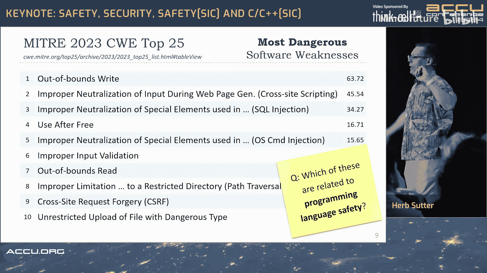

One， I have one， do I have more than one。For any others？7， yes，1，4， and 7。

We'll talk about the other seven later。But three of them are related to programming language safety。

 Notice that two of them are about bound safety。 So we just said there's four main safeties that we want to improve in the short term。

 Bounds is the number one problem。 It's the low hanging fruit。 And so。

Here's a slide I showed a year and a half ago at CPPCon。Showing that， again。

 the breakdown of memory safety vulnerabilities， excluding the others for now。

It's the same old for lifetime initialization type and bound safety。

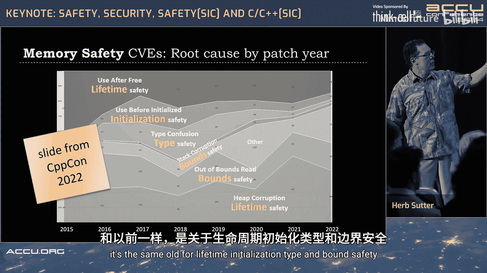

So our immediate problem is that it is way too easy in CNC plus plus code to accidentally write a bug in one of those four areas。

 because the default is it compiles and appears to work， right， like a race condition。That's not。

Ideal。And especially because we already have lots of known rules。

 If you are running a modern static analysis tool， many of those things would be caught。

 But do you have one installed， Does it give the same answers as your neighbors。

 Does it support all the systems that you run on。We want to do better， and converge these things。

And those four areas， type bounds， initialization and lifetime language safety， especially bounds。

 As you'll see above， I deliberately made that one bigger as the low hanging fruit。

Are always among the top C W Es， the weakness areas。 So where we get the most vulnerabilities。

And the most severe ones。And they are also the four main things that the memory safe languages make better。

So by definition， if we made， if we got to parody in those four areas with most other languages in CNC plus。

 plus。There would be no reason， by definition， to recommend people switch to a different language。

Like those， this is the problem。More about that， 70% later， because that is true。

 but taken wildly out of context in the media。We'll talk about what that is and what it isn't。

So my hypothesis that I hope that profiles will be able to deliver is that C plus plus can help us have a mode where we can buy default and force。

The rules that we mostly already have plus fill in a few gaps as we need to。

And get to parity with other languages in writing those defects in code that we get compile time enforcement。

But right away， notice I use the word immediate because this is the start， not the end。

 These are the four to look at first。 But， yes， we also care about thread safety and other kinds of safety。

The defaulted enforcement are important。 And we'll talk about that more later about why。

Safety by default is a big deal。I talk about known rules。

 but there are a few gaps we still need to fill， such as。

An example I'll give is what if we had the compiler inject bounds checks at the call site。

 So you wouldn't need to wait for to vector instead span to be updated。

But the subscript operations at the call site。Would be bounds checked for you。

With your current standard library， without with your current third party libraries that use the same idioms as the S TL。

Now， let's talk a bit about these guarantees， because it's not just what guarantees you have。

 what rules we have， but。How do you enforce them and when do you enforce them？

So I'll try to make two points here。 The first one。

Is that enforcing safety before check in is important。 Today。

 we may have a static analysis tool that maybe is too expensive to run on every build on your local machine as a developer。

So maybe it's run during the CI passed later on。Already。

 you are going to get more defects coming through because you're getting checking later。

 We know we want to shift left， right， We want to get errors as soon as possible。

At build time is ideal。 And I want to quote David Chisnell。 He was from Microsoft Research。

 and he was。Just about three months ago， responding to a thread on the free B free BSD hackers forum about moving to rust as a systems language or adopting rust in freeBSD。

And because he was one of the co authors of a Microsoft internal strategy paper that recommended rust by default。

He gave context from his experience there。 And I worked with that， as well。But here are。

 are David's words that he posted to the list。 So they're already public。 I can quote them。

Between modern C plus pluss with static analysis analyzers and rust， there was a small safety delta。

As far as Microsoft internally was concerned evaluating those languages。

The recommendation nevertheless， was to prefer rust for new code。

 Why it was primarily based on a human factors decision。

 It is far easier to prevent people from committing code that doesn't compile。Right。So， shift left。

 safety。Checks early matter， and at build time is ideal。

He also made the point between using modern C plus， plus， even just smart pointers and ranges。

There is enormous safety Delta with C。 and we'll talk about that as well， a little bit later。

So one thing we should do is move checks that we already have from other tools that already exist in modern C。

 plus， plus。Move them to build time。Is step one。And you might think about this。

 You don't check for weapons。Once you're seated on the plane， you check well before you。

 you don't all checking。 You want early checking。 And thank you， Dolly。

 for trying to make a picture of that。 You might have noticed this is physically impossible。You know。

 maybe， maybe the hand has a magnetic thing that's holding onto the briefcase on the other side。

 So I asked Doally to try again， like， show me a family。 And Doally did better this time。

 except that it was cross like they're not actually going through。😊，AI。

It's fun to poke holes today poke front of AI。 But thanks for the effort。😊。

So that was number one at build time。 Number two， by default， safety by default matters。Today。

 one way。 and this is just me talking。 So this is the way I would phrase it。

 Perhaps other people have better ways of phrasing it。

 I would say that C plus plus today and for the last 30 years， has been built on the philosophy。

 performance by default， safety always available。What's the default。Performance now。

You will take those performance sharp dives out of a C plus plus programmer's cold， dead hands。

 right， We want all of those sharp dives。So don't take them away。

But we also have to acknowledge that if a language can reject errors early and have memory safety guarantees early。

 we'll have fewer bugs overall。 It's not just about safety and security。

It also so about productivity。So what could we do without taking away the knives， We could say。

Aim for safety by default， Have a way to enforce these known rules at compile time by default。

 but still provide an opt out。 You can still at at all the knives， not just like rust unsafe。

 gives you access to 5 or  six of the knives。 We want all the knives。 We want like time travel。

 undefined behavior， but not by default， please。We don't really want trying to travel un to find behavior at all。

 But if we can see when it's happening， then we know what we're paying for。

We're not getting it done to us。 We're saying， I know what I'm doing and that the way I'm doing it。

 I'm going to be extra careful。But I want an expo stopped out。

That is still in accord with as your overhead principle that I don't pay for what I don't use。 Now。

 you might have noticed the picture。So this was I showed you this version of the picture that Dolly generated。

 I'm gonna pick it on Dolly just because I was using chat GT。 And so it used Dolly。 So I said。

 show me like an example of a foot gun。 And I won't show you the first couple because they were really violent。

 But it came up with this。 A damaged foot。 Here is the whole picture， which is kind of。

Kind of interesting。And then I thought， you know， JF Basten gave a really nice talk about safety at CP Now。

 I think it was it last year or the year before。😊，And I I liked how he used rabbits in the style of E B White。

 He also did AI generated artwork。 So I thought， okay。

 show me the same picture in the style of E B White。 Okay， that's much better。😊，So。

Let's talk about those。The rabbit and the kitchen。Okay。I am all in favor of knives。

 We are not going to take the knives away from C plus programmers and still call ourselves C plus+。

 That would be doing harm to our value proposition。

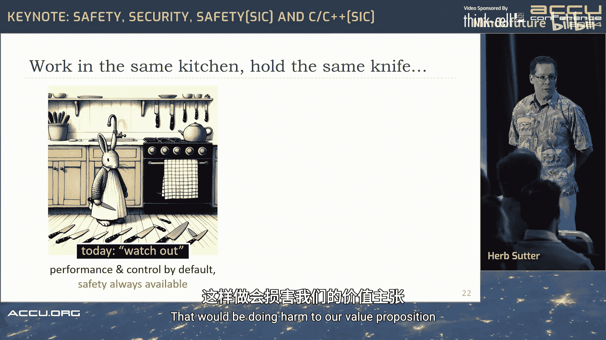

But there's nothing wrong with putting the knives and drawers。

So that we can explicitly opt into opening the door and taking out the knife when we want it。

 I want all my knives。 I just don't want them lyinging around on the floor。The left picture is。

Performance by default， safety always available。 Watch for a step。

The right is the same kitchen with the same chef and the same knives。

But in a drawer safety by default， performance and control， always available。

A lot of chefs have partial fingers， you know， it happens。So one way that I think of it。

 and this was inspired。 I I'll tell you where I got the idea in a minute。

One the way I think of this is like you're wearing armor。 You want safety by default。

 So a knife who's in battlettleled wants armor all the time。 Now。

 you might think this is pretty lightweight armor because maybe he's doing ninja moves。By the way。

 is this AI generated， Yes， count the fingers。Good。There are 9 few thumbs our fingers。

 We can talk about that later。 But context is important。 Safety by default is good。

 But could you think of a context where you wouldn't want to be wearing heavy armor。

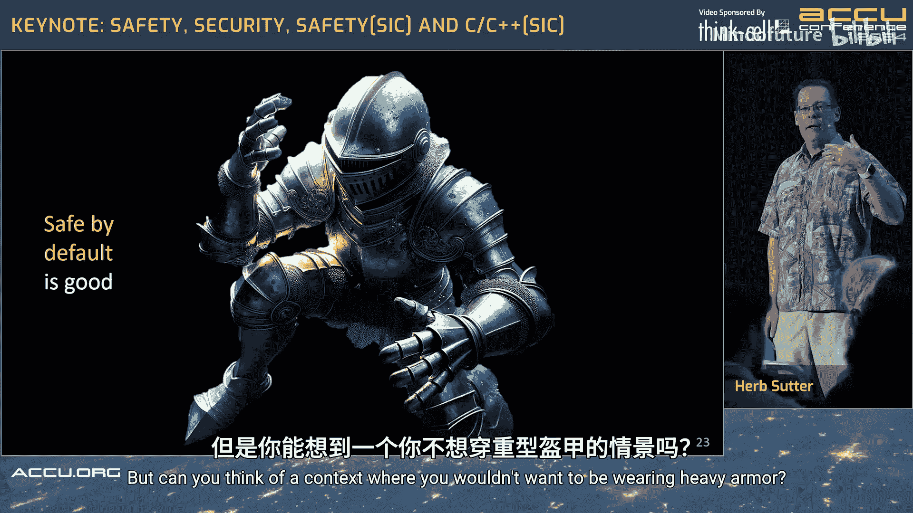

😀Yeah。😊，M。😊，So if you're underwater and sinking， the first thing you want to do is say， you know。

 I love this armor， But now I really want to get out of it real fast。 And this hat tip here。

 this was inspired by a me suit scene in the edge of tomorrow。

 How many of you have seen the edge of tomorrow， Emily Blunt， Tom Cruise。😊，Yeah。

 they were showing it on the plane。 So I took a little video。 Here's Tom Cruise in his me suit。

Falling through water。 And in the very next shot， you see him emerging from the water without a exsuit。

Good idea。 So even Tom Cruise， right， Even Tom Cruise needs to opt out of safety sometimes。

Then he survived later and respond。 But， you know， that was the whole movie。

 It was ground If you haven't seen it， it's Groundhog day。With aliens and nextsuits。So。

 but let's talk about how we make this adoptable。 I want to quote my boss's boss's boss， roughly。

John Cunningham， he is the， the corporate vice president， Microsoft。

 who's responsible for the engineering of all programming languages， Python， C plus plus Rus。

 dot net， all of them。And he put it to me this way。 And he， he allowed me to use this quote。

Our C plus safety improvement efforts can't be art that we hang on the wall and admire。

We're engineers。What we make can be beautiful， but we don't want to design something to hang in a museum。

 We want people to walk around， and use it。This is in the context of how do we make safety profiles adoptable？

 So I really want to talk about that for a bit and keep coming back to that。

I want to maximize adaptability。 How do we deliver them so they can be adopted at scale。

 And I want to maximize impact。I have good code and crafty code。 What can safety profiles do for me。

 also for the crafty code， Or do we just leave that behind。Cause there's a lot of crafty code。

And if we can improve that。We will have done a good thing for our civilization。

 because our civilization depends on that crafty code， too。

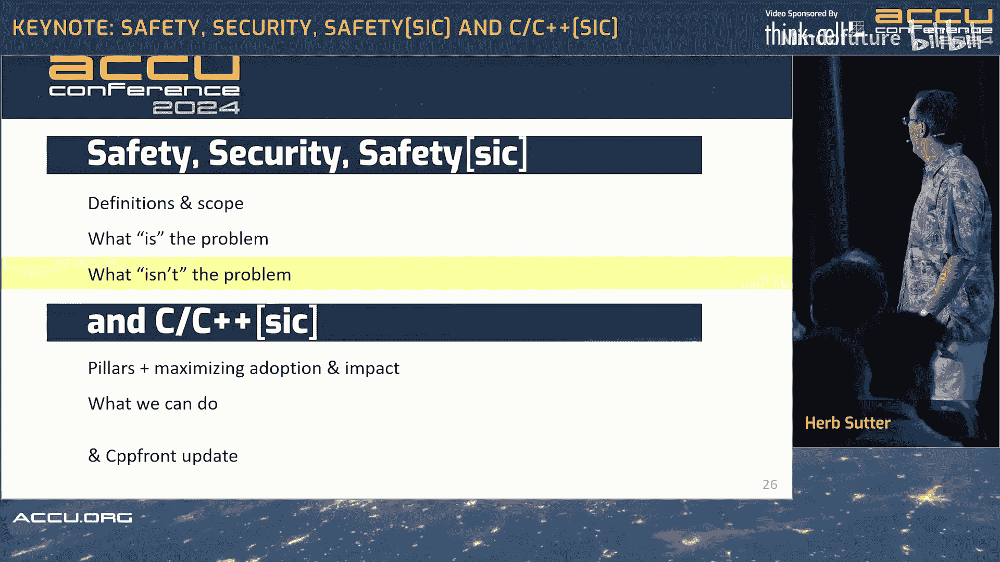

So let me just talk about what isn't the problem。 I enjoyed this book series that when I was an undergrad。

 So I'll use myth conceptions and deliberately。😊，We need slides。 Do we have slides。

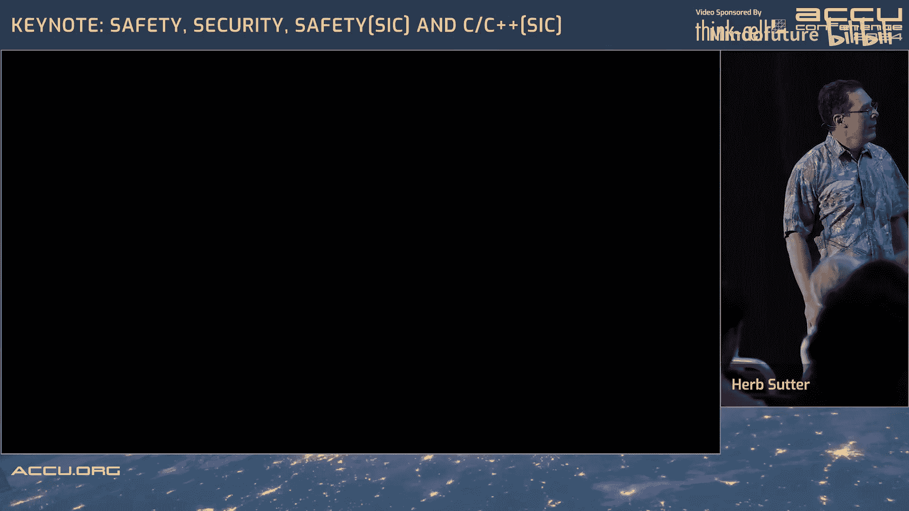

They're back。 Allright。 So misconception number one， the problem isn't defining what safety is。

 I heard a little bit about this two years ago， and I hear a lot less now， which is great。 Like。

 what are the safeties we should aim for first， T safety under flow。😊，Type bounds， initialization。

 lifetime。 That's the low hanging fruit。And then we can do the others as well。

 But this is where the immediate pain points are。 It's where our pain is and where the major gain of other languages is。

Myth concept number two。The problem is not that C plus plus is not formally provable Tya。

 Much to the chagrin of language designers everywhere。

 No commercially successful programming language is。Some are still trying to be。 I'm。

 I'm watching certain ones that are that are trying hard。But it is neither necessary nor sufficient。

 It's not necessary because our memory safe languages have already set it quite a high bar without being perfect。

And it's not sufficient because there are lots of vulnerabilities that are not about memory safety。

 And we have to address those， too， so。All design is about trade offs。

 and here's one where I want to compliment rust。 So if。

 if you're expecting me to say something antirust， you're gonna focus on the second part。

 If you're gonna， if you want to interpret what I say as Herbs convert it to rust。

 you're gonna focus on the first part。 I'm saying both of them。

 So neither of those is a correct interpretation。I think both are true。

 and this is a balanced way to look at it。Russ Sa code uses tree based data structures exclusively。

 Yes， you have R C and you have other ways， of doing non tree based data structures。

This gives it a superpower。 It is the only major commercial language yet today。

 although I know Swift and others are are， are hot on the tail as well。

That has strong concurrency safety， thread safety guarantees。And kudos to us， that's。

 that is a good thing。There's also a cost to it。 You have to use unsafe in rust more often than in other languages。

Because other languages like CNC Shap， you can， you can have a cyclic data structure in entirely safe code and rush。

 you can't。 You need to use R C， which is implemented in terms of unsafe stuff underneath or use indexes as back pointers。

 things like that。This is not a criticism。 Notice that I made the。

The check marks green and the dollar sign green because it's an engineering and design trade off。

RightThis is the real world。 We embrace trade offs。

And that's just to show the different languages among the memory safe languages already embrace different trade offs。

 And that's okay。Nobody's perfect， because engineering reality。This conception number 3。

 this is the first place lightning might strike me。I am going to assert。This is carefully phrased。

No security expert。 I know。Believes that if we could wave a magic wand and immediately overnight。

 wake up tomorrow morning， and every line of CNC plus in the world was transformed to a memory safe language。

😊，No security expert， I know believes that would mean we have 70% fewer vulnerabilities。

When I circulated that， I said had the same statement in the essay I wrote last month when I was circulating drafts of that。

 several security reviewers when I first were saying nobody I know believes this， They said， well。

 actually， some people do believe that。 So I said， okay， fine。

 No security expert I know believes that。For example。

 we already saw that three of the top 10 C W Es are about memory safety。So even if overnight。

 we wave a magic wand and we make all three of those go away。 Are we done。

Should we expect that we've now reduced or removed 70% of the world's vulnerabilities。

 not by a long shot。Don't get me wrong。 It would be great to get rid of those three。

 and we should try。But let's not be myop。 Let's not focus too much on one problem when we want to address all of the threats on our software。

Why doesn't your home front door look like this， I love the Fort Knox label。 That's the manufacturer。

That would be a pretty good front door， right， pretty secure。Yeah。

 and there's always a usability trade off and getting in and out yourself， but。

Why don't we spend all our security， Home security money on the front door。

Burglars go after the next weekest point of entry。 The next weekest point of quiet entry。

 So if you have an unsecured window that has no bars next to the front door or around the back of the house and they can get in without the neighbor's hearing。

 just break it quietly。You spend a lot of money on a front door， but you haven't secured your house。

So， we want to。Protect all the points of attack。 and attackers go after the slowest animal in the herd。

If we fortify one place， they will switch to the next place。

We are already seeing that with attackers moving from malware to other vectors because endpoint security is effective。

 And we have a ways to go。 But we are already seeing the attacker shift。 They'll look at your window。

 even if we ignore it， they will look for it。Yes， there absolutely have been memory safety related。

 severe attacks in the last few years。But many of the most severe attacks， not all。

 but many have had nothing to do with memory safety。

 Solar winds was about hijacking an update system to deliver malware。

Log 4 J was written in a safe language。 It was about sanitizing input。 From 2023。

 Ki security is a parental control app， sensitive information。They didn't enable authentication for。

 for elasticse。And left open 300 million records， including tons of thousands of phone numbers and emails。

In a。Software security application。Not to be outdone darkbe， which was a data breach alert database。

Exposed its records by also drum roll， not enabling authentication for elasticse。😊。

So I guess they would immediately then inform the people since that was their， yeah。

One of the worst last year， one of the ones that we don't know what the impact totally is yet。

 but is perhaps the scariest or one of the scariest of 2023。Kubernetes secrets are by default。

 stored unencrypted in the data store you're using。

And people forgot about that when they put their data stores in public Github repos。And。😊。

We just talked about hundreds of millions and billions of exposed records and kids security and dark beams。

 You might say， oh， hundreds of credentials that we know of。

 The researchers found were exposed on Github and public repos。 So hundreds。

 that that sounds pretty good， right， It's not billions。But those are。Root credentials。

So one of those credentials gave access to an S A P S E repo with nearly 100 million artifacts。

 That was one of those credentials。 Two of the others were to digital to the registries of top tier blockchain companies。

The jury is still out on how much damage is going to be done by these credentials that were stored in the open。

And nothing about that had anything to do with memory safety and programming languages。

 Nor would have helped if all the world's code was written in Java for the last 30 years。

And you might have mentioned X to Z U Tis。I live in America， but we know it's exed us。

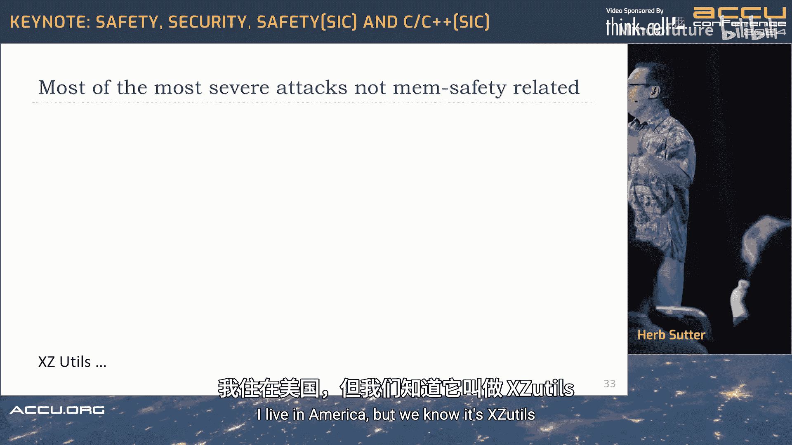

So let's talk about Xedures。Do we have a screen？D， thank you。

 How many of you when you first read about X S U Tis thought of X K CD before they even showed it。

 right， This is like the most topical ex did I thought， wait， wait， Rndaal。

 Rndaall wrote about that And I looked it up。 and then， of course， everybody was quoting it。😊。

Let me just rephrase what Randaall wrote。 He said a project some you think some random person in Nebraska has been tirelessly maintaining since 20 since 2003。

 but has actually already been taken over。As was found out just in time with Xed us before it suddenly gave root access for Debian。

 I think it was Debian and。Red hat， Linux citros。

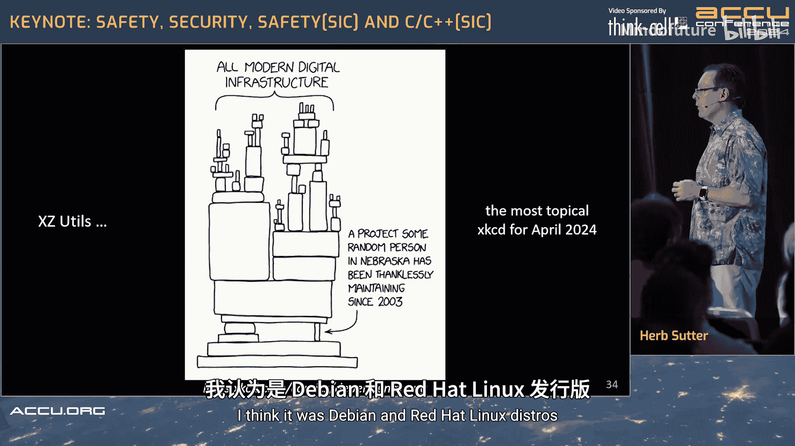

So one of the first things that Bruce Steeyer security guru。Wrote about this on April 2。

 So two weeks ago， I'm going to highlight the bottom part。And he thought， he said out loud。

 the second thing I thought when I saw the first， the first reports of this， I thought。Okay。

 so they caught one。That just shows that it's possible。And they caught this one。

 Why on earth would we think that that was the first。So as he put it。

 I simply don't believe this was the only attempt。 I believe this kind of operation has been successful in the past because we haven't secured what memory safe languages。

 No repose of underappreci fundamental software that everybody relies on。

 but hasn't been invested in， and we rely on the goodwill of volunteers。We need to fix that， too。

 In addition， notice I'm not doing a what about us thing。

 I'm not saying do that instead of memory safe language improvement。 No， do them both。

 because this is really important， too。And finally， I want to address myth conceptception number 4。

 I have heard some people say it's your fault。 If you're a C plus programmer。

 because you should be using the tools we already been giving you you ungrateful lung heads。😊。

Which could raise your ire， especially if you were one of those。 and raise your hand。

 if this is true of you saying， I've tried to use those tools。

 You know how hard they are to get and use，Qu a few hands。So。

I'm not going to read through this slide， but I talk about this in the C+ Law safetyfe essay。

 I wrote， there is a real deficiency in how we deliver these known good rules today。And so。

What developers need is low， false， positive checks。That are delivered in the box。

 ideally with your compiler and run at build time before you check in that are deterministic and easy to adopt。

 That is the kind of thing we should be aiming for。So I have a simple question now。

 Now this is where lightning wlts are going to start coming。 So watch out if you're standing near me。

 maybe I'll just stand out here。This， this will be good like maybe it'll deflect lightning bolts because they won't want to hurt you。

This code on the street。Is that a low level or high level operation， How many of you would say， yeah。

 that's a pretty low level memory allocation。Quite a few hands。 How many would say that's。

 that's a high level memory allocation。Okay， now， you surprised me。

 That's almost the same number of hands。Yeah， it depends what you're comparing it to if。

If you compare it to make unique， that， the top line。

That first line with Make unique is T bounds initialization and lifetime safe。

 It's got all four of those properties。By construction， you will not leak it accidentally。

 You will not go out of bounds because unique pointer not of an array doesn't allow arithmetic。

 You type safe。 You have the type correct all the time。

 There's no reinterpreting cast of the pointer and it's initialization safe because you initialize the the the widget object。

 You actually call a constructor。Before you expose access to it， this is safe code。

But that second line that that many of us say， don't do that anymore because you've got the first line。

It's worth pointing out it is type and initialization save。

It's just not lifetime safe and bound safe because you get back a。

 a raw pointer that you can do arithmetic on and that you could forget to delete， right。

 more easily forget to delete。But it has two of the four safeties already。

 And that is worth pointing out because sometimes people say。

 should we care about how many vulnerabilities。Are in C code versus C plus， plus code。

I don't know how to keep allocate。An object in C without a reinterpret cast。

 which may be implicit from voids to the Malex voidd star to my widget star。

And with a guarantee of initialization safety， that's just not what Malck does。

But there's a good reason and a bad reason to ask this question。

The bad reason to ask this question is to blame C。Right。That is not solving the problem， saying。

 well， you know， that's， that's C's problem。 C plus is already better so we can feel all righteous and good and。

Even though there may be some truth to that， that doesn't actually matter for reasons I'm about to say。

 And I think that it is， has， is the wrong mindset。

But it is validation that C plus House's current guidance actually does work so that when we talk about tools like safety profiles to turn them on by default。

We have known experience with something that is good。 Yes。

 let's turn that on by default because we have some evidence that it already works， right。

So that's a good reason to ask this question。It turns out it's really。

 really hard to find out how many vulnerabilities CEs are reported in C code versus C plus S code。

 The Mire dot org does not distinguish them。I'll show you a database that does。 But it's， again。

 only one data point。 So don't overemphas that。Also。

The security and and robustness cultures in different languages vary。

 Rust is much more eager to report C Es than C plus bosses。So， of course。

 they're going to have proportionately more， not because they're less safe。

 but because they actually have better security culture， right， And still。

 they have fewer C Es than than C does， for example。But here's a summary of why we can't just count。

CV Es。 And there's more， but that gives you a flavor。But I have so far been able to find one source。

 That's a reputable source， Men dot I O。And we're currently working on other members in S G 23 in the safety group are trying to see if they can get similar numbers out of their databases where they actually attribute vulnerabilities to what language was the code written in that had the vulnerability because that's useful information that that mightre org doesn't store。

So they had this thing in 2019。 What are the most secure programming languages。 And even there。

 they showed C C+ kind together， But they distinguished them， which is good。 And again。

 look at the left side of the screen。 I am do not over index on what I'm saying here。

 This is one data point I know about。 I am very aware of confirmation bias that I could be seeing the data point I want to see。

 But this is the data point that I've been able to find。😊，That breaks down by programming languages。

 the source of vulnerabilities。It's also back in 2019。

 And I've reached out to them to see if we can get updated numbers。 But here is。What we know。

So here is total reported open source vulnerabilities。

 according to this database by the language they were written in。 You'll notice C is at the top。

 PH P is a distant second， and C plus plus is down between Ruby and Python。Just one data point。

 Don't quote quoting this as the the last word， but it's， it's a data point。 Okay。

 there is a difference。 I'm not willing to say， oh， yeah， that's eight times as more likely in C。 No。

 I'm not willing to say that。But it's one data point that it appears there is a difference between safety and the source of vulnerabilities in the two languages。

And this endures over time。 If you look at in that same study over the 10 year period up to 2018。

The bottom of the stack is C。 And the next one is C plus plus。

 And you can see the relative difference。In the attribution。

I'm about to tell you things where you shouldn't get too cocky if you're feeling cocky now。

 because this is you're a C person say， yes， I've been vindicated。Hold that thought。

But one of their conclusions was， was really true。 So， yes， the programming language matters。

 But what matters even more is how you use it。 Are you mitigating your vulnerabilities throughout your software development life cycle。

You should be using your sanitizers in rust and go。 Yes， Ru and go support sanitizers。

 You should be using them there。 too。 You should be doing a threat assessment。

 Where are people going to attack your software， It may be in memory safety。

 It may be in credentials， social engineering， supply chain。 There's all sorts of ways。

 And your enemies and my enemies are going to use those， and they are using them。

So as we write our software in any language， how we use it matters。

 And this is why defaults help a lot。 Why improving C+ by bringing rules to to enforce by default matters a lot。

So on Men I O， one of the things it does is shows the most severe vulnerabilities in the past 90 days。

 and all of these were ranked 10 out of 10。By whatever opaque body mysteriously ranks things and gives tends。

And I found it instructive when you click on them。What the language was that was used。

If you're feeling pretty good about S++ right now， because it's not in the top 6 as of 10 days ago。

Hold that thought。 You'll be much less pleased with me， in a moment。

But two of the top six were in C code。 Two of the top six were in PhP code。

 and then Javascript and Java also got a showing。So let's talk about these。

 That first one in Sea code was Xed us。What memory safety loophole did it exploit。Nan。

Social engineering。Taking over a repo and committing code。Your own code。

 It did not take advantage of any memory safety vulnerability。

 That one could have just as well happened to C， plus plus。To sea sharp， to go。

So then what about this other one Integer underflow。 Okay。

 now we're getting to leading to a buffer overflow。 Now we're talking C stuff， right， O。

Here's a link to the details。 If you actually want to look through the source code of this vulnerability and it's nicely annotated Sa on line 1。

 this happens line 2， This happens up to line 6。 There are about six lines annotated。

And here are the steps。The code accidentally subtracts the same value， the same offset twice。

 which is just a bug in the code。 And you could write that in any language。 It just accidentally。

 on some path， subtracts the same value twice。Because that value depends on the input。

 the attacker can control the value as to whether that value can be is like how many characters to the first new line and the attacker can control that。

When you subtract it the second time you might underflow。

 You might go to less than 0 before the beginning of the buffer。 again， it's just a programming bug。

But that index is then passed to a bounds unchecked memory copy function That is not the standard mem copy。

 It is capital M， with underscore copy。But it does the same thing。Okay。

 now we're doing an out of bounds right。But that's not the bad part yet。 The bad part is。

 we then store that index。Go away。 And on the next receive call， use it again。

 And that's where the malware is delivered。We overflow that pointer on the second。

 the subsequent received。 That's where the malware is delivered。So is this in C code， absolutely。

I looked at the source code。If this source code had been written using stood copy and advancing an index into sttpan。

 you would have had the same vulnerability。And in every other language。

 unless it did one of two things。 In this particular case， if you either checked underflow。

 at least for underflow in values leading to indexes and sizes。Or did bounce checks。

 either one of those would have prevented this。So any language that does either one of those would prevent this。

 This is why having bounds checking on my default is such an important thing。

 and one that I hammer on a lot。But yes， we see C。But these things can apply to all languages。

Usually， when I give a talk， I prepare。 I look at the top6 list if it's current information like this。

 And then the night before I go and update it， Then I deliberately left this 10 day old data in for this talk。

Because if I showed you the same list today， it would mostly be the same。 Four of the six， I think。

 are still the same。Since then， there has been a number two severity vulnerability。

 which is now one above X Z us， X Z uils， which moved to number 3。

 which is a rust vulnerability that was fixed in 1 do 77 do2。

But I don't want to distract because that vulnerability is attached to Ru because their security culture reported at first。

 But it applies to a dozen other languages as well， including Java。

 where last I saw their response was won't fix。And it was considered a 10 to 10 severe vulnerability。

 Rust has patched it。I decided not to show that because I do not want to get into a distraction of herbs pointing at a number two Ru vulnerability happens to be one of the worst this week。

 It's not the point。The point is， what can we do to secure all our software。

 What can we learn from other languages and how do these common vulnerabilities actually affect all of us。

In 2023， Horizon 3 dot AI did a nice study that broke down the vulnerabilities that were known to be exploited by the root cause。

 And the bottom left， that red memory corruption， that 20%。 We absolutely。

 that's about memory safety。 We absolutely should do something about it。

Just please don't forget the rest of the pie。答错。So， yes， we should。 We need to fix that。

But that's the beginning， not the end of what we need to do。

 And the clickbait title was Ru won't save us。 Yeah， so a lot of people don't read past the title。

 And that was clickbait。 and largely irrelevant。They actually had a much better subheading in the middle of the article。

 which was Ru won't save us because it doesn't address the whole pie。 That's fine。

 Mem safety is not a silver bullet。 That's okay， but it will help us absolutely with that lower quadrant of that pie。

 And we need to do the same in C plus plus。😊，It pointed out that of the lower quadrant in those 20%。

75% had already been known to be exploited by the time they were discovered。

 and another 25% were discovered to have been exploited before or after discovery。

So zero day exploits are bad。 So， yes， we absolutely need to worry about that 20%。

It's just not the whole pie。So I would say just like the same thing of rust is true of C plus plus。

Giving our C+ us users。A mode that improves safety by default。Won't save us。

 That's not going to solve the whole landscape of threat actors in the world right now。

 unfortunately。But as sure as heck will help us， and we better go do it。The problem with。

 I've got a silver bullet， you know， whether it's a memory safe language or my。

 my latest tool I've been an invention I've fallen in love with， we think it's a silver bullet。

 right， or it's like a shining rainbow unicorn。😊，The problem with。

 even if you have a real silver bullet and let's， let's assume a fantasy land is true in this particular case。

 and we're facing a werewolf。Yes， if you're in a fantasy novel。

 that silver bullet is exactly what you want。 And if you've got a pocket full of them。

You're in good shape。If that silver， if that werewolf is memory safety， the problem is。

 he brought a lot of friends。And the silver bullet is not going to help you against all of those different threats。

This is just what Dolly came up with when I said。Now， add other monsters。

So one way I think of it is were，'ing entrances to a city。So I told Dolly memory saved。 actually。

 I spelled it correctly。 This is what it did， right。😊，But whether you have attackers。

 soldiers or zombies， I said soldiers， but they look kind of like zombies to me anyway。

If we completely bar that door of memory safety， we've done a good thing， right， Obviously。

 this is good。 We don't want them coming in and attacking our city that way。

 But if you turn around to another part of the city。

 and if you leave the log 4 J gate half open and you still haven't patch your systems from that late 2020 vulnerability。

We're still allowing hordes of damage into our city。

And if we look further and we go to another part of the city and we see that we've posted our Kubernetes secrets openly on Github。

 that is just asking for a tank battalion to wtzs right in。Because those secrets， those credentials。

 those admin credentials， in some cases， can do a whole lot of damage over a sustained period of time。

So， yes， let's bar and and fortify that memory safety door。But let's not think we're done。

 Let's not imagine we're done once we've done that。So now let's talk about C slash C++。

I was most nervous about this slide。 We'll see how this goes for my career。

C plus two pillars in a nutshell。And I'm going to explain each one and then ask you。

 what's the best concise term you can think of for that。 So the first  one I'll say is。

Strong abstraction power。 And yet don't pay for it unless you use it。

 What's a good shorthand term for that。I heard it back here。0 overhead principles。

 So0 overhead abstraction。We largely hew to that， not for exceptions in R T C I。

 but we largely hew to that。 And that's one of C plus's superpowers。

The other one is near perfect backward compatibility with older C plus plus and C。😊。

You can mix C and older C plus plus and modern C plus plus in the same C plus plus project。

 And it just works。What's a good short name for that。两个。Legacy。Disaster。Now， now。

 let's be inclusive here because， because we're talking about and we're talking about， I mean。

 the reality is that most of our C plus projects， even because of a third party dependency or something。

 Most of the code that's built in our C process projects， not always。

 some of us have greenfield stuff and newer stuff。 but most of the time。😊。

Is a gloriously blurry melan of styles。😊，That includes all of C slash C， Plus， plus， Now。

 let me get right here。 So my boat will get you all。I know there are people who think that the。

 the term cease that process sauce is a terrible term。

I think it's an awfully good term to describe the the set of code that we。

 as C plus O standards Committee members are responsible for。 Certainly。

 I don't know why anybody has ever argued that it's not a good term for the intersection。

Because code that compiles as C and as C plus plus， obviously。Is is in the intersection。

 But here's a pop quiz for you。 And now I， I'll ask you to point to the left or the right and just exaggerate it。

 So if you want to point at left hand 1， like， just go like this。 So I can。

 I can see which one you're pointing at。 If you want to point at the right hand one。

 go like this so I can see what you're pointing at。Which is a C program， Your answer。For those。

 can't see everybody's doing this。 Allright， which is a C plus plus program。I got some of you。

A lot of people went like this。 That's the correct answer。 Some people went like this。

 then looked around and went like this。But you see the think of the， the thinking trap here， right。

They're both C plus plus programs。 And if you doubt that。IO IEC 1，4，8，8，2 says those are both legal。

 That's the C plus all standard。This is not a good picture of the intersection of C And C plus plus。

 This is much closer。 Yes， there are parts of C that are not standard C plus plus yet。

 like restrict in VL As。But certainly， at least the intersection。

It should be uncontroversial that C C plus is a good name for that because its， it is C。

 And it is C plus plus， the C subset of C plus plus。But you know。We have a variety of styles。

And this is just not even including inhouse styles and ways that C plus plus is used。

And they're all part of a valid C plus loss project。 And， yes， we have modern， good C plus plus。

 If you can find a definition for that。And one of the points I want to make is。

All of these color outside the lines。For example。We already said that over here， on the left。

There are parts of standard C that are not yet part of standard C， plus， plus， like restrict V L As。

 right。If you're using C plus plus without R T T I。

 then you're using your own extensions instead of dynamic has。

 So you're relying on something outside the standard。

 If you're using C plus plus without exception handling。

 then you're up there where you're using something else instead that's non standard。

 And even if you are C plus plus core guidelines authors。And telling people to use good modern C++。

You still say and use GSL span because stoodpan isn't bounce checked yet。

That's coloring outside the lines。 It's like we all do it， right， All of these subsets are。

Extra standard， at least a little bit。But I'm interested in what can we do for all the code inside that circle。

Any solution we have， what's it going to do for all that code？Because if it's legal。C plus， plus。

It's ours。 It is our problem to solve and to do something about。

 including when we talk about safety profiles。So how would you define modern C+pho today。

Without a safety profile to point to。Right， now it's a list of guidelines。

 And like'll follow these practices and like use these tools that enforce some of them。

 There's no bright line verse between bad sea plus or just C。 I forgot before we were starting。

 are there。Are there any folks here who are from Scotland， Anyone， Anyone here from Scotland。

I'm I'm so disappointed。 I was hoping there would be at least two who could say these out loud。

 So I'm not going to try to， I'm not going to try to do this。

 But the the idea of the true Scotsman fallacy is and as I've heard this applied to defining good C plus plus。

 you say， well， good C plus else is this。 But what if I do that。 Well， no。

 that's not good C plus plus， right， it seems like a shifting definition。 And the fallacy goes。

 one Scotsman says， no Scotsman put sugar on his porridge。Then the friend says， well。

 my uncle Angus is a Scotsman， and he put sugar on his porridge。

 And then you know what's coming next， right， It's like， no true Scotsman puts sugar on his porridge。

 And then after a few cycles of this， you narrow and narrow more。 And finally。

 you get to only we true are true Scotsman。 And I'm not so sure about you。

So we have to be careful there's not a fallacy and and shifting of goalpost when we define what modern sea P sauce is。

It's hard to argue with that if it compiles according to I O C plus plus。

 it's our code as C+ Standard Committee members that we own。And are answerable for improving。

Im still waiting for my head to be singed。So what can we do。

Let's assume we have these profiles that define well known， Staally enforceable。

 deterministic rules with， with low false positives。

One option is to simply reject code that doesn't follow them。 So if you use a reinterpretcast。

 you would get it flagged， Sa you have to opt out to use reinterpretcast。

 The problem is that requires you to change your code， right， So there's at least some friction。

 How many of you in your careers have learned the hard way that changing code is expensive。You。

You know what changing code does and not only keeps engineers busy who you're paying。

 it introduces bugs。Let me say that again。Change in code even to eliminate a bug。Will。

 at some percentage， hopefully lower， also introduce bugs。 It's， it's unavoidable。

 You're writing code， you're writing bugs， right， the question is just what's the， the， the fraction。

So what can we do， Can we do anything better， Because sometimes that's the answer。

 Sometimes you just have to say， I'm sorry， change that reinterpret cast。To conform to the profile。

But。One option。 I heard somebody say fix。 like one fix it。 We'll get to that in a second。

 One option would be I I would hypothesize， and I've implemented this in CP PP front all of the things I'm showing here in my simpler syntax。

 But you can do the same things in standard C plus plus。Just say when the profile is enforced。

 type safety is enforced。If we can make the unsafe code do the right thing， just do it。

Without requiring a code change。 So， for example， if I have a static cast pointer downcast。

I know they meant to write dynamic cast。 I know they should write dynamic cast。

 And as long as R T T I is enabled and there's a V table in the base。

I can just admit that dynamic has for them。If they've opted into the safety profile。Now。

 why would we do that？ Becauseuse now there's， there's downsides of that。 The code now arguably lies。

 as it says static has。And we're actually doing a dynamic cast when we've turned the safety profile on。

 But first of all， we document the safety profile does that if we will go this way。And second。

 now we've done something really super important is we've improved existing code。

 All that code that was written in the 1990s。That we can't change。

We just fixed at least some of that。By using profiles without code changes。

 this is about adaptability and impact， even on the older code。

Another thing we can do is insert a runtime check for dynamic error。

 So bounce check is a good example。 If my balance safety profile is on。

And this is what CPP Front does already。 And it's caught my own bounds errors several times。

Is if you see an expression of the form a sub B and stood S size of a is available。

 including for CRs and vector and span and all those things。

Just insert a is 0 less than or equal to B less than stood size A at the call site。And now， suddenly。

 from that code， just like in CPP frontron today， But also in code in the future written with the bound safety profile on。

All your existing standard library， without any A BI break， without any update， is bounce checked。

 And I didn't have to bounce check vector and put instrumentation in there and in span。

 And it works for Cs， too。And then all three of those options could also offer what I call modernize。

 which is to offer a fix it。 Would you like me to change that static cast to dynamic cast for you。

 And you still want the programmer to say yes。But then the superpower still is。

 It's not a manual code change。 If you can offer reliable fix sets that the developer can trust。

 And this is how we can bring code forward。😊，So。On one axis， from C to shining C plus。

 how much of this code can we help and on another axis。Everywhere from at the top， a new project。

 Greenfield project that has no dependencies and no interop。

All the way down to code that can't change Ts third party library that is that nobody understands and doesn't dare touch because it's critical。

How much of it can we help if all we do is we deploy static analysis rules that say。

 I'm going to reject your code。 We can help some of that。 The more modern the code is。

 the fewer changes will be required， So the more adoptable it will be。

But as you get to the older code， that would basically be， be like， well。

 rewrite it to youstead span or something like that。Then we're gonna be， to be adoptable。

 We're gonna be mostly on code that's easy to update that hasnt doesn't have a lot of inter dependencies or greed field projects。

 right。My hope is that with fixed， check and modernize。We can apply not all。

 but some of the safety improvement。To all C And C plus plus code that we recomply with safety profiles on。

 again， we're not going to get the full benefits。 We're not going to get rid of your reinterpret casks。

 I don't know what to replace them with。But we will。Be able to do things like， be bound safe。

Which is an important thing。And remember， our competition is up there。

 So if all we do is ship reject and we're already requiring code changes。

 One of the first questions you are going to get。Is， well， if I'm changing my code。

 and especially if I'm rewriting it anyway， why don't I just rewrite it in rust or C sharprp or Python it or something else？

you' telling me I already got to go rewrite my code。How many of you have， in fact。

 already got that question？A few hands， right。So here is an example that I was showing somebody recently about what I do in CPP Fron。

 which is。With either of these definitions， which is just ordinary C or C plus S code。

 This is a C array in the first case。If you compile the， the three lines below。As CPP2 code。

 And we could do the same thing for a future IO C plus plus with bounds checks injected at the call site。

 you will get。Errors that can tell you exactly the the line number， where your error。

 where your bug was and what your min Max was and what you tried to access instead。

Just by recompiling。So it's not for useful getting asking for the bounce check overhead。

 So you want a way to opt out in tight loops， right， You want all those things。

But I would like bound safety by default。 This one already already protected me because I was writing an example very much like this where I actually got the indexes right。

 I got 0，1，2， right， because I've done this a time or two。😊。

But the mistake I made is in my first example， I had three elements。 And then I decided。

 you know it's a ver example。 I'll remove one of them。 And I didn't update the loop。

 I didn't update the rest of it。And it said， you're trying to access a third element。

 There's no third element coming。All right。Thank you。 You got me。This can happen to all of us。

And by the way， the reason I show visual C plus plus and Gcc is because this already works today through。

 at least through CP P frontron with all major compilers。

 So it's something we can do in the C plus compiler as well。

So here are some slides to look at in more detail later。Column 1 is， hey， if I can change my code。

 great， I can get all the benefit。 But column 2 is。What if I can't change my code。

How much benefit can I get with just a recompile。In type bounds， initialization， lifetime safety。

 and even with improving。Undefined behaviors。If you go through and catalog， as I did。

 the C plus core guidelines， safety rules。And they're all mentioned there。

 like Ty dot 7 is the seventh type safety rule。 Theyre not the whole core guidelines。

 which is very long。 There are like 20 safety rules in the profile section。

And I went through it to see， yeah， many of them are just ours。 You must reject code that doesn't。

 that doesn't abide by them。 You have to go change your code。 But a lot of the time you can fix it。

 You can check it。 You can offer fix it modernizers。 And I'd like us to think about that。

 because adaptability and impact of profiles of any solution is really important。So calls to action。

I don't care what language you're using。 Please use your sanitizers。 Rus support sanitizers。

 They're great。 Go support sanitizers。 They're great。 Use them。

 There's always more than the language can do for you。

if only because some safety checks are too expensive to run at build time。

 that's what sanitizers can help with as one example。Do keep all your tools updated， for example。

 again， not picking on rust， but I hope you have rust1。77。

2 installed from a few days ago because that patch is a critical vulnerability if you're targeting window systems。

 only if you're targeting window systems and you use the command the library to shell out to batch files and you have untrusted input you could have a vulnerability there and again。

 that one applies to a bunch of language is not just rust。

 rust is proactive about reporting and fixing it， which is kudos to them。

Please secure your software supply chain。 Use package management for your library dependencies so you can get fixes and updates。

Do track an S bombm， a software build of materials。 man， it， it's administrative pain。

 and it's a lot of paperwork。 And everybody who knew that Xed utilities was part of their system loved themselves for having done the work to to keep their ebo up to date so they could tell right away。

Okay， I need to go back to a previous version of Excel utilities， or at least not use the tarball。

 which is different from the Github source that was actually checked in。Don't store secrets on code。

 For heaven's sake， don't store them on public Github reos。Turn authentication on。

 change the default password。 I'm sorry that it needs saying， but darkbe， kid security。

Turn on with education。Enncrypt your data at rest and in motion and keep your threat modeling current because attackers will change direction as you harden one area。

 They will move to another area。 These are all taxes on our time。 I get it。 They're not cheap。

 They're boringrg administrative detail when we could be coding new features instead， right。

 like we get it。But so that we have a job and our companies exist next year。

This is necessary hygiene。Remember， we need to harden all of these。 Yes。

 let's start with Wood 4 and 7， but we need to harden all of them。

So let me use the remaining time for an update on CPP frontron and things that have been going on with that personal project of mine。

 So， first of all， thank you again， that it's getting to be smaller and smaller font to fit you all on a slide。

 These are all the people who either opened an issue or opened a PR。

 There's many more who commented and lurked and so forth。

 But thank you to all these who actively contributed to over 1000 issues in PRs over 160 contributors。

 I really appreciated。 And it has really helped make the project better。😊。

One of the big things that at CPPcon 2023， there was a bird of a feather session。

 and they overwhelmingly voted me to go write documentation。

 So I had to basically go dark for like two and a half months and learn M K docs with the materials theme。

 which is great stuff。😊，Always learning new tech， right， we have to do that sometimes。

 and write documentation。Also， they providedded me to start official releases。

 So there now now are numbered releases because I've got an initial feature set complete。

 including documentation。 I feel comfortable putting release numbers on。 And so that will continue。

 They're currently still under a non-commercial use license for now， because at this point。

 it is still an experiment。😊，But let me tell you something I learned。

 I had a whole series of slides on things I learned。

 And but here's one that segues into things that are going on。Into the next few months。

I haven't tried to optimize CP front yet because in my own uses， it's been plenty fast enough。

 Most of the time， it's the C plus compiler that where the majority of the time is spent。

 So I just haven't felt the need to optimize it。 But I always kind of wondered。You know。

I use Io streams for all I Os。 I'm lazy， and I always know I could go and do studioio instead later。

 But， you know， just to get something working on， I'm just gonna use Iio streams。

And I build A S Ts with。Odles and oodles and oodles of pointer chasing data structures。

 like one expression could be like 10 or 50 nodes， depending on how deep in the expression tree。

 grammar it has to go。And that's all little allocations， right， We know allocations。

It is as expensive。 So when Yoel penya submitted two PR is that offered it between a 50 to 1 20 x improvement。

 depending on the use case， a two order of magnitude faster for CPP front all up， I thought。Okay。

 I wonder which one of those it was， you know， because he felt the need to do this。

 So here is what the difference looks like。 And in case you can't see those little green。

 Let me expand this a little bit so you can actually see if there， there， there is green there。

 This is the after。😊，It's a little faster than what I wrote。H。😊，So what do you think。

I gave you a little sneak peek。Which of those two do you think it was。

 The answer was neither he removed the four uses of stood rag accident in my code。

Because I don't normally use stoodg X。 And I thought， you know， I should be setting an example。

 Let me use the standard， and I didn't want a non standard library dependency in CP front。

 So I used stood rugg X。Fool I was。I did not realize that now， I understand what this means。

 those four uses of re X， which is like， for instance， to match is the next thing a keyword。

 like pretty short， simple re Xes。You know， and maybe I was holding it wrong。 Like I， I don't know。

 Like， maybe I was doing it wrong。 I think I only had the created the oneberg object and reused it。

 but I don't know。 Maybe I did it wrong。Those four uses dominated the entire runtime I O。

 memory allocation， everything of the entire compilation。😊，So。Thank you， Joel。

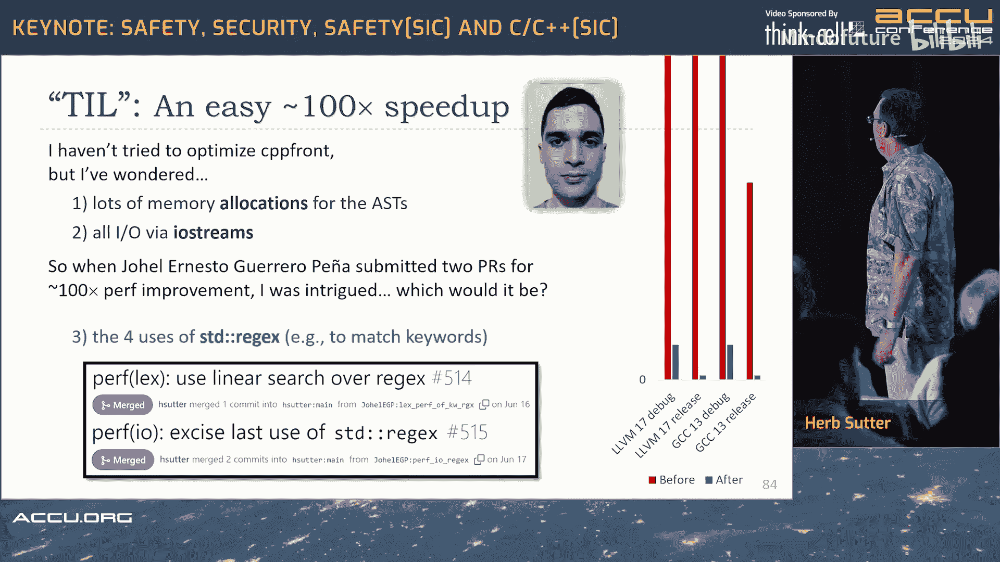

And just to put it in context。We've lost the image again。 Can we get the image back。Oh， there it is。

 good。Those， those， those red bars go up to the top of the stream。

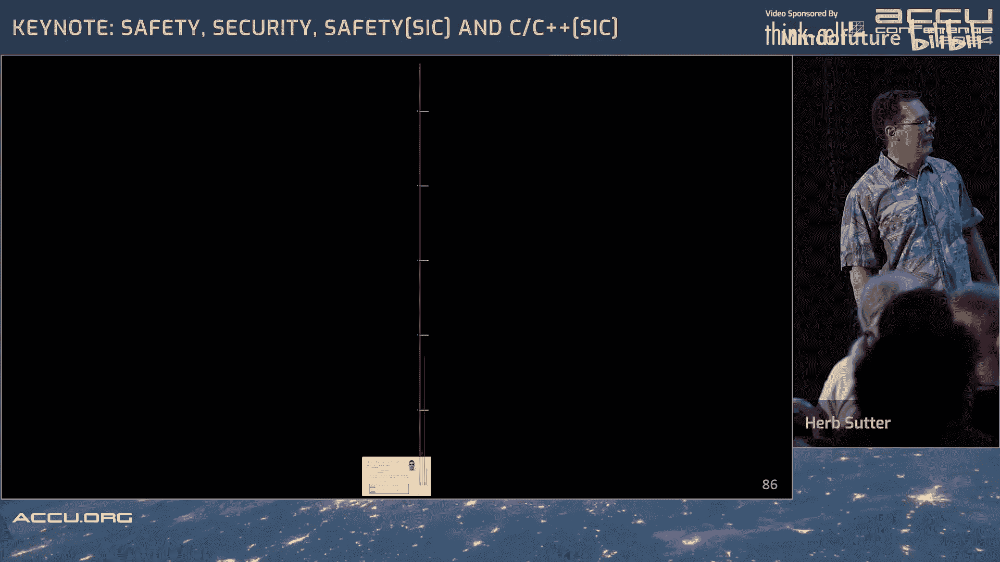

So thank you， Joelle， for that。 But thank you Also， Ha。 Ha couldn't be here today。

 She's going to two other three other conferences in the next two weeks。 But thank you very much。

 Han， for all the work you've done over the past seven years or so on compile time regular expressions。

 which uses contexts for and templates to parse。😊，the redx。

 if you know it at compile time to parse it at compile time。

 you know how much runtime work there is then that much less， right and。

Then it has compile time and runtime matching， and it outputs very efficient assembly。And it works。C。

 TRE and rust are neck and neck on the left hand of this graph， for example。

And C plus fuss and PhP are way over to the right。 C pluss， I believe， is stood redx。

So thank you for that， Han。So the way this relates to CPP frontron is that Max Sageba from Germany。

 he was working on， on saying， well， since in CPP Fron in CPP2。

 we have reflection and source code generation。Could we do what Han is doing。

Without using templates as much and template meta programming context for functions。

 I don't think Kanda was doing much TMP， but。The idea is。

We do so much of our compile time work with templates that that is a leading cause of why C plus plus compiled times get slower and slower as we try to improve the standard。

 but we're removing more fancy work into a template instantiation engine that was never designed to do computation。

 You weren't supposed to write logic。In that。 But it turns out it's too incomplete。 So you can。

 So everybody does， right， But it's a very inefficient way of running it a compile time。 This is。

 by the way， those of you who have used context for functions already。

 which is like regular functions running at compile time。 Yes。

 it requires a C plus S interpreter essentially in the compiler。 She'd be like， oh oh， no。

 I've adding a second compiler in my compiler。 Yeah， you are。

 And it's also nearly always way faster than the TMP equivalent。😊。

Because you're declaring your intent and your compiler will love you back instead of abusing the。

 the TMP， the template instantiation mechanism， which has to do lots of other stuff and was never designed for general computation。

So what Max did is， and at least for the parsing initially。

 he replaced the template stack with reflection and codegen because CPP2 has those things so you can reflect on the code and you can generate more source code that gets that gets flexx and pared and added to your your project。

So the source， the calling code looks pretty much the same with C TR E on the left and CD front on the right。

 The main difference is that instead of the CT TR E con expert and template code。

 a lot of it becomes a compile time meta function that gets called he calls redx。

 and you apply that when you write the type。 And this is just the way he's chose to do it where the X is a member of the type。

 But there's different ways you could do it。 This is the one he chose。

So the sample runtime results said again， this is still incomplete。

 You can't draw conclusions from this yet。But。It seems to be comparable to C TRE。

 in this particular run， it was a little faster， but don't draw conclusions。

 We can't say it's faster yet。 The testing is still in progress。 Maxes does not support UniIcode yet。

 for example， So C TR E is doing more work than Maxes is because it supports more features。But still。

 that's an initial promising。Result that， yeah， we're in that ballpark， not in that ballpark。

So what about compile time。 So the run time looks like it's promising And in the same ballpark。

 The compile time， this is compiling 428 rexes。 This is the Hacal Hasco rex Po conformance test suite。

 And again， too early for perf conclusions。 But I dont didn't have to use a log scale。

 It's in the same ballpark in terms of compilation time。😊，Now a note， and then let me make a point。

First， a note， we're exploring then whether we can use reflection and generation to get the same compile time benefits。

 but with clearer code。And maybe even with less compile time。And still get the same runtime benefits。

 So taking Han's work and continuing on that， saying what if we use more and more reflection and cogen instead of templates。

The early results are promising， and we can learn this and use the same things for IO C plus+ evolution。

 This is not dependent on CPP2 and CP F。 I just happen to have written that implementation as a test bed and as an experiment that is working well here。

But I do want to point something out because I get this a lot。A lot of people say will say to me。

 yeah， but C P P frontron is great。 But it you're running a whole another compiler。

 And my C plus compiler is already way too slow。 And so， and I totally get that。😊。

My compiler is already slow， and you're telling me to run another compiler before I even get to my compiler。

嗯。But you have to count the right things in this particular example。

 this small bar there was no the C TR， of course， had no CPP2。

 So the bar was 0 for the CPP front step in for C TR E。 But this was the entire bar。

 It's more of a line for how fast the C plus the CPP front compiler was to generate the re X's Most of the work was。

In the middle， in the C+ compiler。But look what we traded off， at least so far。

We have this much of an improvement， improvement， less run time in the C plus S compiler for this much cost。

 So when you say， yes， I'm doing extra work that I wasn't doing before。

What does it cost me has to include what work is it saving you that you no longer have to do that you would have otherwise been doing instead。

 That means doing extra work can be faster。 You know， all of us have learned this Caching。

 Ca results。 Like when you do repeated lookups。 How many of you have in the last month written。

 I'm gonna cash your results。 So the repeated lookups don't do the computation more than once。

She number of hands。You're doing more work。You're using more space。

But because of the work that you're not doing that it's replacing， your program runs faster。

Const expert expert。Conext for code is running a whole C plus S interpreter now in your C plus S compiler。

 essentially。So you think， well， that's slower。 Well， it is adding a cost。

 but it's replacing an even bigger cost where expressing the same thing with template meta programming is even slower。

 So that's a net。Speed game。So I think that's a good way to think about it。

 And learning here is that， yes， you're running a whole other compiler。

 But it's a a lot simpler compiler， even when you're doing a lot of meta function work like the rex is doing the source code generation and reflection。

😊，So Max's goal in the coming months， and maybe I'll have an update later in the year is to go further on this and use reflection and cogeneration。

 not just for the parsing， but also for the engine and to use fewer templates in the actual code that's generated to do the re X matching since we can generate code。

 we can make an ordinary code with fewer reusable templates。

So this will be an interesting experiment。 And I think the holy Grail， like Hanna， I know。

 agrees with this。 The holy Grail is a language built in reex where the compiler can just， you know。

 be tuned to do all this for you。😊，But I'm a big fan of saying。

 especially now that we have reflection and， and compile time code on the horizon and cogen on the horizon。

 and at least some prototypes of it working already。How much can we use that general feature to not。

Hardwi， yet another feature into a big language。Can we express it as a compile time ordinary context per function using reflection and generation。

That would be nice to understand。 And if we can get the same。

The same usability at maybe even better compile time through reflection and source generation。

That would be preferable to waiting for all our compiler vendors to go and implement the C plus S 29 rex feature in the compiler built in reex。

 There's no proposal for that， by the way。 But， you know。

 there could be if we didn't have reflection in generation coming。

So this is still my personal experiment to try out things。

 And I'm glad to see others are using it to try things out， as well。😊。

And the goals are ones that you've heard a lot about today。

 So this is roughly a slide that I've presented before。 But we talked a lot about safety today。

We talked a lot about improving our tools to make safety to the default at compile time。

 But we also talked about toolability in terms of compile time。

How can we address that our compilers are slow。I already know how to do that in a simpler language。

 but I also want to contribute to how we can do that in Io standard C plus+。

 especially as we're generating proposals that are now well along， maybe even for C plus+ 26。

 fingers crossed for reflection and some code generation。And。

I've mentioned before that the work I've done in CPP 2， even before CPP Fron existed。

 that particular compiler。I've been doing that since about 2015 and contributing things to the standard。

 So the first thing was operator spaceship that came from that work that has been standardized。

 It's now in C P20。 I didn't tell people like a few people knew。

 but I didn't tell people it was from CP P 2。 I just said， well。

 I have a design for that in my back pocket。 want me to write a proposal。 And so I did。

 And the committee liked it and then fixed it。 Thank you。But Constyval came in right after that。

 So Constyval was in C plus 20。 That came from the C P2 work because Lock 3。

 Andrew Sutton and his team were building a CP X compiler。 It was not called C P 2 yet at that time。

 and saw the need for Consttyval。 So went and proposed it。

 So the reason we have Constyval in the standard already。

 even before we have like two standards before reflection。

Was because we were using it for reflection。 And， and Andrew realized that in C plus S。

 you need a way to say this function runs at compile time。In C P2， you put an at on it。

 so you can already tell that。 But in today's C plus that equivalent doesn't exist yet。

 So we need contival。 And also even the C plus S 26 reflection proposals。 there are two main ones。

 So Andrew Sutton's lock3 and also David Van deora has been really picking it up。

 and in the E DG implementation。 Thank you， D for all that hard work。

 the lock 31 from Andrew Sutton was came from CP2。 It was funded to develop CP2。

 So I am committed to contributing these things back to Io C plus evolution in a cooperative way。

 I am not interested in fracturing and having a splinter language or a competing successor language。

 Those words have never been in my head。 But what could we do cooperatively to bring C plus plus forward。

 And so I talked about reflection here at the end。 But the bound checking。

 the automatic bound checking is already implemented in CP front today。I can implement it。

 I'm sure a real C compiler implementer can implement it。 I know it's not that hard。

And because all you need to do is you see a subscript expression。

 which you know in the parse tree very easily。 Look， it's right there。

 And then you can just emit the code。 You can seal it from CPP Fronts support library if you want。

 that says， if student size exists for that。

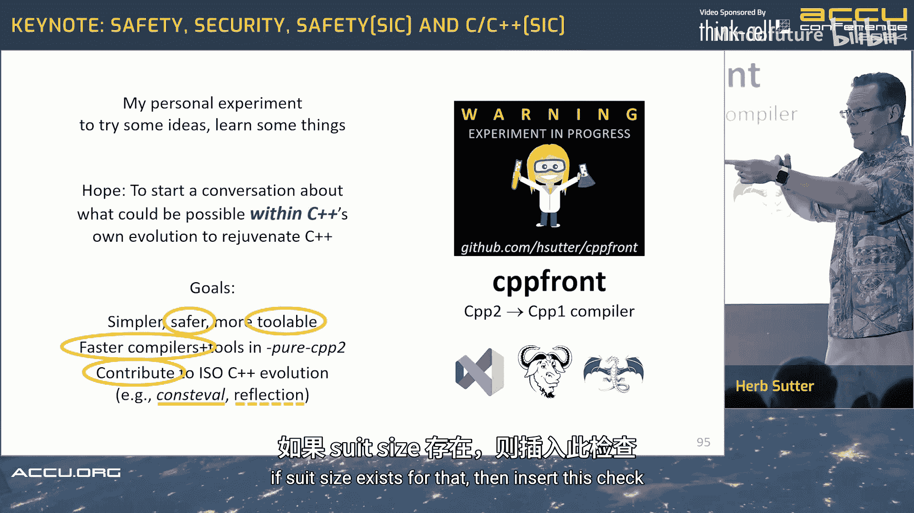

Then insert this check。 It's very easy to do。So。

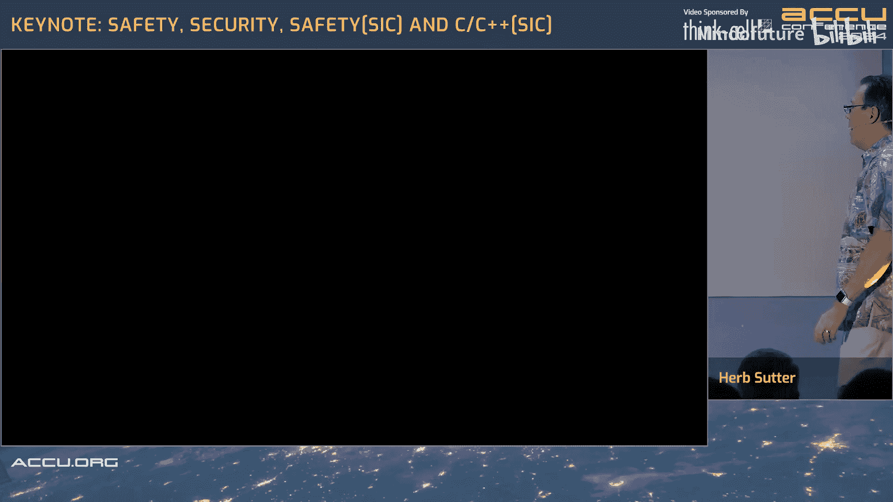

We've talked about safety and security。 We've talked about C slash C plus plus。

 and my hair has not been singed yet。 We'll see how I do the rest of the day。But remember。

 memory safety attacks， we need to do something about， but we have a good road map。

 We know the rules already。 now we need to enforce them by default in a more adoptable way。

 But please， please， please don't ignore the other encirclements or adversaries。

 because our adversaries are all around us， they are causing us a great deal of pain。

 how much better the world would be if we didn't have bad actors in malware。

 if they were contributing to civilization instead of in breaking civilization。

But that's not the world we live in。 So we have to defend ourselves against those。

 And let's keep track of all of those things as we talk about safety and security through safety and other ways in C。

 N，C， plus， plus。

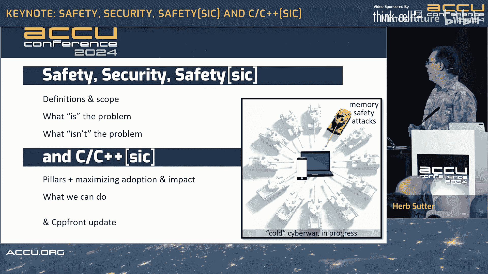

So thank you for your time。 I don't know if we have time。

 I think we have a couple of minutes left for questions，5 minutes。 Okay， so how do you do those。

 Are there mics people go to point and the mics will go。😊，Point and the mics will go。 Let's try this。

👏Thank you。So， so let's try this point and shoot method。 Who'd like to raise a ahead， yes。Oh。

 there's actually an actual mic。 Okay， Phil Dar ahi style。 Ho。

 so if we move to an approach where basically all your knives are in the drawer。

 then the problem becomes find the right knife。 Do you expect half of the booth outside in two years to be about like novel profiler products。

😊，So the question is， if I put a knife in the drawer， you heard the question。

 What about using the right knife， Well we still need tools， absolutelyutely。

 So the the tools that are out in the， I haven't enumerated who all the vendors are。

 But as they're already giving you tools to make your programs better， they will still。

 you will still need static analyzers。 You will still need sanitizerrs， Rus does。

So some of those safety guarantees are going to move， I hope。

 into the compiler and to run a compile time。 But they have to be certain things。

 They have to be low false， positive。So your sanitizer and other tools are still gonna to be there for the higher false positive ones。

 They've got to be efficient enough to run deterministically at compile time。

 The more expensive ones will still have to be somewhere else。

 But I think we can get along away with the low false positives deterministic ones。

 But tools look at other languages。 There's still a vibrant tools ecosystem that will be needed。

But they'll be able to help us better because our code will be cleaner and we'll say what we mean。

 And as far as reaching for the tool we want， that's one of the reasons we have more than one profile。

 So， for example， I think it's important that when I have a line of code。

 And I want to do something bounds unsafe。 I want to say， look， I know my indexes right。

 I already checked it， please don't do the bounds check here in this tight loops。

 which would prevent vectorizing or whatever。I want to say turn off bounce checking。

Not turn off type safety so that accidentally， I could write as silently write a downcast there to a pointer downcast。

 right， So I think it's important to， to have some granularity so I can say which door I'm opening。

 right？ And I think that's perhaps to your question。We have a hand， another hand here。

 Wave if you're on the sides in case I miss you。So you talked about some of the superpowers of languages and I think maybe it'd be right to say that one of the superpowers of a language like Ru is the community and their idea of rewrite it in rust to their mantra I think it's fair to say that the weakest link is where people attack and with C/lash C++ the weakest link might arguably be C so I guess I have two quick questions which is one is there this level of interest in the C user groups for fixing problems there and two is that not worthwhile encouraging instead of relying so much on C within C++ to instead rewrite it in C++ as well。

So。The question about， what do we do about C and what about rewriting。

 So I can't speak to the interest in the C community。

 I've not heard it as loudly as in the C plus community。 In part， they are a low level language。

 If that's if that's the subset you're restricted to where it's hard to give guidance like you spend because it doesn't exist there are no classes。

 So there I'm sure that some improvement can happen。

 but you just don't have the tools you don't have the abstractions， right。

But in terms of how do we help them？I'll go back to the injecting the Bos check。

Like that code that I showed a few slides ago。It showed an honest to goodness C array。

 like it was a C array， naked C array。 But as long as his name is still in scope。

 So you haven't dec to a pointer and lost his length。 As long as the name is still in scope。

In the CPP front， if you compile the， you know， the stood C out a sub 2 line in CPP front。

 it injects a bounds check by default。 So even for C code， it will detect that problem。

We can do the same thing where a C plus plus compiler， when compiling C code。

 gives you a better C than C。Right。And we already have that to some extent。

 because C plus already gives you rules about narrowing and things like that that restrict and go to that restrict what C can do。

So I'm interested in that C code， But even just compiling it with a C plus U compiler with a bound safety profile on without changing it。

Can already give us some improvement。 And one of the reasons I harp on bound safety is because it's two of the top 10 C W Es。

If we can help that C code。By compiling it in an updated mode of a C plus compiler without changing it。

 we have done a great deal of good for the world。😊。

Because as we look at the whole landscape of insecure code in the world。

 it's true Some languages have more than others。We should be looking at what can we do for all of them。

Not just， no， that's， that's somebody else's problem。

 I'm just gonna going to be polishing my part of it。 It's already in a better shape， anyway。

That doesn't help the whole problem。Especially when that C code is valid C plus， plus。 So it's ours。

 I'm gonna hammer that again。If， if it's， if Io IEC C 1，4，8，8，2 says it compiles。

 it's our problem to do something about as long as it's compiled with a C plus compiler。

 So I would like to help even the C code now。If you can change the code， that same profile will say。

 if you enforce it， will say you stood span instead。 wonderful， great。😊。

But if I can already deliver benefits to code， I can't afford to change yet or I。

 or I can't change for whatever reason。Just by recompiling it。

 I think that's a worthy thing to try to do。That will help all of our software defend itself because we're under such attack。

 It's a horrible place， this world。Al right， I think that wraps us up。

 now they're going take down this barrier and split into in two。 And you have 25 minutes， I think。

 until your next talk。 Yeah， and thank you very much again for the knotote to。 Allright。

 thank you for having me。😊。

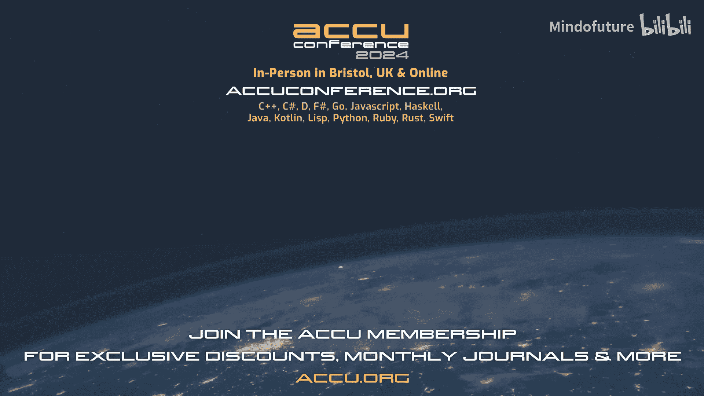