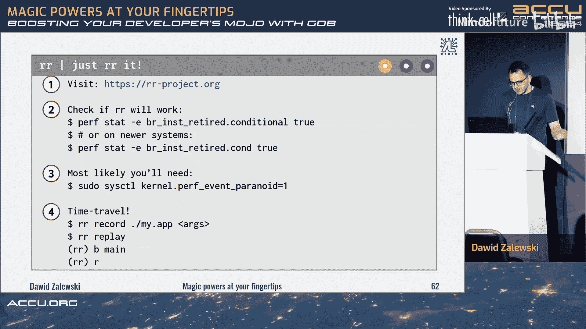

# 中英-•-C++和C语言ACCU大会2024｜人工智能｜架构｜函数编程｜静态分析｜安全｜编译器｜开发者｜垃圾回收｜链接器｜代码生成｜cmake-p20-P22-Boost-your-C-C++-Developers-Debugging-Powers-with-GDB---Dawid-Zalewski--BV1pNotYYELk_p20-

My name is David Zka can， and I'm going to talk about GDP。 So it's it's。

 I wouldn't say it's a niche topic， right。Everybody is debugging and GDP is the most popular debugger。

 I think， in the world， at least when it comes to C C++ and related languages that generate binaries。

So let's do it。 Welcome to the magic power at your fingertips。

 which means that I'm going be using lots of fingertips。My fingertips in particular。

 I have a couple of warnings before we start。 So this is a high risk talk。

 It's a high risk for you because you came here just after at lunch。Which means that you have to。

 I mean， stay awake。 I know it's difficult。 I am happy about it because I am here， So I'm moving。

 right， I'm not gonna fall asleep。It's also high risk talk because I'm going to do a couple of live demos。

 actually it's mostly live demos like half of it。And you know how it goes with live demos It's dangerous。

And what's even more dangerous is that most of the bugs that that I'm going to debug live are generated by Copiot。

 So I I was writing good programs and asking coppiot to sp it up spice it up with bugs。

 the the issue is， I might have not found all of them， so。

Co pilot is very good at generating very bad code as， as you might know。And it's， yeah， so。

Might be that I will get stuck on something， hopefully not。I'm kind of prepared， I have notes。

 so if you see me just looking here， I'm not texting with somebody， I'm looking at the notes。

That's because I have to know what I'm talking about。 I mean， I know what I'm talking about。

 I need to keep the order and the order is kind of caotic if I don't look up the notes。

And that's pretty much all。 So welcome again。 We're going to talk about GDP， right。

 GDP is an acronym and contrary to what official logo might suggest it's not a gold fish doing bubbles。

It's a nu debugger which brings us to the core of the today's talk What is the debugger and what is the debugging right so just like everybody in this dire situation trying to find a good definition for something I looked it up in the Oxford dictionary and it says it's the process of identifying and removing errors from computer hardware and software or software I don't agree with it。

 this is absolutely not true。I mean， I've been programming for some years now。

 and this is what I'm doing all the time， basically， and I'm not always debugging。

I almost do anything。Nothing else besides removing errors from a software。

So debugging must be something deeper， I mean， it must have a purpose to it。

 it's not just identifying and removing errors。So there's another definition。 It's， it's， it's a bit。

More， I think， appropriate or reflects what's happening what's happening when you debug。

 And it says that it's an emergent activity， an emergent activity for those of you who are not trained in psychology。

 just like I'm not Its something that happens when。

There are special circumstances of when actually circumstances meet and when they meet。

There appears something that wasn't there before， like， for example。

 when there is a heavy rain and the temperature is below zero and there is a car going 100。

Miles per hour an emergent activity might be an accident。

 which otherwise wouldn't have happened if those three factors didn't play a role。

 So that's an emergent activity。 and it arises when the mental model of a program of its data differs from its observed runtime behavior so。

We we think we know something about the program， how it should work， but it doesn't work like this。

And then we might start debugging， right？If you need to cite it， it's me。呃。

Let's look at a very simple example of what might debugging look like。

We have an array of three integers inside， some of you know what the bug is。

 it's actually most of you know what the bug is， it's a very simple bug。

This program should return 42 because 1764 divided by the sum of 17 and 25 gives 42。

 it's basically 42 squared 1764 but when you run it。

 when you compile it and when you run it and you print the result it's not what you're going to get you're going to get 49 right so our mental model that basically 1764 divided by 42 should give 42 and also return 42 differs from the observed behavior。

Now it's time to debug。 That's how we debu most of the time。

We want to make sure that the both the compiler and， and。

And the operating system did the right thing。And the value that the program returned was really printed to the screen。

 So we inject some print statement。Just， you know， your normal print Fbuging。

And see what happens then。So after compiling， we are again at the same。Basically start。

 it's still 49 instead of 42。So that's not a good idea when you're debugging， right。

 because you have to inject some statements and the leak into the runtime， maybe and into production。

 you don't really want it you won't to really fire up the debugger。收。

Let's supplement this definition。 It's an activity that arises。

 arises when the mental model differs from the behavior and there is something extra。

 The underlying behavior or the reason cannot be easily found because we did print F。

 and we couldn't find the reason。And only then we can talk about， I think， debugging。

 So let's start debugging。Since this talkque is heavily based around G。

 I'm going to use mostly GCC or G++ or the compiler。

 but Clk works the same for it and actually most of the compilers work the same。

 we compile the program and we fire up GB of course in console because that's how we try to debu。

UWhen you run it up or when you start this program， you're going to be surprised or maybe not。

There will be no debu symbols found in the main， so we didn't manage to really。Properly compile。

 you see when you compile for debugging， you generally do it differently than for production， right。

 and first and foremost， besides perhaps optimizing for debugging。

You need to tell the compiler to emit the deb symbols and switch both in GCC and clk is minus G for8。

 It emits deb symbols in the native format of the operating system。

Or actually not a operating system， but the binary you are using。That's usually not good enough。

 minus G has many other options you might not be aware of。 And first。

 you might say that you are actually compiling for debugging with GDP。

So it will emit symbols in the best formats for GDPB。

 and you might add a number to minus g like minus g1 minus G2 or minus G3。The default is minus G2。

 and minus G3 is a bit better。 It emits even more symbols。 And specifically， it allows you。

 for example， to debug macros， C macros， which are otherwise not possible to debug normally。

 So that's what you want。 And just to。Be absolutely sure you really。 nowadays。

 you really want to do no omit frame pointer， F no omit frame pointer， omitting a frame pointer。

 which is basically。A frame pointer is simply using the base pointer register in your CPU。

To tell the program or actually thebuggger in this case。

 where the stack begins for the current function。Has been dropped when the systems were 30 to beat by default compilers weren't emitting。

Frame pointers， so we'ret sending up the base pointer register。

 and that's because in those times we didn't have a lot of registers in the CPU。

 so saving one was a lot。Nowadays，3 64 bits architectures， there are lots of registers。

 you don't care about one simple base point or register。

 just add it so that thebugger will know exactly where the stack starts for the current function。

And you won't have any problems， at least not under unless you're in the leaves， maybe。

So let's do it。 Let's compile for the proper thing for the debugger， for the GDP。

 I mean all the symbols。Compiled with almost no optimizations， O G and run it。 run is the default。

 I mean， command you might do when you are G D being。 It runs the program。 It runs the program。

 And if the program doesn't do anything special， it will just quit。hich is very， yeah， unexciting。

 right， We don't want to just run the program。 We want to debug it。So let's rewind and start again。

 instead of doing Gr， you can start， start， dust one more thing。 it inserts a temporary break point。

As the entry point of the program， which is exactly what you want， it will stop at domain。

It will insert and directly start， and then we are in the main。Now， this is a lot of typing， right。

 because GDPDB is a command line interface， but you get used to it。After you started。

 and you and GDPDB were displayed the next line to be executed because this is basically like the next line that is going to be executed number four with intmin。

 you might press next。The next line is the standard array numbers definition so the array definition so again we do next or just press enter if you press enter。

 the last command will be repeated automatically for you or you might also press n and enter doesn't really matter and and then where at the end of the program right because the last statement in the program is the return statement and we still haven't found the buck。

So it's time to look at the data you are always， I mean， in GDP， you can look at any data you want。

 private， non private， you have access to pretty much everything。

The most common thing to do is just to print it or repeat it when you print it。

 you just name what you want to print and you see it GDb works with pretty printers most of the time。

 so special scripts that basically tell Gb how to display information and the standard libraries come with pretty printers and if you don't install from sources but for just familiar your package managers。

Everything will be good and set up for you on Otherwise。

 you will have to tell GB where the pretty printers are located。 I'm not using pretty printers here。

 I'm just saying that I want to print directly the elements。 So the array inside the array。

 the real array actually of array。And it will print something like this。

 And there is our first kind of discovery。 It's a 13 and 23 inside， not 17。And 25， right。

 So that that's not really what we wanted to have。啊。

Kind of surprising because there should be something else there。Notice that GDP names the results。

 We have the dollar one， right， So every time you。Print something。

 you will get it back under a new name。 Doar1 you is something you can refer to。

 It's a variable created by the GDP。 And from now on， in this debugging session。

 Doar1 will always be this three elements array。Move forward， you can verify， for example。

 using the dollar one if the zeroth element and the first elements are 42。

 there are not obviously we can also check if the last element divided by 42 is 42 it is。

 and well when you divide it by the sum of the first two， you are gonna get 49。

 So the compiler wasn't wrong。 our mental model of the program was wrong。 and what truly was wrong。

Is well， we had ocals numerals right or octal literals in the array。

 So the numbers that we had weren't really integers or there were integers。

 but not in base 10 they were in base 8 and they were well interpreted as such。

 So that was the mistake。 something you wouldn't find by debugging， but you know。

 it's a good thing to see it。 Last command you might be interested in is least that lets you see the program。

 but we'll talk about it in a moment。 And that pretty much the basics so。Let's do it。

 Let's do it very quickly。I'm in the directory， the build directory。 And if youll actually。

Look at what's inside。This is my whole project。 There are six different apps that I can build。

 The first one that I'm gonna do。Its actually the debuak new one。

 which is exactly what we just saw a moment ago。 Let's switch to build again。Almost。

 I'm already interview。Let's fire the GDB， but before we do it， we have to make the program。啊。

Let's make it properly， so make clean。First and， and then make it built with no warnings and trust me。

 warnings are enabled。 Still， all the programs are buggy。Up a great thank for debuing demo。

And let's see how it goes。 as do GDPB。I have to go into the right directory。

 So debuak me01 and then GB。DBM，0，1。That's your typical GDP session。 right， doesn't show you a lot。

 I mean， it prints a lot of information and prints that it loaded symbols from。啊。From the binary。

And nothing girls。And we can start debugging。 As I said， you can run the program。 but that's quite。

 yeah。Not， not really， not really good， at least not in the situation。

 Let's better start the program。 So we start the program。And the temporary breakpoint was inserted。

 and you can see where you are in the program somewhere。 Now， that's unfortunate。

 but you can always display the10 lines around your current execution point by。Pressing L and enter。

 And this Google will give you basically the beginning beginning of the program。

 If I again press enter， I will see the next 1 lines and then you can slowly start running so you can do next。

You can see what will be the next。Program line executed。 This will。 This is this line。

 It's the next line to be executed。 I still haven't executed it。Which you can by the way。

 see because if I try to print numbers。I'm gonna go 0，0，0。 so it's there。

 but it's it's nothing in there， really。So let's do next and now if I repeat print numbers。

 the elements on their inside， I can refer to them， of course， so exactly what I did before。

 like print。An element at index， I don't know  one， which will give me 21 and so on and so on。

 And this is your basic debugging session， right， This is the absorb basics。

 something everybody should be aware of。And I think most of us are aware of the basics like how to step through the program。

 how to actually next through the program， how to run their program， how to print something。啊。

Then come the more difficult things。 So once you are running the program。

 you are not only restricted， of course to one function。

 as I just was a moment ago there might be multiple functions， like in this case。

 there are three different functions and you would like to visit also them。

So let's do the same experiments。Experiment as before， we start at main。We do the next。

 which we'll call the make Fibonacci in this case function。

 it's a function that makes a fibonacci sequence， nothing really special。

 returns a vector with a Fibonacci sequence of n numbers。And then we are at the next line。

 and here instead of doing next we are going to step。Next。

 when you press next it executes the next line in the current function step executes the next line wherever it is。

 that's the difference， so when you do step here we are going to end up in the sum function that sums all the numbers in the Fibonacci sequence that's passed to it。

When you are in a function， you have different choices， you can still go step or next。

 whatever you want， so you can basically explore the function you can do， for example。

 next next and you will return from a function， or you can just say that you are bored with the current function because sometimes you are at the beginning of a very big function and you notice what happens already and you just want to return from it。

The finish is a good command to go。 Finish finishes the current function and。Steps away。

 steps out of it。 and tenderter is a very fancy one。 return。

So you can influence the program's behavior。You can basically say that despite the fact that I'm at line one of the functions。

 some I already want to return from it and return 42。And it's gonna work。 This function will return。

 or actually GDPDB will return 42 for you。 And this will result in the sum Fibonacci at the end。

 getting the number 42。As you have seen already GDP is not really friendly when it comes to displaying source code right because you have to press L so some people prefer to use the text user interface the TUI mode and I'm going use it sometimes just because then you see a bigger piece of code you know what's going on you can always switch in and out of it by pressing control X followed by a it's quite okay actually to debug like this sometimes it gets stuck actually it gets stuck every three seconds roughly speaking and for this you need to refresh the screen pressing the control L I think I press controlt L like L lot。

And I'm going to do it also here。 So let's do the second program。 Let's go back from that one。

Move to the next one on the list。 iss 0，2。Make it。 I I'm， actually， I think I made everything。 Yes。

 I made everything already。 and GD B。呃，DBM。0，2。So we are in the next program。

 and this time I'm going to switch into the graphical mode。So not not really graphical。

 but into the text interface mode。 So this is my program。 and I'm nowhere， right。

 I haven't started it yet， but it loaded the source associated with the program。 Let's start it。

We press， actually， we don't press。 we do start。And see what happens。 And now it's quite helpful。

 You can see exactly which line you are at and which line。Will be executed next when you press next。

So let's do it。 Let's do next here。 great。 let's do another next。

 So now the Fibonacci should be there。 I can print the Fibonacci。

 It's a vector of length 11 capacity 16。 and there are lots of things inside。

 You can see that there are numbers that are properly populated。

I can again do next and now let's do continue。 see for continue。

 it basically goes further in the program。And it actually exited with code 01， which is a failure。

And the unfortunate thing is that I have a small buck in the program。

 So let's surround it again and try not really to fix the bug。

 but at least to prevent the program from emitting a failure code at the end of it。

The issue with this one is's not really back right is just that I don't know how the Fibonacci sequence works and I ask for the 10 first Fibonacci numbers。

 but what I got is the 11 first Fibonacci numbers because the indices start with zero and I construct the sequence as if they。

They actually asked if they started with  zero but inclusive the upper boundary。

 which is not really correct here。So let's do it again。 I'm not gonna really modify this 1。

 I could actually step into it， right， And I could say。

I could modify the behavior also of the program。 I could modify the upper boundary。

 but we are not that far yet。 so I'm just going return from it by typing in finish。

And accept the vector that I got。 And let's step into the next one function。

 the one that accumulates。 Now， I know that it's going to return a bad result。Right。

 because it's going to accumulate。The range which is a bit to one to many。 so let's fake it。

 I can navigate what to what the program expects。 It expects 88 as the result。You know。

 let's make the program happy and return 88。GDB doesn't like it。 It's， it might， I mean， it likes it。

 but it wants to be sure that you are sure。 Yes， we want to return it and。

 and we return it hopefully。 And then we can next and you can now see actually that if you print the sum。

Fibbonacci it's 88， so it's not what3 the function calculated it was I told GDPB to return。

If I continue now。The programed， the process exited normally great。 so it's not really。

Fixing the bug， but we managed to do something。Special， in a way。

 we modified the run behavior of a program， right。Let's move forward。 This is the basics。

 this is the basics and most of the people who studied computer science at one point or another know at least this and most of the programmers know at least this so stepping through the program returning continuing cried next thing breaking maybe I didn't really break I only always break at the beginning。

 but there is you know the break point that you can set and we will see them a lot Also they are coming up。

But that's something everybody knows about。Now， what will happen next is something that's already。

Not。😡，Known to everybody or at least not to everybody I know about。

Let's say that we have a program like this one。 It's again a Fibonacci。

 that's the last Fibonacci program I'm going to show today。 It's a more fancy one。

 It's uses a Fibonacci generator which uses a cache because it's you know。

More optimal for some reasons， maybe。ITo use a cache， and it does a couple of things。

So it generates a number and when you generate a number， the cache。

 actually the Fibonacci generator is checking the cache for what's inside。Return this number。

 if it's there， if not it calculates puts in the cache。 So let's say we broke we broke or sorry。

 we stopped here。That people actually generate。At this moment we are in the function main and there is a concept known as a stack frame。

 right， there is a stack。 there are frames on the stack。

 Each stack frame belongs to a specific function。 We are at frame  zero。

Because this is the only function that we are executing and once we are there。

 we can press next or step， sorry， in this case， and we are going to step into the next function into the generate function。

Now we have two stack frames and the innermost is the zero frame and the main。Frame became frame 1。

 Both of them have variables， Local variables associated with them and arguments that you pass to。

To the function， including the implicit disagree argumentment， if it's a member function。

 let's step again and again we are in the frame。Now。

 the frame of the get cached becomes the zero frame。And the rest is， yeah， growing up， so one and2。

Now， you can watch the frames when you break in a program， you can see the frames。

 You can see the content of the frames every time you are in a program。And what's better。

 you can navigate through the frames。 So every time you stop in the program， when you debug it。

You can navigate through the frames。 You can change things in the frames。

 You can do whatever you want pretty much。 and there are commands for it。Like， for example。

 you can print the whole trace of the frames with the back trace command。

 you can navigate through the frames with the frame and you can go up and down with up and down and we are going to do justice so we are going to I'm going to do back tracece frames up and down and show you how this works。

We should go， or I should go to。Debug me 3， because we are already at debug me 3。Let's do the GDP。

Mineus quiet and D BM。0，3 reading symbols clear it。By the way， I don't have a specific slide on it。

 but sometimes you will see me like in this case， doing an exclamation mark followed by something。

 This is calling a shell command。 So I'm talking then directly to the shell and I can execute something in the shell like like the clear for example。

 to clear the console I can also call make like this make actually special you don't need an exclamation mark you can just make it directly but you can pretty too much do anything like is the current directory right and it will show you what's inside。

啊。Let's clear again。We are in the program。Switch to the good mode and first let's do something like run the program。

So let's run the program。It tells me like ask me for a Fibonac number。

 a negative number to quit now that looks interesting。

 let's quit the program directly see how it fars。And that's kind of。I wouldn't say it disappointing。

 but the program just has crashed。Let's repeat the experiment。Enter-1。

 And you can see that there was a secfold segmentation fold。

 which usually is caused by reading an nu pointer somewhere。 your program has crashed。

 What do you do then， you haven't finished running the program at this stage。

 That might be surprising。 But if you're in the debugger。 You haven't finished running the program。

 You are still in the program is actually a prime time to debug it。 Now the first thing to do is。

 of course， see where it happens and you can do it by basically saying frame or just F。

 and it will print you。Exactly where the buck happens。 So this is where the program has crashed。

 It has crashed at the return， dot value cache N。That's good， how did it happen？

Now the back trace comes in handy because this will and let's I can see the whole back trace。

 this will print all the functions that were called one after another。

 and you can see what actually caused。That crashed to happen。

So you can see that there is some main up and then we call de generaterate function and then we are crashing and that's quite surprising right because the programme told me that it's going to quit if I enter a negative value。

 but it didn't so somewhere most likely in the zero frame。

 so I'm going to switch to the zero frame somewhere at this moment。When I print that n。

 it's going to say that it's -1 and I try to get something from the cache at index minus-1。

 which most likely wasn't the ideal situation。 We can check what the cache is。

So we can say what is cash if we are unsure it tells me it's a vector of unsigned long， long， great。

I tried to access something from the vector at the index-1。 That's not really a fortunate situation。

 Let's print the cache itself and see what it has。 It has no capacity。 No length。 So most likely。

 it means that I just dereence an null pointer somewhere， right， and then de referenceence it。Yeah。

 like it's not even a normal， it's I don't No minus-1 or something like this。Not good。

 I shouldn't have done it。I have a buck， and that's very clear。And to really fix the bug。

 I guess I have to go to。To the editor and see how it happened， because this is the only situation。

 I'm in the only thing that I can most likely do。 So I am in the editor。诶。

And I promise somewhere that I will quit the program if the number is negative， but I'm not doing it。

 right， I read from St C in。 and despite the number being no negative， I just， yeah。

 don't do anything。 So let's with the help of Co pilot。

 I kept it enabled because it knows what I want to do all the time。 That that's great。

And I can type in faster。 Let's do something very simple。

 If n is less than zero break and we are good to go。 I mean， we should be good to go。Sw back to。呃。

在第八个。Can I make it， Yes， I can make it from here， so it will remake it， and I can run it again。

 run from the start enter negative。It quit， perfect， right， it's perfect。It works as expected。

Is there anything else we can do， Yes， we can， because this program is not fixed， so。

We already had a segmentation fault， great， but this is not the end of the story。

there are more things。That will happen。 and fortunately， we'll see them in a moment happening so。

Let's move back。To this one， we already have the new program and let's start it again。

So I'm going to do start。Insert a temporary break point。 Oh， no， just for the。Fan of it。

 Let's do it manually。 So let's run it again。Clear， because I always do start。

And let's now not to start。 Let's do normal run， but insert the temporary break point just like the G GDB does for us。

 You do it with T B。 TB stands for the temporary break point。

 It's a break point that's only going to be hit once and never again。 So once it stops。

 you can continue。 So T at main。The temporary breakpoint was inserted。

 now we can run instead of starting great we are there。Do we need a breakpoint。 No。

 let's just see how the program runs。 So enter a fibonacci number。 If I enter minus-1。

 we know it won't work， it will work correctly。 So let's do something crazy let's not do anything crazy。

 let's do 101055， It happens to be correct。55 is the 10 fibonacche number in the sequence。

 So it works at least for 10 great let's try something else。20 still works 150。

s that's again something bad something bad happened right The program crashed again。

 I mean that's the whole purpose of this of this demo you will see lots of crashed programs。

 And now we could do the same as before。 We could back trace right and see where the crash happened but for fun。

 Let's do something else。GDB works pretty well with。C plus plus you as you have already seen。

 because I'm work in each classes， it works so well that you can， for example。

 catch an exception so you can catch an exception when it's being thrown or you can catch it。

 when it's being code， whatever you want。 I can see actually what a kind of exception was thrown。

 right， This is the stood length error。 So let's try to catch it。I'm going do catch。Though， I mean。

 it looks stupid， but not as stupid as catch catchch。

Which catches an exception that's being code and stops the program at the execution。

 Cat through catches an exception when it's being thrown。 So。

 and I'm going catch and let's do it in the quotes in the single quotes single quotes are your basically。

Key to C plus plus and GDP， especially if you have namespaces。

 because GDP sometimes gets crazy when it sees namespaces and cannot。AReol a name。

So we need to stop at logical。 Let's do catchtro logical。 We just created a catch point。 Great。

 a catch point is just a break point。 I mean， there are different names for breakpoint。

 but the catch point is just one of them。 You can always display the current break points。

 all of them by doing info B。😊，And now we have only one。

 The first one was this temporary that basically we had before。 it was deleted already automatically。

 You can see it's a catch point。 It has to match state logic error。

You can actually see pretty much what kind of a description is there， like。

It happens when the exception is being thrown， it's enabled。

 We can always disable it if we want by doing these and two， this will disable it。

If we don't want it for some time and then re enable with enable again with the number of their exception that we want to enable。

 it's there。And there are many different options。 you can do it。 We can ignore it for some time。

 We can delete it and so on and so on， pretty much whatever you want。 Anyway， we have a catch point。

 So let's run the program again。 And I'm gonna enter exactly the same sequence just in case my program is。

Deterministic， I think it is。So it crash at 150， Oh， it didn't catch it。

Did I do the catchpoint correctly？Yeses， i was typing it correctly， but。But then I oh。

 that's that's good because we can delete it， right， So I just deleted it。And then then do length。

 I don't know I did logic。But thank you for this。That's my be。 Yes， that's my mouse be this one。

 So let's run again。Yes，102，150。And it still didn't work。 And actually， I， this time。

 I know why it didn't work， so。That's one of these very weird times when GDP doesn't like the single quotes。

Normally， whenever you work with symbols， C plus+ symbols， you have to work single quoteds。

This is the only time you don't and don't ask me why。😡。

So let's run it again and just do it very quickly to 150。And now it worked。

 So now it matched the symbol， and we stopped at catch point 4， exception being thrown。啊。Oh， back。

You need the backs always。 And there are lots of things happening。 Now， there are frames， right。

 So let's go from the。First one that looks like something that I can understand。

 which is frame number 2。So let's go to frame number two。Info arcs。

 those are the arguments passed to this function。 Can you see something strange。I mean。

 there is a huge number there。Right， a horribly huge number。

And this is a call to reserve if I am not mistaken。So， if you look at。At the source code。

We are at the vector reserve and the N。 So let's print。 the N is a huge number。 That's not good。

 right。That's why we got the exception lengther。Most likely you can always print it with arcs if you don't want to if you want to just get all the arguments together。

 I think there are no locals here， but you could also print the local variables if there were any。

 there are no locals so there is nothing there or you can just do F frame which will basically print everything that's in the current frame。

A simple way of doing things。So something went wrong。 let's go up， up， up。To cash reserve。

 So there is this call to the cache reserve somewhere。 so I'm reserving the cache。

I'm basically telling the vector to grow。 And if you print the n this time。 So let's print the n。

 you're gonna say it's -106。 So that's not exactly what I was passing， right。

 Because if you go one frame up to the calling。诶。Function， you're going to see that the n was 150。

 So there is a mis match。And by observing it very slowly。 So let's go down a frame。

And scrolling through the source， you， I think， going to see very quickly the source of the error。

We are getting a car here， a assigned character。Hopefully。The problem is it's only 8 bits。

 but I'm passing an integer to it。 So there is， there is some bad things happening。

 I'm passing 150 and8 it overflows and and goes to a negative number。 So a fix is， of course。啊。

To fix this number， right， so we shouldn't get a car here。

 There should be an int or something respectable。 Most likely， we should also insert。

Some checks for it， which I'm not doing， but let it be like this。 Let's not you know。

 go any further than this。Quted。Make。So the target has been built run again from GDP。

 And let's do the puzzle again。This works， this works， 150 at least gets accepted。

Doesn't crash the program anymore。 Good， right。 And if I enter something negative， like -1。

It quits as it should now this is not the end of it this program is actually still buggy。

 but I decided to leave it like this because the other bug are not so interesting so we'll move forward to the next box。

Again， I sorry， I didn't hear you。No， that's that's that's a good question。 No， micro is。

 is a text editor。And I'm， I'm calling basically a script under the hood then that fires up micro with the current line of code in the current frame。

So， but you can set it up for any editor you want。 I just set it up for this one because it's。

I don't have to switch， constantly。啊。ItWe can talk about it later on。So we are here， right。

 debu me 0，3。 when found we we even made some small break points。

And there are lots of things that can be done with the breakpoint。 like you can set a breakpoint。

 actually I I'm not really going to talk a lot about it。 It's just one slide about it。

 We've seen that you can delete a breakpoint。 We did it or we did it with a catchpoint but it's the same。

 enable disable。 We did it。 Didn't you use it buttons there。

 You can also ignore a breakpoint for some number of executions， if you want。

Set break points conditionally， which is super cool。

 And we' are going to do it at the end of that talk。At to remove conditions。

 which we are also going to do display the breakpoints， which we did。

 and last but not least save the breakpoints to a file。

 which is a super good thing right you save all the breakpoints and it remembers it and then you can load them I'm not going do it because I don't really need it。

 I never step out of the GDP I recompile it within using make so my breakpoints are saved they persist。

 but otherwise if you need to quit GDP remember you can save the breakpoints。Next。

 we are going to talk about the real stuff about money。 So for the remainder of this talk。

 I'm going to use one example， a moneypot， it's a put with money。And it's a class。C Manpot。

 it has a goal which can be like a trip to the moon people are saving for their trip to the moon or whatever it's a group of friends。

There is a target。 So whatever they want to save， there are deposits。 so everybody can， you know。

 put money into it。 There is some size of deposits。

 So how many are there already in the moneyold There is a capacity which hints actually at manual memory management because there is a capacity of of how many deposits I can hold and there is a size。

And you are not wrong because the deposit is the dynamic error is's a dynamic array I needed a dynamic array because you know that's really good。

 easy to make errors with it and box and there are some functions like Toal which displays I mean gives you the money amount of money already stored in the pot a deposit which adds a single deposit into it you can check if somebody's contributor to it and check how much money somebody put into the pot。

And there is also a deposit。 It's a simplestruct， aold。W whichch just has the name and an amount。

 And the idea is that， you know， there is a group of friends。 They put money， everybody like， I put。

10 bucks one time， another time 20。 So I have two deposits for 10 and 20 to get our 30。

 and I can list them。 and we know how much we saved for our target， whatever it is。

 And I'm going to use it a lot in the。In this presentation in the reminder of the presentation。

 And we are going start with a core dump。 This is the only A I generated image I have。

 and I really had trouble with it。 So Dally refused to generate a computer experiencing a core dump。

 It was telling me that it's offensive， so。Literally， so I think that it gains consciousness。

 I'm afraid。 So we have to be aware of it。I finally managed， and that's one。

 noticed a nice calm background and a computer in panic。

So only this made it through the filters that are there， profanity filters， whatever they are。

We are going to do a cord。 that's a fun thing to do always。So let's quit it。 Al C D to the DBM。

 sorry， Dbu。啊。D back me4。啊。It's already made and I can do DBM04。When I run it。

 basically we can see that there is some pot being happening there a bit buggy because the gold doesn't display properly。

 but there is a total remaining 1400 deposits which are none here and the core has been dumped。

Which is a lie。 There is no code that has been dumped， right， so it says so。

 but depending on the system that you're running it on。Most of the time， there is no corn dumped。

Unless you。Set a limit for the core dumps to something bigger than 0。 And by default， it sets to 0。

 So this is the limit for the core dumps。 You can set it to unlimited。So let's set it to unlimited。

And now if I run the program。So let's round it again。 the core has been truly dumped。I'm on Uuntu。

 so my core are in a very specific location and I can actually pick it up。 It's in the var。

 You can look it up for for your system， whatever the system is。Took me some time to find it。

 but it might happen。And you can see there are pretty much a lot of code dumps。

 Let's remove them for now。 So let's。Remove everything that I have there and cord up again。

 So not R F R M。 I wanted to do right， remove。And I need so。Because apparently。

 because I don't know which one generated this one。 So I really want to remove them。Yes， removed。

 And let's generate another core damp。Very quickly。And now it's the only one there。 great。

 Let's copy it。 Let's copy it to my current directory。And then this is the name of this core dump。

 And let's just call it core。Yes， the names are quite horrific。 So I don't want to work with them。

 I just copied this core into my directory， so I have it directly at hand。

 And now you can debug a core。 So a core is just a dump of raw memory of a program， right。

 something that happens very often。 I mean， not very often。

 but you might set up your system to dump cores on the customer side useful for debugging。

So let's debu it G。And my program is still DBM 04。And I'm gonna add core to it。

 So you can just write directly load core。 You can also load the core later on。 if you want。

 I just want it directly。Here it is。 so I loaded the core and I can directly see that I setfolded。

Right。I have a segmentation vote， not a good thing to happen。😊，What do you do then， Well。

 the standard thing。 Back。 It's a segmentation fault。 So the back is your friend。

 It will point you directly to the error。 in this case。

 you already can see the error happening somewhere。 You can see it here。 right？

 There is some class pot deposit deposit and the function is being called name and this is0，0。

 which is not good。Let's switch to frame number 2。See what's there。 It's a very simple function。

See what arguments were passed to it。 and you can see that there is this 0，0， not good。

Let's go up the frame and here we are。 this is the basically from here we crashed。

 so we were passing some deposit。啊。Basically， this 1。

 I think this is the offending client deposit our name that tried to。To a function， I mean。

 we are comparing two names。 And that's how it went。 So apparently our deposit is no， verify it。

 now in for locals where work， you can see that deposit is indeed no。

 So we received a no deposit from fine deposit。 Now， that's not that great。

Let's let's see what fine deposit looks like。This is my fine deposit。

 and I think I hit the last line， which returns an nu pointer under some conditions， right？

So basically， if you look at this， let's switch to the second frame again。

Or maybe let's go one up and do the micro again。 The problem is。

 I'm not checking for an null pointer somewhere。 And that's why I crashed。

So let's return or not return。 Let's do something like。If not， deposit。啊。Then directly return， great。

Safe， quit。make。That didn't work very well。Yes， I have to return a ball。

 and now I cannot Mi again again because I cannot debug， which is very unfortunate。啊。

But I always have like the second choice here。Thank you for it。People， I mean。

 the audience is usually more ob at the time。Oh， that's， that's， that's good。So we were crashing。

 We were crushing。 Oh here。 I have to return something。 Yes， fools。哪哪位菜编？So let's go here again。

 make。Now we can run it and it works， right， it kind of works very well。啊。So， I mean。

 it doesn't crash， but works in the sense it doesn't crash， it doesn't mean that it's correct。

So now we really had a core dump， we debugged it and you saw how it's done now what follows is a bit of printing because debugging is usually lots of printing and GDP supports different ways of printing。

So we are going to print， print， print， print a lot。There are different ways of printing。

 You've seen already print with basically just print something。 you've seen like。

 yeah you only in print， but there are many or at least two other ways of printing。

 There is a display， which is automatic display， a very handy one because it displays variables。

 you tell it or objects you tell it to print at each step and there is a debug print which is which is amazing because it allows you to do print F debugging in G by kind of automatically。

 So let's just do those。I run the program， right， and if you look at it。

It doesn't really work correctly， or there is something fishy going on and most likely or first so not most likely。

 but I'm telling it because it says that the total of all my deposits is 100。

 but if you sum it up manually。It's not only 100。So there is like 30，55 around 70 here， not 100。

 So there is something going on there which is not correct。Now let's break at total。O now。

 I can don't have to qualify the name。 I can just do that total of。

 and GDP will put a break point at everything that matches total off for it's a function。 No。

 I need to start it。It's total， sorry， it's just a total。So break it total， it prints the total。

 so let's break it and let's run it and see what's going on there。Again。The the the nice mode。

 it sums everything。 So it seems that it's correct。 I call it only once。啊。

I can see what arguments have been passed to it。 It also looks。Correct， I can print this。

And you can see that this is a proper object。 it has a gold trip to the moon with some target and the deposit size。

 everything is correct and there is deposits， So what is deposits。It's a row pointer。 great。

 Now you would like to see what's inside， right， it's a row pointer。

 but it's an area with the size of 12。 at least that's what my object is telling me。I mean。

 you can always de referenceference the pointer。That's not a problem。So， let's do。

Do you reference the pointer？But that will only kind of print you or sorry。

 not what is I wanted to do that。Backward， backward。I wanted to print it。So let's print deposits。

 but it will only print the first one。 and I want to see all 12。

 I can already see there is something fishy going on because it says there are 12 deposits。

 but the first one is wrong。Up， let's go further。 So let's do the printing of the whole array。

Info locals。In for。Arcs and first and foremost modes。 Let's print this。

There is a special syntax which will allow you to print。More than one。

 if it's an array in GDP and the syntax is pretty easy。

 you just say how many elements you want to print， like in this case I want to print 12 elements so I do add 12 and it will basically make an array out of it and it will print all 12 of them。

You can also use a variable for it， so if I wanted to do something like deposits。Size here， almost。

That would be also okay。 So I can just do it basically any rrithmatics anyway I won't。

 And I can see that there is something wrong there， right， it's totally wrong because it doesn't。

 it doesn't match， right？ I mean， at least there shouldn't be zero or nothing in the first place。

 Now， if you look at。The main。There is this at some function， which basically。

Adds deposits to my simple port by calling the add deposit function。

 So let's look at the add deposit。What it does because apparently it does something wrong。😡。

Simple check or arudiary check of whether I need to increase the size of the array or not。

 But I don't really want to debug it。 I want to kind of。Go back to the print F thing。

 because I'm pretty sure if I do it correctly， I will be able to catch the errors。Let's try to do it。

 and believe in me or not。GDB supports print Fbuging。

So imagine you have this kind of a function like that one add deposit， whatever it is。

 and you would like to insert print F statements in it now you are not going do it in the program。

 you can do it in the GDP。 So imagine you wanted to print something in the beginning automatically each time this function is called while you can do it。

 There is a function for it It's called D print F de back print F and you tell GDP where you want to inject it like I want to inject it at the beginning of a deposit and I want to print something Great it would inject it and you will say it works great。

啊。There is even more to it。 I can print like the whole array。

 even there is a special formatting sequence percent V， which will allow me to print objects。

 the whole objects in the same way that print interprets them。Let's search it。

Let's do it very quickly。 I'm gonna do a different F， and。I want to do it at Add deposit。

And I want to print something like size is percent D。And depths。Our percent V new line。

And I want to do it like maybe before， right， So that's what happens before。I need to， of course。

 it's some of our print F。 So we need to still do。A lot of typing， unfortunately。And followed by。

This one。It's only one time typing， luckily。And let's do， you know。Let's just print the first five。

 I hope there are no typos because if there are any typos， I'm going have problems in a moment。

I think there were no typos。It works like a breakpoint。

 so you can list it as a breakpoint and it's going to show us a breakpoint。And you can see it there。

 and I want to inject another one。At the end of our deposits， so。Let's list it。 It's a line，86。少来多。

1 at line 86。So both CPP atline 86， I want to see the after。 So what happens after the call was made。

Two different depths I let。 And hopefully， if I run it now。

There are lots of things going to be happening。 So you can see that every time the deposit was added。

 every time its function was called， that the print F， the print F statement was injected into it。

 I got a full printout。 and I can see， indeed， that deposits are not being added correctly。I mean。

 this is not what I'm adding。 If you look at the source code， it shouldn't happen really。

 the size is correctly incremented， but the deposit， the first one is put at the wrong place。

Not that great， right。Let's break at。out。Deposit， because this is the easiest way for me to。

Basically， you know， added the code， if needed， the bug is pretty obvious I'm。

Predicrmenting instead of post deccrmenting something。 And that's the only thing that was wrong。Make。

啊。Inf break points delete。3 and 4， as you read，3 and 4。 And we kind of， you know。Made debug printing。

 Another kind of debug printing you might be interested in。 And I'm gonna do it。啊。

In the total4 function。It's a special function that。Calculates how much money everybody start。

 Let's start it very quickly。 And you will see。How it works。Continue。

And I'm in the total four function and another one that you might be interested in because this function is obviously also buggy。

Is something that prints automatically everything you want to print at each step。

 So let's step quickly through the function。 for now， it's going。 okay。

 And let's now print two things。 Let's print the name。 It's only small letters。 and let's print the。

Depo underscore I add name。Which is a capital letter our all， the comparison should work。啊。

But as you will notice， it doesn't。 So it kind of doesn't。

 And you might want to verify what's going on。 And for this one， there is an automatic display。

 You do it with dis。So we want to display always the name and we always want to display。

Are the deposits at I。Dot name。And let's next to it。

 And you can basically see at each step what happens， the GDP。

Every time at each step emits what the variables are。

Something that might be handy when you are going through lots of data。 Again。

 we have an example where the Els name is small letter and deposit's name is capital letters。 Well。

 you know， let's verify whatever it works。 Another magic power of GDP。

 You can call everything you want， right， So we can， for example， do coal。

And code it to lower function。And let's call it first on the name， which is already the two lower。

 so that should work。It works。 I mean， you are allowed to call everything when you're in a program。

 Let's call the other one。So， let's call to lower。And I'm going to do two different things。 First。

 I'm going to do the good thing。So let's step out of it。 So let's call。啊。To6湾。Deposits underscore。

IA name， I'm calling a function here。And you can see that it didn't to lower it。

 So it's still uppercase。 And I'm going to do a bad thing。

 So something you have to be aware of where when you use the built in functionality or GDB to call functions that are part of your program。

This won't work。 It causes us to terminate an exception。

 and you might be surprised because if you look directly at what actually。If I list that。

 I think it was deposit。Of course， it doesn't exist。Because it's in the namespace。No。

 that' that's very bad， right。Let's translate the whole。Deposit。I think it's gold like this。

I'm not doing well today， right， with this one， at least。I hope it was called deposit then age。no。

I don't know how it was called。 Maybe big letters doesn't matter。 Now， anyways， no。

 I know how to do it。 I know how to do it。 I know how to do it。 Let's run it。Yes。

 I want to start from the beginning because I am in the break point。 If you look at what it is。

 if you look at what is。Deposits。Add。I don't name。 you're gonna to see。Next。

 or you're gonna see in a moment。Where am I？This is the moment when I'm confused。

It's gonna rewind in a moment。 So I'm gonna。continuetue。Control next， next， next， next。 Thank you。

 I am in a good context now。 So if you look at what is。Deposits name。

 it returns to a standard string view。 If you look at what to lower except it's also a string view。

The name itself， on the other hand， is a standard string。And you can do it。 The problem is， I mean。

 we try to do it， right， We try to do something like。To nowhere。And then， do deposits。I don't name。

 but it didn't work。😡，Where else there one did work。

Now it cannot it can but I need to call right whereas thearrow one did work。

 The reason is there are no runtime conversions happening。 It's impossible。

 right Those are functions that are already compiled all the conversions that could have happened already happened at the computationil time。

 So there is no runtime conversion from a standard string to the string view。

 It's impossible that happens at the compile time。 So when I try to pass a standard string to it。

 it won it will basically just crash， don't try to do it this creates lots of fancy problems like it's difficult to。

 for example， create an object in the GDP if you want to test it with some functions。

 it's possible but it involves model calling constructors on the pointer and so on and so on。

So it's quite involved。Anyways， we identified， I think the the bug is in the two lower function。

 and with that we can move forward。So let's go to back to the presentation。So we've。

 we've done this one。 We've done this one， and I'm going to now go directly to the slide 52。

 which is a planned thing。We are going to talk。About a thing that's also kind of an ability。Of GDP。

 But before we do it， and it's a very good thing。 But before we do it。

 we are going to deal with one more fancy back。So let's go to the debuy 0，5。

And trying to run it directly。So run it。And this is DBM。Oh not like this， of course， no space here。

And basically directly crashes。 There is a logical core has been dumped and so on and so on。奥。

If you try to debug it， So GDP。DBM 0，5 and basically started。 So I'm going to start it。

Let's go into this fancy mode。 You can kind of very quickly see what's going on。

 I'm gonna step through it。So I'm going to step into the next file。 There is a from file。

 so I'm now reading some data from file， which I hopefully passed。啊。Let's step。 Let's thin up。Step。

Step。Finish。That's a lot of。I think I am now good。 I mean， it wasn't that easy to find it。

 but the problem is。If I back now， there is let's let's run， let's run and back。

 So the problem is if you back it correctly。Is that there is some。

There is extreme construction happening。 And it's being constructed from a new pointer。

And if you look at the last frame at the main frame。

 I can just directly switch to the F9 and see where it happens。 it's exactly a this line。

And as you can imagine， the construction from the null pointer happens because I'm constructing somewhere standard string from Arc V1。

 you can always print arguments that has been passed to it。

 It's kind of uninformative because it's an array。 So let's do it with with an asterisk。Info。

That didn't work。 as expected。 I wanted to do print， sorry。2K。And it will tell you basically， again。

 only one element that the name of my program， let's print some more。Like at 10， for example。

 And what you will see is， of course， that this is an empty array。

 or at least the element at index 1， which is here。Some were lost up。

A sno because I haven't been passing any arguments to my program， right。

So it's quite easy to do it when I， when I run from here。

 I can just do DBM and pass like a file name。Let's do。I don't know。 file dot T X T。

 but how do you do with GDP。 There are different ways。 You can， for example， call the GDP itself。

With the arcs and pass the argument to it just like this。 And now the argument will be passed。

 you can show it always it will tell you that the list of arguments that are going to be passed is file do text。

 great， but you can also modify it later。 so I can do， for example。

 start or run and pass like file do in。And if I run it now。And try to print。A V。

At to the file in has been passed， which is great。 So I'm now passing something。

 I should have been passing it， but I wasn't。 Let's skip the check for now。 I mean。

 let's not skip the check。 Let's， let's just fix it。啊。Because it's ready to do check。 So if。Stood。

I should do it actually before， right， so I should do it here somewhere。Our aazdo earth stood。

File system。ex。啊。Av at one。It's good。 Now， let's let's let lesson do it。 That complicated。

 Let's adjust if R C。Its different than too。Then you simply return。

or maybe print something to the standard error stream，Whatever it is。And you return one and。

Ay has to be taken， of course， Go I wasn't taking it。 And now it's kind of good。

 I'm at least checking it， right， so I can quit。I can make it。 It's going to build luckily。

 And now if I try to run it。 So let's do set arcs， which sets the arguments to the program。

And run it。诶。It gonna crash up。 I think so。 I mean， it's not gonna crash it axis with code 1。 But。

 but that's exactly what I wanted， right。So let's start with the file。

 and let's do something like that one。Start info dottXT and continue。And again， it crashed。

 And now we're doing going to do something different。

 So instead of what we've done previously examining the back and so on。

 I'm going to do something that a lot of people like， which is the time travel debugging。

The GDPD supports it out of the box。 So if you're running GD， you can do time travel debugging。

 no problems whatsoever。However， it comes with some caveat。 So let's quickly go through it。

The normal order of things of doing things when。This is what we've done is the normal order of doing things when you're doing time travel debugging。

Its basically something like this。 I mean， instead of executing the program from the beginning to the end。

 you execute it in any arbitrary direction so you can either step or next program or reverse step。

 reverse next Re program。 And that's available out over the box when you're using GDP。

 that's no questions asked。It's good because you can always replay the program。

 So if you didn't catch something， you can always go back， see what's going on。 step again。

 go back whatever you want。 And the normal order of。How this should be done。

 Imagine you have an app that crashes at some function。 You at a break pointer， you know。

 it's gonna to crash soon。 So there is something going on。 recordinging is expensive。

 So you only want to do it for things that crash。啊。You run it。

 you basically stop at the breakpoint and you start recording right once your app has crashed after the continuing。

 you can reverse so you can go back in time and examine everything step by step as much as you like so let's try do it I know it crashes and I actually know it crashes quite quickly right so I don't even need to set a break point。

 I will just clear it let's see if as are being passed。There are being bus。Great。So let's start。

The program from the beginning， are and less record。Red has started continue。

 and there is a thing happening， right？Basically tells me that the recording didn't happen that's because unfortunately as of now and this is the newest version of GDP。

 the recording functionality of GDP doesn't support the US instructions especially it doesn't support almost any vector instructions and I'm using strings heavily and strings are vectorized nowadays in all the standard library implementations so it cannot record them properly Now there are two solutions to the problem one is to use a special build of GDP called refers GDP。

Kiing， it's not a special build。 It's an， it's a function。That I have defined。

In my initialization script， which basically disables all the vectorization in the standard library。

 you can do it。So there are some environmental variables you can set up， right。

 there are lots of them。啊。Disables all of them， including the SSE extensions， which are quite old。

Just to be absolutely sure。 And I just yesterday found out that there are some extensions that are not disabled by it。

 But， but you can do it， right， You can disable all of them and and around GDP。

 and it's gonna to work。 So let's do the reverse GDP。嗯在DBM。0，5。Info。Great， I can start again。

And record， and hopefully it works。 if not there is another solution。And continue， continuing。

Did I bus anything？Yes， I need to stop the program because it should have crash。

 So let's show the arguments。No， I didn't。 So let's start it again。 Let's， let's start。

 And now with info， because that's what in was crashing。 right， So info start。Again。

 rinse and repeat record。Continue。And it managed to record so there is a segmentation fold and I record the traces。

And now great things will happen because and I will switch for a moment to this mode。

 I crashed in some function， I can go back in time right I can do reverse next。

 there are commands like reverse next which with a shortcut Rn there is the reverse step reverse continue and there is a reverse finish and the reverse finish is the most unfortunate one because somebody didn't elias it yet so you have to type in at least reverse dash F。

For now on， let's do auxary reverse。Finish first。We are in some function。 Let's do it again。

 Re finished。 and now we are actually in our in the place where we should be。And put function。

Info arguments。This is null。 So this is null。 We again， have a null pointer。

 We are in a member function。 This shouldn't be nu， not at this point， right， I can reproduce。

 by the way， the crash if I want， if I now press continue， it will again crash， which is。

 which is no pretty cool。 but I don't want to do it。 I want to go back。I want to see why it's not。

 so I'm going to do reverse step， reverse step， there is going to be quite lots of reverse steps。

I think this is reversed next if I don't， if I remember correctly。

 and now I have to really switch to reverse stepping。Again， reverse step。This requires some practice。

 because the funny thing is that the function that you see highlighted is not the function that it's going。

 It's the function that already executed in the current context。 So when you reverse。

 you are going to step into it， which is。Kind of。Mine mind boggling， so。You have to， in a way。

 understand what you're doing。And I think I don't know。 Oh， I do。

I am at some function that basically in the put manager。 So let's print。

Because I'm kind of an manager。 what is， what is instant。 Let's let's print the instant。

It's a pot manager， and the pot inside So my moneypo is 0。 Not good。Let's reversever step again。

 and now I'm back into the pot。I can see I am at the function that actually loads the file。

 or almost there。Reverse step one more time。And， and now if I go again， reverse step， reverse step。

I think we found that problem。 So I'm opening a file stream。 but as you can see， if I do R S now。

Or sorry， step now。I am directly going to the false， which means that the file wasn't open， however。

My。But which is somewhere here。Is still being nu， so it's not being initialized correctly in the case that I didn't manage to read from a file。

So that's the basics of how you can reverse step and how you can use the glue debugger for it。

 If you don't want to use the glue debugger for it， there is another way。So， I am back。At this one。

 Mozilla has a great project， which is R R。 It's for recording， right。

It's much easier to do it because instead of what I was doing。

 I can just do our R record without setting any environmental variables and so on。 D BM 0，5。

And let's say， in full。Dot text。It tells me now that it which is actually something that happens all the time when I'm using it。

 I never want to set it permanently， so my performance counters don't allow recording of some events。

啊。Let's set it correctly， says。Control。And。Lower the safety a little for the performance counter， so。

Are R can record properly。And now， I should be able to。啊。Regard。That was it， I think。Right。

 segmentation fold， great。😊，R our replay。And and finally， finally， it loaded。 I'm back in my program。

 So I recorded the full trace， and I am basically executing it in the G debugger。

 but under a different alias of R R， I have to break at main， because I am。

 if you print the back trace now， I am in some library functions。

 which are not correctly decoded even because I am deep in in， in whatever mozilla came up with。

So let's break at main。 and you have to do it manually。 I'm afraid I am already running。

 so I can continue。And hopefully it will stop at one point or another。

 It stopped I am main and I can now continue debugging but doing it in either direction so I can go next。

 for example， next and step into it or I can just reverse next whatever I want。

 right so here are both ways。You can go。How much you want and wherever you want。

 Let's switch back to the presentation。So we've done this one， right， and it's pretty cool。

 reverse time debugging and especially reverse time debugging with the R R is a piece of cake。

 So if you ever want to do it， use R R instead of the build in。😊。

Gnodi bugger recording facilities because their pleasure is， I mean。

 the experience is much more pleasurable。

And we kind of are at the end of the talk because there are， I can see only  seven minutes left， so。

It's not of debugging story， right？ We started doing slowly the things that are kind of in the territory between the intermediate and advanced。

 There is much more。 and you know， the more is mostly scripting of GDB。 GDB nowadays。

 can check your email if you want。Just like any piece of software that evolves long enough。

 it's just enough to write a small Python script for it。

So that was one of the question is make micro built。 in now， it's scripted。

 I actually scripted a lot of other things to hide some information from you that would help the debugging。

because I wanted to dis some messages that GDPDB would otherwise print。The next step would be。

 I think， investigating commands。 So issuing automatic commands whenever you stop at a break point or a watch point or whatever you can tell debugger。

 your debugger to do something then and then the next step is rewriting your own function and extensions for GDP。

 which is pretty powerful because you can write your pretty printers， for example。

 for your own objects， you can write your own debugging functions， logging whatever you want。

But for now， that's the end， thanks for listening and hanging around with me with Deimmo。Its。

 it wasn't so many hiccups as I expected。 So I don't know why。 So thanks again。 And that's all。

