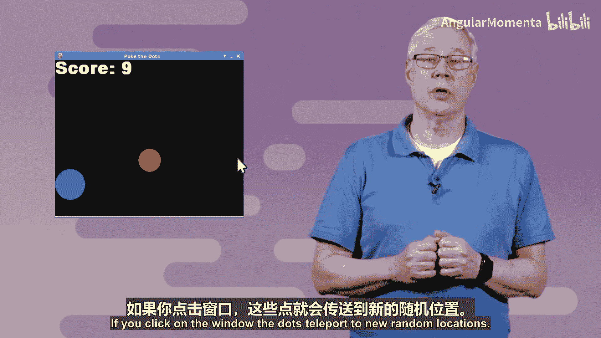
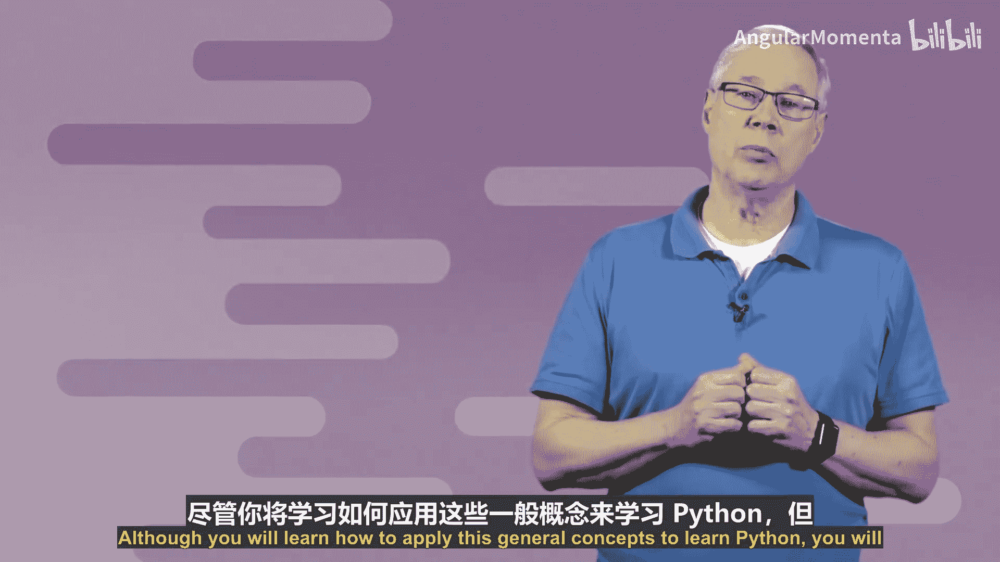
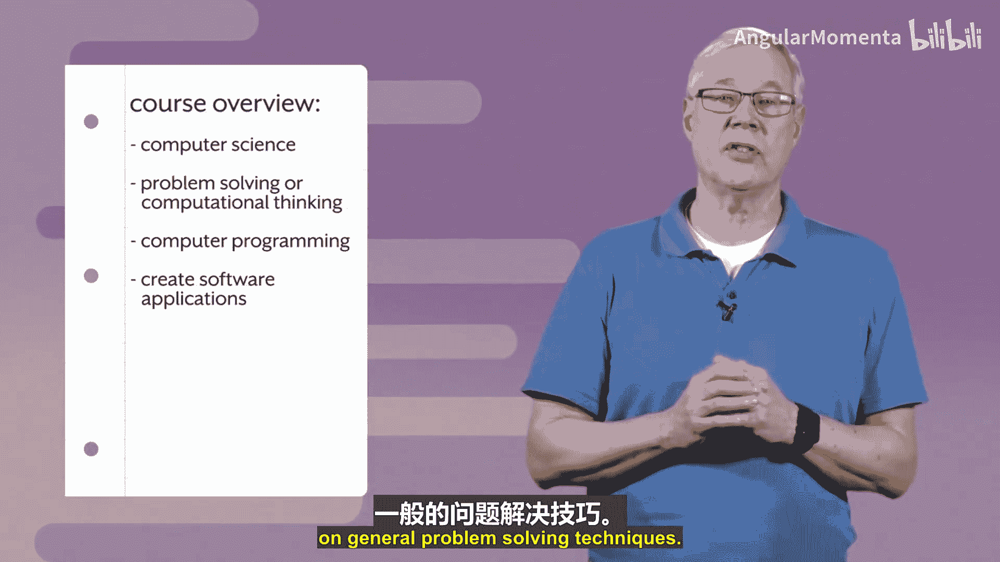

# 001：课程主题 🎮

欢迎来到《问题解决、编程与电子游戏》课程。我们是PVG课程的教学团队。

我叫Dwayne。我是阿尔伯塔大学计算机科学系的教授。我教授入门编程语言课程已有大半生。闲暇时，我喜欢玩电子游戏、看棒球和做木工。

我叫Paul。我也是一名计算机科学教授。这么多年过去，当学生理解一个新的编程概念时，我仍然会感到兴奋。闲暇时，我喜欢看电影和带我的孩子去看航展。

大家好，我叫Elise。我是阿尔伯塔大学的计算机科学毕业生。我之前参与开发过一个应用程序，旨在让编程初学者能更容易地与Arduino机器人交互并创建游戏。我很高兴向大家介绍我们的课程，并希望你们能享受编程的乐趣。

我叫Emma。我拥有数学和计算机科学学位。过去几年，我一直在阿尔伯塔大学担任入门计算机科学课程的教学团队成员。我喜欢指导编程新手，并希望这门课程能让计算机科学对你来说变得触手可及。

在本课程中，你将学习四件事：
1.  计算机科学如何将计算应用于信息。
2.  如何使用计算思维（或问题解决）来解决计算问题。
3.  如何用Python编程。
4.  如何创建电子游戏及其他应用。

以下是你在本课程中将创建的两款游戏的简要介绍。

我们将第一款游戏称为“黑客”。它基于Bethesda Soft Works公司广受欢迎的《辐射》系列中出现的一个迷你游戏。这是一段该迷你游戏在《辐射：新维加斯》中出现的视频片段。游戏目标是选择屏幕上显示的一个单词作为正确密码。你最多有四次猜测机会。每次猜测后，会得到一些反馈。这是你将在本课程中创建的“黑客”游戏的视频。

我们将第二款游戏称为“点点碰撞”。游戏目标是防止两个点发生碰撞。如果你点击窗口，两个点会传送到新的随机位置。你的得分是两点碰撞前所经过的时间。

在本课程中，我们使用“电子游戏”这个术语来指代可以为了娱乐而进行的交互式图形应用程序。

学习创建游戏很酷，但这并非本课程的真正目标。你用来创建游戏的过程同样适用于大多数其他类型的软件应用程序。我们选择电子游戏有三个原因：
*   首先，它们有趣且好玩。
*   其次，尽管游戏很有趣，但它们足够简单，可以在本课程期间完成。
*   第三，电子游戏是图形化和交互式的。这意味着在课程结束后，你将能够创建交互式图形软件应用程序。例如，你可以创建一个管理音乐播放列表的应用程序，或者一个演示化学反应的应用程序。

要创建电子游戏，你必须学习用某种编程语言编写程序。你将学习Python编程语言，以便用它来编写游戏代码。在本课程中，我们将使用Python 3版本。这是“点点碰撞”游戏的部分Python代码。如果你现在还不理解，不用担心，课程结束时你就会明白。

学习编写Python程序既有趣又有用。然而，编程语言有很多种。如果你过于狭隘地专注于Python语言，以后学习其他编程语言可能会遇到困难。在本课程中，你将学习通用的计算机科学概念，例如语法、语义、命名空间和控制结构。虽然你将学习如何应用这些通用概念来学习Python，但你以后也能利用这些概念来学习其他编程语言。

在理解代码必须做什么之前，你无法用编程语言编写出有意义的代码。代码是问题解决过程的一个最终产物或成果，这个过程始于一个想法。

将一个想法转化为可行的解决方案是一个基于问题解决的过程。例如，如果你的想法是一个新设备，其成果可能包括物理对象、设计文档、内含的软件和用户手册。创建这些成果中的每一项都需要使用不同的问题解决技术。

当成果是一个软件应用程序时，就需要进行计算问题解决。在本课程中，你将学习使用计算问题解决（也称为计算思维）将游戏想法转化为游戏软件。然而，同样的问题解决过程可以用来创建任何类型的软件，无论它是否是游戏。

计算机科学是对不同类型信息以及计算可以应用于这些信息的不同方式的系统性研究。也许“计算科学”这个术语比“计算机科学”更准确。例如，我们将我们的大学院系称为“计算科学系”，以更准确地反映该学科的性质。这是一门研究计算和信息，以及计算机和计算机编程的科学学科。下一课将介绍计算机科学。

我们使用游戏让课程更有趣，我们使用Python，因为它是一门目前流行的优秀语言。然而，你在本课程中学到的计算问题解决过程，无论软件是否是游戏，无论编程语言是Python还是其他语言，都可以使用。完成本课程后，你将能够运用所学的问题解决过程和计算机科学概念，使用大多数编程语言将大多数软件想法转化为实际的软件。

有些课程只专注于Python编程，或只专注于为游戏编写代码。本课程专注于通用的计算机科学概念和通用的问题解决技术。是的，它使用了电子游戏和Python。但它所做的远不止于此。

---

**本节课总结**

在本节课中，我们一起学习了《问题解决、Python编程与电子游戏》课程的核心主题。我们认识了教学团队，了解了课程将涵盖的四个主要方面：计算机科学基础、计算思维、Python编程以及电子游戏开发。我们预览了课程中将创建的两款游戏——“黑客”和“点点碰撞”，并理解了选择游戏作为教学载体的原因。最重要的是，我们明确了本课程的终极目标：掌握通用的计算问题解决方法和计算机科学概念，而不仅仅是学习Python语法或游戏制作。这些技能将使你能够应对更广泛的编程挑战，并为学习其他编程语言打下坚实基础。