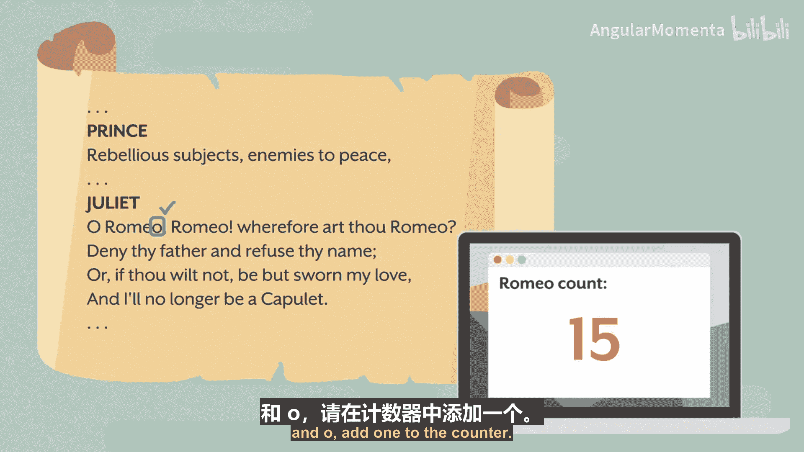
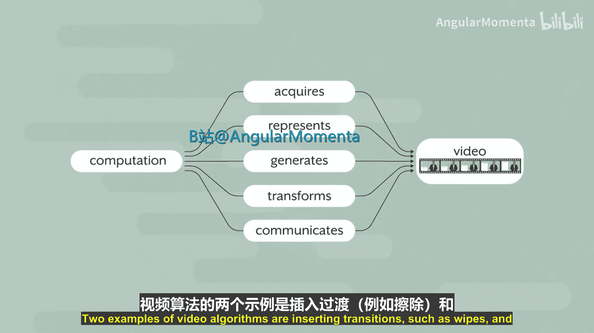
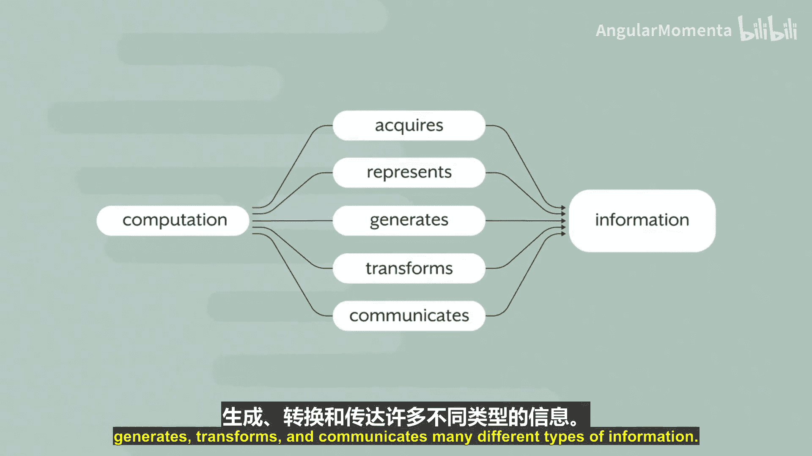

# 002：计算机科学入门 🖥️

在本节课中，我们将要学习计算机科学、计算以及信息的基本概念。我们将了解计算机科学的研究范围，认识不同类型的信息，并初步探索算法是如何驱动计算的。

## 什么是计算机科学？🔍

计算机科学是研究计算与信息的学科。它探究那些可用于获取、表示、生成、转换和传递知识的计算算法，以解决计算问题。

## 信息的类型 📊

信息有多种类型。数字是其中一种类型，例如 `4` 和 `10.5`。对数字进行的计算通常被称为**计算**或**运算**。换句话说，计算是一种获取、表示、生成、转换和传递数字的过程。你可以用大脑进行加法或乘法等运算，也可以使用计算器处理更复杂的计算。

然而，数字只是信息的一种类型，计算也只是处理数字的一种方式。计算同样可以应用于其他类型的信息。

## 字符串与文本 📝

字符串是另一种信息类型，它由有限的字符序列构成。例如，`"four"` 是一个字符串，而不是数字。你可以对字符串执行计算，例如生成一个所有字母都变为大写的新字符串。同样，计算机也可以对字符串进行计算，例如计算它包含的字符数量。

以下是字符串处理的一些例子：
*   你可以或计算机可以统计在戏剧《罗密欧与朱丽叶》的台词中，“Romeo”一词出现的总次数。
*   计算机执行简单计算的速度远快于人类，它能在远小于一秒的时间内给出答案 `128`。

## 算法：计算的步骤 📐

**算法**是执行计算所遵循的步骤序列。例如，统计《罗密欧与朱丽叶》中“Romeo”出现次数的算法可以是：
1.  将计数器初始化为 `0`。
2.  扫描文本字符串，寻找大写字符 `‘R’`。
3.  如果这个 `‘R’` 后面紧跟着小写字符 `‘o’`, `‘m’`, `‘e’`, `‘o’`，则将计数器加 `1`。

**计算**是你想要执行的任务（例如，统计“Romeo”的出现次数），而**算法**是你执行该任务的方式（例如，上述的步骤序列）。

## 更多信息类型：文本、图像与视频 🎨

文本是另一种信息类型。它类似于字符串，但除了字符内容外，还具有字体、颜色和大小等属性。例如，一个带有特定字体、颜色和大小的“4”是文本，而不仅仅是字符串。计算机可以通过改变其字体、颜色和大小等属性来处理文本。

图像是另一种信息。例如，一张梅花4扑克牌的图片就是图像信息。计算机可以通过改变其大小或分辨率等属性来转换图像。

视频是我们目前要介绍的最后一种信息类型。本课程中的视频就是视频信息的例子。视频算法的两个例子是插入转场效果（如划像）和添加动画。本课程视频的制作就运用了这些以及更多的计算过程。

## 本课程中的应用 🎮

在本课程中，你将遇到许多不同类型的信息以及针对每种信息的多种算法。例如：
*   在第一个游戏“Hacking”中，你将创建算法来生成密码字符串。
*   在第二个游戏“Poke the Dots”中，你将创建自己的“点”类型，并编写一个在两个点碰撞时结束游戏的算法。该算法将检查两个点中心之间的距离是否小于或等于它们的半径之和。

你将使用 Python 3 编程语言来实现你的算法，并在计算机上运行这些程序。

## 计算的用途 🛠️

计算可以用于许多目的，但本课程将聚焦于一个目标：**通过计算解决问题来创建电子游戏**。计算的其他常见用途包括通信、信息存储与检索、设备监控与控制、信息加密与解密以及模拟仿真。

你可以在未来的课程中学习计算的其他用途。本课程将为理解这些主题打下坚实的基础，特别是**类型**和**算法**，它们是所有其他计算应用的核心组成部分。

## 总结 📚

本节课中，我们一起学习了计算机科学是研究计算与信息的学科。我们了解到，计算能够获取、表示、生成、转换和传递多种不同类型的信息。算法是执行这些计算的明确步骤序列。在本课程中，我们将运用这些概念，通过Python编程来创造我们自己的电子游戏。