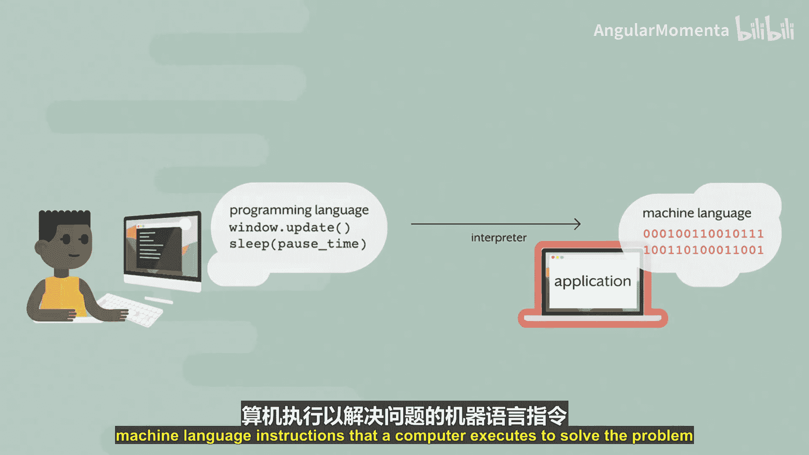

**编程语言：P03：编程语言简介**

在本节课中，我们将学习编程语言的基本概念，了解计算机如何通过编程语言来执行计算，以及翻译器（特别是解释器）在其中扮演的角色。

---

计算被用于解决计算问题。创建一个电子游戏或其他应用程序就是一种计算问题解决。我们希望计算机能为应用程序执行适当的计算。

那么，如何让计算机执行这些计算呢？在应用程序编程过程的最后步骤之一，是编写一个计算机程序，供计算机用来执行应用程序所需的计算。一名或多名程序员使用一种**编程语言**来表达这个计算机程序。

然而，现代编程语言并不包含可以直接被计算机执行的机器指令。相反，计算机程序是计算机必须执行步骤的一种高级表示。一个**翻译器**必须将计算机程序翻译成**机器语言指令**，然后计算机才能使用这些指令来执行计算。对于本课程，你不需要了解关于机器语言的其他知识。

---

上一节我们介绍了编程语言需要翻译成机器指令。本节中，我们来看看翻译器的两种类型。翻译器有两种：**编译器**和**解释器**。本课程使用的Python编程语言是**解释型**的。

一个解释器通过**解释**程序的一行语句，将其翻译成机器语言。然后，计算机执行这几条机器指令来完成部分计算。解释器和计算机会继续这个“解释-执行”循环，直到程序的每一条语句都被翻译，并且所有生成的机器指令都被执行完毕。

我们可以用一个类比来更好地理解解释过程。《牛津英语词典》对“interpreter”的定义是：进行解释的人，尤指口头或用手语翻译讲话的人。考虑在自然语言（如英语和手语）之间进行翻译的问题。**解释是实时发生的**，因为解释员在讲话者说话时，一次翻译一个短语或句子。这种翻译有时被称为**同声传译**，它与计算机语言的解释过程类似。

对于本课程，你只需要理解翻译过程会发生，而不需要理解它是如何完成的。你已经看到，计算机程序代表了一个解决计算问题的计算过程。然后，一个解释器将这个表示翻译成机器语言指令，由计算机执行以解决问题。

---

在本节课中，我们一起学习了编程语言的核心概念。我们了解到，编程语言是人与计算机沟通的桥梁，它用高级的、人类可读的代码描述计算任务。为了让计算机理解并执行这些任务，需要一个翻译器（如Python的解释器）将代码逐行转换成底层的机器指令。这个过程是自动且实时的，使得程序员能够专注于用编程语言表达逻辑，而无需直接操作复杂的机器语言。