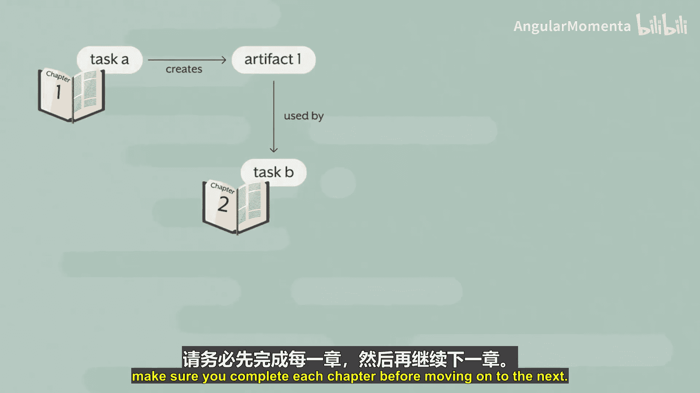
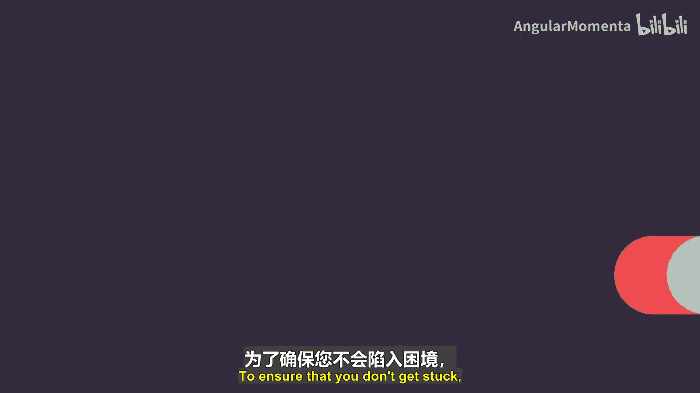
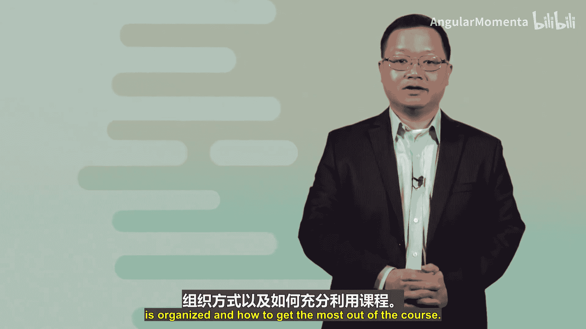

# 005：如何从本课程中获得最大收益

在本节课中，我们将介绍本课程（PVG）的组织结构，并学习如何从中获得最大收益。了解课程的设计理念和最佳学习方法，将帮助你更有效地掌握问题解决、Python编程和电子游戏开发的核心技能。

## 课程结构与内容

本课程包含12个模块。每个模块都包含教学视频、设计与编码活动、A类活动、阅读材料和拓展内容。

教学视频主要分为两类。第一类专注于通过设计和编程电子游戏来解决问题。第二类被称为Python编程语言视频（简称Python视频），它提供与电脑游戏无关的、关于Python编程语言的通用教学。

## 基于问题的学习方法

本课程采用基于问题的学习方法。因此，Python视频会按照创建电子游戏所需的顺序来介绍Python概念。

Python视频使用一个可用于理解任何编程语言的概念框架来呈现内容。这个框架基于几个通用的编程语言概念，你将在课程中学习到它们：**词法**、**语法**、**语义**、**命名空间**和**控制结构**。你现在不需要识别或理解这些概念，它们将在编程语言视频中进行解释。

这些通用的编程语言概念较为复杂，因此你可能需要多次观看每个编程语言视频，并在观看时经常暂停。在课程后期，当你第二次或第三次需要使用某个语言结构时，你可能还需要回看之前的视频。

其他学习编程语言的方法可能更快，但它们依赖于模仿简单示例而缺乏充分理解。许多方法更狭隘地专注于单一编程语言，或只关注编程语言中最简单的几个方面。如果你接受本课程所使用的方法，你将获得对编程语言更深入的理解，并为在课程结束后学习额外的Python语言特性及其他编程语言做好准备。

## 模拟真实世界的游戏开发流程

在现实世界中，创建游戏是一项团队工作。优秀的设计是一种社交活动，而非孤立的。在游戏创作开始时，一些团队成员会通过语言、声音、概念艺术和故事板向团队其他成员演示游戏。

在本课程中，你将观看完整游戏的玩法视频并亲自试玩游戏，而不是仅仅看到游戏的想法。换句话说，我们已经创建了游戏的一个版本，而你的目标是自己创建相同的游戏。

创建电子游戏是一个复杂的问题。因此，游戏通常首先创建一个简化版本，然后创建一系列逐渐复杂的版本，最后一个版本才是完整的游戏。每个版本都会增加一些新功能。

在现实世界中，在确定了游戏功能后，团队中一些经验丰富的设计师会将游戏分解为多个版本，可以按功能或其他标准划分。在本课程中，我们将扮演你团队中经验丰富的设计师角色，决定你创建的每个游戏版本应包含哪些功能。

团队将每个版本分解为多个组件，团队成员共同为每个游戏组件创建描述、测试计划、算法和代码。

## 互动学习对象

在本课程中，除了在课程论坛上的互动，你将独自学习。然而，为了模拟在团队中工作的真实世界游戏创作体验，你将使用三个互动学习对象：**描述构建器**、**功能测试计划构建器**和**算法构建器**。

这三个互动学习对象通过为三项游戏设计活动提供一个明确的设计伙伴和导师，来模拟真实世界的设计过程。

## 最佳学习实践

在游戏创作过程的每个任务中，你都需要创建或完善一个构成游戏组成部分的“工件”。为了从本课程中获得最大收益，你应该严格遵循游戏创作流程，并按顺序完成每项活动。每项活动都使用前一项活动的工件。因此，在进入下一项活动之前，你应该诚实地努力创建或组装每个目标工件。

本课程就像一个故事，请确保在进入下一章之前完成每一章。

为了确保你不会卡住，在游戏创作过程的每项活动中，都会使用前一项活动的正确工件副本作为起点。在设计活动中，你应该从你的互动学习对象伙伴和导师那里获得指导，但要避免盲目猜测以迫使你的伙伴揭示正确答案。总的来说，猜测不是通向理解的好途径。

## 总结

本节课中，我们一起学习了本课程的组织结构以及如何从中获得最大收益。我们了解了课程采用基于问题的学习方法，通过模拟真实团队开发流程来教授Python和游戏设计，并强调了按顺序完成活动、利用互动学习对象指导的重要性。遵循这些方法，你将能更深入地理解编程语言，并为未来的学习打下坚实基础。