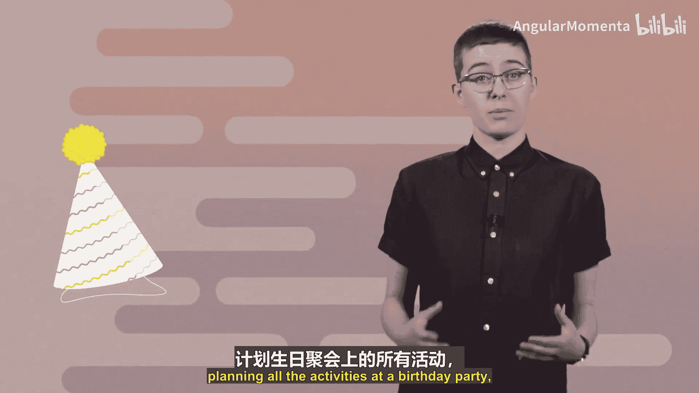
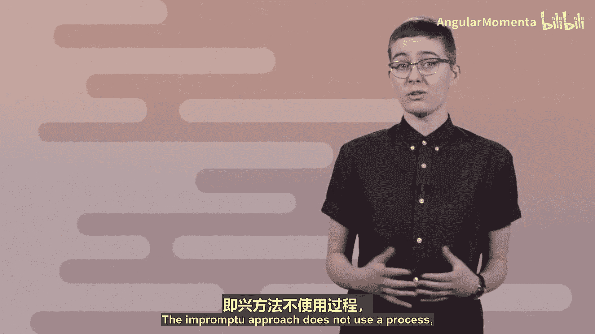
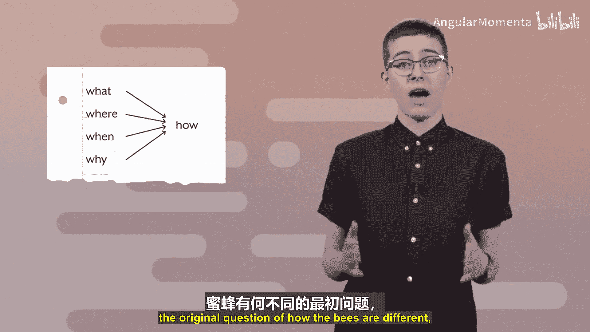
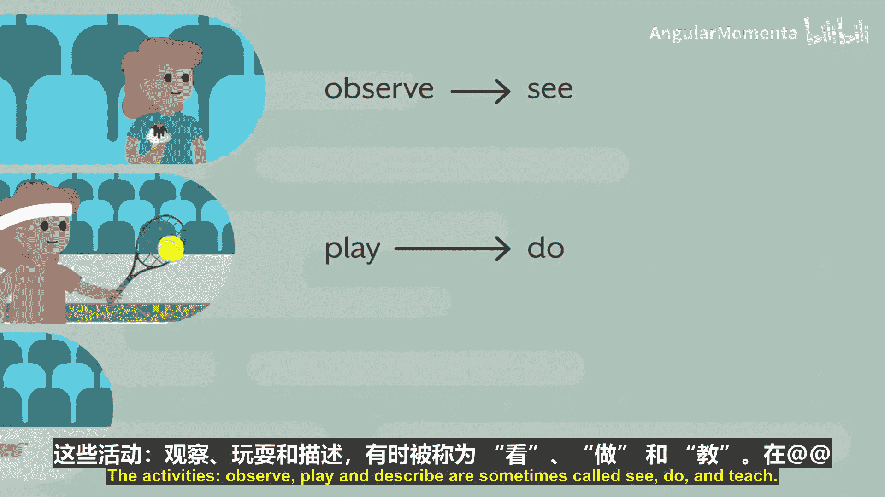
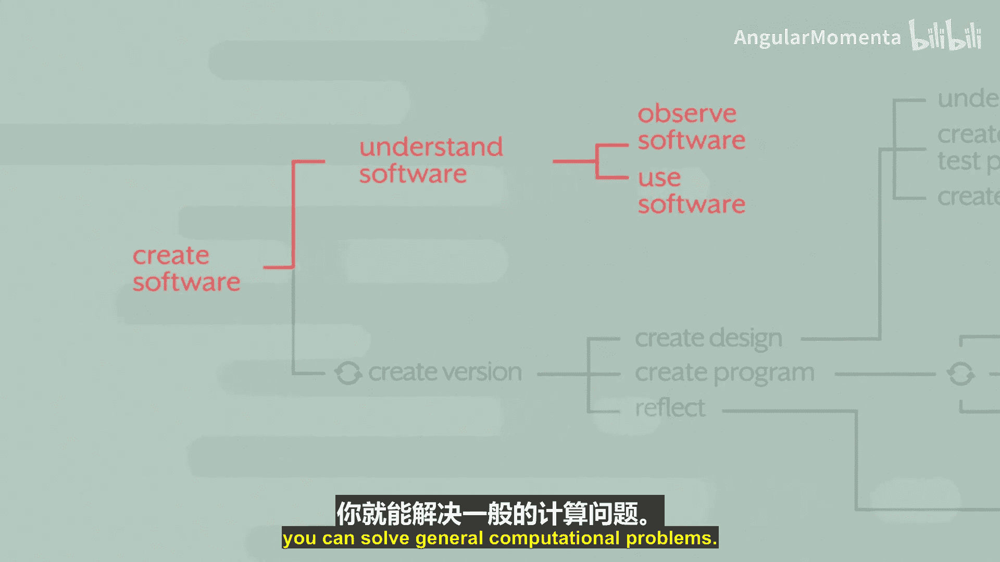

# 007：游戏创作流程 🎮

在本节课中，我们将学习游戏创作流程。这是一个用于解决复杂计算问题的结构化方法，尤其适用于游戏开发。我们将重点介绍计算问题解决的核心技术，并详细分解游戏创作流程的第一步。

---

## 概述：什么是游戏创作流程？

游戏创作流程是一个**算法**或**过程**，它是一系列用于解决问题或创造产物（我们称之为**制品**）的动作序列。就像遵循食谱烘焙饼干或策划生日派对一样，使用一个经过验证的流程能更高效、更成功地完成任务。

在游戏开发中，由于涉及艺术、音乐、编程、设计等多个专业领域，流程变得至关重要。本课程的游戏将专注于计算问题，简化了艺术和音乐等部分，但创作过程本身依然复杂，因此我们需要一个清晰的步骤来指导。

---

## 计算问题解决技术

在深入流程之前，我们需要了解支撑它的核心技术：**计算思维**。它主要运用三种技术：

1.  **问题分解**：将大问题拆分为更小、更易管理的子任务。
2.  **算法**：定义解决问题的明确步骤序列。
3.  **抽象**：忽略不必要的细节，专注于核心概念。

本节我们将重点运用**问题分解**和**算法**来启动我们的第一个游戏《Hacking》的创作。

---

## 为什么需要流程？

我们可以通过一个对比来理解流程的重要性。

*   **使用流程（如遵循食谱）**：需要前期准备，但通常能产出可预测的成功结果（美味的饼干）。
*   **不使用流程（即兴发挥）**：看似省事，但可能导致结果不一致、重复或失败（烤焦或没熟的饼干）。

游戏创作同理。一个清晰的流程能帮助我们系统化工作，避免混乱，并确保最终产品的质量。

---

## 游戏创作流程分解

游戏创作本身是一个复杂的任务。通过问题分解，我们可以将其划分为多个子任务。下图展示了完整的游戏创作流程：

如图所示，即使专注于计算部分，“创作游戏”也包含许多环节。我们将按顺序介绍每个子任务。首先，我们从第一个也是基础性的任务开始。

---

## 第一步：理解游戏

在解决任何问题之前，你必须先理解它。对于游戏创作，“理解游戏”意味着你需要知道游戏中**发生了什么**（What）、**在哪里发生**（Where）、**何时发生**（When）以及**为何发生**（Why）。这“四个W”将最终指引你“如何”（How）创建这个游戏。

这类似于写一篇关于蜜蜂差异的论文前，你需要研究不同蜜蜂的外观、栖息地、行为和时间以及原因。

“理解游戏”本身也是一个复杂任务，因此我们可以对其再次进行分解。

---

## 分解“理解游戏”：体验式分解

为了深入理解游戏，我们采用一种称为**体验式分解**的方法。它通过三个层次的参与来逐步深化认知：

以下是三个层次的详细说明：

1.  **观察**：这是被动的第一层次。通过观看他人进行游戏，你可以获得对游戏规则和行为的广泛但浅显的初步印象。例如，观看别人打网球。
2.  **游玩**：这是主动的第二层次。通过亲自参与游戏，你将个人经验与新知识结合，获得更深层次的理解和技能。例如，亲自上场打网球。
3.  **描述**：这是互动的第三层次。通过向他人解释游戏，你需要在不同情境下组织你的知识，这常常能带来最深刻的理解，并迫使你调整观点以适应他人。例如，教练网球或教左撇子球员。

这三个层次有时也被概括为：**观看、实践、教授**。

在接下来的课程中，你将通过**观察**和**游玩**《Hacking》游戏来完成“理解游戏”这一步。“描述”这一步将在创作流程的后续阶段学习。

---

## 总结与展望

本节课我们一起学习了游戏创作流程的概貌及其重要性。我们了解到：

*   使用**流程**（算法）是系统化解决复杂问题（如游戏开发）的关键。
*   **问题分解**是将大任务拆解为可管理子任务的核心技术。
*   理解游戏是创作的第一步，而**体验式分解**（观察、游玩、描述）是达成深度理解的有效方法。

在接下来的两节课中，你将应用这些知识，亲自**观察**和**游玩**《Hacking》游戏，为后续的创作打下坚实的基础。你所学的这些计算问题解决技术，不仅适用于游戏开发，也能应用于更广泛的编程和问题解决场景中。