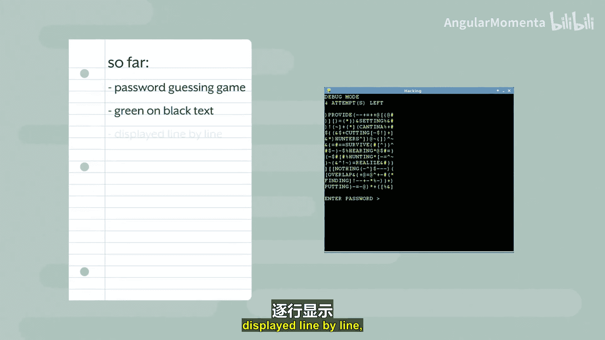
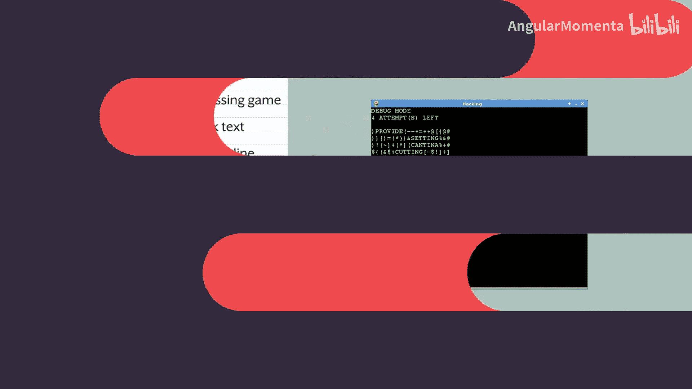
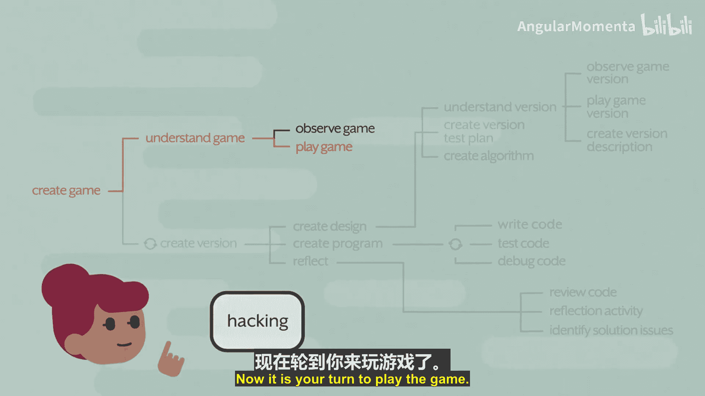

# 008：观察黑客游戏 🎮

在本节课中，我们将通过观察一个完整的“黑客游戏”来理解其运行机制。我们将关注游戏窗口中的各种元素、它们的出现时机以及变化规律。

---

## 游戏初始界面 🖥️

游戏开始时，会打开一个窗口。窗口标题为“hacking”，背景为黑色。窗口左侧显示绿色的文本行，模拟老式计算机终端的效果。

文本内容显示计算机处于调试模式，并且剩余尝试次数为4次。这似乎意味着调试模式允许玩家进行最多四次某种尝试。

在这段文本下方，是一个嵌入在符号字符中的单词列表。在该列表下方，系统提示玩家输入密码。

根据目前观察，可以得知这是一个在窗口中进行的密码猜测游戏。文本以绿色显示在黑色背景上，并逐行呈现。玩家将有四次机会来猜测密码。

---

## 游戏过程与反馈 🔍

接下来，我们看看输入密码时会发生什么。我首先猜测单词“survive”，因为它是窗口中出现的单词之一。

在窗口右侧，可以看到一个两行的提示信息：“Sur is incorrect, but two of the seven letters in the guess match letters in the same positions of the secret password.” 同时，剩余尝试次数减少了一次。

然后我尝试猜测密码“pudding”。这个猜测也不正确，但提示变为“five of seven letters are in matching positions”。

接着我尝试“hunting”。此时，窗口内容被清空，并在窗口中央逐行显示四行文本。

文本显示了我输入的密码，然后提示游戏正在退出调试模式，登录成功，并告知玩家按回车键继续。当我按下回车键后，窗口关闭。

---

## 观察总结与思考 💡

至此，我们完成了对游戏的观察。我们观察到：

*   游戏要求玩家猜测一个密码。
*   玩家最多有四次猜测机会。
*   游戏会检查猜测密码与秘密密码在相同位置上的字母匹配情况，并显示提示。
*   如果猜测成功，游戏会祝贺玩家。

除了视频中展示的情况，你还能想到哪些游戏中可能发生但视频未演示的场景？例如，如果玩家进行了太多次错误猜测，会发生什么？

现在轮到你来玩游戏了。请多次试玩，以获得对“黑客游戏”更深入的理解。