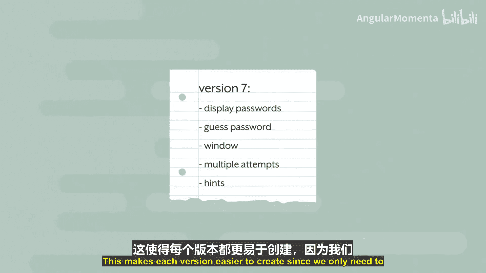
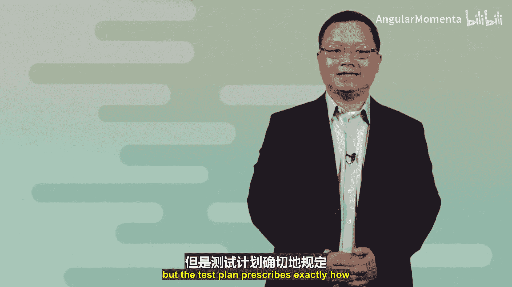
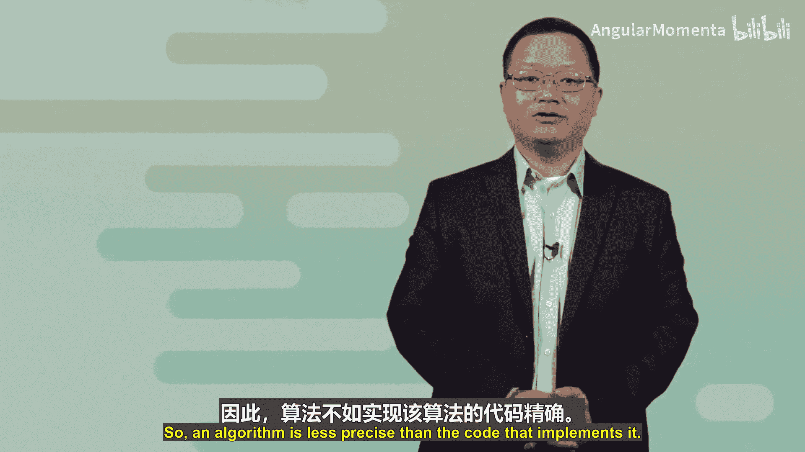
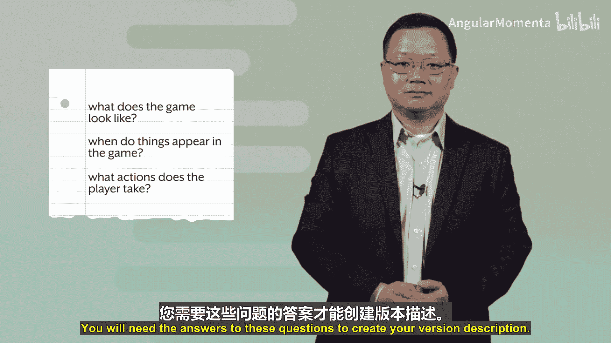

# 009：2.3.1 游戏版本

在本节课中，我们将学习如何将复杂的游戏开发问题分解为更小、更易管理的版本。我们将介绍一种新的问题分解方法——**特征选择**，并探讨如何通过**问题细化**来规划每个版本的实现过程。

## 已完成的任务

上一节我们完成了“理解游戏”任务中的“观察游戏”和“试玩游戏”两个子任务。现在，让我们揭示下一个任务和游戏创建过程。

## 🎮 创建版本

“创建版本”旁边的循环箭头表示这个任务可能需要执行一次或多次。

我们需要将游戏划分为多个版本，因为大问题很难一次性解决。因此，我们将一个大问题分解成几个更小、更容易解决的问题，这些更小的问题就称为**版本**。

之前，我们使用**经验分解**，根据“参与程度”这一标准，将“理解游戏”分解为“观察游戏”和“试玩游戏”两个子任务。参与程度衡量的是一个人与问题的互动程度：观察的互动最少，试玩互动更多，而描述或解释的互动最多。

## 🔍 特征选择分解法

现在，我们将使用一种新的问题分解方法——**特征选择**，来将我们的游戏分解为多个版本。

完整的黑客游戏包含一系列**特征**，例如：
*   显示密码
*   猜测密码
*   使用窗口
*   支持多次尝试
*   提供提示

一次性尝试开发所有特征是很困难的。相反，创建一个只支持部分特征的版本会更容易。第一个版本从少量特征开始，后续的每个版本再添加一些新特征，直到最后一个版本拥有所有必需的特征。这使得每个版本都更容易创建，因为我们每次只需要关注少量的改动。

当你学习大多数新技能时，都会用到特征选择。例如，学习一门新语言时，你不会从写论文或发表演讲开始，因为这些活动需要许多复杂的语言特征，如难词和复杂语法。相反，你会从学习简单的单词和短句开始，然后再添加更复杂的语言特征。

特征选择决定了每个版本必须实现的**特征集**。

## ⚖️ 特征选择的标准

各版本的实现工作量应该保持平衡。因此，特征选择的标准之一是**平衡特征集**。你应该为每个版本选择那些需要大致相同工作量来实现的特征。

例如，单独实现“使用窗口”这一特征的工作量，可能与实现“显示密码”和“猜测密码”两个特征加起来的工作量相当。

有时，将一个单一特征拆分成多个特征有助于平衡特征集。例如，“使用窗口”既包括打开窗口，也包括关闭窗口。

然而，特征选择的第二个标准是**特征依赖性**，因为某些特征依赖于其他特征。例如，如果窗口没有被打开，它就无法被关闭。

不幸的是，在没有经验的情况下，很难准确估计特征的工作量。因此，在本课程中，我们将为你选择版本的特征集。随着你的使用，你将学会识别好的特征集。在本课程之后，你就可以运用自己的经验，为自己的项目创建特征集了。

## 🛠️ 创建版本与问题细化

让我们回到“创建版本”和游戏创建过程。“创建版本”作为一个单一任务过于复杂。因此，我将应用第三种问题分解形式——**问题细化**，来创建合适的子任务。

问题细化通过将一个完整问题分解为一系列细节逐渐增加的解决方案来解决问题。其标准是**细节层次**，也称为**精确度**。

第一个解决方案是完整的，但细节最少。例如，画一个笑脸只有很少的细节，但它对于“画一张脸”这个问题来说是一个完整的解决方案。

其余的解决方案精确度逐渐提高。最后一个解决方案和第一个解决方案一样完整，但包含了所有细节。例如，可以向笑脸添加细节，直到最终的草图成为最详细的。

这是问题细化的另一个例子：让我们规划一次从阿尔伯塔大学到不列颠哥伦比亚大学的旅行。

我可以写一份详细的路线说明，从阿尔伯塔大学开始，到不列颠哥伦比亚大学结束。这就像从开始到结束逐行编写程序一样。仅仅从阿尔伯塔大学到埃德蒙顿机场，就有超过10条详细的指令。

然而，在创建了这些详细的指示后，我可能会决定改乘火车而不是飞机。那么所有详细的指令现在都没用了。我因为过早关注细节而浪费了时间。

相反，我会使用问题细化来创建一个不精确但完整的计划：
1.  从阿尔伯塔大学开车到埃德蒙顿机场。
2.  从埃德蒙顿机场飞往温哥华机场。
3.  从温哥华机场开车到不列颠哥伦比亚大学校园。

然后，我们可以在决定采用这个计划之前，通过研究成本和时间来测试它。如果我们想尝试不同的计划，比如从埃德蒙顿坐火车到温哥华，修改这个简短的计划比修改一长串详细的指示要容易得多。在研究完所需成本和时间后，我可以通过这个计划来制定更精确的（乘飞机或火车的）路线指示。

同样地，在知道解决方案的大致形式之前就编写代码是不明智的。你应该在将细节编写为代码之前，先规划好你的解决方案。在软件开发中，这种计划被称为**设计**。

因此，我将把“创建版本”分解为三个任务：
1.  **创建设计**：产生一个不精确的解决方案，即一个版本的黑客游戏大纲。
2.  **创建程序**：将这个不精确的大纲转换为该版本黑客游戏的精确程序。
3.  **反思**：评估你对所应用的编程语言技术的了解，评估你的解决方案，并为下一个版本确定改进之处。

“反思”本身就是一种细化，因为它将你对解决方案、知识和技能的理解，提炼到当前版本所需的最高细节层次。此外，反思类似于经验分解中的“解释或描述”部分，因为你的反思就像向自己解释这些想法。这种最高层次的参与度会带来对本版本最详细的理解。

这是最后一次细化，因为在反思之后，你将拥有对解决方案最精确的设计、代码和理解。

## 📝 深入“创建设计”任务

现在让我们回到“创建设计”任务。我们应该如何完成这个任务？尝试一些新方法怎么样？我们可以把它分解成子任务。我知道这并不新鲜，但它很有效。我们的目标是不断细分任务，直到最终的子任务变得非常简单，解决方案显而易见。

让我们使用问题细化来创建三个子任务：
1.  **理解版本**
2.  **创建版本测试计划**
3.  **创建算法**

“理解版本”任务看起来可能很熟悉，因为你已经见过“理解游戏”任务。事实上，如果我们展开“理解版本”任务：
*   “观察游戏”对应“观察游戏版本”。
*   “试玩游戏”对应“试玩游戏版本”。

请记住，经验分解有三个组成部分：观察、试玩以及描述或解释。“创建版本描述”对应“描述”。这是一个新任务，它产生游戏版本的书面描述。这个描述是一个**工件**，解释了游戏的功能，包括其特征和玩家操作。这个描述是不精确的，因为它提供了我们实现的目标，但没有提供实现本身的细节。

“创建设计”中的下一个任务是“创建版本测试计划”。这个任务创建一个测试计划，用于检查特征集是否正确实现。这个工件比游戏描述更精确，因为它更明确地考虑了多种游戏场景。描述描述了所有可能的结果，但测试计划规定了哪一系列玩家操作会导致哪种游戏结果。例如，描述指出可能会显示成功或失败的结果，但测试计划精确规定了必须如何玩游戏才能体验到每种结果。

“创建算法”任务产生设计中最精确的工件。**算法**是一系列步骤，规定了代码应如何编写。它比测试计划更精确，因为算法更接近代码。每个步骤对应几行代码。然而，算法应该独立于任何特定的编程语言，因此算法不如实现它的代码精确。

## 🚀 开始实践

现在，“创建设计”中的所有任务都已介绍完毕，是时候让你回到游戏创建过程了。

首先，从“理解版本”开始。观看第一个版本黑客游戏的试玩视频。问自己观看完整游戏时间样的问题：游戏看起来怎么样？事物何时在游戏中出现？玩家可以采取哪些操作？你需要这些问题的答案来创建你的版本描述。

## 总结

本节课中，我们一起学习了如何通过**特征选择**将复杂游戏分解为多个循序渐进的版本，以及如何运用**问题细化**的方法，将“创建版本”这个大任务逐步细化为“创建设计”、“创建程序”和“反思”等可操作的具体步骤。我们了解到，良好的规划（设计）应先于具体的编码，并且平衡的工作量和考虑特征依赖性是成功分解的关键。现在，你已经准备好开始为第一个游戏版本创建详细的设计了。