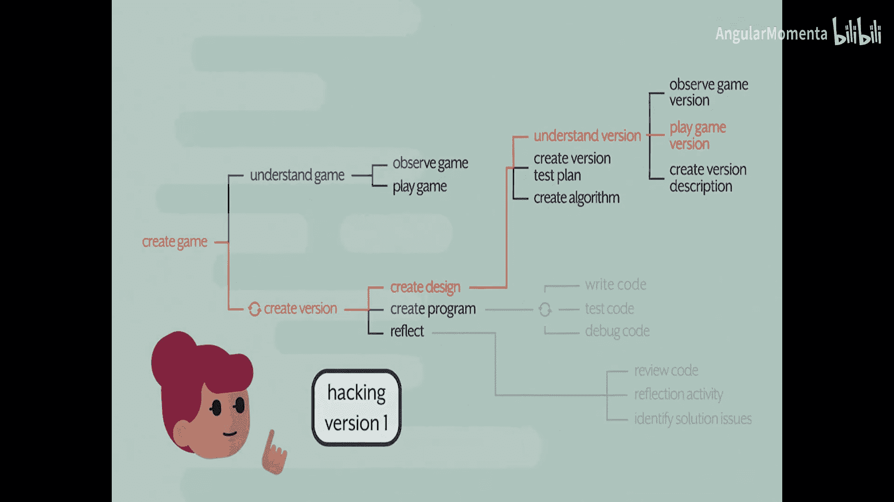

# 010：观察黑客小游戏版本1 🎮

在本节中，我们将观察并分析“黑客小游戏”的第一个版本。我们将重点关注这个初始版本的游戏界面、玩家交互方式以及它与最终版本之间的核心差异。

## 游戏界面观察 👀

上一节我们了解了游戏的最终形态，本节中我们来看看它的初始版本。当程序启动时，游戏会使用操作系统默认字体显示文本。

*   文本逐行显示，每一行都位于上一行的下方。
*   这与最终版本不同。最终版本的游戏窗口拥有独立标题，并在窗口内的不同位置显示绿底黑字的文本。

## 游戏规则与交互 🔍

这个初始版本的游戏规则也有所简化。以下是游戏界面中呈现的关键信息：

*   游戏标题头显示只允许**1**次尝试机会，而最终版本允许**4**次。
*   显示的密码列表不包含任何象征性字符（如`*`或`#`）。
*   游戏仍然会提示玩家输入密码。

## 示例游玩过程 🕹️

接下来，我们通过一个具体操作来观察游戏的反馈机制。我输入了密码 `hunting`，这个密码在最终版本中是正确答案。

然而，程序在我输入后打印了一条信息，指出我的猜测是**不正确**的，即使我输入了正确的答案。最后，我按下回车键结束了游戏。

## 总结与练习 📝

本节课中我们一起观察了“黑客小游戏”版本1的基本运行情况。我们看到了它在文本显示、尝试次数和反馈机制上与最终版本的区别。

以上就是对黑客小游戏版本1的观察。现在，轮到你亲自尝试游玩这个版本了。你可以多次游玩，以更深入地理解这个初始版本的游戏逻辑和设计。