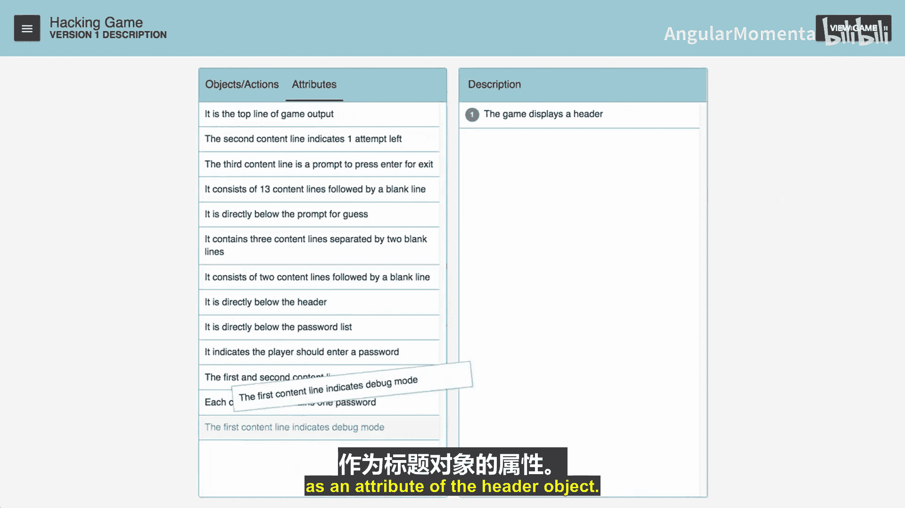
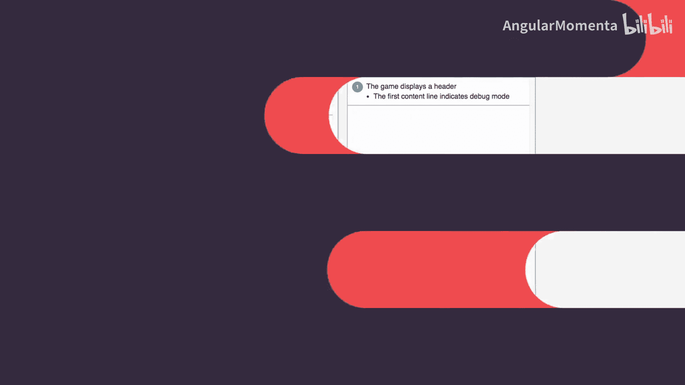
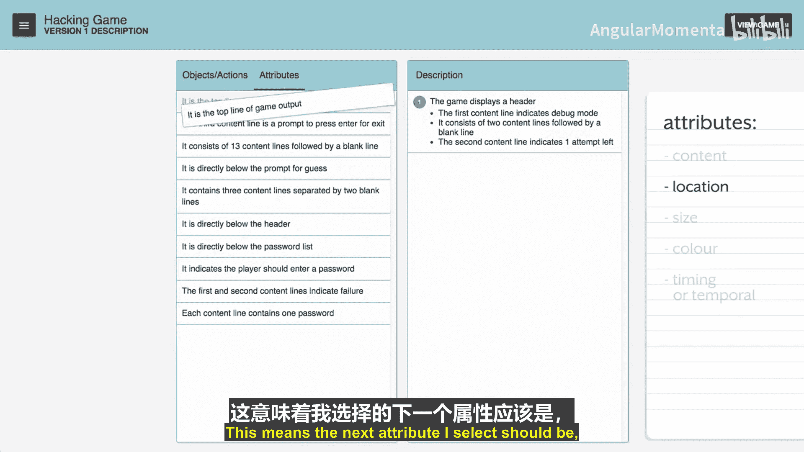
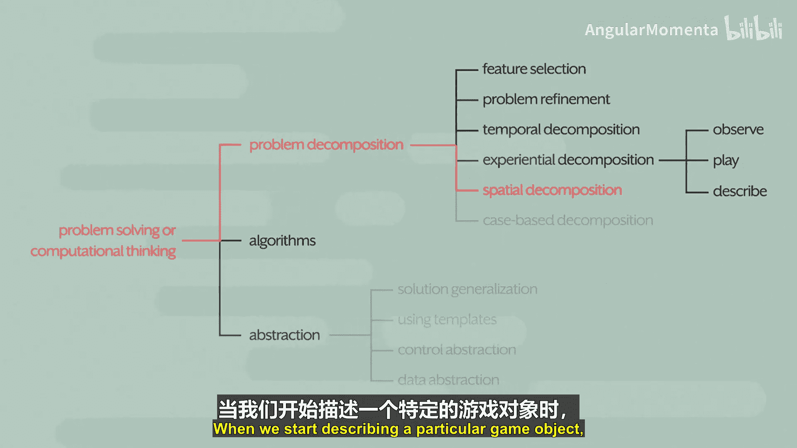

# 011：描述黑客游戏版本1 🎮

在本节课中，我们将学习如何为“黑客游戏”的第一个版本创建一份正式的游戏描述。这份描述将准确说明游戏运行时发生的一切，包括显示的内容、玩家的操作以及游戏的反应。

## 概述

游戏描述是“理解版本”阶段的最后一项子任务。它解释了游戏进行时发生的一切，包括游戏的外观、变化方式以及对玩家操作的响应。本质上，描述规定了游戏中必须包含的功能以及这些功能如何交互。一份好的描述能让读者完全了解如何玩游戏，但它不涉及游戏是如何实现的。

上一节我们观察并试玩了黑客游戏版本1，本节中我们来看看如何系统地描述它。

## 使用描述构建器

我们将使用“描述构建器”工具来创建描述。这个工具模拟了真实的团队协作环境。在真实环境中，每个成员观察游戏并提出描述性属性，其他成员提供反馈和指导，最终共同完成游戏描述。构建器提供了描述当前版本所有方面的短语，你的任务是将这些短语组合成一份准确、全面的描述。

描述构建器窗口的左上角是当前活动标题“Hacking version 1 description”。旁边是菜单按钮，你可以保存描述、打开已保存的描述、下载当前描述的PDF、重置练习或查看使用教程。点击右上角的按钮可以观看当前版本的游戏视频。

构建器包含两个主要面板。左侧面板有两个标签页，每个标签页包含描述短语：
*   **“对象和操作”标签页**：包含游戏中显示的对象（如标题、消息）以及玩家或游戏执行的操作（如输入猜测）。
*   **“属性”标签页**：包含对象的属性（如位置、内容）。

右侧面板是你构建描述的地方。你必须将所有相关的对象、操作和属性描述添加到右侧面板，以创建准确的描述。

## 构建描述的原则

以下是构建描述时需要遵循的关键原则：

*   **顺序原则**：对象和操作可以按任何顺序添加，但必须根据它们在游戏中发生的**时间顺序**进行正确放置。新添加的对象或操作必须放在游戏中发生在它**之前**的所有内容之下，以及发生在它**之后**的所有内容之上。
*   **属性依附原则**：属性不能独立存在，它必须依附于一个对象或操作。在描述中，属性必须作为其描述对象的子项添加。
*   **反馈机制**：构建器会提供反馈来指导你。反馈信息会出现在右下角。

## 开始构建描述：一个示例

我将演示如何添加前几个短语，并展示你可能遇到的不同类型的反馈。观看完这个示例后，将由你完成剩下的描述。

**第一步：确定首先发生什么？**
在黑客版本1中，首先显示的是“debug mode”这行文本。在“对象和操作”标签页中，没有直接描述这行文本的短语。我切换到“属性”标签页，找到了短语“The first content line indicates debug mode”。我尝试将它添加到描述中。

**反馈一：属性必须依附于对象**
添加失败，属性回到了左侧面板。构建器给出了反馈：“an attribute must belong to an object or action”。这是第一种反馈，说明了属性和对象之间的关系。属性不能脱离对象存在。

**第二步：先添加对象**
我需要先添加一个表示“有对象被显示”的短语。在“对象和操作”标签页中，有六个可用短语。其中四个是对象：密码列表、标题、失败结果、猜测提示。两个是操作：玩家按回车键结束程序、玩家输入猜测并按回车键。
“debug mode”属性是游戏启动时前两行文本的一部分，我们称这两行为“标题”。因此，我选择“The game displays a header”并将其添加到右侧面板。添加成功。

**第三步：为对象添加属性**
现在我可以尝试将“The first content line indicates debug mode”作为标题对象的属性添加。添加成功。
每个显示对象都有五个属性：内容、位置、大小、颜色、时间（或时序）。标题的内容是其主题。标题由两行内容和一个空行组成，所以我添加属性“It consists of two content lines followed by a blank line”。我已经添加了描述第一行内容的属性。要完成内容描述，我还必须找到描述“attempts left”内容行的属性并添加到标题对象。
标题的位置是顶部输出行。所以我添加属性“It is the top line of game output”。
由于此版本使用纯文本，我们使用默认的操作系统文本大小和颜色，因此不为每个对象指定这些属性。
对象的时序属性描述它何时显示、更改或删除。此版本中的所有对象都按我们从上到下描述的顺序显示，且不会被擦除。由于是文本版本，空间顺序也定义了时间顺序。在此版本中，“下方”一词既指空间上的下方，也指时间上的之后。

**第四步：添加下一个对象**
游戏中接下来显示的是密码。所以下一个要添加到描述中的对象是“The game displays a password list”。它必须放在标题下方，因为它在标题之后显示。
如果我错误地把它放在标题上方，会得到第二种反馈：“this concept should be placed higher or lower in the description”。这描述了概念在描述中的位置。新添加的对象或操作必须根据其在游戏中的时间顺序，正确放置在已存在内容的上方或下方。
如果我错误地尝试将密码列表作为标题的属性添加，构建器不会允许。因为密码列表本身是一个显示对象，不是其他显示对象的属性。
正确地将密码列表放在标题下方后，添加成功。

**第五步：为密码列表添加属性**
属性可以按任何顺序添加。
首先是内容属性。我添加“It consists of 13 content lines followed by a blank line”。密码列表还有第二个内容属性，我将留给你来完成。
其次是位置属性。我添加“It is directly below the header”。

**反馈三：属性不属于此概念**
为了展示第三种反馈，我尝试将属性“It indicates the player should enter a password”添加到密码列表。这是错误的，构建器显示新反馈：“this attribute does not belong to this concept”。“输入密码”属性实际上是密码提示的属性，而不是密码列表的属性。

## 问题分解的新方法

描述构建器使用了两种新的问题分解方法：**时间分解**和**空间分解**。它们允许我们将创建描述的任务分解为对象、操作和属性描述。

*   **时间分解**：根据任务必须执行的顺序来划分任务。我们在旅行规划示例中实际上就使用了时间分解，因为每个行车指令都必须遵循前一个指令的时间顺序。在创建版本描述时，通过按游戏中发生的顺序描述对象、操作和属性来应用时间分解。
*   **空间分解**：根据任务的空间位置来划分任务。所有影响单个对象的细节被分组在一起。当我们开始描述一个特定的游戏对象时，我们将其所有属性放在一起描述。

## 你的任务

现在轮到你了。请完成以下步骤：
1.  为密码列表添加另一个内容属性。
2.  自行完成版本描述的其余部分。

如果你改变主意，不想将某个对象或操作添加到描述中，只需将其拖回“对象和操作”面板即可。如果描述构建器中出现了重复的短语，则必须多次使用它们。

你完成的描述必须按游戏中的发生顺序列出所有对象和操作，并且必须为每个对象添加所有适当的属性（属性可以按任何顺序添加）。

## 总结

本节课中，我们一起学习了如何为游戏创建正式描述。我们介绍了描述构建器的使用方法，理解了描述中对象、操作和属性的组织原则，特别是**时间顺序**和**属性依附**关系。我们还接触了**时间分解**和**空间分解**这两种新的问题分解策略。通过实践，你现在应该能够为黑客游戏版本1构建一份完整、准确的描述了。