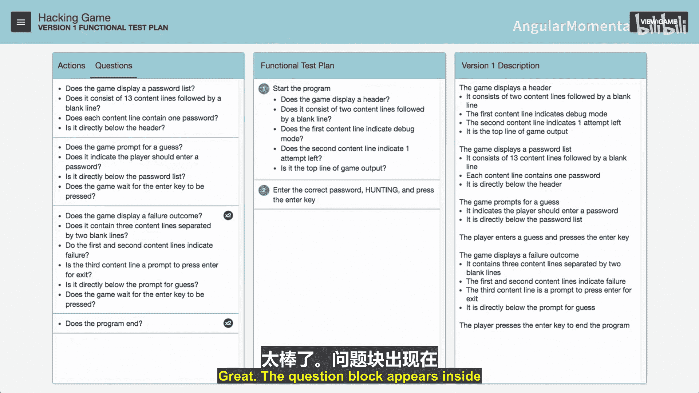
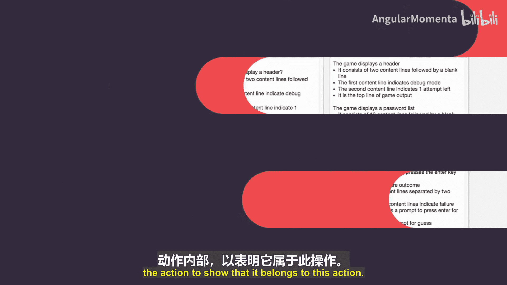
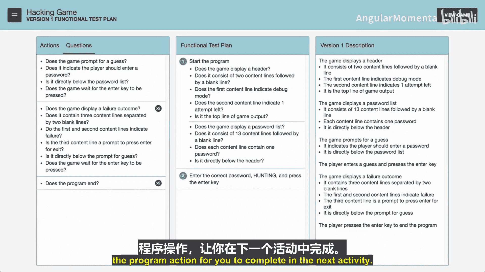
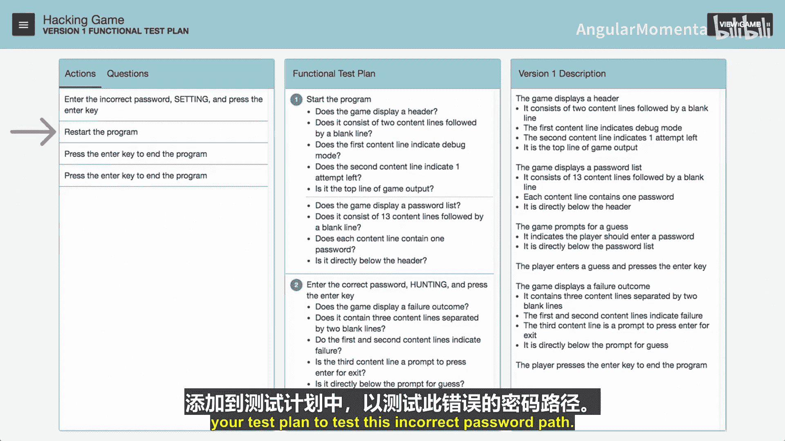
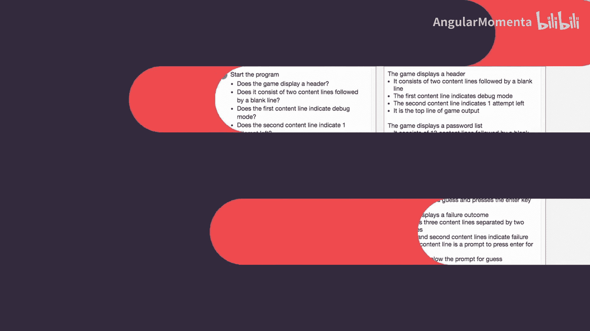

# 012：为黑客游戏版本1创建测试计划

## 概述

在本节课中，我们将学习如何为“黑客游戏”的第一个版本创建功能测试计划。测试计划是确保我们编写的程序行为符合预期的重要工具。我们将了解测试计划的结构、创建步骤以及它在游戏开发过程中的作用。

## 什么是测试计划？

上一节我们完成了游戏版本1的描述设计，本节中我们来看看如何为它创建测试计划。

一个测试计划是一组对程序执行的测试，目的是确保其表现符合预期。最初，我们的测试计划将只包含功能测试，非功能测试将在后续引入。

每个功能测试包含一个**动作**和一组**问题**。测试者手动执行动作，并使用这组问题来评估游戏对该动作的响应是否符合游戏描述中的规定。每个测试都以“是”或“否”的问题形式提出。所有答案都必须为“是”，程序才算完全正确。

我们测试游戏是为了确保我们创建的游戏与我们预期创建的游戏相匹配。

## 为何在编程前创建测试？

我们在编写程序之前创建测试，是为了在描述和代码之间提供一个额外的精确度层级。在编程前创建测试，迫使你在编码之前规划游戏的行为。

在工业界，在编写代码之前创建测试通常被称为**测试驱动开发**或**TDD**。然而，TDD通常使用一个测试程序来自动测试应用程序，而不是使用手动测试者动作。

问题细化原则建议我们逐步提高精确度，作为简化问题的有效方法。测试允许我们在需要编写逻辑代码之前，通过明确描述玩家可能采取的动作以及游戏应对每个动作的方式，将逻辑引入我们的设计中。

测试还能指出可能出错的地方。在开始编写代码之前了解这些信息非常有用，这样代码就可以处理这些潜在的出错情况。

## 测试计划的演进

每个版本都会修改前一个版本的测试计划。到最终版本时，你的测试计划将测试游戏的所有功能和大部分逻辑。

随着游戏复杂度的增加，对所有可能的玩家动作的所有组合进行完整测试变得不切实际。例如，考虑一个有八个任务、玩家可以按任意顺序完成的电子游戏。这会导致8的阶乘，即超过40,000种不同的游戏路径。为每一种任务完成顺序进行测试是不切实际的。

## 测试计划的好处

一个测试计划允许任何人快速发现游戏中的错误或缺失的功能，不需要具备程序的专业知识。事实上，在商业游戏中，负责测试的质量保证团队通常与编程团队不同。

由于我们的游戏并不复杂，你将能够为所有具有代表性的游戏路径创建测试。

## 功能测试计划构建器介绍

以下是功能测试计划构建器的使用指南。

构建器左上角是活动标题“黑客版本1功能测试计划”。与描述构建器类似，你可以按右侧的按钮查看游戏玩法视频。如果你想保存、加载或重启练习，可以使用左侧的菜单按钮。

构建器有三个面板：
*   **左侧面板**包含两个标签页：“动作”和“问题”。
*   **中间面板**是你通过添加动作和问题来创建功能测试计划的地方。
*   **右侧面板**包含当前版本的描述。

## 构建测试计划的步骤

以下是创建测试计划的具体步骤。

1.  **添加动作**：功能测试必须按照测试者应执行动作的顺序列出。这些动作必须构成一个或多个从开始到结束的完整游戏路径。在测试计划中定位动作就像在描述中定位对象和动作。第一个动作必须是“启动程序”。

2.  **添加问题块**：问题按对象分组，称为“问题块”。你将选择这些块，而不是单个问题。每个问题块必须属于它所测试的那个动作。例如，“游戏是否显示标题？”这个块测试的是“启动程序”这个动作的结果。

3.  **处理反馈**：构建器会提供反馈以确保计划有效。例如，不能将动作放在错误的时间顺序上，也不能将问题块放在动作之外。

## 测试不同游戏路径

测试计划与描述不同。测试要求多次运行游戏，以检查在所有可能游戏条件下的正确行为。

版本1的描述指出，在玩家输入猜测后，游戏会显示失败结果。无论玩家输入什么猜测，都会发生这种情况。因此，在这个版本中，正确和错误的密码都必须导致相同的失败行为。

因此，测试计划必须测试这两个动作，这需要我玩两次游戏。描述没有区分输入正确和错误的猜测。测试计划更精确，因为它明确测试了两个特定的游戏场景。

虽然在这个版本中有许多不同类型的错误猜测，但你只需要一个错误和一个正确的猜测来代表两种最常见的游戏路径。

## 关于重复项和额外测试的说明

以下是关于测试计划中重复项和额外测试点的说明。

注意，有些动作（如“按回车键结束程序”）和问题块是重复的。如果一个动作或问题块必须在测试计划中使用多次，它就会被复制。

然而，标题、密码列表或猜测提示的测试没有重复，即使你将测试程序两次。这是因为在玩家做出猜测之前，你不需要重新测试任何内容，因为在此之前游戏的行为方式总是相同的。

你必须重新测试失败结果和结束提示，因为输入错误的密码可能会影响该不同玩家动作之后的所有游戏过程。

通常，描述中的每个属性都会在测试计划中生成一个问题。此外，可能还有额外的问题来测试游戏玩法，但并不对应于某个特定属性。例如，“游戏提示进行猜测”有两个必须测试的属性。然而，还有一个额外的问题是“游戏是否等待按下回车键”。测试这种描述中没有属性代表的额外等待功能非常重要。

## 总结

本节课中我们一起学习了如何为“黑客游戏”版本1创建功能测试计划。我们了解了测试计划的目的、结构以及创建步骤。关键点包括：在编程前创建测试以增加精确度，测试计划需要覆盖不同的游戏路径（如正确和错误密码），以及如何处理重复的测试项和描述之外的额外功能点。在接下来的活动中，你将通过添加缺失的动作和问题来完成这个功能测试计划。