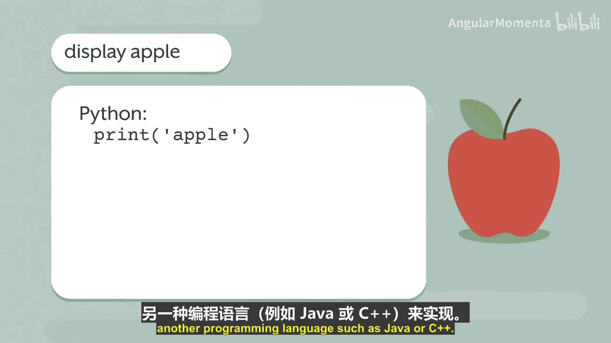
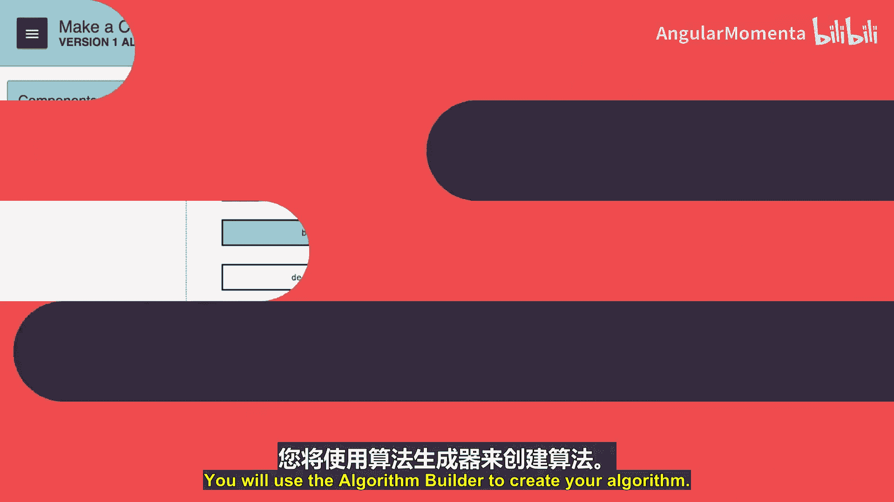
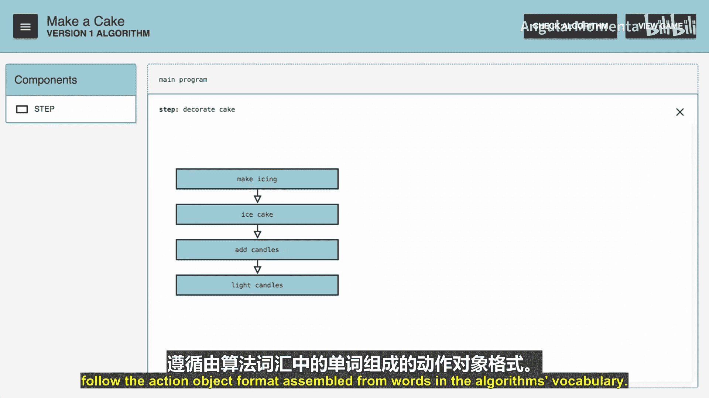
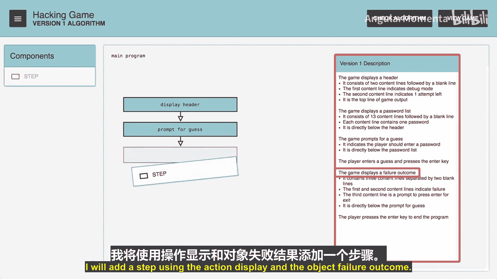
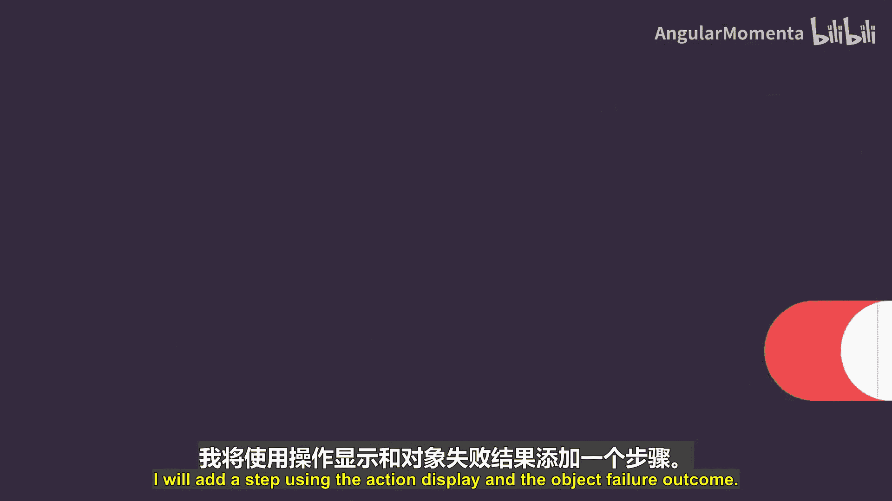
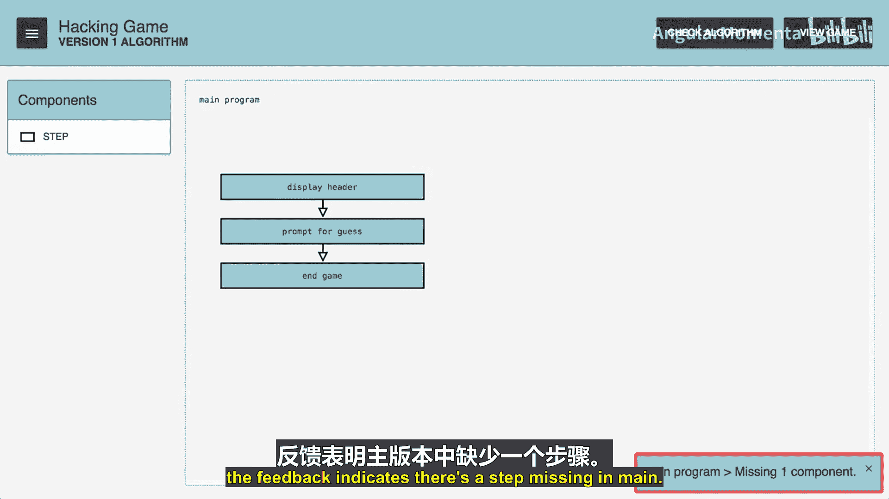

# 013：创建算法（黑客游戏版本1）

在本节课中，我们将学习如何为“黑客”游戏版本1创建算法。这是“创建设计”阶段的最后一个子任务。我们将了解算法的定义、特性，并使用算法构建器工具来构建一个具体的算法。

## 什么是算法？

上一节我们完成了版本测试计划，现在我们来创建算法。算法是解决问题的步骤序列。它比测试计划更精确，因为它定义了解决方案的逻辑。这种逻辑需要考虑到问题中可能出现的所有潜在情况，并规定如何处理它们。

算法是对测试计划的细化。由于我们的问题是创建游戏，因此每种情况都是玩家操作可能引发的一系列游戏事件。因此，算法步骤必须能适应所有这些游戏事件序列。

虽然算法比测试计划更精确，但它比代码的精确度低。它之所以不那么精确，是因为它比代码更易于人类阅读，并且忽略了不重要的细节。

例如，让我们为“吃苹果”这个任务创建一个不精确的步骤列表：
1.  **拿起苹果**。
2.  **吃苹果**。
3.  **丢弃果核**。

算法步骤按从第一到最后的顺序执行。这意味着算法步骤必须按照它们应该执行的顺序列出。算法使用**时间分解**将问题分解为多个步骤。存在一些机制允许算法选择性地跳过或重复某些步骤，你将在版本3中学习到第一个这样的机制。

顺序在算法中很重要，否则算法可能导致错误或无法解决问题。如果“吃苹果”和“丢弃果核”这两个步骤颠倒，算法就无法解决问题，因为你不能在丢弃苹果后再吃它。

在本课程中，所有算法都是**编程语言无关**的。这意味着你创建的算法是一个不依赖于特定编程语言的通用解决方案。你稍后将编写一个实现该算法的Python程序。同样的算法也可以用其他编程语言（如Java或C++）实现。

## 使用算法构建器

你将使用算法构建器来创建你的算法。这个工具与你目前见过的其他构建器不同，因为它基于连接各种图形形状，而不是排列文本行。

每个形状将包含一个算法步骤。步骤之间用箭头连接，以指示算法执行时的步骤顺序。当你编写程序时，算法中的每个步骤最终将转化为几行代码。

让我们通过一个示例算法来探索算法构建器。在左上角，你可以看到游戏标题和版本号：“制作蛋糕 版本1 算法”。

算法构建器有一个主面板，你将在其中创建对问题的完整但不精确的解决方案。

以下是制作蛋糕算法的步骤：
*   **制作面糊**
*   **烘烤蛋糕**
*   **装饰蛋糕**

主面板左侧的组件面板由各种形状组成，每种形状代表你可以添加到算法中的一种步骤类型。在后续版本中，你会看到其他形状，但目前面板中只有一个形状：一个标记为“步骤”的**矩形**。矩形代表一个或多个精确的程序语句序列。

矩形中的每个步骤由一个**动作**和一个**对象**组成。例如，“制作”、“烘烤”和“装饰”是动作；“面糊”和“蛋糕”是对象。当你添加一个步骤时，必须从词汇表中选择合适的动作和对象词来命名该步骤。

主算法已经完成。现在，我将通过添加细节来增加其中一个步骤的精确度。“装饰蛋糕”这个步骤的具体做法并不明确。

你可以通过单击其形状来查看和编辑主面板中某个步骤的细节。这将创建一个新面板，将单个步骤扩展为更精确的步骤。这些步骤也由连接的形状表示。例如，展开“装饰蛋糕”步骤后，会看到其详细步骤：**制作糖霜**、**涂抹糖霜**、**添加蜡烛**、**点燃蜡烛**。

所有这些步骤都使用额外的动作（涂抹、添加、点燃）和对象（糖霜、蜡烛），并遵循从算法词汇表中组装的“动作-对象”格式。

## 构建黑客游戏版本1的算法

我将清空算法构建器，开始构建黑客游戏版本1的算法。

版本1描述的第一句话是“游戏显示一个标题”，因此我将为此部分游戏创建一个算法步骤。

我将在主面板中添加一个步骤来完成此操作。我必须从提供的词汇表中选择一个动作和一个对象。词汇表包含你在版本1描述和测试计划中使用过的对象（如“游戏”、“猜测”）和动作（如“显示”、“提示输入”）。你应该参考你的描述，为每个矩形从词汇表中选择合适的动作和对象。

我将从动作列表中选择“显示”，从对象列表中选择“标题”，然后单击“添加步骤”按钮来完成此步骤。描述中包含许多关于标题的细节，这些细节将在代码中体现，但不会包含在算法中。对象的大多数属性在算法中不予描述。

描述中的下一个对象是密码列表。你将在下一个活动中添加一个步骤来显示密码列表。

描述接着指出游戏会提示输入猜测，因此我将为提示添加一个步骤。我将选择动作“提示输入”和对象“猜测”。

你可以随时按下“检查算法”按钮来检查你的算法是否正确和完整。反馈信息表明主程序缺少两个组件。你已经知道必须添加一个显示密码的步骤，所以还有一个步骤缺失。

描述中的下一个动作是“玩家输入猜测并按回车键”。这个动作不会成为算法步骤，因为算法无法规定玩家的操作。有些算法步骤是对玩家操作的响应，但没有哪个算法步骤会转化为迫使玩家采取行动的代码。

因此，最后一个算法步骤应该显示失败结果。我将使用动作“显示”和对象“失败结果”来添加一个步骤。

## 完善算法步骤

除了显示密码列表的步骤外，算法应该已经完成。然而，“显示失败结果”这个步骤有两个重要部分：显示结果和提示玩家结束程序。

我将展开“显示失败结果”步骤并添加这两个步骤：**显示失败结果**和**提示结束**。但是，如果我在主面板中使用相同的名称来表示通用的“显示失败结果”步骤和它内部包含的更具体的“显示失败结果”步骤，将会导致错误。

为了避免这个错误，我将重命名其中一个步骤。一般来说，不要对执行不同操作的两个步骤使用相同的名称。在主面板中，我将删除“显示失败结果”步骤，并用一个名为“结束游戏”的新步骤替换它。删除一个步骤也会删除其面板内的所有步骤。“结束游戏”是一个很好的通用名称，因为显示结果和提示结束都是结束游戏的一部分。

一般来说，正确分解算法的方法有很多种。例如，可以将“显示失败结果”和“提示结束”都从“结束游戏”面板移到主面板，并保持正确的步骤顺序。然而，最好将这两个步骤保留在“结束游戏”面板中。随着算法规模变大，如果每个面板只包含少量步骤，算法将更容易理解。分解的目的就是将每个任务分解为少量可管理的子任务，而这正是算法面板允许你做的事情。如果我们不使用面板，黑客游戏最终版本的算法可能会看起来非常庞大和复杂。

由于分解问题的方法有很多，你制作的每个算法只是众多可能正确算法中的一种。在本课程中，算法构建器将引导你为每个版本找到一个特定的算法。你可能需要进行实验才能发现每个版本的具体算法，算法构建器的反馈将引导你走向这个特定的算法。

现在轮到你了。你必须通过添加缺失的步骤来修复当前算法中的错误。你还必须展开“结束游戏”步骤，并添加结束游戏所需的那两个步骤。

完成此活动后，在将算法转化为Python代码之前，你将完成几个关于Python的课程。

## 总结

本节课中，我们一起学习了算法的概念，它是一种解决问题的精确步骤序列。我们了解了算法比测试计划更精确但比代码更抽象的特性，并掌握了使用算法构建器为“黑客”游戏版本1创建具体算法的过程。我们学会了如何通过“动作-对象”格式定义步骤，以及如何通过分解和细化步骤来构建完整的算法逻辑。