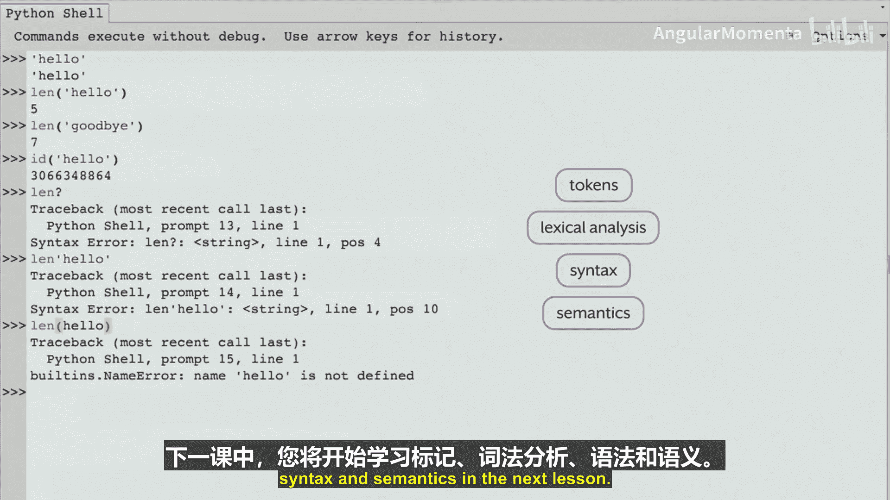

# 014：Python表达式求值示例 🐍

在本节课中，我们将学习如何评估两种简单的Python表达式：字面量字符串和函数调用。我们将通过Python交互式环境来观察表达式的求值过程，并理解在此过程中可能出现的不同错误类型。

## 表达式求值过程

上一节我们了解了Python的基本概念，本节中我们来看看Python解释器如何处理我们输入的代码。

我将在Python交互式环境中输入一些Python表达式并观察结果。

第一个表达式是 `‘hello’`。我输入后按回车键，Python解释器显示了我输入的相同字符。

第二个表达式是 `len(‘hello’)`。这次，解释器显示了数字 `5`。Python进行了一次计算。

以下是这两个过程中实际发生的情况：
*   在每种情况下，我输入了一个简单的Python表达式。
*   Python解释器对表达式进行求值，得到一个结果对象。
*   解释器在交互式环境中以人类可读的形式显示这个结果对象。
*   随后，解释器在下一行显示 `>>>` 提示符，表示它已准备好评估下一个Python表达式。

## 字面量字符串

表达式 `‘hello’` 被称为**字面量字符串**。字面量字符串可以用单引号或双引号括起来。在本课程中，为简洁起见，我们使用单引号。我们所说的“引号”即指单引号。

## 函数调用

表达式 `len(‘hello’)` 在计算机科学中被称为**函数调用**。

一个函数就像一台有输入和输出的机器。`len` 函数有一个输入（或称为参数）对象，并产生一个输出（或称为结果）对象。它的参数是一个字符串对象，结果是一个整数对象，表示该字符串中有多少个字符。

可以类比在汽车餐厅点餐：输入是你的口头订单，输出是你收到的餐食。

数学中也使用函数，例如平方函数和平方根函数。3的平方是9，4的平方根是2。

我之前使用的 `len` 函数是一个内置函数，`len` 是 `length`（长度）的缩写。字面量字符串 `‘hello’` 被用作函数的参数。`len` 函数计算其参数对象中的元素数量。由于 `‘hello’` 有五个字符，`len` 计算出了 `5`。

## 探索内置函数

你如何知道内置函数 `len` 的作用？还有哪些其他内置函数可以使用？

Python的官方文档位于Python官网上。Python有一个包含内置函数的**标准库**，标准库文档描述了有哪些内置函数可用以及这些函数的功能。

以下是关于 `len` 函数的说明：
*   `len` 函数返回一个对象的长度（项目的数量）。
*   参数可以是序列（如字符串、字节、元组、列表或范围）或集合（如字典、集合或冻结集合）。
*   到目前为止，你见过的唯一序列类型是字符串。

我将 `len` 函数应用于另一个字面量字符串 `‘goodbye’`。按回车后，出现了整数 `7`。这是合理的，因为字符串 `‘goodbye’` 中有7个元素。

通过类比，如果你在同一家餐厅点不同的餐，你会收到不同的食物。输出取决于输入。此外，如果你在不同的餐厅点相同的餐，你也会收到不同的食物。输出不仅取决于输入，还取决于函数本身。

例如，当你对相同的输入对象 `‘hello’` 应用另一个内置函数 `id` 时，你会得到一个不同的结果对象。`id` 函数的含义将在后面讨论。这里的重点是，不同的函数会产生不同的结果。

## 错误类型分析

Python能识别你输入的每一个字符序列吗？

我输入 `len?` 并按回车求值。Python交互式环境报告了一个语法错误。Python识别 `len` 为一个有效的**词法单元**，但 `?` 不属于任何有效的Python词法单元。这实际上被称为**词法错误**，但这个Python解释器将所有词法错误都报告为语法错误。词法单元、词法错误和语法错误将在未来的课程中解释。

为什么需要括号？如果我漏掉括号，输入 `len ‘’` 会发生什么？虽然这个表达式包含两个有效的Python词法单元，但它们没有构成一个有效的Python表达式。要理解这个错误发生的原因，你必须理解Python的**语法**。在定义Python语法之前，看更多例子是有用的。

为什么 `‘hello’` 有引号而 `len` 没有？回想一下，`‘hello’` 被称为**字面量字符串**，而没有引号的 `len` 被称为**标识符**或**名称**。

我把括号加回来，但通过去掉引号将 `hello` 从字面量字符串改为标识符。这次，Python交互式环境报告了一个**名称错误**，这是一种**语义错误**。这个错误表明名称 `hello` 没有被定义。要理解这个错误发生的原因，你必须理解Python的**语义**。

## 课程总结

本节课中我们一起学习了：
*   你刚刚看到了一些成功的Python求值示例和三种不同类型的错误：词法错误、语法错误和语义错误。
*   识别这三种错误非常重要，因为修复每种错误的方法是不同的。
*   你将在下一课开始学习关于词法单元、词法分析、语法和语义的知识。

