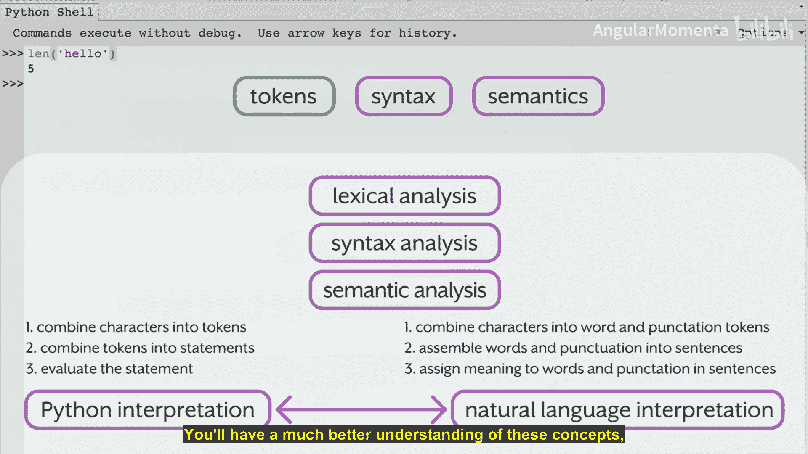

# 015：Python解释过程


## 概述
在本节课中，我们将要学习Python解释器评估代码时所采用的三步解释过程。这个过程包括词法分析、语法分析和语义分析，是理解Python如何“读懂”并执行代码的基础。

## Python解释过程简介
Python程序由语句构成。最简单的语句是表达式语句，它在一行中包含一个或多个表达式。例如，`len("hello")` 就是一个包含单个表达式 `len("hello")` 的表达式语句。

当你在Python交互式环境中输入一串字符并按回车键后，Python解释器会尝试将这串字符解释为一行Python语句。那么，解释器具体使用什么过程来将字符序列解释为Python语句呢？

## 自然语言与编程语言的类比
Python使用的过程与自然语言（如英语、法语、普通话）的处理过程类似。

在自然语言中，文本被划分为基本单元，如单词和标点符号。这些单元被组合成称为句子的句法结构。然后，意义被赋予句子中的单词和标点。

Python解释过程也遵循类似的步骤，以确保代码能被正确理解和执行。

## 第一步：词法分析
上一节我们介绍了Python解释过程与自然语言的类比，本节中我们来看看第一步——词法分析。

在这一步中，字符序列被翻译成一系列称为“词法单元”的基本单元。当你用语言思考、阅读、书写或说话时，你使用的是像“Mary”这样的词法单元，而不是像“M”、“a”、“r”、“y”这样的单个字符。

在Python中，解释器将字符组合成词法单元。词法单元的定义是：**一个具有基本语言单元意义的字符序列**。

在自然语言中，有两种词法单元：一种是像“Mary”、“is”、“I”这样的单词；另一种是像问号和逗号这样的标点符号。

编程语言也有多种词法单元。Python有五种不同的词法单元：
*   **分隔符**：在编程语言中类似于自然语言的标点。例如，左括号 `(` 和右括号 `)` 就是Python中的分隔符词法单元。
*   **字面量**
*   **标识符**
*   **运算符**
*   **关键字**

字面量和标识符在编程语言中类似于自然语言中的不同词性。名词指代特定对象，如“Alberta”。编程语言中的**字面量字符串**类似于名词，因为它也指代特定对象，如 `"hello"`。代词在不同时间指代不同的人，例如“I”在我（Dwayne）指代自己时指代我，在另一个人（Elise）指代自己时指代她。编程语言中的**标识符**类似于代词，因为你将发现同一个标识符可以在程序的不同部分指代不同的对象。例如，在表达式 `len("hello")` 中，标识符 `len` 指代长度函数对象；然而，在程序的其他地方，也可以使用相同的标识符 `len` 来指代一个不同的对象。

如果在自然语言中使用了无效的词法单元会怎样？例如，字符序列“its snus”如何被解释？在自然语言中，列出所有有效单词词法单元的表格称为字典。如果一个字符序列不在字典中，它就不能构成有效的词法单元，因此会导致词法错误。“its”是一个有效的英语单词词法单元，但“snus”不在英语字典中，所以它会导致词法错误，即一个无效的词法单元。

类似地，如果编程语言解释器在从字符创建词法单元时遇到错误，这被称为词法错误。然而，Python解释器将词法错误报告为一种语法错误。

还记得我输入字符序列 `len?` 时发生了什么吗？问号 `?` 不是一个有效的Python词法单元，就像“snus”不是一个有效的英语单词一样。

如果我输入字符序列 `"hello`（开头有引号，但结尾没有），Python解释器会报告一个语法错误，这实际上是一个词法错误，因为 `"hello` 没有结束引号，不是一个有效的字面量字符串词法单元。

## 第二步：语法分析
在成功将字符转换为词法单元之后，解释过程进入第二步——语法分析。

在这一步中，词法单元被组合成英语句子或Python语句。适用于自然语言和编程语言的语法定义是：**语法定义了句子和语句的格式或结构**。

人们如何将自然语言词法单元（单词和标点）组合成语法正确的句子？自然语言使用语法。考虑一个非常小的英语子集，它包含一个标点符号（问号）和六个单词：动词“was”和“is”，名词“Mary”和“school”，以及疑问副词“when”和“how”。

语法图定义了一种语法，它表示自然语言句子的有效格式。例如，以下是我们这个小型英语子集中称为“疑问句”的句子的语法图。

```
[疑问副词] -> [动词] -> [名词] -> [?]
```

你可以使用这个图来检查一个词法单元序列是否构成语法上有效的疑问句。一个词法单元序列在语法上是有效的，条件是它恰好有四个词法单元，并且按顺序匹配图中的四个状态。

这个词法单元序列是否构成语法上有效的疑问句？`How is Mary?`
这个词法单元序列有四个词法单元。词法单元“How”是副词，匹配副词状态。词法单元“is”是动词，匹配动词状态。词法单元“Mary”匹配名词状态。词法单元“?”匹配问号状态。由于没有更多词法单元，这个词法单元序列是一个语法上有效的疑问句。

这个词法单元序列 `When Mary was?` 在语法上是无效的。它以副词“When”开始，这匹配语法图的第一个状态。下一个词法单元是名词“Mary”，它不匹配动词状态。这种不匹配在我们的小型英语子集中是一个语法错误。

类似地，如果Python解释器在将词法单元组合成语句时遇到错误，它会报告一个语法错误。回想一下，Python成功评估了 `len("hello")`（括号和引号都包含在内）。然而，当括号被省略时，就发生了语法错误。虽然这个表达式有两个有效的词法单元 `len` 和 `"hello"`，但不存在一个Python语法图包含这两个按顺序排列的词法单元种类（标识符和字面量）作为一个有效的表达式。

## 第三步：语义分析
一个词法单元序列可能具有有效的语法，但仍然没有意义。例如，词法单元序列 `When is Mary?` 在我们简单的英语语法中是语法上有效的。它由副词“when”后跟动词“is”，再后跟名词“Mary”，并以问号结束。虽然这个句子语法有效，但其含义或语义是无效的。为了有用，自然语言句子和Python语句除了语法有效外，还必须在语义上有效。

这就引出了解释过程的第三步——语义分析，解释器在此步骤中为语法上有效的句子和语句赋予意义。

语义定义了句子和语句的含义。人们如何为自然语言句子赋予意义？你可以使用字典来解释语法正确句子中单个单词的含义。许多单词可以用作不同的词性，并且大多数有多个含义。因此，一个单词在句子中的含义在很大程度上取决于上下文。例如，单词“school”至少可以作为名词有两种不同的含义：“学校”或“鱼群”。它也可以作为动词使用，如“I can school my brother.”。

这种上下文依赖性意味着，没有一套简单的语义规则可以描述所有语法上有效的自然语言句子的含义。

在编程语言中，词法单元的上下文依赖性较低；一套简单的语义规则可以定义所有语法正确语句的含义。为了实现这一点，编程语言的语法和语义规则必须非常精确。这意味着必须非常小心地正确表达Python语句。例如，在Python中，你可以写 `len("hello")`，但不能写 `len(hello)`（未加引号的hello）或 `"hello".len`。英语的结构性较弱，你可以说“the length of a string”或“the string's length”，它们具有相同的含义。

如果在语义分析阶段没有错误，Python解释器会成功计算出一个对象作为表达式求值的结果。如果表达式是在交互式环境中求值的，那么Python解释器通常会以人类可读的形式在交互式环境中显示其结果对象。



## 总结
本节课中我们一起学习了Python解释器评估代码的三步过程：**词法分析**、**语法分析**和**语义分析**。Python使用这个过程通过计算结果对象来评估表达式。为了理解解释器如何计算这些结果对象，你必须学习更多关于Python词法单元、语法和语义的知识。在观看后续视频后，你将对这三个概念有更深入的理解。