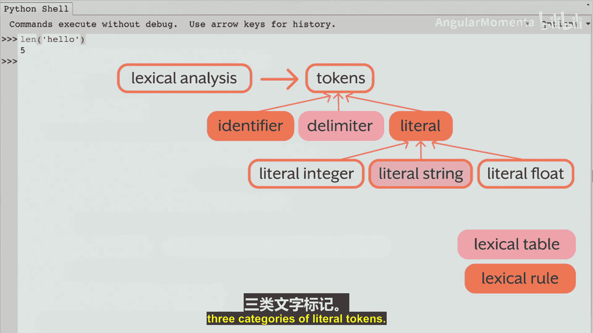

# 016：词法分析详解 🧩

在本节课中，我们将要学习Python解释器执行代码的第一步：词法分析。我们将了解词法分析器如何将源代码中的字符组合成称为“词法单元”的基本单位，并详细探讨标识符、分隔符和字面量这三种词法单元。

## 概述

词法分析是Python解释器处理代码的三步流程（词法分析、语法分析、语义分析）中的第一步。它的核心任务是将字符序列转换为有意义的词法单元序列。

## 词法分析过程

回忆一下，Python解释器使用三步流程：词法分析、语法分析和语义分析。词法分析步骤是如何将字符组合成称为词法单元的基本单位的？

之前，我们评估了表达式 `len(“hello”)`。这个表达式包含四个词法单元：`len`、左括号、`“hello”` 和右括号。Python解释器是如何执行这个词法分析的呢？

一个词法单元由一个或多个字符构成，其中每个字符可以是字母、数字、符号、特殊字符或空白字符。空白字符包括空格、制表符或换页符。

## Python词法单元的种类

回忆一下，Python有五种不同的词法单元：标识符词法单元、分隔符词法单元、字面量词法单元、运算符词法单元和关键字词法单元。

每种词法单元要么由简化的词法规则描述，要么由词法表定义。

Python从左到右将字符翻译成词法单元。

## 标识符词法单元

第一个词法单元是 `len`，一个标识符词法单元。标识符是我们在Python代码中用来引用内存中对象的名称。`len` 引用了一个计算序列（如字符串）长度的函数对象。

Python使用简化的词法规则来识别标识符词法单元：

**规则**：以字母或下划线开头，后跟零个或多个字母、下划线或数字。

标识符区分大小写，因此大写的 `R2D2` 与小写的 `r2d2` 是不同的标识符。

## 分隔符词法单元

第二个词法单元是左括号 `(`，一个分隔符词法单元。分隔符用于分隔其他词法单元，就像自然语言中使用标点符号一样。

我们使用词法表来定义Python的分隔符词法单元。每个分隔符由一个、两个或三个符号字符组成。有些分隔符，如逗号和星号等号，单独出现。其他分隔符成对出现，例如左括号和右括号，它们出现在 `len(“hello”)` 表达式中。

## 字面量词法单元

第三个词法单元是 `“hello”`。这是一个字面量词法单元。

字面量词法单元有几个类别，而 `“hello”` 属于字面量字符串类别。

字面量字符串的简化规则是：

**规则**：以引号开头，后跟零个或多个非引号字符，并以引号结尾。

另一个字面量类别是字面量浮点数，它表示非负有理数。字面量浮点数最简单的规则是：一个点、一个或多个数字，没有其他字符。

第三个字面量类别是字面量整数，它表示非负整数。字面量整数的简化规则是一个或多个数字。

例如，`27` 和 `0` 是字面量整数，而 `4.5`、`0.0` 和 `0.3` 是字面量浮点数。然而，`-5` 和 `“2.3”` 不是字面量整数或字面量浮点数，因为 `-5` 有减号，`“2.3”` 有引号。实际上，`“2.3”` 是一个有效的字面量字符串。您稍后会了解到，`-5` 实际上由两个词法单元组成：减号运算符和字面量整数 `5`。Python必须评估这两个词法单元才能创建一个值为负5的int对象。

## 最长词法单元规则

为什么Python创建单个词法单元 `27` 而不是创建两个词法单元 `2` 和 `7`？两种选择都满足字面量整数的词法规则。

词法分析器使用最长词法单元规则：在创建词法单元时，创建尽可能长的词法单元。

因此，在创建 `2` 或 `27` 之间选择时，词法分析器创建更长的词法单元 `27`。

给定字符序列 `4.5`，Python解释器使用最长词法单元规则创建单个浮点词法单元 `4.5`，而不是创建字面量整数 `4` 后跟字面量浮点数 `.5`，或者创建字面量浮点数 `4.` 后跟字面量整数 `5`。

类似地，字符序列 `last_chance` 将被解释为单个标识符词法单元 `last_chance`，而不是两个标识符词法单元 `last` 和 `chance`。

## 空白字符规则

除了最长词法单元规则，词法分析还有空白字符规则。

对于不在行首的空白字符：如果空白字符在字面量字符串内部，则它是字面量字符串的一部分。否则，它结束当前词法单元，并且不为它创建词法单元。

行首的空白字符具有特殊含义，我们将在未来的课程中讨论。

## 字面量字符串的作用

字面量字符串是我们在Python代码中用来引用表示字符序列的内存对象的词法单元。

Python使用引号字符来区分字面量字符串词法单元和标识符。词法单元 `len` 是标识符，而词法单元 `“hello”` 是字面量字符串。

在表达式 `len(“hello”)` 中，标识符 `len` 被绑定到一个计算字符串 `“hello”` 长度（为5）的函数对象。

## 使用错误的词法单元类型

使用有效但类型错误的词法单元可能导致语法错误或语义错误。

例如，如果我在这个表达式中使用字面量字符串 `“len”` 而不是标识符 `len`，会发生什么？

这个表达式包含四个有效词法单元，因此没有词法错误。Python报告一个类型错误，这是一种语义错误。错误消息表明Python期望一个函数对象作为函数调用的一部分，但遇到了一个字符串对象。

## 回到示例表达式

现在让我们回到表达式 `len(“hello”)`。这个表达式中的第四个也是最后一个Python词法单元也是一个分隔符词法单元：右括号 `)`。

因此，这个Python表达式由标识符 `len`、分隔符左括号 `(`、字面量字符串 `“hello”` 和分隔符右括号 `)` 组成，共四个有效词法单元。

## 总结

在本视频中，我们使用词法表定义了分隔符词法单元。我们还使用简单的词法规则描述了标识符词法单元以及三种字面量词法单元类别：字面量字符串、字面量整数和字面量浮点数。