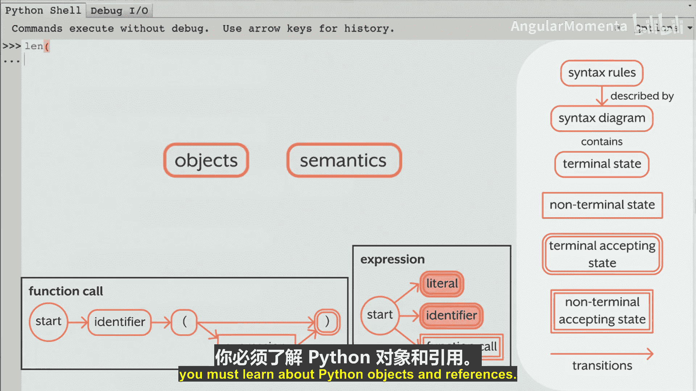

# 017：Python语法分析

在本节课中，我们将学习Python编程语言的基本语法结构，包括字面量表达式、标识符和函数调用表达式。我们将使用语法图来理解Python解释器如何识别有效的代码结构。

## 概述

Python程序由语句构成。在词法分析课程中我们了解到，Python解释器首先通过词法分析过程将代码分解为称为“词法单元”的基本单位。语法规定了每个语句的格式，而语句的格式则指定了该语句中词法单元的顺序。我们使用语法图来定义语句中包含哪些词法单元以及它们的顺序。

## Python语句与表达式

Python有多种语句。表达式语句在一行中包含一个或多个表达式。在本课中，我们只考虑由单个表达式构成的表达式语句。

表达式也有很多种。我们将探讨三种：字面量、标识符和函数调用。

## 语法图简介

Python解释器使用规则来识别有效的语法。我们使用语法图来描述这些规则。一个语法图包含状态和转换。

以下是包含字面量、标识符和函数调用的表达式的语法图：
*   起始状态绘制为一个圆圈。
*   终止状态代表来自一组词法单元（例如所有分隔符词法单元集合中的一个分隔符词法单元）的单个词法单元。终止状态绘制为圆角矩形，并匹配一个词法单元。
*   字面量是一个终止状态，代表来自任何字面量类别（包括字符串、整数和浮点数）的一个词法单元。
*   标识符也是一个代表一个标识符词法单元的终止状态。
*   不代表来自一组词法单元的单个词法单元的状态称为非终止状态。它绘制为矩形，必须使用其自己的语法图进行展开。函数调用就是一个非终止状态。
*   具有双边框的状态称为接受状态。字面量、标识符和函数调用都是接受状态，稍后将进行解释。
*   箭头称为转换，通过连接状态形成图中的路径。

## 验证表达式语法

要验证表达式的语法，必须找到一条从起始状态到接受状态的路径，该路径按顺序匹配所有词法单元。接受状态是语法图中任何可用于匹配你试图匹配的词法单元序列中最后一个词法单元的状态。

### 示例：字面量表达式

我们之前评估过字面量字符串表达式 `"hello"`。这个表达式包含一个词法单元：字面量字符串 `hello`。

这个单一词法单元序列是否构成有效表达式？从起始状态开始，有三个转换。第一个转换指向字面量终止状态。由于 `"hello"` 是一个字面量词法单元，可以将其匹配到终止的字面量状态。该词法单元序列匹配具有双边框的终止字面量接受状态。因此，`"hello"` 是一个有效的表达式。

### 示例：无效的单一词法单元

是否每个Python词法单元本身都能形成一个有效的表达式？让我们尝试标识符 `len`，它是一个有效的词法单元。`len` 求值后得到一个对象，其人类可读输出是 `built-in function len`。

现在尝试一个右括号 `)`，它也是一个有效的词法单元。不，这个单一词法单元不是一个有效的表达式。

为什么？从起始状态开始，有三个转换。前两个转换指向不匹配分隔符词法单元的终止字面量和标识符状态。第三个转换指向一个非终止状态。请记住，每个状态要么是匹配单个词法单元的终止状态，要么是必须使用其自己的语法图展开而不是匹配单个词法单元的非终止状态。

以下是函数调用的简化语法图，它要么有一个参数（表达式），要么没有参数。从其起始状态开始，只有一个转换，它指向终止标识符状态。由于分隔符词法单元不是标识符词法单元，因此不匹配。由于没有更多路径可尝试，单个分隔符不是有效的Python表达式。

### 示例：函数调用表达式

在词法分析课程中，你看到函数调用表达式 `len("hello")` 求值结果为 `5`。这个表达式包含四个词法单元：标识符 `len`、分隔符左括号 `(`、字面量字符串 `hello` 和分隔符右括号 `)`。

如何匹配 `len("hello")` 到语法图？从表达式的起始状态开始。起始状态有三个转换：字面量、标识符和函数调用。由于第一个词法单元 `len` 是一个标识符，它不匹配到字面量终止状态的转换，因此不能使用那条路径。

第二条转换指向标识符终止状态。然而，该状态没有向外的转换，并且还有词法单元需要匹配。如果它是一个非终止状态，可以展开它以匹配更多词法单元。然而，它是一个终止状态，因此只能匹配一个词法单元而不能展开它。尝试另一条路径。

第三条转换指向函数调用非终止状态，因此必须展开它。遵循函数调用图起始状态的单一转换，将词法单元 `len` 匹配到终止标识符状态。由于只有一个转换离开标识符状态，尝试遵循它。下一个词法单元左括号 `(` 匹配左括号状态。到目前为止一切顺利。

下一个词法单元是字符串字面量 `"hello"`。这个词法单元不匹配右括号状态。因此不遵循这个转换。相反，遵循指向表达式非终止状态的转换。使用表达式语法图展开这个状态。

表达式的定义是递归的，因为表达式可以是函数调用，而函数调用本身包含表达式。表达式起始状态有三个转换：一个指向字面量终止状态，一个指向标识符终止状态，一个指向函数调用非终止状态。这次，如果遵循指向字面量状态的转换，它会匹配第三个词法单元，即字面量字符串 `hello`。仍然有词法单元剩余，并且没有离开此状态以匹配剩余词法单元的转换。现在该怎么办？

回想一下是如何到达这里的：正在尝试匹配函数调用语法图中的表达式非终止状态。由于处于表达式图中的接受状态，已成功匹配了一个表达式，因此可以返回到函数调用图中的路径。下一个转换将右括号词法单元与右括号终止状态匹配。成功，因为已经匹配了所有四个词法单元，并且右括号是一个接受状态。因此，原始表达式 `len("hello")` 在语法上是有效的。

## 识别语法错误

记住 `Eval` 示例视频中，计算 `len "hello"`（没有括号）导致了语法错误。Python解释器是如何检测到这个语法错误的？

解释器从表达式的起始状态开始，尝试找到任何有效路径。由于第一个词法单元 `len` 是一个标识符，它不匹配从起始状态到字面量的转换。已经看到 `len` 匹配标识符状态，但是还有剩余的词法单元需要匹配，而没有转换可遵循。因此，解释器尝试匹配函数调用状态。

函数调用的语法图有一个从起始状态到标识符状态的单一转换，它匹配 `len` 词法单元。然而，离开标识符状态的唯一转换是到左括号状态，它不匹配 `"hello"` 字面量字符串词法单元。因此，在语法图中没有路径匹配词法单元序列 `len` 后跟 `"hello"`。所以这个词法单元序列不是一个有效的表达式。

让我们再尝试一个词法单元序列：`len` 后跟一个左括号 `(`。解释器从表达式的起始状态开始，尝试找到任何有效路径。如前所述，`len` 后跟 `(` 不匹配字面量或标识符，但匹配函数调用的前两个状态。没有更多词法单元了，并且当前状态不是接受状态，因此这条路径无效。由于解释器在所有路径上都失败了，这个词法单元序列作为表达式是无效的。

注意，在这种情况下不会立即报告错误。在某些情况下，解释器会识别语法图中的当前进度并等待更多词法单元。然而，如果没有提供其他词法单元，它就是一个语法错误。

## 总结

在本节课中，我们一起学习了如何使用语法图来识别有效的Python字面量、标识符和函数调用表达式的格式。我们的下一步是研究Python语义。然而，在此之前，你必须学习Python对象和引用。