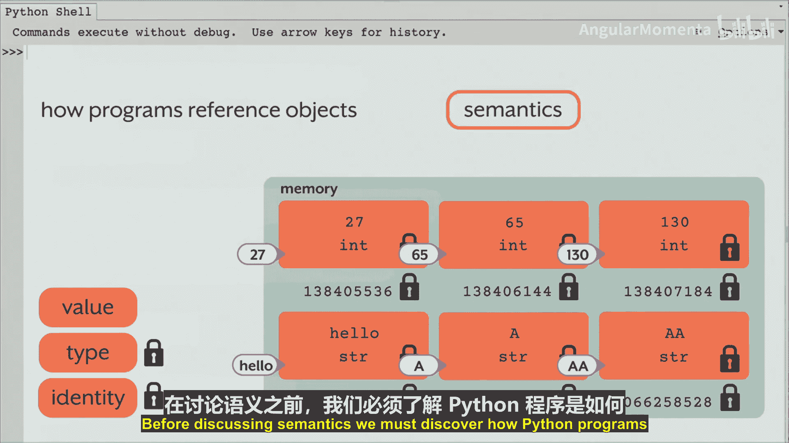

# 018：Python对象


## 概述
在本节课中，我们将学习Python编程语言中一个核心概念：对象。我们将了解Python解释器如何在计算机内存中创建对象来表示数据，并详细探讨每个对象所具备的三个基本属性：身份、类型和值。理解这些概念是掌握Python编程的基础。

## 对象的三个属性
Python解释器在内存中创建对象来表示程序中的数据。每个对象都拥有三个不可分割的属性：身份、类型和值。

### 身份：对象的唯一标识
对象的身份在对象创建时被确定。一旦创建，其身份就是唯一且不可变的，这意味着它不能被更改。我们可以将对象的身份理解为它在计算机内存中的位置。

我们可以通过内置的 `id()` 函数来获取对象的身份。例如：

```python
id(27)
```

执行上述代码会返回一个代表对象身份的整数。需要注意的是，这个身份标识在不同的Python解释器会话中可能不同。

以下是Python标准库中关于 `id()` 函数的文档说明：
> 返回对象的身份。这是一个整数，保证在该对象的生命周期内是唯一且恒定的。

### 类型：对象的格式与解释
对象的类型决定了它在内存中的格式（或形状），以及在计算过程中如何被解释。每种类型都定义了一种内存格式，不同的格式可能需要不同大小的计算机内存。

一旦我们创建了一个特定类型的对象，其类型就是不可变的。我们不能改变它的类型，因为改变其形状会破坏内存中相邻的对象。

为了简化理解，在后续的图示中，我们将对所有类型的对象使用相同的表示方式，尽管实际上不同类型在内存中的大小和形状各不相同。

Python中有许多内置类型，本节我们重点介绍两种基本类型：
*   **整数**：类型名为 `int`，用于表示整数，支持加法和乘法等运算。
*   **字符串**：类型名为 `str`，用于表示字符序列，Python提供了计算字符串长度、连接两个字符串等操作。

我们可以通过内置的 `type()` 函数来获取对象的类型。

以下是Python标准库中关于 `type()` 函数的文档说明：
> 传入一个参数时，返回该对象的类型。

例如：
```python
type(65)    # 显示 <class 'int'>
type('A')   # 显示 <class 'str'>
```

在Python中，“类型”和“类”这两个术语可以互换使用。因此，`type()` 函数告诉我们 `65` 的类型是 `int`，而字符串 `'A'` 的类型是 `str`。

### 值：对象的二进制表示
现代计算机使用二进制数字（简称“位”）来存储所有数据。每个位要么是0，要么是1。对象的值就是用于表示它的位序列。

例如，整数 `65` 有其对应的二进制表示。由于整数 `65` 和 `27` 的值不同，它们必须有不同的二进制表示。

既然不同的值有不同的二进制序列，为什么我们还需要类型呢？这是因为对象的类型定义了如何解释这些二进制数字。

例如，在许多编程语言中，整数 `65` 和字符 `'A'` 可能使用相同的二进制序列来表示它们的值。对象的类型决定了这两个对象将如何被解释：一个作为整数，一个作为字符串。

请看以下示例：
```python
65 + 65            # 结果为 130 (整数加法)
'A' + 'A'          # 结果为 'AA' (字符串连接)
```

尽管初始对象的二进制序列可能相同，但由于类型不同，运算产生的二进制值也完全不同。

## Python对象的特性与图示约定
每个对象都拥有一个不可变的身份和类型，以及一个由位序列表示的值。

在示意图中，为了清晰起见，我们使用16位的序列来表示整数和字符串。但实际上，Python并不使用固定长度的二进制序列来表示这些类型。

许多其他编程语言（如C、Java）使用固定位数（如32位或64位）来表示整数，这限制了整数的最大范围。Python的 `int` 类型则没有这种限制，它可以表示任意大的整数。

例如，宇宙中的原子数量大约在10^78到10^82之间，这个巨大的数字在Python中可以直接用一个 `int` 类型的对象来表示。

用于对象值的内存表示的具体位序列因Python的不同实现而异。因此，Python标准库中没有内置的 `value()` 函数来显示对象的位表示。

幸运的是，我们编写Python程序时通常不需要了解Python类型的内存表示细节，因为Python解释器会自动在内存表示和人类可读的格式之间进行转换。

因此，在我们的示意图中，为了更易于理解，我们将使用更人性化的格式来表示对象的值，而不是使用位序列。具体来说，对于 `int` 类型，我们用十进制数字代替二进制数字；对于 `str` 类型，我们用不加引号的字符序列来表示。



## 总结
本节课我们一起学习了Python中对象的核心概念。我们了解到，内存中的每个对象都包含身份、类型和值这三个属性。我们认识了两种基本类型：`int`（整数）和 `str`（字符串），并将在后续课程中遇到更多类型。在讨论对象的行为（语义）之前，我们还需要探索Python程序如何引用这些对象，这将是下一节的内容。