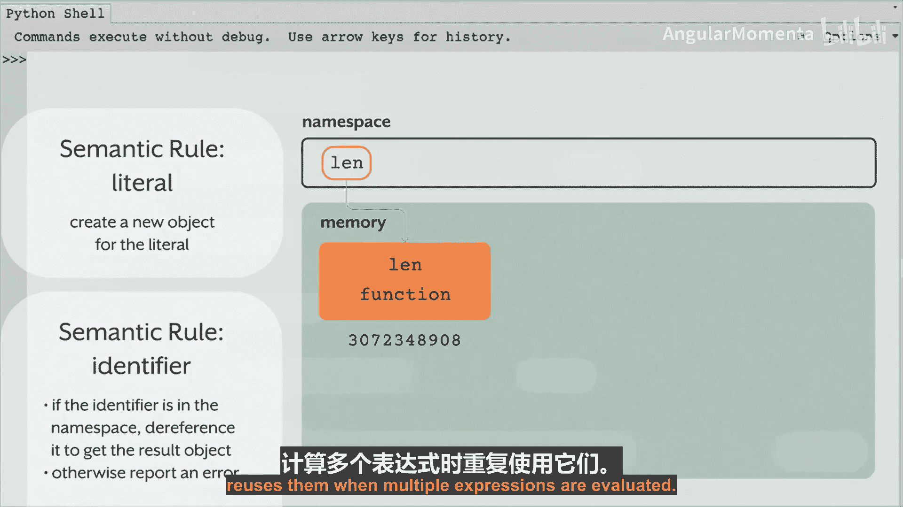

# 019：字面量与标识符的语义 🐍

在本节课中，我们将学习Python编程语言中**字面量**和**标识符**的语义。理解这两个核心概念是掌握Python如何解读和执行代码的基础。

---

## 回顾Python的解释过程

Python解释器通过一系列步骤来评估一条语句。首先，**词法分析**将代码分解为**词法单元**。接着，**语法分析**验证这些词法单元的顺序是否符合语法规则。最后，**语义分析**通过评估语句来定义其含义。

我们将使用简化的语义规则来定义Python语句的含义。

---

## 表达式语句的构成

表达式语句由一个单独的表达式构成，这个表达式可以是**字面量**、**标识符**或**函数调用**。我们已经定义了字面量和标识符作为词法单元，也定义了由单个字面量或单个标识符构成的表达式语法。

为了定义字面量和标识符的语义，我们首先需要了解为什么在Python表达式中会使用它们。

---

## 字面量的语义

在表达式中使用人类可读的对象表示，是为了让人们能够理解这些对象。解释器必须将这些人类可读的表示转换为计算机内存中的对象，以便对它们进行计算。

在表达式中表示对象的最简单方式是使用**字面量**。字面量通过描述对象来代表它，包含了创建对象所需的所有信息。

**字面量表达式的语义很简单：为字面量创建一个新的对象。** 例如，当解释器评估字面量词法单元 `300` 时，它会创建一个新的整数对象。

表达式中的字面量类似于现实世界中的优惠券或代金券，可以兑换成物品。优惠券只是物品的**表示**，并非物品本身。一旦优惠券兑换成物品，优惠券就不再需要。同样，字面量本身**不是**对象，它只是在表达式中代表那个对象。一旦字面量被用来在内存中创建了对象，字面量就不再需要，只有对象是必需的。

如果解释器在另一个表达式中再次遇到字面量词法单元 `300`，它会创建另一个整数对象。回想一下，`id()` 函数为每个不同的对象返回不同的身份标识号。`id()` 函数可以用来判断相同字面量的再次使用是创建了新对象，还是复用了之前创建的对象。

例如，使用字面量 `300` 两次，会创建两个不同的对象，因为它们的 `id` 不同。

每个Python解释器对于复用字面量创建的对象都有自己的策略，并且这个策略取决于字面量本身。例如，这个解释器会复用所有在 `-5` 到 `256` 之间的整数对象，但对于任何其他整数，每次使用时都会创建新对象。

为了简化字面量的语义，我们忽略特定解释器是否会为多次出现的相同字面量复用同一个对象。我们定义字面量的语义为：**每次评估字面量时都创建一个新对象**。为字面量复用对象只影响Python代码的评估速度，通常不会影响代码结果。

---

## 标识符的语义

除了字面量，Python还使用**标识符**（也称为**名称**）在表达式中代表对象。

标识符通过**引用**一个对象来在表达式中代表它。我们说一个标识符**绑定**到一个对象，并用一个箭头来表示这种绑定关系。例如，标识符 `len` 代表一个函数对象。

表达式中的标识符类似于一个人的名字或角色。人们通过名字或角色来指代我们，但名字或角色只是一个**标签**，并不是人本身。正如人们可以多次使用同一个名字或角色来指代同一个人一样，一个标识符也可以多次引用同一个对象。

标识符是对象的**持久性**表示，只要在交互式环境或程序中的所有表达式正在被评估，它就存在。而字面量只是一个**临时性**表示，直到它所代表的对象被创建。

Python使用**命名空间**来允许标识符在评估期间持久存在。命名空间将出现在Python表达式中的每个名称与其绑定的对象关联起来。因此，`len` 标识符就与一个函数对象**关联**或**绑定**。

命名空间就像一个字典，只不过解释器不是查找一个单词并找到其定义，而是查找一个名称并找到它绑定的对象。这一步称为**解引用**。解引用是在Python代码评估期间，将标识符转换为其绑定的内存对象的行为。这个过程就像在网上搜索餐厅名字：你在浏览器或应用中输入餐厅的名字，然后得到它的位置，你用这个位置在现实世界中找到餐厅。

当我们打开一个Python交互式环境或运行一个Python程序时，解释器会创建一个命名空间，并在评估我们的代码之前**预绑定**许多标识符。例如，解释器创建一个计算序列长度的函数对象，然后将名称 `len` 添加到命名空间，并将这个名称绑定到该函数对象。解释器预绑定了所有内置函数的名称，例如 `id` 和 `type` 函数名。如果内置函数的名称没有被预绑定，我们将无法引用它们，也就无法使用它们。

解释器还将每个内置类型的名称预绑定到一个类型对象，并预绑定许多其他标识符。你可以使用内置函数 `dir(__builtins__)` 来查看所有内置标识符。你会注意到内置函数名 `len` 和 `id`，以及内置类型名 `str`、`int` 和 `float`。同时，也会看到一些熟悉的错误名称，如 `SyntaxError` 和 `NameError`。在我们的图示中，不会展示所有预绑定的标识符，只会展示特定Python交互式环境示例或程序中将要使用的预绑定名称。

以下是标识符表达式的语义：
*   **如果标识符在命名空间中，则解引用它以获取结果对象。**
*   **否则，报告错误。**

例如，如果我们评估一个包含标识符 `len` 的表达式，解释器会在命名空间中找到 `len` 并解引用它以获取函数对象。

让我们评估一个不在命名空间中的标识符 `hello`。这个表达式包含一个词法单元，即标识符 `hello`。解释器应用标识符表达式的语义规则：它检查标识符 `hello` 是否在命名空间中。由于 `hello` 没有被预绑定到任何内置函数、类型或其他类型的对象，它不在命名空间中。解释器报告一个语义错误。由于没有结果对象，只显示错误信息。我们将在后续课程中讨论如何绑定那些未被预绑定的标识符。

---

## 标识符绑定的特性

一个姓名标签可以被一个人佩戴，然后稍后被另一个人佩戴。例如，在驾驶公交车时，一个人可能佩戴“司机”姓名标签来代表他们的角色。当另一个人替换第一位司机时，“司机”姓名标签可以从第一个人身上取下，由第二个人使用。

标识符就像一个姓名标签，因为我们将在未来的课程中发现，一个标识符可以在不同时间绑定到不同的对象。然而，**命名空间中的一个标识符不能同时绑定到两个不同的对象**。类比来说，一辆公交车上不能有两个具有相同“司机”角色的人。公交车上只有一个“司机”姓名标签，一次只能贴在一个人的身上。

---

## 总结

本节课中，我们一起学习了Python编程语言中**字面量**和**标识符**的语义。我们了解到：
*   **字面量**是对象的直接描述，每次评估时通常（在我们的简化模型中）会创建一个新对象。
*   **标识符**是对象的引用或名称，它们存储在**命名空间**中，可以被多次使用来引用同一个对象。
*   Python解释器在启动时会预绑定许多内置标识符（如 `len`、`id`），以便我们可以直接使用它们。
*   评估标识符时，解释器会在命名空间中查找并**解引用**它，如果找不到则会报错。

理解这些基础语义，是后续学习变量赋值、函数调用等更复杂概念的关键。