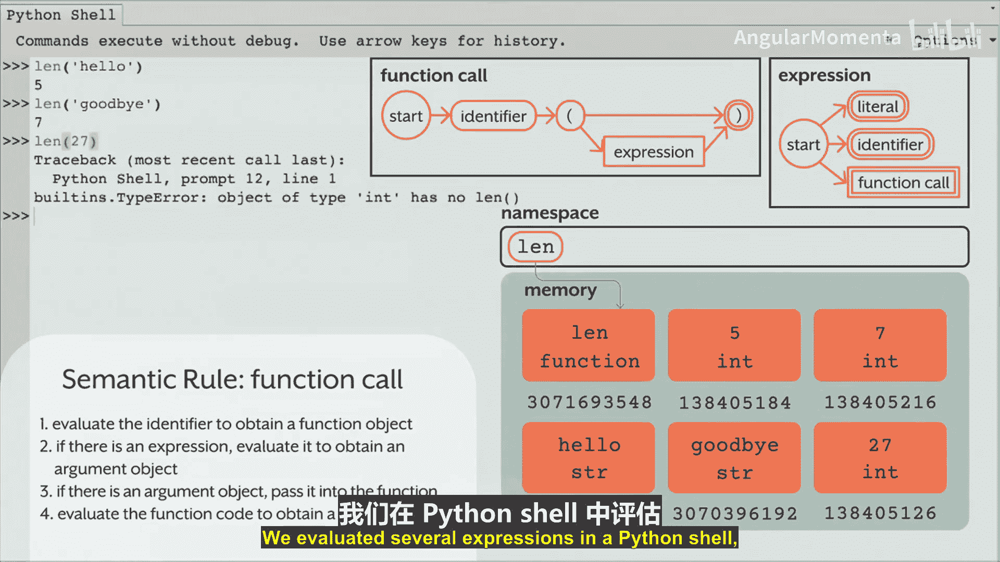

# 020：函数调用的语义 🐍

在本节课中，我们将学习Python编程语言中**函数调用表达式**的语义。我们将了解当Python解释器遇到一个函数调用时，它内部是如何一步步执行的。

在上一节中，我们介绍了字面量表达式和标识符表达式的语义。本节中，我们来看看当这些元素组合成一个函数调用时会发生什么。

## 函数调用的语义定义

回忆一下，函数的作用是**应用于一个参数对象**，以**获得一个结果对象**。函数调用的语义可以分解为以下四个步骤：

以下是函数调用语义的四个核心步骤：
1.  **计算标识符**，以获取函数对象。
2.  如果存在参数表达式，**计算该表达式**，以获取参数对象。
3.  如果存在参数对象，将其**传递给函数**。
4.  **执行函数内部的代码**，以获取结果对象。

## 语义分析示例

在语法课程中，你已经知道 `len(‘Hello’)` 这个表达式是一个语法有效的函数调用。它以一个标识符 `len` 开头，后跟左括号、一个字符串字面量 `‘Hello’` 和右括号。

在Python解释器评估这个表达式之前，标识符 `len` 已经被预先绑定到了内置的 `len` 函数对象上。

现在，让我们应用函数调用的语义规则来分析它：
*   **步骤1**：解释器评估标识符 `len`。标识符表达式的语义规则会在命名空间中查找 `len`。由于 `len` 是预绑定的内置函数，解释器找到它并解引用，从而获得 `len` 函数对象。
*   **步骤2**：解释器评估表达式 `‘Hello’`。字面量的语义规则会创建一个新的字符串对象 `‘Hello’`。
*   **步骤3**：我们将这个参数对象（字符串 `‘Hello’`）传递给 `len` 函数。
*   **步骤4**：解释器执行 `len` 函数内部的代码（这些代码对我们不可见）。这个函数的执行过程与你正在学习的解释器过程相同。最终，该函数返回整数对象 `5`。

这个 `5` 对象随后会显示在Shell中。

## 更多调用示例

表达式 `len(‘Goodbye’)` 是对同一个函数的调用，但使用了不同的参数（字面量字符串 `‘Goodbye’`）。函数调用使用相同的语义计算出整数对象 `7`，并显示出来。

让我们尝试评估 `len(27)`。当解释器尝试解释这个表达式时，它会报告一个**类型错误**。

它是如何以及为何失败的呢？解释器成功地完成了步骤1到步骤3。错误发生在**步骤4**，当它尝试使用参数对象（整数 `27`）来执行 `len` 函数的代码时。`len` 函数无法计算一个整数中的元素数量，因为整数本身并不包含“元素”。Python Shell会报告这个错误。

## 总结

本节课中，我们一起学习了Python编程语言中**函数调用表达式**的语义。我们通过几个步骤定义了函数调用的执行过程，并在Python Shell中评估了多个表达式。Shell以人类可读的形式显示了这些函数调用的结果对象。理解这些底层语义，有助于你更清晰地预测和理解代码的行为。