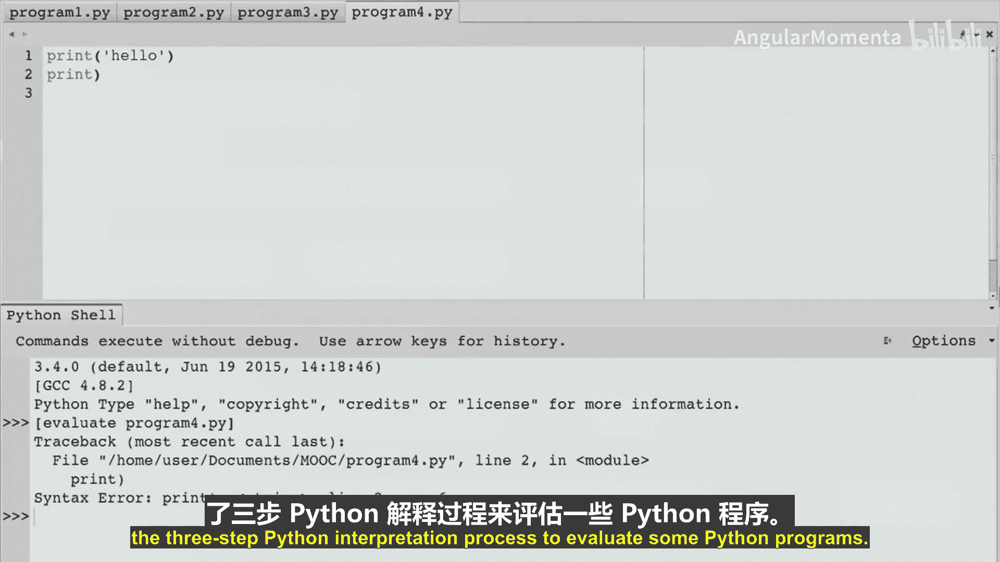

# 021：Python程序解释


## 概述
在本节课中，我们将学习Python程序的基本概念，了解如何通过编写包含多个语句的程序来按特定顺序执行计算。我们将探讨程序与交互式Shell的区别，并学习如何使用`print`和`input`这两个内置函数来显示信息和获取用户输入。

---

## 程序与顺序执行
上一节我们介绍了在Python Shell中逐句执行语句。本节中我们来看看如何通过程序来顺序执行多个语句。

一个应用程序通常需要按照适合该应用的顺序计算多个对象。例如，游戏通常在开始时创建并显示欢迎界面，在游戏过程中创建并显示移动的游戏对象，在游戏结束时显示其他对象，如分数或排行榜。

如何按特定顺序创建并显示多个对象？你可以使用多个语句，Python解释器会按顺序评估这些语句。这些多个语句被称为一个**程序**。

Python解释器使用词法分析为整个程序创建标记。然后，它按顺序从第一条语句到最后一条语句检查每条语句的语法。最后，它使用语义分析按顺序评估每条语句。实际上，有些语句会改变这种默认的顺序评估方式，但这些将在未来的课程中介绍。

---

## 从文件运行程序
Python允许我们调用解释器来运行存储在文件中的程序。

以下是一个按顺序计算“hello”的长度、“goodbye”的长度以及“Ho”的ID的程序。这个程序包含三个表达式语句，这些语句在之前的课程中曾在Python Shell中单独评估过。

```python
len("hello")
len("goodbye")
id("Ho")
```

如果运行这个程序，其输出将显示在Python Shell中。为什么表达式的结果对象没有显示出来？当这些表达式在Python Shell中评估时，结果会立即显示。解释器使用相同的语义规则来评估程序语句和输入到Python Shell中的语句。然而，在Python Shell中，表达式语句评估后，结果对象会立即在Shell中显示。当解释一个程序时，表达式语句的结果不会自动显示。

Shell显示每个评估后的表达式，以便你可以查看结果。但在大多数程序中，你并不希望显示每次计算的结果。因此，结果对象不会自动显示。

---

## 使用`print`函数显示输出
为了在程序评估时显式地显示一个对象，你需要使用内置函数`print`。该函数显示其参数对象，然后将光标移动到下一行。

不幸的是，`print`的文档难以理解。目前，只需知道`print`函数会显示其参数对象的人类可读形式。

为了有选择地显示程序中的三个对象中的两个，我将把第一个和第三个对象作为`print`函数调用的参数。

```python
print(len("hello"))
len("goodbye")
print(id("Ho"))
```

当我运行这个程序时，每个表达式语句按顺序评估，`print`函数调用显式地以人类可读形式显示第一个和第三个结果对象。

`print`函数是一个函数，因此它必须返回一个结果对象。`print`函数返回一个类型为`NoneType`的唯一对象。任何不返回有用对象的函数都会返回此对象。

当我评估`type(print("Ho"))`时，Python解释器首先显示`print`函数调用的输出“Hello”。由于我是在Shell中评估此表达式，解释器随后显示`print`函数调用返回的对象的类型，即`NoneType`对象。

---

## 使用`input`函数获取用户输入
`print`函数在程序中显示信息。程序如何从用户那里获取信息？你可以使用内置函数`input`将用户的按键转换为`str`类型的对象。

Python标准库中关于`input`的条目如下：
`input([prompt])`

此文档中有一些新符号。`prompt`参数周围的方括号表示该参数是**可选**的。它可以包含，也可以省略。

如果存在`prompt`参数，它将被写入Shell，且不带尾随换行符。如果省略该参数，则不显示任何内容。然后，该函数从输入中读取一行，将其转换为字符串，去除尾随换行符，并返回该字符串对象。

这个`prompt`参数有什么用？如果程序需要用户输入一些信息，它应该提示用户，然后等待响应。显示提示后，`input`函数将光标保留在同一行。因此，用户输入位于提示的右侧。用户通过按Enter键表示输入完成。然后，该函数将用户的按键转换为一个不包含Enter键换行符的单个字符串对象。

我将运行一个程序来展示`input`函数的工作原理：

```python
color = input("What is your favorite color? ")
print(color)
```

请注意，键入时颜色会显示在提示行上。然后，`print`函数调用在下一行也显示这个颜色字符串。

---

## 语法错误与程序执行
当我运行这个程序时，Python解释器在评估任何语句之前会检查整个程序的语法。

第一行中字符串参数“hellello”没有被`print`函数调用显示，即使第一行具有有效的语法和语义。这是因为第二行发生了语法错误。

如果你的程序包含任何语法错误，则不会评估任何语句。

---



## 总结
本节课中我们一起学习了Python程序解释的基本过程。我们了解了程序是多个语句的集合，解释器会按顺序进行词法分析、语法检查和语义评估。我们掌握了使用`print`函数来显式输出信息，以及使用`input`函数来获取用户输入。最后，我们认识到程序在执行前会进行完整的语法检查，任何语法错误都会阻止整个程序的执行。