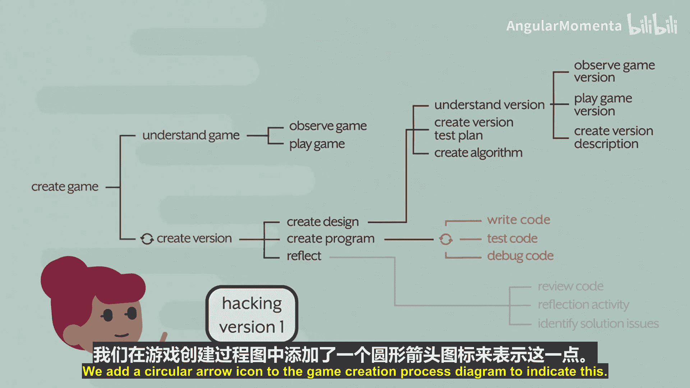
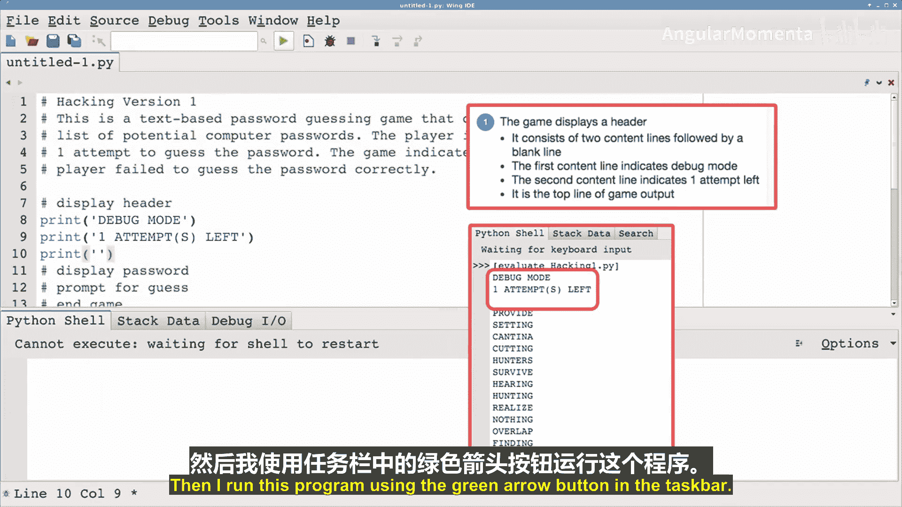
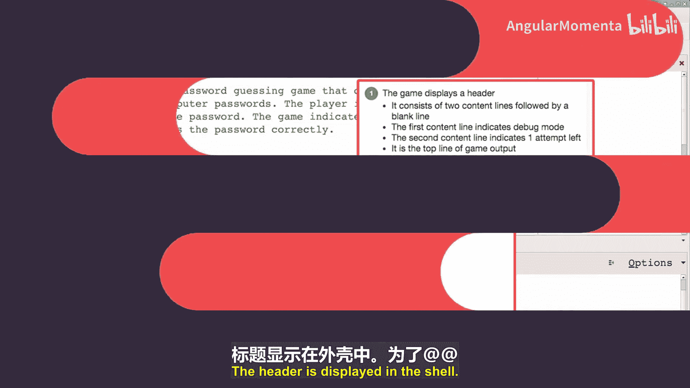
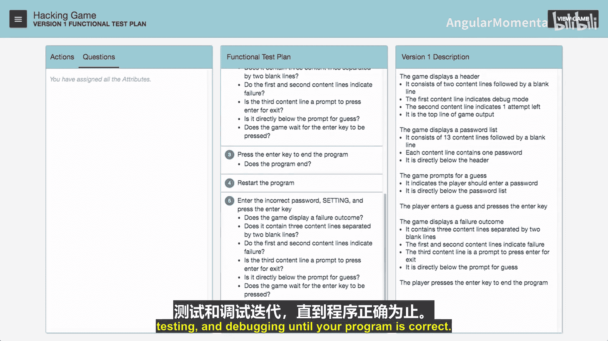

# 022：程序编写 - 版本1 🎮

在本节课中，我们将学习如何将设计好的算法转化为实际的Python代码。我们将遵循“创建程序”这一步骤，包括编写代码、测试代码和调试代码。

## 概述：从设计到实现

上一节我们完成了游戏版本1的设计，包括版本描述、功能测试计划和算法。本节中，我们来看看如何实现这个解决方案。编写代码是一个精炼的过程，它比算法描述更加精确。

## 从算法到代码

我们可以用蛋糕算法来类比。仅凭“制作面糊”这个算法步骤无法烤出蛋糕，我需要知道具体的配料、每种配料的分量以及如何混合它们。同样，“烘烤蛋糕”的步骤需要具体的温度和时间。通过添加细节，我们可以从算法创建出一个食谱。这个食谱就是算法的**实现**，正如代码是软件算法的实现。

我们需要一个将算法转化为代码的过程。

以下是“创建程序”的三个子任务：

*   **编写代码**：将你的算法翻译成编程语言的过程。算法的每一步都将成为某种编程语言中的一个或多个顺序语句。在本课程中，我们使用Python。
*   **测试代码**：通过运行代码来确定出现了哪些错误。当你编写Python程序时，你会犯很多错误。不要气馁，犯错是学习编程非常重要的一部分。
*   **调试代码**：发现究竟是代码的哪一部分导致了错误，并决定如何修复它的过程。学习调试与学习编写代码同等重要。

测试和调试不是同一个过程。**测试**是运行你的代码以确定程序中存在哪些错误。**调试**是发现哪些程序语句导致了错误，并分析如何修复这些语句。

一旦知道如何修复错误，你就必须编辑你的代码。这可能涉及更改现有语句或添加新语句。自然地，当你编写新语句时，你将需要再次测试并可能调试它们。因此，你需要多次重复编写、测试、调试的过程。我们在游戏创建过程图中添加了一个循环箭头图标来表示这一点。

## 使用集成开发环境

在本课程中，我们使用集成开发环境来编写代码。我们将使用Wing IDE的免费版本。IDE用于编写、运行和调试代码。

使用IDE编写代码类似于使用Microsoft Word或Google Docs等文本编辑器来撰写文章。

在开始编码之前，我们先看看Wing IDE的面板。要开始一个新程序，我可以选择“文件”->“新建”，或单击任务栏上的蓝色“新建页面”按钮。一个名为“Untitled-1.py”的新程序会出现在任务栏正下方的面板中。该面板左侧现在有行号，这将帮助你确定语句中错误的位置。

程序下方是一个带有多个标签页的面板：搜索、堆栈数据和Python Shell。“搜索”标签用于在程序中查找和替换单词。我们将在后续的“黑客”版本中使用相关调试功能时讨论“堆栈数据”标签。“Python Shell”标签你应该在编程语言课程中已经很熟悉了。你的IDE中可能会看到其他标签配置。

## 开始编码

编程的挑战之一在于确保你的代码易于理解和有良好的文档记录，这不仅是为了方便他人使用，也是为了你自己。我们常常认为在几周或几个月后，我们仍然能准确记得代码是如何工作的。不幸的是，在很长一段时间后回到一个文档记录不佳的项目，会导致挫败感和延误。

良好的文档包括描述性的标识符名称和表明代码意图的注释。你可以在行首使用井号来创建注释行。注释是供人类使用的，Python解释器会忽略它们。

我将首先添加注释，包括此游戏版本的标题和游戏的简短摘要。

现在，让我们将算法翻译成代码。

我们算法的第一步是“显示标题”。让我们添加一个名为“显示标题”的注释。实际上，我会将每个算法步骤作为一个块注释添加，该注释描述你将编写来翻译该步骤的程序语句块。

我从主面板开始，包含四个步骤：显示标题、显示密码列表、提示猜测和结束游戏。然后，我在“结束游戏”注释下添加“显示失败结果”和“提示结束”的注释，因为它们是“结束游戏”的一部分。然而，我在注释中添加了额外的空格，以表明它们是“结束游戏”的子步骤。这使得我们很容易看到所有必须翻译的算法步骤。

正如我们之前所说，每个算法步骤将被翻译成一个或多个Python语句的块。

现在让我们将第一个算法步骤“显示标题”翻译成Python代码。我们在编程语言视频中看到，Python使用`print`函数来显示字符串。

参数字符串应该是什么？根据版本描述，你必须输出“调试模式”、“剩余一次尝试”和一个空行。你可以通过重新运行程序来找到确切的字符串。

我在“显示标题”注释下方键入了`print`函数调用，然后使用任务栏上的绿色箭头按钮运行这个程序。标题显示在Shell中。

我只翻译了第一个算法步骤后就运行程序，是为了让错误更容易被发现。如果测试发现错误，你需要使用调试来定位导致错误的语句。如果你只在做了少量添加或更改后进行测试，就更容易识别错误发生的语句。

例如，我将从“显示标题”的最后一个`print`函数调用中删除右括号，但我不测试程序。相反，我将翻译更多的算法步骤。我将把“显示密码列表”的翻译留作一个活动，转而翻译“提示猜测”。

一个提示会显示一些文本，并将用户的按键捕获为一个字符串。我们可以将我们的“提示”步骤翻译成对Python `input`函数的调用。相同的算法步骤在其他语言中将被翻译成其他函数调用，例如Java中的`Readline`和C语言中的`gets`。

我将编写`input`函数调用，其参数字符串以“输入密码”开头，以大于号结尾。我再次使用绿色的“运行”按钮运行程序。Python Shell报告了一个语法错误，在`input`函数调用行，尽管我们知道错误实际上在`print`函数调用行。报告的行号并不总是错误实际发生的位置。

我们每翻译完一个算法步骤就运行程序，是为了让调试更简单。在下一个活动中，你将修复这个错误，并将算法的其余部分翻译成代码。

你必须将测试计划应用于你完成的代码，以确保你的代码功能正确。确保你执行了测试计划中的所有测试操作，从“启动程序”到“输入错误答案并按回车键退出”。确保所有问题的答案都是“是”。如果任何问题的答案是“否”，那么你必须应用更多次的编写、测试和调试，直到你的程序正确为止。

## 总结

本节课中，我们一起学习了如何将设计好的算法转化为可运行的Python代码。我们了解了“创建程序”的三个核心子任务：编写代码、测试代码和调试代码。我们介绍了使用集成开发环境进行编程，并强调了良好文档和逐步测试的重要性。记住，编程是一个迭代的过程，犯错和调试是学习过程中不可或缺的部分。