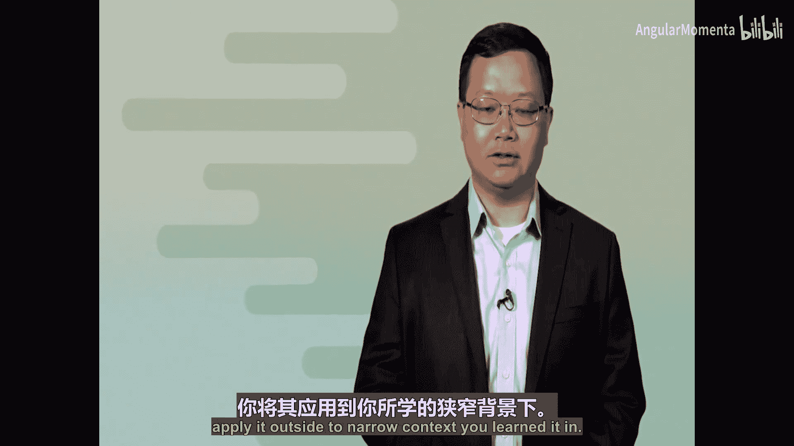

# 023：反思过程 🧠


在本节课中，我们将要学习应用开发流程中的一个关键环节——**反思**。许多初学者在编写出一个可以运行的程序后，可能会认为任务已经完成。然而，从设计解决方案到实现代码，这并非流程的终点。通过本节课，你将理解为何以及如何进行反思，以提升你的问题解决能力。

## 反思的重要性

上一节我们介绍了从设计到实现的基本流程。本节中我们来看看为何在“创建版本”任务中，“反思”是一个至关重要的子任务。

反思是游戏（乃至任何应用）创作过程中的重要步骤。学习一项新技能通常最初会聚焦于特定的、具体的情境。为了能举一反三，必须将这项技能**泛化**，使其能够应用于新的、不同的情境。

## 什么是解决方案泛化？

解决方案泛化，指的是将一个针对特定问题的解决方案，替换为能够解决**一组相关问题**（包括原特定问题）的通用方案。这是一种被称为**抽象**的新问题解决技术。

例如，在之前的编程课程中讨论过，我可以根据“蛋糕算法”创建一份巧克力蛋糕食谱，从而烘焙出我的第一个蛋糕。但在成功烘焙一个蛋糕后，我未必能制作另一种蛋糕。

我希望利用在创建巧克力蛋糕食谱时获得的知识，来创建适用于任何种类蛋糕（如芝士蛋糕或咖啡蛋糕）的食谱。😊 这就是解决方案泛化的一个例子：一份通用的蛋糕食谱将取代针对不同蛋糕的独立食谱。

以下是其核心思想：
*   **算法步骤**（如制作面糊、烘烤蛋糕）保持不变。
*   需要识别出哪些细节对应于**参数**（在切换食谱时会改变），哪些细节保持不变。
*   例如，**打开烤箱**这个动作不会改变，但**烤箱温度**这个参数会改变。

## 在编程中如何泛化？

你必须学会通过改变所使用的**函数、字面量和其他对象**，来泛化你编写的代码语句，以解决不同的问题。

以下是几个例子：
*   在编码活动中，你打印了特定的密码字符串。然而，更一般地说，`print` 函数可用于打印**任何字符串**。
*   更进一步，你可以通过使用不同的函数调用（例如 `input`）来执行**不同的操作**。

用代码来描述这个核心概念：
```python
# 特定解决方案：打印固定字符串
print("MySecretPassword123")

# 泛化方案：打印任何作为参数传入的字符串
def print_any_message(message):
    print(message)

# 调用泛化后的函数
print_any_message("Hello, World!")
print_any_message("Another message")
```

反思让你能够将学到的技能，应用到最初学习它的狭窄语境之外。

## 总结



本节课中我们一起学习了应用开发流程中的“反思”阶段。我们了解到，仅仅实现一个能运行的程序并不够，关键在于通过**解决方案泛化**和**抽象**的思维，将针对特定问题的代码转化为可复用的模式与知识。这使你从一个特定问题的解决者，成长为能够应对一类问题的程序员。记住，**反思是将经验转化为能力的关键一步**。