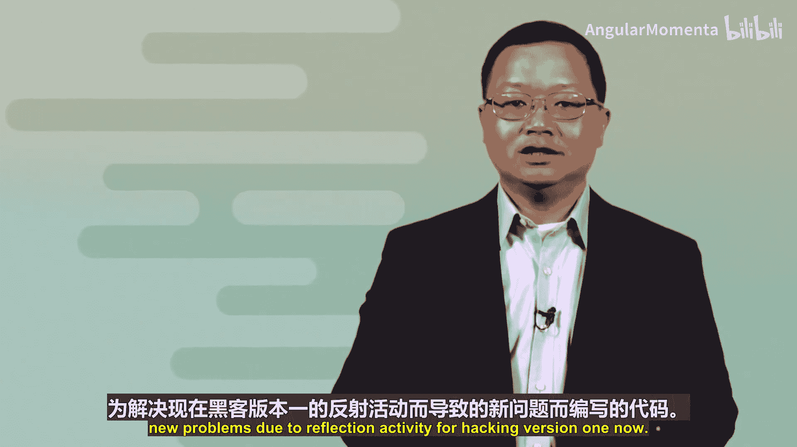

# 024：代码审查与反思活动

在本节中，我们将学习程序开发中“反思”阶段的两个核心子任务：代码审查与反思活动。我们将通过调试器追踪代码执行，并了解如何评估和改进代码质量。

## 代码审查

上一节我们编写了“黑客”游戏的第一版程序。为了更深入地理解程序的工作原理，现在我们需要进行代码审查。这意味着你需要按程序实际运行的顺序，逐一检查每一条语句。你的目标是理解这些语句如何协同工作，以实现游戏功能。

我们可以使用调试器来追踪Python解释器运行程序的过程。以下是使用调试器的基本步骤：

以下是启动和进行代码追踪的步骤：

1.  点击“开始调试”按钮（也称为“步入”按钮，图标是一个箭头指向方框）。调试器会高亮显示程序的第一条语句，表示该语句将被首先执行。
2.  要执行当前高亮的语句，点击“单步跳过”按钮（图标是一个箭头越过方框）。例如，当执行一个 `print` 函数调用时，其参数字符串会显示在Python shell中。
3.  每次点击“单步跳过”按钮，解释器就会按顺序执行下一条Python语句。
4.  你可以随时点击红色的“停止”按钮来结束调试，返回程序。

让我们看看当解释器执行一个 `input` 函数调用时会发生什么。请注意，下一条语句不会高亮，并且除了“停止调试”按钮外，所有按钮都会变暗。这是因为 `input` 函数尚未执行完毕，它正在等待用户输入一个字符串。

在Python shell中输入密码（例如“gas”）后，解释器完成了对 `input` 函数调用的求值，并会高亮显示 `input` 函数调用之后的语句。你可以继续点击“单步跳过”按钮，逐条语句地完成对整个程序的追踪。

这种追踪展示了Python解释器默认的顺序执行过程。在未来的课程中，我们将介绍改变这种默认顺序执行的语句，并使用追踪来理解非顺序的执行流程。

为了确保你理解如何追踪程序，你应该亲自尝试完整地追踪一遍你的程序。如果在追踪过程中，你不小心点击了“步入”按钮而不是“单步跳过”按钮，调试器可能会高亮显示一个不在你程序中的代码行。例如，在 `input` 函数调用行点击“步入”按钮就会发生这种情况。此时，你将看到属于该库函数实现部分的代码。要返回到你的程序代码，请点击“步出”按钮（图标是一个箭头从方框中指出来）。

## 代码质量与软件质量测试

现在你已经理解了代码的功能，接下来让我们讨论代码的质量。代码质量通过软件质量测试来保证。这些测试与你已经创建和使用过的功能测试结合使用。

*   **功能测试** 用于证明代码按预期工作。
*   **软件质量测试** 则用于确保你做出了良好的编码选择并遵循了最佳编程实践。

你不需要创建自己的软件质量测试，我们会为每个游戏版本提供具体的测试要求。

对于“黑客”游戏的第一版，你只需要使用一个软件质量测试来检查你的注释。你必须测试两种注释：程序注释和块注释。

*   **程序注释** 是对程序功能的总结，必须放在程序开头。
*   **块注释** 是单行注释，必须出现在构成一个逻辑任务的每组语句上方，并对后续代码进行简短说明。

以下是我们为“黑客”游戏第一版提供的解决方案示例。程序顶部是游戏标题和简短摘要，这满足了程序注释的软件质量测试要求。其余注释是块注释，它们是在编程演示过程中作为算法步骤添加的。按照目前的写法，它们满足了块注释的软件质量测试要求，每个块注释都位于构成一个逻辑任务的语句块开头。

随着课程引入新的编码概念，我们将添加更多的软件质量测试。请将这些不断演进的软件质量测试视为一系列风格指南，来指导你编写代码。

## 反思活动

反思的第二个子任务是进行反思活动。每次反思活动都将加深你对**标记**、**语法**、**语义**、**对象类型**的理解，并教你如何将已编写的代码推广到解决新问题。

现在请完成“黑客”游戏第一版的反思活动。

---

本节课中，我们一起学习了如何通过调试器进行代码审查以理解程序执行流程，并了解了使用软件质量测试（特别是针对注释的测试）来评估和提高代码质量。最后，我们介绍了反思活动的作用，它是巩固和扩展编程知识的重要环节。