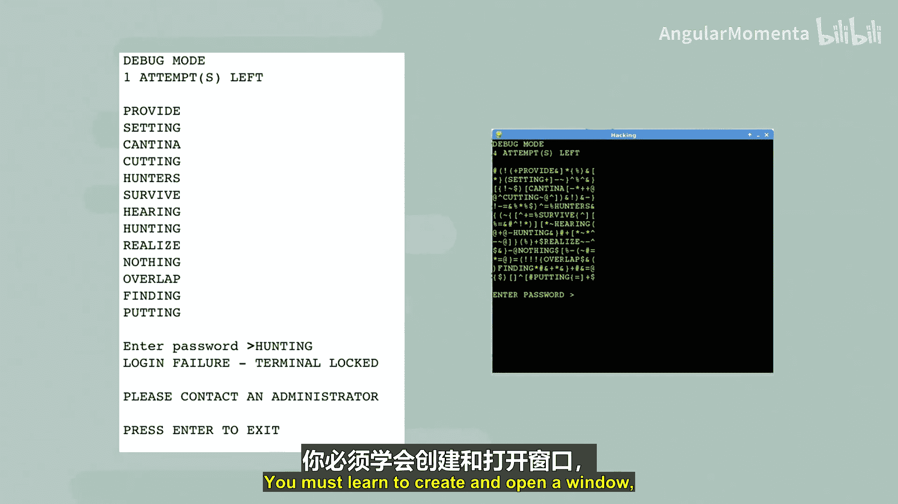

# 026：识别解决方案问题与添加图形

在本节课中，我们将学习如何识别代码中的“解决方案问题”，并开始为我们的“黑客”游戏添加图形界面。我们将分析第一个版本游戏的不足，并了解如何通过使用外部图形库来改进它。

---

## 识别解决方案问题

每次完成一个游戏版本后，你都需要决定下一个版本要添加或改进什么。这个过程被称为**识别解决方案问题**。解决方案问题是指你寻求的最终解决方案与你已编写的设计和代码之间的差距。识别这些问题是系统化改进代码和功能的关键。

“黑客”游戏的第一个版本并不令人兴奋，与你需要完成的完整游戏只有少数相似之处。它仅以黑白文本格式显示标题和密码。虽然它允许你输入猜测，但它只在Python shell中显示未经修饰的密码，而不是使用自己的窗口。此外，你只有一次猜测密码的机会，并且无论你选择什么，游戏都会报告你失败了。

我们可以识别出第一个版本至少存在五个不同的解决方案问题。

以下是这些问题及其对应的改进计划：

1.  **代码质量问题**：在之前的课程中，我们讨论了多次调用 `print` 函数的缺点。我们需要移除这些重复的语句，因为重复会使程序变得不必要的冗长。我们将在“黑客”版本4中通过引入一种称为**重复控制结构**的语言机制来解决这个问题。

2.  **逻辑判断问题**：当你输入正确密码时，游戏却显示你失败了。为了解决这个问题，你需要一种机制来比较密码和猜测。然后，你需要选择向玩家报告成功还是失败。你将在“黑客”版本3中学习如何做到这一点。

3.  **猜测次数限制**：你只被允许进行一次猜测。在未来的版本中，你必须被允许最多进行四次猜测。为此，你必须能够在算法和代码中一致地重复步骤和语句。你将在“黑客”版本5中学习如何做到这一点。

4.  **密码装饰问题**：你的密码不包含最终版本中的任何符号字符装饰。为了进行这项改进，你必须能够操作密码字符串，并以随机方式添加符号字符。你将在“黑客”版本7中学习如何做到这一点。

5.  **图形界面问题**：你的游戏是基于文本的，而不是基于图形的。你必须学习创建和打开一个窗口，并在窗口中绘制图形对象。

---

## 为版本2添加图形

上一节我们介绍了“黑客”游戏版本1存在的五个主要问题。本节中，我们来看看如何为第二个版本进行改进。

对于“黑客”的第二个版本，你将进行的唯一解决方案改进是**用图形替换文本**以及**显示玩家的猜测**。其他改进需要你学习和实践几个新的设计组件和Python语句。

要使用图形窗口，你必须掌握一些新的库函数。使用图形窗口的游戏不能使用 `print` 函数在该窗口中显示文本。`print` 只在终端窗口或Python shell中显示。它不允许你指定要显示的文本的位置、颜色或字体。

对于“黑客”游戏，你需要在屏幕的左上角、右上角、右下角和中心显示绿色文本。为此，你必须使用一个图形库来显示文本。

到目前为止，你使用的函数是Python标准库中包含的内置函数。不幸的是，标准库不支持图形。你不能用它来打开窗口、绘制圆形或打印不同颜色的文本。因此，我们将使用一个外部库。

一个**外部库**或**第三方库**是由Python社区提供的代码编译集合。它包含增强标准库的函数和其他代码。使用库是使用模板的一个例子。使用模板是一种抽象技术，它利用先前创造的解决方案并将其调整以解决新问题。

回顾“黑客”版本1的代码。如果你深入 `input` 函数，你会看到实现它的底层代码。这个 `input` 函数的代码是由其他人编写的，其他人可以在不重写的情况下使用它。试想一下，如果你必须在实现“黑客”游戏之前先实现Python的所有内置函数，那么编写本课程中的游戏会有多困难。这将花费很长时间，以至于你永远没有时间编写使用这些函数的游戏代码。不要浪费时间重新发明轮子。使用模板可以基于他人的工作更快地创建解决方案。

在本课程中，你将使用我们创建的一个名为 **UAGame** 的库。这是一个简单的库，可以让你创建一个窗口并在其中绘制字符串。它基于一个流行的Python图形库，称为 **Pygame**。我们使用这个更简单的图形库来实现“黑客”的所有版本。你将在本课程的第二个游戏“Pol the dots”中使用Pygame本身。

让我们为“黑客”游戏添加图形。

---

## 总结

本节课中，我们一起学习了如何识别代码中的“解决方案问题”，这是迭代开发游戏的关键步骤。我们分析了“黑客”游戏第一个版本的五个主要不足，并明确了后续版本的改进方向。接着，我们重点介绍了为第二个版本添加图形界面的必要性，解释了为什么不能使用内置的 `print` 函数，以及如何通过引入外部图形库（如UAGame和Pygame）来创建窗口和绘制文本。使用外部库是高效编程的重要实践，它能让我们站在巨人的肩膀上，避免重复劳动，专注于实现游戏的核心逻辑。