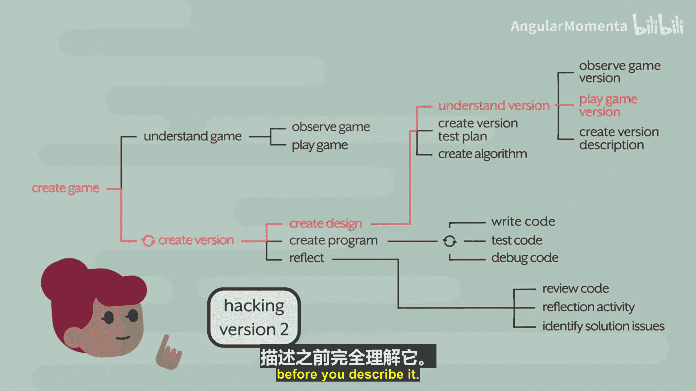

# 027：观察黑客入侵游戏第二版 👀

在本节课程中，我们将观察“黑客入侵”游戏的第二个版本。通过观察，我们将了解这个版本与第一版在视觉和功能上的区别，并学习如何分析一个正在开发中的游戏。

---

上一节我们介绍了游戏开发的基本流程，本节中我们来看看“黑客入侵”游戏第二版的实际运行效果。

游戏立即开始。可以看到，黑客入侵第二版的外观与第一版有很大不同。一个新的图形窗口打开，标题为“Hacking”，背景为黑色。文本显示为绿色，但文本内容与黑客入侵第一版相同。

以下是观察游戏时需要问自己的几个关键问题：
*   游戏看起来是什么样子的？
*   屏幕上的元素何时出现？
*   玩家可以执行哪些操作？

我将执行与玩第一版时相同的操作。当提示输入密码时，我将输入正确的密码 `hunting`。不幸的是，与第一版一样，屏幕上出现了失败提示信息。不过别担心，我们将在下一个版本中修复这个问题。

至少，屏幕会清空并显示猜测次数，这与最终版本一致。失败信息正确地显示在屏幕中央。实际上，黑客入侵第二版的功能与第一版几乎相同，但其图形和风格已经与最终版本一致。

在接下来的活动中，你将亲自试玩黑客入侵第二版，以确保在描述它之前能完全理解其行为。

---

本节课中，我们一起观察并分析了“黑客入侵”游戏第二版。我们了解到，此版本在**图形界面**上进行了重大更新，采用了与最终版一致的黑底绿字风格，但核心**游戏逻辑**（如密码验证）仍与第一版相同。通过对比观察，我们明确了当前版本的状态，为后续的描述和修改工作做好了准备。