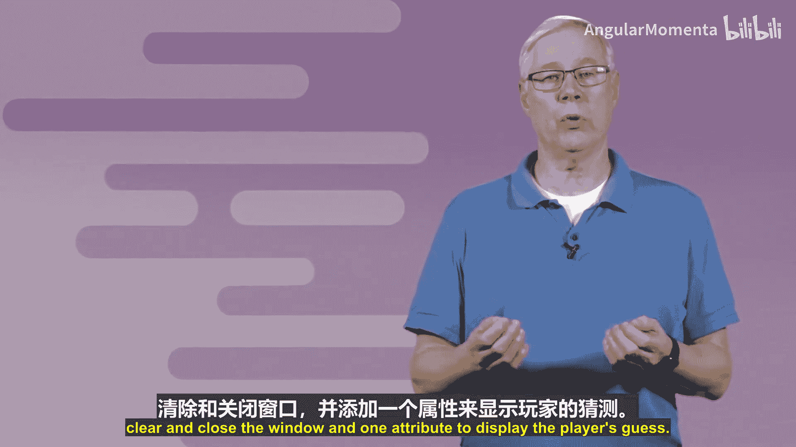

# 028：描述黑客游戏版本2

## 概述
在本节课中，我们将学习如何为图形界面的“黑客游戏”版本2创建描述。我们将基于版本1的文本描述进行修改，重点关注从文本界面到图形窗口的转变所带来的变化。

---

## 从观察到描述
上一节我们观察并试玩了黑客游戏版本2。本节中，我们将正式描述它。

观察、试玩、描述这个过程，随着课程的深入，应该成为你的自动反应。这是一种经验性分解，它能巩固你对主题的理解，这也是为什么这三个子任务构成了“理解版本”任务。

与版本1一样，你将使用描述构建器来为版本2创建描述。然而，由于游戏的第二个版本是在第一个版本的基础上构建的，因此你不是从零开始，而是通过修改版本1的描述来创建版本2的描述。

考虑到这一点，创建版本2描述的第一个任务是，删除版本1描述中所有不再相关的内容。

我将打开版本1的描述，以便找出应该删除的对象、属性和动作。

## 识别并删除过时内容
版本1的描述指出，标题的位置是游戏输出的顶行。这在版本2中看似仍然成立，因为标题显示在窗口顶部。然而，在图形窗口中，位置必须以不同的方式指定。因此，必须从描述中删除此属性。

由于玩家的猜测现在作为失败结果显示，失败结果的属性也必须更改。猜测是失败结果内容的一部分。这意味着必须移除内容属性，以便用版本2的适当内容属性替换。

让我们关闭版本1的描述，打开版本2。

## 构建版本2的描述
描述构建器的组装面板中已经加载了版本1描述的概念。但是，不适当的概念已被移除。

版本2的功能与版本1相同。改变的两件事是游戏的外观（使用图形窗口而非基于文本的Shell）以及必须显示玩家的猜测。

在版本1中，程序启动后，所有内容都显示在Shell中。在这个版本中，窗口在显示任何内容之前出现。

在左侧面板中，描述了一个新对象：**游戏打开一个窗口**。这是我们游戏的新第一个对象，因此我将把这个对象拖到组装面板中“游戏显示标题”的上方。

如果我把它放在标题下方，反馈会提示我添加对象的顺序错误。

与之前的描述活动一样，我可以添加新对象，也可以添加属性。让我们看看标题的属性。你将在后续活动中添加窗口的属性。

## 描述图形对象的属性
回想一下，每个显示对象都有五个属性：**内容**、**位置**、**大小**、**颜色**和**时序**。

当我们从文本转向图形时，每个对象的内容不会改变。因此，内容属性的描述将保持不变。

在制作图形游戏时，你必须描述窗口中所有对象的位置，因为你需要在程序中指定这些位置。在基于文本的游戏中，每个`print`调用的参数都显示在连续的行上，无需指定位置。

在我们的描述中，我们将使用通用术语来指示窗口位置，例如“左上角”、“窗口中心”或“直接在某些其他文本下方”。

由于标题在左上角，让我们将此属性添加到标题中。

下一个属性是文本的**大小**，即字体大小。在我们的描述中，让我们使用**小**、**中**、**大**。在黑客游戏中，所有文本大小相同，所以我将使用**小字体大小**。我将把这个属性添加到标题中。

黑客游戏中的所有文本都是**绿色在黑底上**，所以我将把“它是绿色在黑底上”添加到标题中。

最后一个属性是关于**时序**的。在版本1中，我们处理了对象显示的时间顺序。版本2引入了一个新的时间属性：**在显示每一行后，有0.3秒的暂停**。我将添加此属性以完成标题的描述。

## 后续任务
在下一个活动中，你将添加所有的窗口属性，以及其余对象的**位置**、**大小**和**颜色**属性。你还将在适当的时间顺序中添加两个新动作：**清除窗口**和**关闭窗口**。

此外，还需要添加一个属性来**显示玩家的猜测**。

---

## 总结
本节课中，我们一起学习了如何为图形化的黑客游戏版本2构建描述。我们基于版本1的文本描述，删除了不再适用的属性（如基于行的位置），并开始为图形界面添加新的属性，如**窗口位置**、**字体大小**、**颜色**和**显示时序**。关键点在于理解从文本到图形界面时，描述对象的方式需要从抽象的行概念转变为具体的窗口坐标和视觉属性。