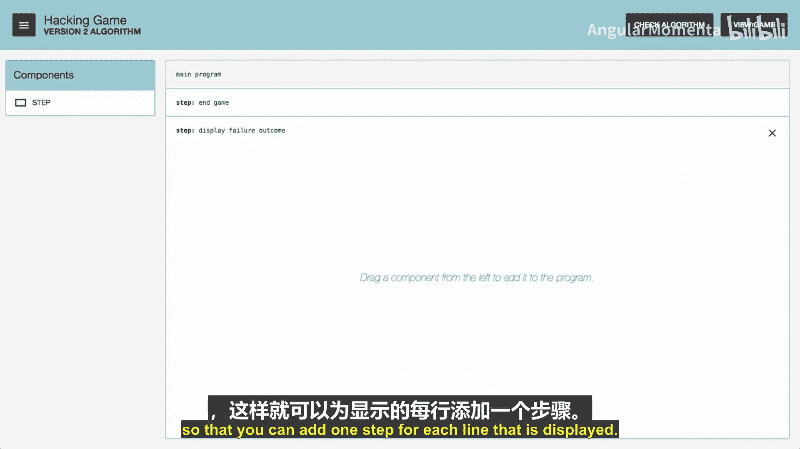

# 030：创建黑客游戏算法（版本2）

在本节课中，我们将学习如何为黑客游戏的第二个版本创建算法。我们将基于版本1的算法，通过添加图形化功能来构建更复杂的版本2算法。

上一节我们介绍了版本1的基本算法。本节中，我们来看看如何通过添加图形库功能来升级到版本2。

## 算法构建基础

版本1的算法已经存在于构建器中。由于版本2的算法包含了版本1的所有步骤，因此你无需决定删除哪些步骤。你将通过**添加步骤**来创建你的版本2算法。

回想一下，**功能选择**用于将一个复杂问题转化为一系列称为“版本”的子问题。功能选择是为每个版本确定合理功能集的过程。

在版本1中，你为最小的功能集创建了算法。在版本2中，你将添加图形化功能。你必须使用**图形库**来代替内置函数显示文本。

## 图形库功能

大多数图形库都具备一些通用功能。以下是常见的图形库能力：

*   打开和关闭窗口。
*   在窗口中显示对象。
*   清除窗口内容。

你将把类似上述的步骤添加到你的算法中。诸如文本颜色等细节包含在你的描述中，但它们过于具体，不应包含在算法步骤里。然而，当你编写代码时，会需要这些细节。

## 游戏结束步骤的扩展

你的“游戏结束”算法步骤包含了前一版本中的“显示失败结果”和“提示结束”步骤。你必须为“游戏结束”添加其他步骤。同时，你必须扩展“显示失败结果”步骤，使其使用自己的面板，以便为显示的每一行添加一个步骤。

这是必要的，因为必须显示猜测内容，并且结果行必须**居中显示**。

## 文本对齐的复杂性

居中显示文本行比显示左对齐的连续行（例如标题和密码列表）需要更复杂的计算。

请使用你已完成的黑客游戏版本2描述和测试计划，从版本1的算法出发，创建出版本2的算法。

---

本节课中，我们一起学习了如何从版本1的算法升级到版本2。核心在于通过**功能选择**添加图形库功能，并特别注意了扩展“游戏结束”逻辑以及处理文本居中显示所带来的算法复杂性。记住，算法描述应保持高层次，而将具体实现细节留给编码阶段。