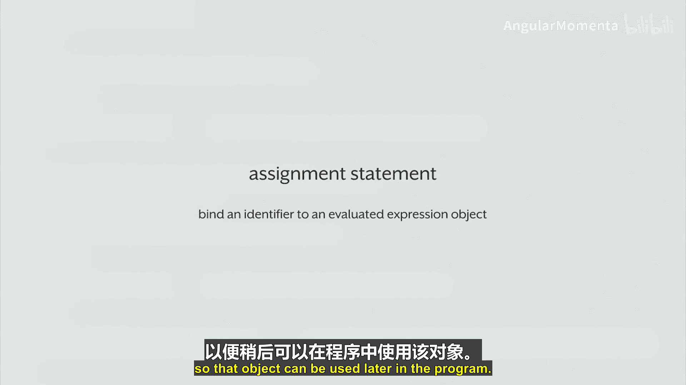

# 031：Python赋值语句


在本节课中，我们将要学习Python编程中的一个核心概念：赋值语句。我们将了解它的语法、语义以及如何在程序中有效地使用它来存储和引用数据。

## 概述

赋值语句是Python中用于将标识符（如变量名）与一个对象（如数字、字符串等）绑定起来的关键工具。它允许我们在程序的一个地方计算一个值，并在后续的多个地方通过一个简单的名字来引用它，从而使代码更加清晰和高效。

## 赋值语句的语法与语义

上一节我们介绍了程序的基本结构，本节中我们来看看一种新的语句——赋值语句。

赋值语句用于计算一个表达式，并将一个标识符绑定到结果对象上。

以下是赋值语句最简单的语法形式：

```
target = expression
```

*   **target（目标）**：目前我们只讨论最简单的目标——一个标识符（即变量名）。
*   **`=`（赋值符号）**：这是一个分隔符标记，由单个等号组成。在Python中，它不表示“相等”，通常读作“赋值为”或“得到”，而不是“等于”。
*   **expression（表达式）**：任何可以计算出结果的Python表达式。

当一个赋值语句的目标是标识符时，其语义（执行规则）如下：
1.  计算表达式以得到一个结果对象。
2.  如果该标识符不在当前命名空间中，则将其添加到命名空间。
3.  将该标识符绑定到这个结果对象。

## 程序示例分析

让我们通过一个具体的程序来理解赋值语句是如何工作的。

考虑以下程序代码：

```python
favorite = input("Enter your favorite color: ")
second_favorite = input("Enter your second favorite color: ")
print("You picked:")
print(favorite)
print("and")
print(second_favorite)
```

当Python解释器执行这个程序时，其过程如下：

1.  **执行第一条赋值语句**：计算表达式 `input("Enter your favorite color: ")`。假设用户输入“purple”，该函数调用返回字符串对象 `"purple"`。解释器将标识符 `favorite` 添加到命名空间，并将其绑定到字符串 `"purple"`。
2.  **执行第二条赋值语句**：类似地，假设用户输入“red”，标识符 `second_favorite` 被绑定到字符串 `"red"`。
3.  **执行后续的表达式语句**：当执行 `print(favorite)` 时，解释器会**解引用**标识符 `favorite`，即在其绑定的命名空间中查找它，并获取它指向的对象——字符串 `"purple"`，然后将其打印出来。`print(second_favorite)` 的过程与之类似。

通过使用赋值语句，我们可以在程序开头获取数据，并在程序的任何后续部分方便地使用这些数据。

## 标识符的重新绑定

一个已经被绑定的标识符可以被重新绑定到另一个不同的对象。

如果对一个已绑定的标识符再次应用赋值语义规则：
*   该标识符已存在于命名空间中，因此不会被再次添加。
*   该标识符会被**重新绑定**到表达式计算出的新对象上，之前的绑定关系则被覆盖。

考虑以下程序：

```python
L = id
print(L("Hello"))
```

1.  程序开始时，命名空间包含预绑定的标识符，如 `len`（`L`的预绑定对象）、`id` 和 `print`。
2.  **执行第一条赋值语句**：`L = id`。表达式 `id` 被解引用，得到内置的 `id` 函数对象。标识符 `L` 被重新绑定到这个 `id` 函数对象，覆盖了原来指向 `len` 函数的绑定。
3.  **执行第二条表达式语句**：`print(L("Hello"))`。解释器解引用 `L`，现在得到的是 `id` 函数。`id("Hello")` 被调用，返回字符串 `"Hello"` 的身份标识（一个内存地址相关的数字），然后由 `print` 函数输出。

这个例子表明，任何标识符都可以被绑定到任何对象。**但是，你绝对不应该在代码中重新绑定那些在程序运行前就已预定义的标识符（如 `print`, `len`, `id` 等）**，这会导致意想不到的行为并使代码难以理解。

## 检查命名空间

你可以使用内置的 `dir()` 函数来检查当前的命名空间。

*   在交互式环境中输入 `dir(__builtins__)`，可以查看所有预绑定的内置对象名称。
*   输入 `dir()`（不带参数），可以查看当前作用域中已定义的所有名称，包括你自定义的变量。

例如，在绑定 `favorite` 和重新绑定 `L` 之后调用 `dir()`，结果列表中将会包含 `favorite` 和 `L`，表明它们已被绑定。

## 总结



本节课中我们一起学习了Python赋值语句的核心知识。我们了解到，赋值语句（`变量名 = 表达式`）用于将标识符与一个对象绑定，使得该对象可以在程序后续部分通过标识符方便地引用。我们分析了其执行语义，并通过示例看到了如何绑定以及重新绑定标识符。最后，我们知道了可以使用 `dir()` 函数来探查命名空间的状态。正确使用赋值语句是组织和管理程序数据的基础。