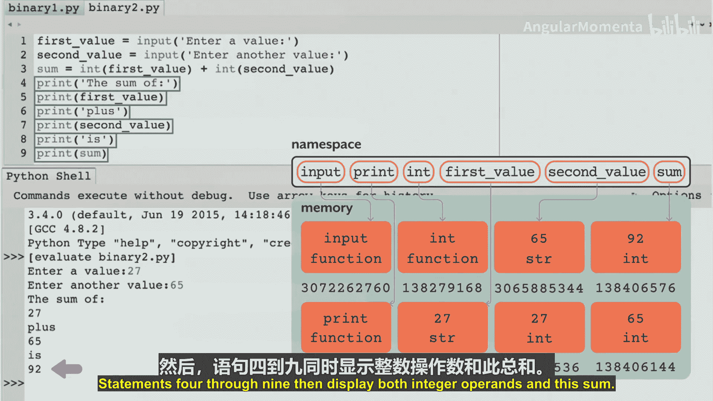

# 032：Python二元表达式与运算符标记


在本节课中，我们将学习一种新的表达式——二元表达式，以及一种新的标记——运算符标记。我们将把二元表达式添加到我们的表达式语法图中。

## 概述

我们已经介绍了Python五种标记中的三种：分隔符、字面量和标识符。在本节中，我们将介绍运算符标记。

## 运算符标记

考虑以下程序，其第三条语句包含一个二元表达式和一个名为“加号”的运算符标记。

```python
first_value = input("Enter first value: ")
second_value = input("Enter second value: ")
sum = first_value + second_value
print("First value:", first_value)
print("Second value:", second_value)
print("Sum:", sum)
```

这个程序提示用户输入两个值，并将标识符 `first_value` 和 `second_value` 绑定到 `input` 函数返回的两个字符串对象。

运行此程序，输入 `27` 和 `65`，结果是 `2765`。发生了什么？

除了第三条语句，其他所有语句都包含你已经学过的标记和表达式。所有这些语句都具有有效的词法和语法。那么第三条语句呢？让我们对第三条语句应用词法分析、语法分析和语义分析。

## 词法分析

第三条语句包含以下标记：标识符 `sum`、赋值分隔符 `=` 和标识符 `first_value`。下一个字符是加号 `+`，而我们目前描述的任何标记类型都不以加号字符开头。加号字符是一种新的标记类型，称为**运算符标记**。

运算符用于从一个或多个操作数计算出一个结果对象。由于只有19个运算符标记，我们将其列在词法表中，而不是使用词法规则。

以下是Python中的运算符标记表：

*   `+` 加法
*   `-` 减法
*   `*` 乘法
*   `/` 除法
*   `//` 整除
*   `%` 取模
*   `**` 幂运算
*   `==` 等于
*   `!=` 不等于
*   `<` 小于
*   `>` 大于
*   `<=` 小于等于
*   `>=` 大于等于
*   `=` 赋值（注意：这是分隔符，不是运算符）
*   `&` 按位与
*   `|` 按位或
*   `^` 按位异或
*   `~` 按位取反
*   `<<` 左移
*   `>>` 右移

一些数学运算符在Python中用相同的运算符标记表示，一些用不同的标记表示，还有一些则没有对应的运算符标记。

*   **加号 `+` 和减号 `-`** 在Python和数学中相同。
*   **乘法** 在数学中使用乘号或点表示，在Python中使用星号 `*`。
*   **小于等于** 在数学中是 `≤`，在Python中用两个符号 `<` 和 `=` 表示。
*   **幂运算** 在数学中用上标表示，在Python中使用双星号 `**` 运算符标记。
*   **等于** 在数学中是 `=`，在Python中，相等运算符是双等号 `==`。请注意，单独一个等号 `=` 实际上是赋值分隔符标记，而不是运算符标记。在应该使用相等运算符时误用赋值分隔符是一个常见的编程错误。
*   **阶乘** 在数学中使用感叹号 `!`，但Python中没有阶乘运算符标记。

## 最长标记规则

你看到运算符标记表中同时包含 `**` 和 `*`。如果词法分析器遇到 `**`，它是创建一个单独的运算符标记 `**`，还是两个运算符标记 `*` 和 `*`？我们可以将最长标记规则应用于运算符标记，就像我们在词法分析课程中将其应用于整数字面量和标识符一样。因此，答案是**一个长标记 `**`**。

## 语法分析：二元表达式

第三条语句的最后一个标记是标识符 `second_value`。第三条语句是一个赋值语句，其中的表达式是一种新的表达式——**二元表达式**。

以下是二元表达式的语法图：

```
二元表达式 -> 表达式 二元运算符 表达式
```

这个语法图包含一个新的非终结符 **二元运算符**。目前，我们将使用以下语法图来表示非终结符“二元运算符”：

```
二元运算符 -> 运算符标记（除 `~` 外）
```

任何运算符标记（除了 `~`）都可以用作二元运算符。在未来的课程中，我们将把二元运算符的概念泛化，以包含一些其他非运算符标记。

第三条语句中的表达式是一个二元表达式，因为 `first_value` 匹配第一个表达式（作为标识符），加号标记 `+` 匹配二元运算符状态，`second_value` 匹配第二个表达式（作为标识符）。

## 语义分析

二元表达式用于将运算符函数应用于两个操作数对象。应用的函数取决于二元运算符和两个操作数的类型。

二元表达式的语义如下：

1.  计算左表达式以获取第一个操作数对象。
2.  计算右表达式以获取第二个操作数对象。
3.  根据二元运算符和两个操作数的类型确定运算符函数。
4.  应用二元运算符的函数。

在未来的课程中，你会发现一些二元运算符函数可能会忽略第二个表达式。

在将语义应用于语句3之前，我们先快速应用语义到语句1和2。

程序开始时，存在一个包含所有预绑定标识符的命名空间。在我们的例子中，程序中使用的唯一预绑定标识符是内置函数名 `input` 和 `print`。语句1和2是赋值语句。

*   **语句1** 提示用户输入一个字符串。在本例中，`input` 函数返回字符串对象 `"27"`。解释器将标识符 `first_value` 添加到命名空间，并将其绑定到字符串对象 `"27"`。
*   **语句2** 将标识符 `second_value` 添加到命名空间，并将其绑定到字符串对象 `"65"`。

现在，让我们对语句3应用赋值语句语义。表达式是一个二元表达式，因此我将对其应用二元表达式语义。

1.  计算左表达式以获取第一个操作数对象。由于左表达式是一个标识符表达式，我们使用标识符的语义。由于标识符 `first_value` 在命名空间中，解释器解引用它以获取字符串对象 `"27"`。
2.  解释器必须计算右表达式以获取第二个操作数对象。由于右表达式是一个标识符表达式，标识符 `second_value` 被解引用以获取字符串对象 `"65"`。
3.  二元运算符是加号运算符标记 `+`，并且两个操作数的类型都是字符串，因此解释器找到为字符串实现加法的运算符函数。这个函数是**字符串连接**。
4.  当字符串连接函数应用于操作数——字符串对象 `"27"` 和字符串对象 `"65"` 时，会创建结果字符串对象 `"2765"`。

为了完成赋值语句的语义，标识符 `sum` 被添加到命名空间并绑定到这个字符串对象。

语句4到9显示程序输出。

## 数值求和

要计算两个数字的数值和，我可以使用内置函数 `int`，它从字符串对象创建一个整数对象。以下是 `int` 函数的Python文档：

```python
int(x) -> integer
```

这是修改后的程序：

```python
first_value = input("Enter first value: ")
second_value = input("Enter second value: ")
sum = int(first_value) + int(second_value)
print("First value:", first_value)
print("Second value:", second_value)
print("Sum:", sum)
```

在这个程序中，语句3中的二元表达式包含两个函数调用表达式。第一个调用计算为整数对象 `27`，第二个调用计算为整数对象 `65`。

当应用二元表达式语义时，解释器找到为整数实现加法的运算符函数。这个函数是**数值加法**。解释器应用这个数值加法函数以获得整数对象 `92`，然后将标识符 `sum` 绑定到这个对象。语句4到9随后显示两个整数操作数及其和。

## 总结



在本节课中，我们一起学习了运算符标记和二元表达式。我们了解了运算符标记的种类，学习了如何通过语法图识别二元表达式，并深入探讨了二元表达式的语义分析过程，特别是如何根据操作数的类型选择正确的运算符函数（如字符串连接或数值加法）。理解这些概念是掌握Python表达式求值的基础。