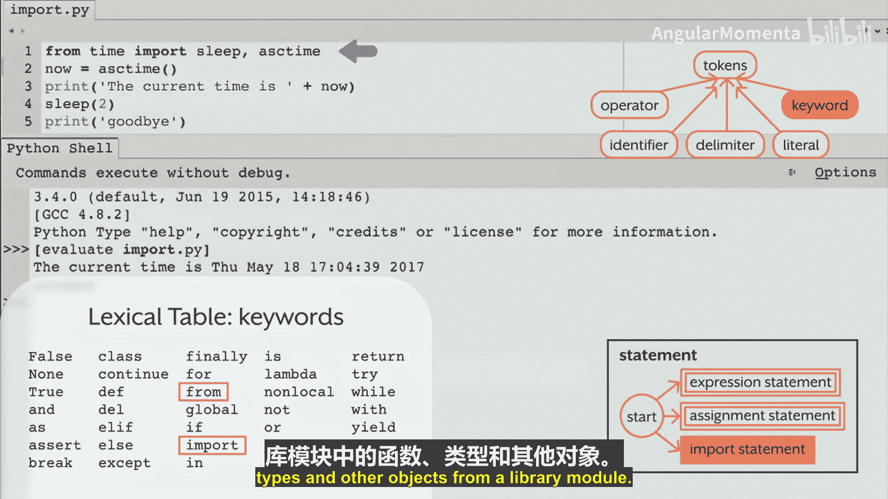

Python编程与电子游戏：第4章第8节：import语句与关键字token


在本节课中，我们将学习一种新的语句——**import语句**，以及最后一种词法单元——**关键字**。import语句允许我们在程序中使用来自库模块的函数、类型和其他对象。掌握它是扩展Python程序功能的关键。

---

### 导入语句的作用

到目前为止，你只在代码中使用过内置函数。然而，内置函数的数量是有限的。如果你想为代码添加内置函数不支持的功能，就需要使用**模块**。

模块是一个拥有自己语句和命名空间的Python程序。它提供了你可以在自己程序中使用的函数、类型和其他对象。Python的标准库包含许多模块。

例如，如果你想在程序中暂停一段时间，没有内置函数可以实现这一点。但是，标准库中`time`模块的`sleep`函数可以做到。

```python
# 尝试直接调用sleep函数会出错
sleep(2)  # 错误！NameError: name 'sleep' is not defined
```

出错的原因是`sleep`这个名字不在程序的命名空间中。它不像`len`或`int`那样是预绑定的。我们可以使用内置的`dir()`函数来检查当前命名空间。

为了使用模块中的对象，我们需要使用一种新的语句：**import**。

### 理解import语句

import语句将标识符从模块导入到你程序的命名空间中，这样你就可以使用这些标识符所绑定的对象。

import语句有几种不同的语法形式，本节课介绍`from...import...`形式。

要理解这个语法图，我们必须先介绍**关键字**词法单元。

### 关键字词法单元

Python中有33个关键字。`from`和`import`都是关键字词法单元。

关键字看起来像标识符，但它是**保留字**，不能用作标识符。尝试将关键字用作标识符会导致语法错误。

例如，如果尝试用赋值语句绑定关键字`from`，就会发生语法错误。

```python
from = 10  # 错误！SyntaxError: invalid syntax
```

回想一下我们之前学过的标识词法规则：以字母或下划线开头，后跟零个或多个字母、下划线或数字。现在，我们必须修改这个标识符词法规则，以**排除关键字**。

### 语法分析示例

让我们对下面的import语句进行语法分析：

```python
from time import sleep, asctime
```

1.  第一个词法单元是关键字`from`，它与import语句语法图中的`from`终结状态匹配。
2.  下一个词法单元是标识符`time`，下一个状态是非终结状态`module`。在本课中，我们使用`module`最简单的版本，即单个标识符。标识符`time`匹配`module`语法图中的标识符状态。
3.  import语句中的下一个词法单元必须是关键字`import`。
4.  在这个关键字状态之后，是匹配一个或多个由逗号分隔的标识符的状态。注意，最后一个标识符后面没有逗号。
5.  由于语句中没有更多词法单元，并且当前状态标识符是一个接受状态，因此这是一个语法上有效的import语句。

### import语句的语义

在展示import语句的语义之前，让我们先运行一个使用它的程序：

```python
from time import sleep, asctime

now = asctime()
print("Current time:", now)
sleep(2)
print("Goodbye!")
```

这个程序会显示当前时间，暂停两秒，然后显示“Goodbye!”。`sleep`和`asctime`函数不是Python内置函数，它们包含在一个名为`time`的库模块中。

以下是import语句的语义步骤，我们将它们应用到程序中的import语句上：

1.  **查找模块**：解释器使用模块名`time`来找到`time`模块。
2.  **评估模块**：解释器通过评估其语句来评估`time`模块。我们看不到`time`的语句，但解释器评估它们的方式与评估我们程序的方式相同：一次一个语句。评估`time`的语句会在内存中创建对象，将一些名称（如`sleep`和`asctime`）添加到`time`的命名空间，并将这些名称绑定到一些创建的对象上。
3.  **解引用名称**：解释器解引用`time`命名空间中的`sleep`和`asctime`名称，以获取它们绑定的两个对象。
4.  **检查程序命名空间**：解释器在程序的命名空间中查找，没有找到`sleep`或`asctime`，因此它添加这两个名称。
5.  **绑定对象**：解释器将程序命名空间中的名称`sleep`和`asctime`绑定到步骤3中使用`time`命名空间找到的对象上。

### 程序执行过程

当程序评估第二条语句（`now = asctime()`）时，它使用赋值语句的语义：
*   首先评估函数调用表达式，在程序的命名空间中查找`asctime`，绑定并解引用它以获取`asctime`函数对象。
*   评估这个函数对象，返回一个表示当前日期和时间的字符串对象。
*   最后，它将标识符`now`添加到程序的命名空间，并将其绑定到这个字符串对象。

第三条语句是一个包含`print`函数调用的表达式语句。解释器评估这个函数调用，在程序命名空间中查找`print`名称，绑定并解引用它以获取`print`函数，然后评估参数表达式，连接字面字符串和标识符`now`绑定的字符串对象，并将这个字符串对象显示为当前时间和日期。

第四条语句是一个包含函数调用的表达式语句。解释器评估这个函数调用，在程序命名空间中查找`sleep`名称，找到`sleep`名称，解引用它以获取`sleep`函数，并用参数对象`2`评估它。这个函数使程序暂停两秒，并返回一个类型为`NoneType`的对象（被忽略）。

第五条语句显示告别字符串，程序结束。

### 使用多个import语句

你可以使用多个import语句从多个模块导入名称。这些语句可以按任何顺序放置，只要**在使用一个名称之前导入它**即可。

```python
from math import sqrt
from random import randint
from time import sleep

# 现在可以使用sqrt, randint, sleep
```

---

### 总结

在本节课中，我们一起学习了：
1.  **import语句**：一种允许我们从外部库模块导入函数、类型等对象到当前程序命名空间的语句。
2.  **关键字**：Python中最后一种词法单元，是保留的标识符，具有特殊语法含义，不能用作普通变量名。
3.  `from module import name`语句的语法结构和执行语义。
4.  通过导入`time`模块并使用`sleep`、`asctime`函数的实例，理解了模块如何扩展程序功能。



理解import语句是构建复杂、功能丰富Python程序的基础。在接下来的学习中，你会遇到更多强大的标准库和第三方模块。