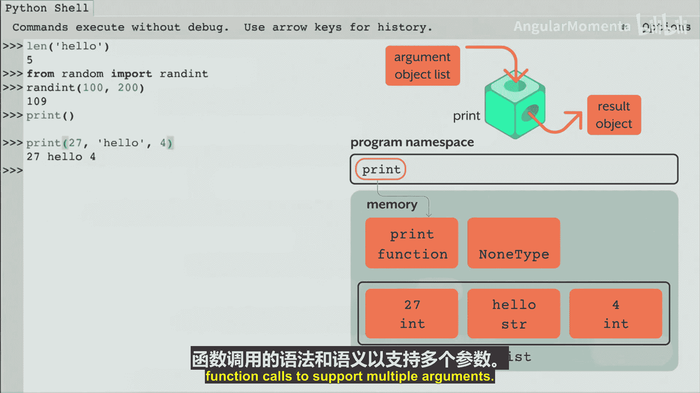

# 034：多参数函数调用 🧩


在本节课中，我们将学习如何扩展函数调用的语法和语义，使其支持多个参数，而不仅仅是零个或一个参数。

## 概述

之前我们已经学习了如何调用不带参数或带一个参数的函数。然而，在实际编程中，许多函数需要接收多个输入值才能完成其任务。本节将详细介绍Python中多参数函数调用的语法规则和内部执行过程。

## 函数参数数量的多样性

不同的函数支持不同数量的参数。例如：

*   `len()` 函数**恰好**需要一个参数。
*   标准库 `random` 模块中的 `randint()` 函数需要两个参数，用于指定随机数的范围。

许多Python函数可以接受**可变数量**的参数。`print()` 函数就是一个典型的例子。

以下是 `print()` 函数不同调用方式的示例：

```python
print()          # 无参数调用，输出一个空行
print("Hello")   # 单参数调用
print(27, "Hello", 4) # 多参数调用，输出：27 Hello 4
```

当 `print()` 函数被传入多个参数时，它会从左到右依次**求值**每个参数表达式，并将结果对象在同一行输出，对象之间用单个空格分隔。

## 多参数函数调用的语法

为了支持多个参数，我们需要扩展函数调用的语法定义。以下是支持一个或多个参数的简化语法图。

上一节我们介绍了基础函数调用的语法，本节中我们来看看如何定义参数列表。

参数列表 (`argument_list`) 的语法规则是：它由一个表达式开始，后面可以跟随零个或多个由逗号分隔的表达式。

让我们用这个语法规则来分析表达式 `print(27, "hello", 4)` 是否有效。

1.  标识符 `print` 匹配函数名。
2.  左括号 `(` 匹配左括号状态。
3.  进入 `argument_list` 状态：
    *   字面量 `27` 是一个有效的表达式。
    *   逗号 `,` 匹配分隔符状态。
    *   字符串 `"hello"` 是一个有效的表达式。
    *   逗号 `,` 再次匹配。
    *   字面量 `4` 是一个有效的表达式。
4.  右括号 `)` 匹配右括号状态，表示参数列表结束。
5.  所有令牌消耗完毕，且当前处于函数调用的接受状态，因此该表达式**语法有效**。

## 多参数函数调用的语义

既然语法有效，解释器就可以进行语义分析，即执行这个函数调用。

之前单参数函数调用的语义规则需要被修改以支持多个参数。新的语义步骤如下：

**步骤1**：对函数名进行求值，获取函数对象。
**步骤2**：如果存在参数列表，则对其求值，得到一个**参数对象列表**；否则，创建一个空列表。
**步骤3**：将这个参数对象列表传递给函数对象。
**步骤4**：对函数对象进行求值，得到结果对象。

其中，参数列表的语义是：**从左到右依次求值列表中的每个表达式，并将结果对象按顺序添加到一个列表中**。

让我们将这些规则应用到 `print(27, "hello", 4)` 上。

1.  程序启动时，名称 `print` 已绑定到内置的 `print` 函数对象。
2.  存在参数列表 `(27, "hello", 4)`。解释器对其求值：
    *   求值 `27`，得到整数对象 `27`。
    *   求值 `"hello"`，得到字符串对象 `"hello"`。
    *   求值 `4`，得到整数对象 `4`。
    *   将这三个对象按顺序放入参数对象列表：`[27, "hello", 4]`。
3.  将这个包含三个对象的列表传递给 `print` 函数对象。
4.  执行 `print` 函数。其功能是接收一个对象列表作为输入，将这些对象以人类可读的形式打印出来（默认用空格分隔）。因此，屏幕输出：`27 hello 4`。
    `print` 函数返回一个 `NoneType` 类型的对象，通常被忽略。

## 总结



本节课中，我们一起学习了多参数函数调用的核心概念。我们扩展了函数调用的**语法**，使其能够定义由逗号分隔的参数列表；同时更新了其**语义**，明确了解释器会从左到右求值所有参数，并将结果对象列表传递给函数执行。理解这一点是编写和调用复杂函数的基础。