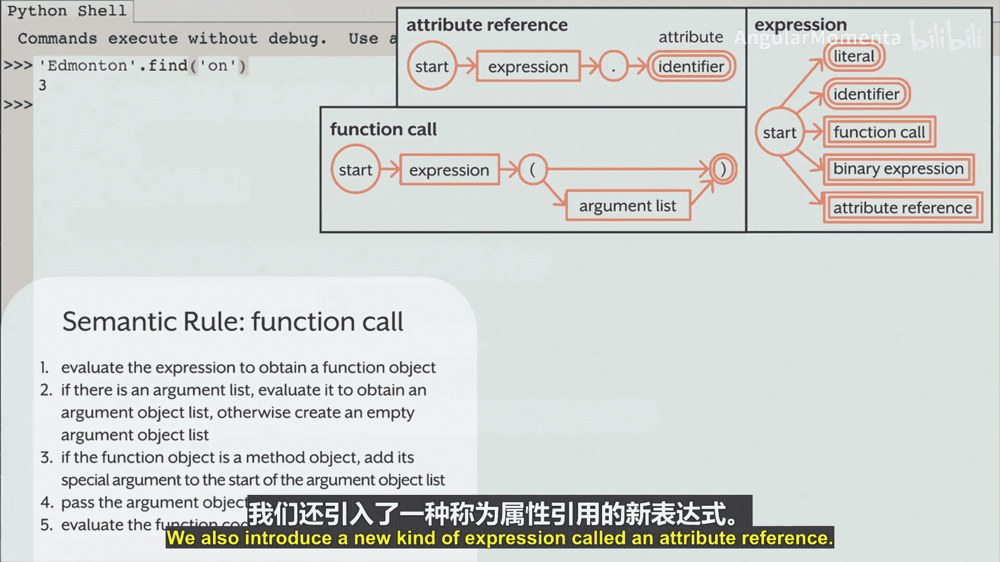

# 035：方法调用与属性引用 🐍


在本节课中，我们将学习Python中的两个核心概念：**方法调用**和**属性引用**。我们将了解如何通过对象访问其内部的功能（方法）和数据（属性），并深入探讨方法调用的独特语法和运行原理。

---

## 概述

在之前的课程中，我们学习了函数调用的基本语法和语义。本节我们将对其进行**泛化**，使其包含一种特殊的函数调用——**方法调用**。同时，我们将引入一种新的表达式类型——**属性引用**，它是访问对象内部命名空间的关键。

---

## 属性引用：访问对象的命名空间

每个程序都有一个命名空间，用于将标识符绑定到对象。此外，**大多数对象也拥有自己的命名空间**。对象命名空间中的名称被称为**属性**。

为了访问对象命名空间中的对象，我们使用一种名为**属性引用**的新表达式。

例如，每个字符串对象都有一个名为 `lower` 的属性，该属性绑定到一个**方法对象**。

在本课程中，我们假设对象的命名空间在对象创建时一同创建。实际上，Python不同实现中命名空间的管理方式可能有所不同。

以下是包含属性引用的表达式的新语法图：

```
表达式 . 属性
```

而这是属性引用本身的语法图。属性必须是一个标识符标记。

从这些语法图中可以看出，`R2D2.lower` 是一个语法上有效的属性引用，其表达式是字面字符串 `"R2D2"`，属性是标识符 `lower`。

### 属性引用的语义

属性引用的执行遵循以下两个步骤：

1.  **计算表达式以获取一个对象。**
2.  如果该属性存在于对象的命名空间中，则返回其绑定的对象。否则，报告一个属性错误。

当我们计算属性引用 `R2D2.lower` 时，解释器会应用上述语义：

*   首先，表达式是字面字符串 `"R2D2"`。解释器计算这个字面量，创建字符串对象 `"R2D2"`。由于这是一个字符串对象，其命名空间包含标识符 `lower`，该标识符绑定到一个方法对象。
*   其次，解释器在 `"R2D2"` 的命名空间中找到标识符 `lower`，并解引用以获取该字符串对象的 `lower` 方法对象。

因此，每个字符串都有一个名为 `lower` 的属性，它绑定到一个方法对象。

---

## 方法对象与方法调用

那么，什么是方法对象？方法又有什么用呢？

一个**方法**是一个对特定类型对象进行操作的函数。我们说这个方法与该类型**关联**。方法所应用的对象被称为**特殊参数**。

方法应用的语法与普通函数调用不同。特殊对象不像普通函数调用那样作为参数列表中的一个求值表达式。相反，方法调用使用属性引用的语法，其中特殊对象是点号 `.` 前的一个求值表达式，而方法名则放在点号之后。

例如，`lower` 方法对一个字符串对象进行操作，并返回一个将所有大写字母转换为小写字母的相似字符串对象。

如果 `lower` 是一个普通函数调用，函数调用看起来会是这样：

```python
lower("R2D2")
```

但 `lower` 不是一个普通函数调用，因此这种语法无效。Python中没有名为 `lower` 的内置函数。相反，存在一个与字符串类型关联的内置方法，其名称就是 `lower`。你可以通过查看类型文档来查阅内置方法的文档。

有些方法除了特殊参数外，还需要普通的参数对象。例如，字符串方法 `find` 还需要一个普通的字符串参数。

`find` 方法返回字符串中第一次出现子串的起始索引。

```python
"Edmonton".find("on")
```

在这个例子中，子串 `"on"` 在字符串 `"Edmonton"` 中的第一次出现位于索引 3。在Python中，字符串索引从0开始编号。所以0是`E`，1是`D`，2是`M`，3是`O`。这个`O`就是第一次出现`"on"`的起始位置。

---

## 泛化函数调用语法以包含方法调用

上一节我们介绍了属性引用和方法的基本概念，本节中我们来看看如何将函数调用的语法进行泛化，使其能够包含方法调用。

以下是你已经见过的函数调用的当前语法：

```
函数名 ( 参数列表 )
```

为了将此语法泛化以包含方法调用，我们将语法图中的 `函数名` 状态替换为 `表达式` 状态。这样，任何表达式（包括属性引用）都可以在函数调用中用作函数名，而不仅仅是使用单个标识符。

我将使用这些语法图来验证方法调用表达式的语法，然后再定义方法调用的语义。

你已经看到，前三个标记 `R2D2`、`.` 和 `lower` 匹配属性引用（这是一个表达式）。最后两个标记匹配函数调用图中的左右括号。因此，这个标记序列是一个有效的函数调用。

由于 `R2D2.lower` 求值得到一个方法对象，而不是一个普通的函数对象，所以这个表达式是一个**方法调用**。

---

## 泛化函数调用语义以包含方法调用

现在，我将函数调用的语义泛化，以包含方法调用的语义。以下是更新后的步骤：

1.  计算表达式以获取一个对象。
2.  计算参数列表中的每个表达式，创建一个参数对象列表。
3.  **如果表达式对象是一个方法对象，则将其特殊参数添加到参数对象列表的开头。**
4.  将参数对象列表传递给函数对象。
5.  计算函数代码。

让我们看看解释器如何将函数调用语义应用于 `"Edmonton".find("on")`：

1.  首先，它计算表达式，该表达式由属性引用 `"Edmonton".find` 组成。
    *   应用属性引用的语义：属性引用的第一个语义步骤是计算其表达式，即创建字符串对象 `"Edmonton"`。由于这是一个字符串对象，解释器也会创建其命名空间。
    *   属性引用的第二步是在 `"Edmonton"` 的命名空间中定位名为 `find` 的属性，并解引用以获取方法对象 `find`。
2.  属性引用求值完成后，解释器返回到函数调用的语义规则并执行步骤2：如果存在参数列表，则计算它。参数列表包含一个单一的字面字符串表达式 `"on"`。因此，创建一个包含字符串对象 `"on"` 的单元素参数对象列表。
3.  在步骤3中，解释器评估表达式并识别出 `find` 是一个方法对象，因此它将特殊参数 `"Edmonton"` 添加到参数对象列表的开头。此时参数对象列表变为 `["Edmonton", "on"]`。
4.  在步骤4中，解释器将参数对象列表传递给函数对象，即方法对象 `find`。
5.  在步骤5中，解释器计算函数代码，即 `find` 的方法代码。该方法计算并返回整数对象 `3`，作为字符串 `"Edmonton"` 中第一个匹配字符串 `"on"` 的索引。

---

## 总结

在本节课中，我们一起学习了：

1.  **属性引用**：一种用于访问对象命名空间中绑定的表达式，语法为 `对象.属性`。
2.  **方法**：与特定类型关联的函数，用于操作该类型的对象。
3.  **方法调用**：函数调用的一种特殊形式。其语法使用属性引用来指定方法（如 `对象.方法名()`），其语义会在执行时自动将点号前的对象作为第一个参数（特殊参数）传递给方法。



通过泛化函数调用的语法和语义，我们统一了对普通函数和方法的理解，这是掌握Python面向对象编程基础的重要一步。