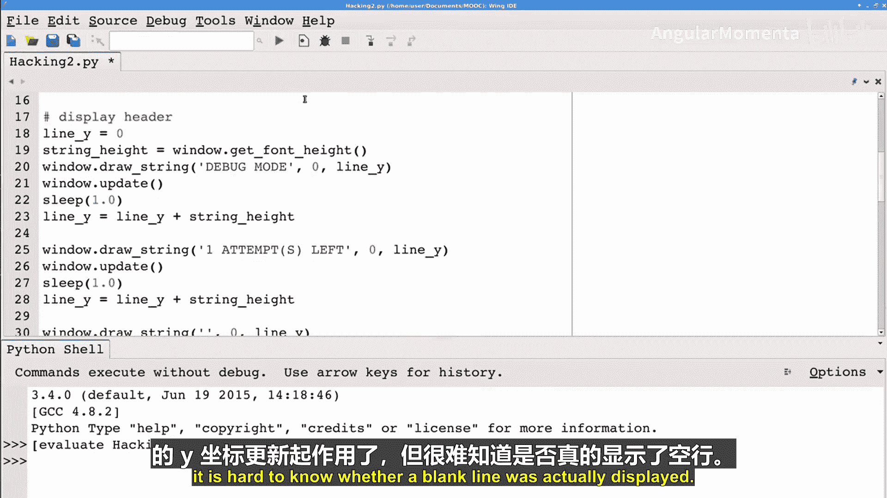
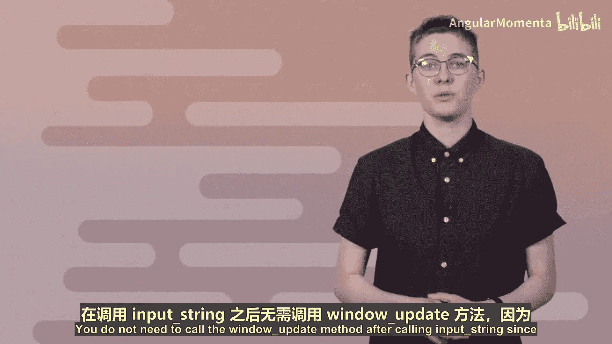

# 036：编程黑客游戏版本2

## 概述

在本节课中，我们将学习如何将黑客游戏从命令行版本升级到图形窗口版本。我们将使用UA游戏库创建一个窗口，并在其中显示文本、获取用户输入，并处理图形界面的坐标系统。

---

## 从版本1到版本2

上一节我们完成了黑客游戏的命令行版本。本节中，我们来看看如何将其转换为一个带有图形窗口的版本。

开始新版本项目时，最佳实践是保存前一个版本的副本，并在新副本上进行修改。现在，我将复制`hacking version 1`，并将新副本重命名为`hacking2.py`，这将成为版本2的代码。

## 添加算法步骤注释

首先，为版本2算法的每个步骤添加描述性的块注释。部分注释在版本1中已存在，我将添加新的注释。我们使用注释开头额外的空格来表示它是更大步骤中的一个子步骤。

## 创建游戏窗口

我将查阅UA游戏库文档，看看可以使用哪些窗口方法。由于要创建一个窗口对象，我将选择一个合适的标识符来绑定我的窗口对象，例如`window`。

现在，我将使用UA游戏库中的`window`函数来创建一个窗口对象。文档指出，我必须传递三个参数：一个标题字符串、一个宽度整数和一个高度整数。我将从版本2的描述中获取这些值。

标题应为`"hacking"`，窗口的宽高比应为6:5。这是在代码中需要更精确处理的描述不明确之处。我将使用一个600x500像素的窗口。

我不需要从程序开始到结束逐行添加代码。我可以将相关的功能放在一起添加。例如，为了在游戏结束时关闭窗口，我将在`Close window`注释下，在程序末尾添加名为`window.close`的方法。

## 导入与初步运行

现在我将运行我的程序，看看会发生什么。首先，我需要添加一个`import`语句，以便可以使用UA游戏库中的`window`类型。这使我能够访问与`window`相关的所有方法。

一个窗口打开了，但所有`print`函数调用仍然显示在Shell中。在我输入密码并按回车退出后，窗口关闭了。`print`和`input`函数在窗口中不起作用。因此，我将删除所有原始程序行。

## 在窗口中绘制文本

`window`类型有一个名为`draw_string`的方法。由于此方法在窗口中显示字符串，我将使用它来显示第一个标题行。

`draw_string`接受三个参数：一个要显示的字符串，以及两个指示其在窗口中位置的左上角坐标的整数。

计算机图形使用坐标系来定义窗口中的点。你可能从数学中熟悉坐标。将窗口视为一个图形，X轴是水平的，Y轴是垂直的。

在数学中，我们将原点(0,0)放在窗口的左下角；X从左向右增加，Y从下向上增加。在图形学中，原点位于窗口的左上角。X仍然随着向右移动而增加，但Y随着向下移动而增加。距离左上角向下10像素的点表示为(0,10)。一个600x500像素窗口的右下角点位于(600,500)。

为了在左上角显示标题的第一行，我将传入字面字符串`"debug mode"`、字面整数`0`和另一个字面整数`0`。

## 添加暂停以查看内容

我再次运行程序。窗口内容显示得太快，很难看清。由于我知道程序应该在显示每一行后暂停，我现在将添加一个暂停，以便在窗口关闭前更好地查看其内容。

为了添加暂停，我将使用导入课程中介绍的`time`模块中的`sleep`函数。我将在窗口导入语句旁边添加`from time import sleep`语句。回想一下，`sleep`需要秒数作为参数。

我将在`draw_string`调用之后添加一个参数为字面浮点数`0.3`的`sleep`调用。

现在再次运行程序。这样更容易看清。你可以通过增加秒数来保持窗口打开更长时间。

## 更新窗口与文本属性

我期望在左上角看到`"debug mode"`显示，但它不在那里。为了看到字符串，我需要在`window.draw_string`之后添加另一个方法调用`window.update`。

添加后再次运行程序。大多数图形库在调用更新方法之前实际上不会更改窗口。如果你想同时显示多个字符串，可以使用多次`draw_string`调用，然后调用一次`update`。

字符串格式看起来不太对。我将添加几行代码来更改文本的字体和颜色，然后运行它。现在文本与版本2视频中的文本匹配了。

我使用了几个方法来更改一些窗口属性：字体名称、字体大小、字体颜色和窗口背景颜色。这些窗口属性用于所有显示的文本，它们有默认值。默认字体是操作系统字体，默认的字体和背景颜色是白色和黑色。

由于默认背景颜色是黑色，我们实际上不需要设置它，但我们还是会设置。

## 显示标题的第二行

现在，我准备显示标题的第二行。我可以再次使用相同的三行代码，但我需要更改`draw_string`的参数。首先，我将替换字符串。

我应该使用什么字面整数来在第一行下方显示第二行？由于第二行应显示在窗口的左边缘，X坐标应为`0`。我需要计算它的Y坐标。如果我使用`0`，第二行将显示在第一行的顶部。我希望第二行显示在第一行下方，所以我的Y坐标应该是第一行的高度。

## 计算文本行高

如何计算一行文本的高度？数像素会很繁琐，而且可能数错。如果有一个函数能为我做这件事就容易多了。好消息是，UA游戏库有一个名为`get_font_height`的方法，它返回游戏字体的高度（以像素为单位）。

我将此方法调用的结果绑定到标识符`string_height`，并在`draw_string`中使用这个标识符。

标题以一个空行结束，所以我可以再次使用这三行代码并编辑它们。Y坐标应该是什么？在绘制第一行之后，我在绘制第二行之前将Y坐标更新为`string_height`。

我可以再次这样做以获得第三行的Y坐标。只需再次加上`string_height`。对于其他行，我们将需要重复此操作。下一个Y坐标将是三个`string_height`，依此类推。

然而，让我们以不同的方式思考Y坐标。每个新的Y坐标是前一个Y坐标加上`string_height`。如果我这样想，那么我可以使用`line_y = line_y + string_height`来更新Y坐标。

这行代码通过将其重新绑定到一个新值来更新Y坐标。在运行程序之前，我需要将标识符`line_y`初始化为`0`。否则，第一次调用`draw_string`时，在解引用`line_y`时会导致名称错误。

现在运行程序。这个新的Y坐标更新有效，但很难知道空行是否真的被显示了。

## 获取玩家猜测

接下来我想做的是获取玩家的猜测。我们已经知道内置的`input`函数在窗口中不起作用。相反，UA游戏库有一个名为`input_string`的方法。

此方法的行为类似于`input`函数，尽管它有一个在窗口中显示的提示参数，它还需要像`draw_string`一样的显示位置，使用2个整数参数作为位置。

我将使用提示字符串`"enter Pass"`、X坐标`0`和Y坐标`line_y`。由于我需要将玩家的猜测作为结果的一部分显示，我将把此对象绑定到一个名为`guess`的标识符。

调用`input_string`后不需要调用`window.update`方法，因为提示必须在输入字符串之前出现。

## 居中显示结果文本

结果文本在窗口中居中，因此我必须计算每个结果行的位置。在窗口左边缘显示文本是行不通的。让我们从X坐标开始。

我希望每个结果行在X方向上居中。让我们看一张图。如果我希望一行居中，我希望该行两侧的空间相等。

为了计算相等空间的大小，我从窗口宽度开始，减去行的宽度。这得到了两侧空间的总大小。我将使用`get_width`方法获取窗口宽度，使用`get_string_width`方法计算猜测字符串的宽度。

为了获得每个单独空间的大小，我将这个距离除以`2`。我将使用整数除法运算符`//`来除两个整数以获得整数结果。这个除法会丢弃任何余数。我将这个单独的空间距离用作该结果行的X坐标。

为了计算Y坐标，我使用相同的原理。窗口顶部边缘与第一个结果行顶部之间的空间应与窗口底部边缘与最后一个结果行底部之间的空间相同。

我通过将结果行的总数（包括空行）乘以`string_height`来计算结果行块的高度。现在，我将使用`get_height`方法从窗口高度中减去文本块的高度。最后，我将总空间除以二。

我可以使用刚刚计算的两个坐标作为参数来绘制玩家的猜测。当我再次运行程序时，猜测显示在它应该在的位置，但结果文本显示时没有擦除之前的游戏文本。当你完成游戏编程时，你将修复这个问题。

## 显示一个密码

在你接手之前，我要做的最后一件事是显示一个密码。我已经知道需要哪些代码行：一行用于显示字符串，一行用于更新窗口，一行用于暂停，一行用于递增`line_y`。我将复制这些行，更新第一个密码字符串，然后再次运行我的程序。

密码显示在它应该在的位置。你将在下一个活动中编写程序的其余部分。记住要经常运行和测试。你犯的每一个错误都是一个学习的机会。

---

## 总结

本节课中，我们一起学习了如何将黑客游戏升级到图形界面版本。我们创建了一个窗口，学习了图形坐标系统，使用`draw_string`显示文本，使用`input_string`获取用户输入，并计算了文本的居中位置。这些是构建图形用户界面游戏的基础步骤。