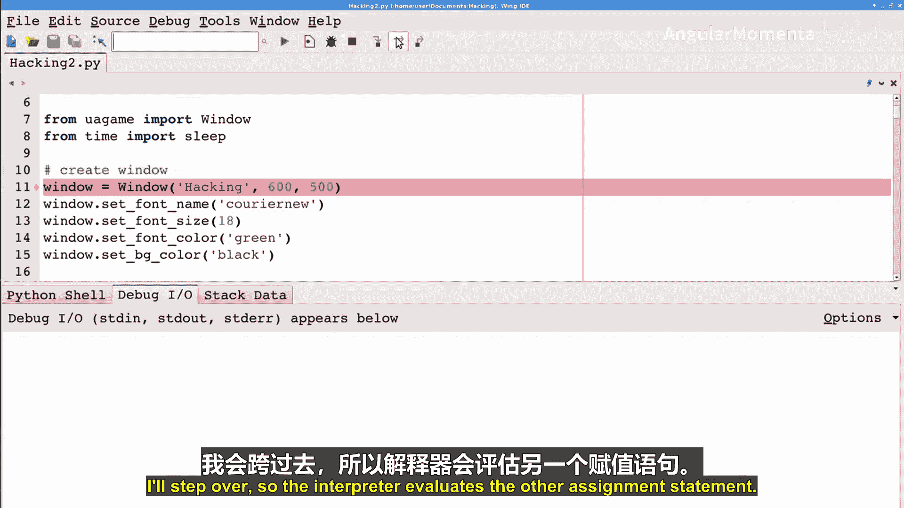
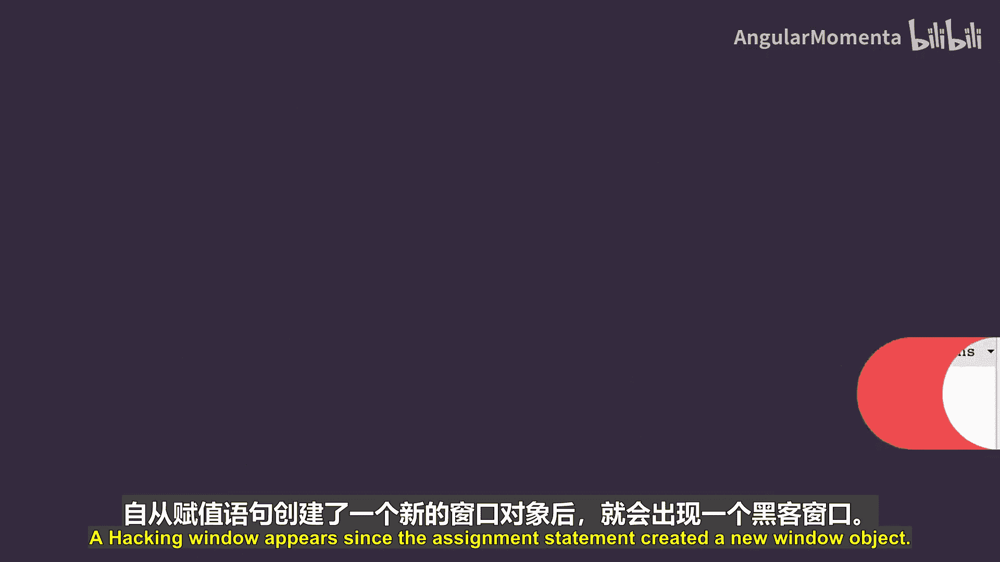
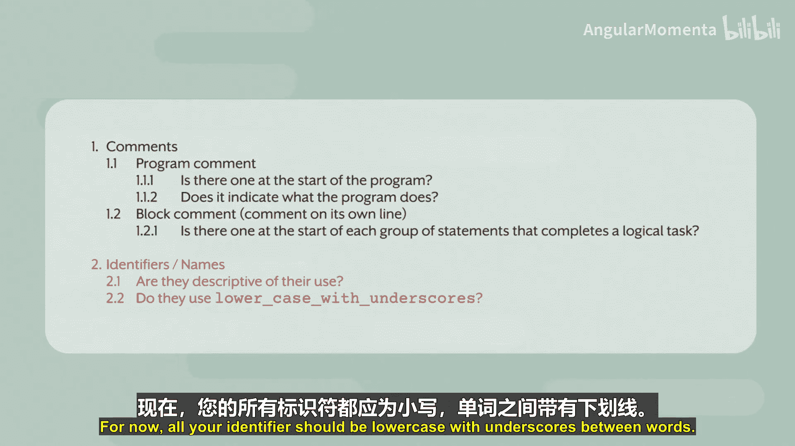

# 037：代码审查 - 黑客游戏第二版


在本节课中，我们将回顾黑客游戏第二版的代码。我们将使用调试器来观察赋值语句如何将标识符绑定到对象，以及如何通过标识符获取对象。同时，我们还将学习新的软件质量测试标准，特别是关于标识符命名的规范。

上一节我们介绍了调试器的基本功能。本节中，我们来看看一个包含赋值语句的更复杂示例。

以下是黑客游戏第二版的解决方案代码。它以一个描述版本信息的程序注释开始。

```python
# 黑客游戏 - 版本 2
from uagame import Window
from time import sleep
```





代码的第一条语句是导入。我将按下“步入”按钮开始调试过程。第一条高亮显示的语句是 `from uagame import Window`。与之前的回顾一样，从现在开始，我将使用“步过”按钮，而不是“步入”按钮。没有必要进入那些未在程序中明确写出的代码。

我按下“步过”按钮，下一条高亮显示的语句是另一个导入语句 `from time import sleep`。我再次步过这个导入语句，接下来高亮显示的是一条窗口赋值语句。


我步过这条语句，解释器将执行这个赋值语句。


一个黑客游戏的窗口出现了，因为赋值语句创建了一个新的窗口对象。

代码下方是栈数据面板。这个面板有两个加粗的单词：`Locals` 和 `Globals`，每个词下面都有一系列以下划线开头和结尾的单词。该面板的 `Locals` 部分充当了程序的命名空间。在我们跟踪程序时，每一条赋值语句都会影响一个标识符。遗憾的是，内置函数和导入的名称虽然被添加到了命名空间，但不会显示在这个 `Locals` 部分。

在 `Locals` 部分的底部是新的标识符 `window`。如果我点击它旁边的箭头，可以看到窗口对象的命名空间。窗口有许多属性，包括背景颜色、字体名称和字体颜色。当前高亮的语句是一个设置字体名称的方法调用。当我步过它时，可以看到字体属性从空字符串变成了“courier new”。

代码中的下三条语句绑定了窗口的字体大小、字体颜色和背景属性。当我步过这些语句时，可以看到字体颜色属性从白色变为绿色，而背景颜色属性保持不变。这个属性没有改变，因为它实际上被重新绑定到了这个黑色的字符串对象。

我将收起 `window` 标识符，因为其他程序语句不会再影响它的属性。下一条语句是另一个赋值语句。步过这个赋值语句会将 `line_y` 添加到 `Locals` 命名空间，并将其绑定到 `0`。再下一条语句添加了 `string_height` 并将其绑定到 `19`。字符串高度是 19 像素，尽管字体大小是 18 点。字符串高度通常比点大小大几个像素。

我将步过接下来的三条语句，因为它们不会更新 `Locals` 命名空间。再下一条语句是一个重新绑定 `line_y` 到不同对象的赋值语句。你可以看到 `line_y` 绑定为 `0`，`string_height` 绑定为 `19`。当我步过这条语句时，可以看到 `line_y` 被重新绑定为 `19`，即 `0` 和 `19` 的和。我将步过接下来的几条语句，直到遇到下一个重新绑定 `line_y` 的赋值语句。步过这个赋值语句后，`line_y` 被重新绑定为 `38`，即旧的绑定值 `19` 加上 `string_height`（也是 `19`）的结果。

希望你现在对如何使用调试器跟踪标识符绑定有了更好的理解。

跟踪完成后，我们来谈谈代码的质量。在黑客游戏的第一版中，我们有一个软件质量测试：你的程序必须在开头有描述性注释，并且必须在每个逻辑代码块的开头有行内注释。对于版本 2，我们增加了第二个软件质量测试，它涉及标识符的命名。

以下是关于标识符的两个测试：

首先，你使用的名称必须描述它们所绑定的对象。例如，使用标识符 `s` 来描述字符串高度对象就不够清晰。

其次，测试评估标识符的格式。目前，你所有的标识符都应该是小写，单词之间用下划线连接。




例如，`string_height` 是可接受的，但 `stringHeight` 则不可接受。这是一个 Python 风格约定，它能让任何查看你代码的人更容易理解你写的内容。一些导入的类型名称（如 `Window`）可能包含大写字母，但我们将在后面讨论这个约定。

本节课中，我们回顾了如何使用赋值语句将标识符绑定到对象。恭喜你，黑客游戏版本 2 已完成。