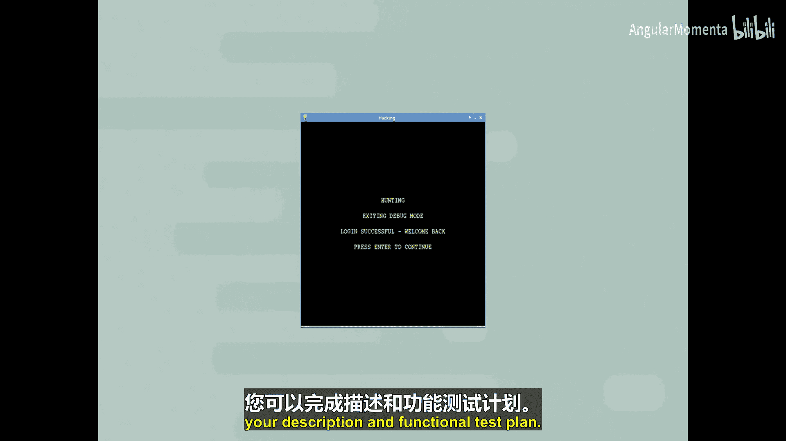

# 039：观察黑客攻击游戏第三版 🎮

在本节课中，我们将要观察并分析“黑客攻击”游戏的第三个版本。我们将重点关注游戏在玩家输入正确密码后的行为变化，并与之前的版本进行对比。

## 游戏初始状态

上一节我们介绍了游戏第二版的行为，本节中我们来看看第三版的初始表现。

游戏开始时，其界面与第二版看起来完全相同。

## 输入正确密码

现在，我将输入正确的密码“hunting”。这一次，游戏会显示一个不同的结果。

在猜对密码后，游戏会显示一条成功信息，然后提示我按下回车键。

## 实践与观察任务

为了充分理解这个版本的变化，你需要亲自进行以下操作。

以下是具体的实践步骤：
*   自己玩几次这个游戏。
*   确保你看到了两种可能的结果（成功与失败）。
*   注意这两种结果之间的区别，以便你能完成你的功能描述和测试计划。

## 总结

本节课中我们一起观察了“黑客攻击”游戏的第三版。我们了解到，此版本在玩家输入正确密码后，会显示成功信息并新增一个等待玩家按下回车键的提示，这是与第二版的一个关键区别。通过亲自体验和对比两种结果，你可以为后续的编程实现制定更清晰的需求和测试方案。