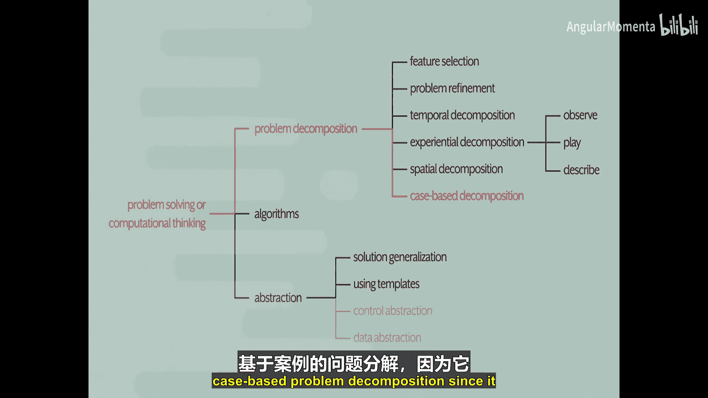
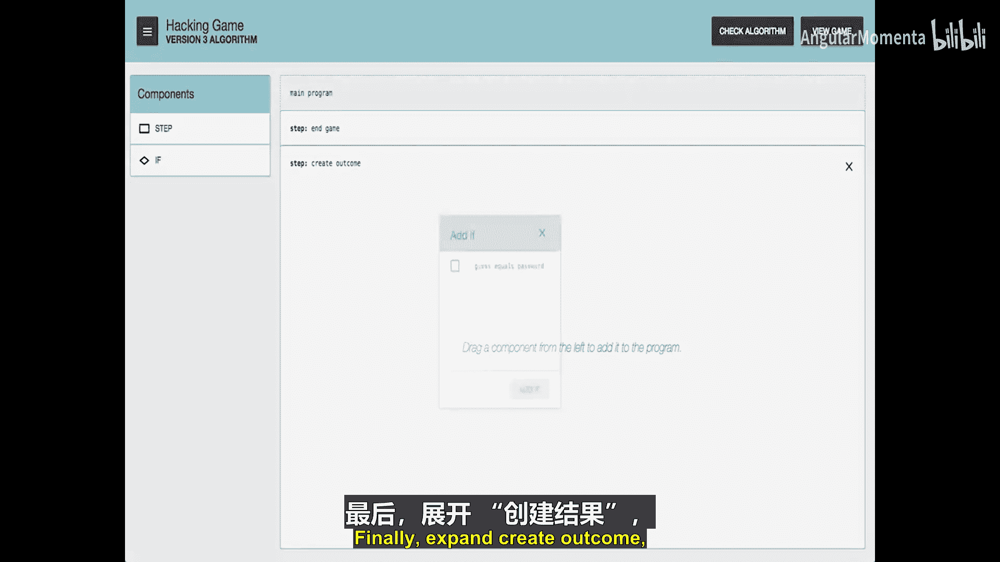

# 040：创建黑客游戏版本3的算法 🎮

在本节课中，我们将学习如何为黑客游戏的第三个版本创建算法。这个版本引入了基于玩家输入的多条游戏路径，因此我们需要修改版本2的算法，加入**选择控制结构**来决定游戏的结局。

---

## 从版本2到版本3的演变 🔄

上一节我们介绍了版本2的算法，它只有一条固定的路径和一种可能的结局。本节中我们来看看版本3的核心变化：游戏结局现在取决于玩家的输入。为了实现这一点，我们需要在算法中加入一个**控制结构**。

控制结构决定了算法中的步骤何时执行，甚至是否执行。在算法构建器中，每种控制结构都有其独特的形状。**选择控制结构**由一个菱形表示。

## 理解选择控制结构 💎

为了说明菱形选择结构的用法，我们来看一个简单的例子：一个决定是否穿毛衣的算法。

首先，我添加一个菱形。我需要基于某个**计算**结果来选择“穿毛衣”这个动作。这个用于选择结果的计算通常被称为**条件**。条件被放置在菱形中。

在我的算法中，条件是“温度是否低于10摄氏度”。因此，我从词汇表中选择“温度低于10度”作为条件。

这个条件（温度低于10摄氏度）的结果只能是**真**或**假**。要么温度低于10度（条件为真），要么温度大于等于10度（条件为假）。

在算法构建器中，每个选择控制结构都关联着两个矩形：
*   **真矩形**：包含当菱形中的条件为**真**时要执行的算法步骤。
*   **假矩形**：包含当菱形中的条件为**假**时要执行的算法步骤。

你为选择控制结构选择的条件必须始终能评估为真或假，这样才能用它来选择执行真矩形或假矩形中的步骤。

真矩形中必须始终有算法步骤。如果没有任何步骤可选，那么在算法中包含选择结构就没有意义。然而，假矩形中并不总是需要有步骤。

例如，在穿毛衣的算法中：
*   如果温度低于10度（条件为真），我会穿毛衣，所以我把“穿毛衣”放在真矩形里。
*   如果温度大于等于10度（条件为假），我什么也不做，所以假矩形里不需要放任何东西。

一个选择控制结构通常会占据一个独立的面板。如果在真或假的情况下需要执行多个算法步骤，你可以扩展真矩形或假矩形，让它们使用自己的面板。必要时，两者都可以扩展。

选择控制结构支持**基于情况的分解**，因为它允许独立创建解决方案的每个部分。

---

## 修改算法：应用选择结构 🛠️

现在，让我们修改一份黑客游戏版本2的算法副本，来创建版本3的算法。

你已经拥有了显示失败结局消息所需的步骤。你本可以创建一个“显示成功结局”面板，它与“显示失败结局”面板几乎相同，只是显示的结果不同。然后，你可以根据用户的猜测来选择使用哪一组算法步骤序列。

然而，软件开发中有一个原则叫做“**不要重复你自己**”（Don‘t Repeat Yourself， DRY）。如果你发现自己多次编写相同的算法步骤，就应该停下来，看看是否能修改算法，让公共步骤只编写一次。

在这个案例中，这些算法步骤之间唯一的区别在于显示的消息（“显示失败结局”的第2、3行 vs “显示成功结局”的第2、3行）。因此，我们可以采取更好的方法：根据玩家的猜测，创建一个不同的结局消息（失败或成功），然后只显示这个消息。这是一个**解决方案泛化**的例子，因为成功和失败结局中的公共部分被泛化并集中在一处使用。

以下是修改步骤：
1.  将“显示失败结局”修改为更通用的“显示结局”。
2.  在“显示结局”步骤之前，添加一个名为“创建结局”的步骤。
3.  最后，展开“创建结局”步骤，并使用**选择结构**来创建适当的结局消息。

通过这种方式，我们构建了一个更高效、更易于维护的算法，它能够根据条件动态决定游戏走向。