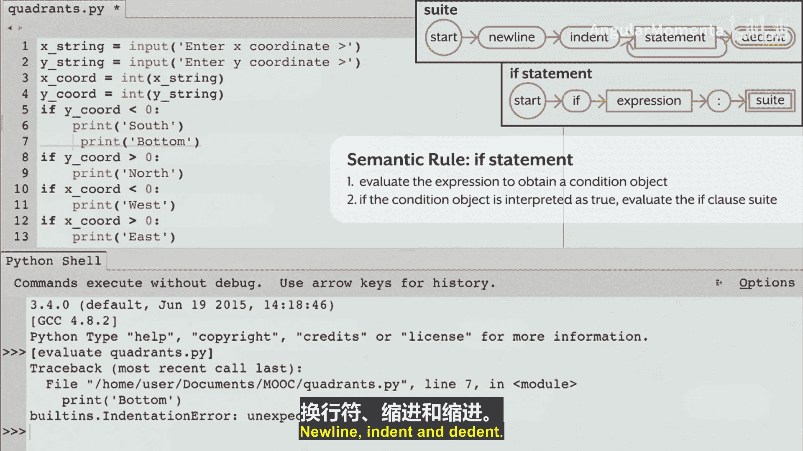

# 041：Python if语句与布尔类型 🐍


在本节课中，我们将学习一种新的语句——`if`语句，以及一个新的Python类型——布尔类型。我们还将介绍三个特殊的标记：`NEWLINE`、`INDENT`和`DEDENT`。这些概念是控制程序流程的基础。

## 概述

想象一个包含X轴和Y轴坐标的地图，X轴向右增大，Y轴向上增大。当用户输入一个X和Y坐标值时，程序需要判断该坐标点位于哪个象限（西北、东北、西南或东南）。解决这个问题的关键在于判断X和Y值是大于0还是小于0。

如果X值小于0，坐标点在西方；如果X值大于0，坐标点在东方。同理，Y值小于0表示南方，Y值大于0表示北方。

到目前为止，我们见过的所有Python语句都是按顺序从上到下执行的。为了解决上述问题，我们需要程序能够根据条件决定是否显示“北”、“南”、“东”、“西”这些方向词。这就需要引入`if`语句来实现条件执行。

## `if`语句简介

`if`语句是一种**复合语句**，它可以根据条件决定是否执行其内部的语句。一个`if`语句可以执行其内部的语句，也可以跳过它。

以下是解决象限判断问题的程序示例：

```python
x_str = input("Enter an X coordinate: ")
x = int(x_str)

y_str = input("Enter a Y coordinate: ")
y = int(y_str)

if y < 0:
    print("South")
if y > 0:
    print("North")
if x < 0:
    print("West")
if x > 0:
    print("East")
```

运行程序，输入X为100，Y为-50，程序会输出“South”和“East”，这是正确的结果。

## 语句结构：简单语句与复合语句

一个包含其他语句的语句称为**复合语句**。不包含其他语句的语句称为**简单语句**。

*   `if`语句是复合语句。
*   表达式语句、赋值语句和导入语句是简单语句。

每个简单语句末尾的换行符会产生一个`NEWLINE`标记，我们稍后会讨论。

在Python中，可以将简单的复合语句写在一行，但本课程中所有复合语句都将写在多行。

## `if`语句的语法

`if`语句的简化语法图如下：

```
if_statement ::=  “if” expression “:” suite
```

*   **头部**：关键字`if`、表达式和冒号`:`共同构成了`if`语句的头部。其中的表达式常被称为**条件**。
*   **代码组**：`suite`是一个缩进的语句块，从新的一行开始。

## 三个特殊标记：`NEWLINE`、`INDENT`、`DEDENT`

`NEWLINE`、`INDENT`和`DEDENT`是三个独立的Python标记，不属于运算符、标识符、分隔符、字面量或关键字中的任何一类。它们用于分隔语句，并界定代码组的开始和结束。

1.  **`NEWLINE`**：当词法分析器遇到由按下回车键产生的行尾字符时，会创建一个`NEWLINE`标记来分隔语句。
2.  **`INDENT`**：为了标记一个代码组的开始，需要在冒号后换行，并在下一行开头使用空白字符（空格或制表符）。词法分析器会将这些开头的空白字符转换为一个`INDENT`标记，无论有多少个空白字符。
3.  **`DEDENT`**：`DEDENT`标记标识一个代码组的结束。代码组之后的语句必须与包含该代码组的`if`语句头部保持相同的缩进级别。词法分析器会将这种对齐的缩进转换为一个`DEDENT`标记。

示例程序中的四个`if`语句都具有有效的语法。以第5-6行的`if`语句为例，词法分析器会生成以下标记序列：
`if` -> `y` -> `<` -> `0` -> `:` -> `NEWLINE` -> `INDENT` -> `print` -> `(` -> `"South"` -> `)` -> `NEWLINE` -> `DEDENT`。

## 布尔类型

`if`语句使用了一种新的Python类型——**布尔类型**，简称`Bool`。

布尔类型只有两个对象：
*   **`True`**：表示真。
*   **`False`**：表示假。

许多Python表达式会求值为这两个对象之一。例如，程序第5行的表达式 `y < 0` 会根据变量`y`绑定的整数值，求值为`True`或`False`对象。

为了方便，Python使用两个关键字`True`和`False`来指代这两个布尔对象。尽管它们是关键字，但行为类似于字面量。当解释器遇到这些关键字时，会使用内存中相应的布尔对象。

请注意，`if`、`import`、`from`也是关键字，但它们被用作分隔语句的标点符号，不会被对象替换。

## `if`语句的语义

`if`语句的执行语义如下：
1.  对头部中的**条件表达式**进行求值。结果是一个布尔对象（`True`或`False`）。
2.  如果条件对象是`True`，则执行代码组`suite`中的语句。如果条件对象是`False`，则跳过整个代码组。

代码组`suite`的语义是：按顺序执行其中的每个语句。

让我们将语义应用到示例程序上：

*   **第5-6行**：条件 `y < 0` 求值（`y`为-50），结果为`True`，因此执行代码组，打印“South”。
*   **第7-8行**：条件 `y > 0` 求值，结果为`False`，因此跳过代码组，不打印“North”。
*   **第9-10行**：条件 `x < 0` 求值（`x`为100），结果为`False`，跳过代码组。
*   **第11-12行**：条件 `x > 0` 求值，结果为`True`，执行代码组，打印“East”。

如果运行程序并输入X和Y都为0，则不会有任何输出。因为所有四个`if`语句的条件都求值为`False`，所有代码组中的语句都不会被执行。

## 代码组中的多条语句

`if`语句的语法和语义支持在代码组中包含多条语句。

例如，如果将程序修改为：

```python
if y < 0:
    print("South")
    print("Bottom")
```

当输入为100和-50时，输出将包含“South”、“Bottom”和“East”。因为第6行和第7行的两条语句（都在同一个代码组中）以及第13行的语句都被执行了。

请注意，一个代码组的开始只有一个`INDENT`标记，结束只有一个`DEDENT`标记。词法分析器不会在代码组内部的语句之间创建`INDENT`或`DEDENT`标记。

**重要**：缩进时应使用统一数量的空格（通常是4个）。如果缩进空格数不一致，很可能会遇到“缩进错误”。

## 总结

本节课我们一起学习了：
1.  **`if`语句**的语法和语义，它是一种用于条件执行代码的复合语句。
2.  **布尔类型**，它只有`True`和`False`两个值，是条件表达式的结果类型。
3.  三个用于代码结构化的特殊标记：**`NEWLINE`**、**`INDENT`**和**`DEDENT`**。



理解这些概念是编写能够根据不同情况做出决策的程序的关键第一步。