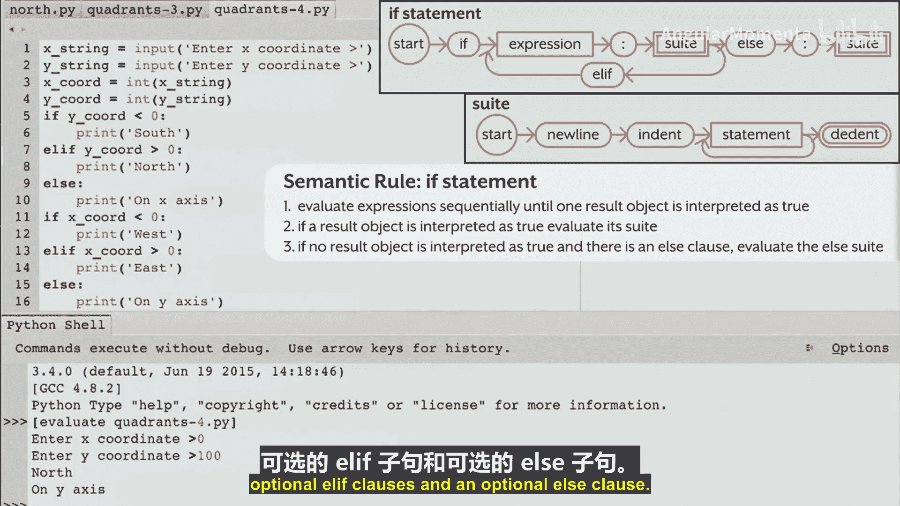

Python编程与问题解决：第5章：if语句的elif和else子句


在本节课中，我们将学习Python中`if`语句的更多细节。具体来说，我们将了解当`if`语句中的表达式求值结果不是布尔对象时会发生什么，并学习如何使用可选的`elif`和`else`子句来扩展`if`语句的功能。


### 非布尔条件表达式

上一节我们介绍了`if`语句的基本用法，本节中我们来看看当`if`语句的条件表达式结果不是布尔值时，Python会如何处理。

在Python中，当`if`语句中的表达式求值结果为一个对象时，该对象总是会被解释为一个布尔值，即使它本身不是布尔类型。

大多数对象会被解释为`True`，即使它们并不等于`True`对象本身。只有少数对象会被解释为`False`，包括：
*   `False`对象
*   空字符串 `""`
*   整数对象 `0`
*   浮点数对象 `0.0`
*   `None`类型对象
*   以及其他一些我们尚未接触到的对象类型。

例如，字符串对象`"hello"`在`if`语句中会被解释为`True`，因此其对应的代码块会被执行。

在计算机科学中，一个求值为布尔值的表达式被称为**条件**。由于在Python的`if`语句中，所有对象无论其类型如何，都会被解释为`True`或`False`，因此`if`语句中的表达式也被称为条件。


### 使用else子句

如果我想在条件为`True`时执行一套语句，在条件为`False`时执行另一套不同的语句，可以使用`if`语句的`else`形式。

以下是包含可选`else`子句的`if`语句的修订语法：
```python
if condition:
    # if 子句的语句组
else:
    # else 子句的语句组
```

当使用`else`关键字时，我们说这个`if`语句有两个子句：`if`子句和`else`子句。`if`子句包含一个条件和一个语句组，而`else`子句只包含一个语句组，没有显式的条件。


### 使用elif子句

`if`语句还有一种更通用的形式，可以使用`elif`子句。`elif`子句可用于在同一个`if`语句中检查多个条件。

以下是包含可选`elif`子句和可选`else`子句的`if`语句的修订语法：
```python
if condition1:
    # 条件1为真时执行的语句组
elif condition2:
    # 条件2为真时执行的语句组
else:
    # 所有条件都不为真时执行的语句组
```

这些语义意味着：
*   如果存在`else`子句，那么`if`语句中**恰好会有一个**语句组被执行，其余语句组将被跳过。
*   如果没有`else`子句，并且至少有一个条件为`True`，那么**恰好会有一个**语句组被执行。
*   如果没有`else`子句，并且所有条件都不为`True`，那么**不会有任何**语句组被执行。


### 总结



本节课中我们一起学习了Python `if`语句的两个重要扩展。我们首先了解了当`if`语句的条件表达式求值结果为非布尔对象时，Python会如何将其解释为布尔值。接着，我们学习了如何使用`elif`子句在同一个`if`语句中检查多个条件，以及如何使用`else`子句为所有条件都不满足的情况提供一个默认的执行路径。这些结构使得我们的程序能够根据更复杂的情况做出不同的决策。