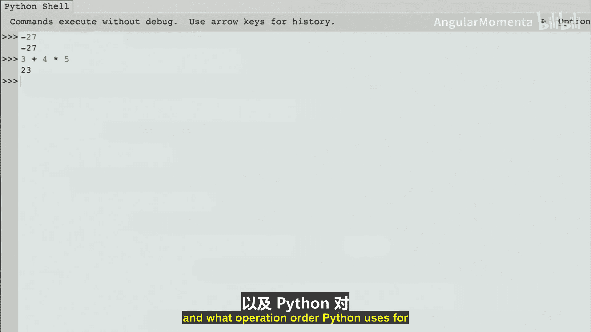

# 043：Python关键字运算符、短路求值、一元表达式与运算顺序 🐍

在本节课中，我们将学习四个核心概念。首先，我们将介绍那些行为类似于运算符的关键字。其次，我们将描述布尔运算符使用的一种特殊求值技术，称为短路求值。第三，我们将引入一种新的表达式类型，称为一元表达式。最后，我们将描述Python在处理包含多个运算符的计算时所使用的运算顺序。

## 关键字作为运算符 🔑

上一节我们回顾了运算符的基本概念。现在，让我们来看看Python中的关键字如何扮演运算符的角色。

回想一下，诸如加号（`+`）和小于号（`<`）这样的运算符标记，用于在二元表达式中对两个操作数应用一个运算符函数。Python共有19个运算符标记。有趣的是，一些Python关键字也可以用作运算符。

让我们更仔细地审视所有的关键字。你已经知道，像 `from`、`import` 和 `if` 这样的关键字被用作分隔符，为语句添加标点。实际上，33个关键字中有26个被用作分隔符，以区分语句的不同部分。

你也见过，像 `True` 和 `False` 这样的关键字被用作字面量，绑定到特定的对象。实际上，`None` 也是一个关键字字面量，它绑定到一个类型为 `NoneType` 的对象，这个对象通常由不需要返回有意义对象的函数调用返回。

剩下的四个关键字 `and`、`is`、`not` 和 `or` 被用作运算符。而关键字 `in` 根据上下文，既可以用作运算符，也可以用作分隔符。

我将通过添加可以用作二元运算符的关键字运算符，来修订二元运算符的语法图。

请注意，除了 `and`、`in`、`is`、`or` 之外，还有两个关键字运算符对 `not in` 和 `is not`，它们各自可以作为一个单一的二元运算符使用。

虽然我添加了一些新的二元运算符，但二元表达式的语义规则并没有改变。

## 短路求值 ⚡

上一节我们介绍了关键字运算符。本节中，我们将重点探讨布尔运算符 `and` 和 `or` 使用的特殊求值技术——短路求值。

例如，我将二元表达式语义应用于表达式 `False and unbound`。

1.  第一步，左侧表达式是关键字字面量 `False`，它求值为布尔对象 `False`。
2.  第二步，运算符是 `and`。虽然第一个操作数的类型是布尔型，但由于操作数是 `False`，情况变得特殊。

通常，运算符和操作数类型都需要用来确定运算符函数。然而，当运算符是 `and` 时，实际上会忽略第一个操作数的类型。`and` 运算符总是调用同一个运算符函数，无论第一个操作数是什么类型。

在第三步中，解释器应用这个 `and` 运算符函数。`and` 运算符函数使用了一种称为短路求值的技术，其结果对象可能不依赖于第二个操作数。

以下是 `and` 运算符函数的语义：

1.  如果第一个操作数被解释为 `False`，则第一个操作数就是结果对象。
2.  否则，将第二个表达式求值作为结果对象。

在第一步中，第一个操作数是 `False`。因此，这个第一个操作数对象 `False` 被返回。第二步被跳过，所以第二个表达式甚至没有被求值。

如果第二个表达式被求值，由于我没有将标识符 `unbound` 绑定到任何对象，它将会显示一个语义名称错误。

`and` 运算符函数还有另一个有趣的特性。在第一步中，第一个操作数是空字符串 `""`，你可能还记得在 `if` 语句条件中，它被解释为 `False`。`and` 运算符函数的语义以同样的方式解释非布尔对象，因此空字符串被解释为 `False`。所以，空字符串就是结果对象。如果我使用 `0` 或 `0.0` 代替空字符串，表达式将分别求值为 `0` 或 `0.0`。同样，第二步被跳过，因此第二个表达式没有被求值，也没有显示语义名称错误。

如果第一个操作数没有被解释为 `False`，则会对第二个表达式进行求值。例如，如果我求值 `"hello" and "goodbye"`，解释器将返回 `"goodbye"`。在第一步中，第一个操作数是字符串 `"hello"`，它被解释为 `True`（因为它没有被解释为 `False`），因此应用第二步。在第二步中，第二个表达式求值为字符串 `"goodbye"`，该字符串被用作结果对象。

`or` 运算符函数也使用短路语义。如果第一个操作数被解释为 `True`，则第一个操作数就是结果对象。否则，将第二个表达式求值作为结果对象。

## 一元表达式 ➕➖

上一节我们探讨了短路求值。现在，让我们来看看一种新的表达式形式。

请注意，无论是运算符标记 `~` 还是关键字运算符 `not`，它们本身都不能用作二元运算符。相反，两者都是一元运算符，作用于单个操作数。

以下是一元表达式的语法图。

这是一个更通用的表达式语法图，现在包含了一元表达式。

加号（`+`）和减号（`-`）运算符标记既可以用作二元运算符，也可以用作一元运算符。一元表达式的语义与二元表达式的语义相似，只是它只对一个操作数进行求值。

例如，我将一元表达式语义应用于 `-27`。

1.  第一步，表达式是字面量整数 `27`，它求值为 `int` 对象 `27`。
2.  第二步，一元运算符 `-` 和类型 `int` 用于确定数值取反函数，该函数会反转其整数操作数对象的符号。
3.  第三步，将数值取反函数应用于 `int` 对象 `27`，以获得 `int` 对象 `-27`。

请注意，`-27` 不是一个字面量整数。它是一个一元表达式，应用减号运算符到一个整数对象以获得结果对象。

## 运算符优先级与运算顺序 📊

上一节我们介绍了一元表达式。最后，我们来学习当表达式中出现多个运算符时，Python如何决定运算顺序。

如果一个表达式中出现多个运算符，Python解释器必须选择运算的顺序。例如，在表达式 `3 + 4 * 5` 中，有两个运算符 `+` 和 `*`。

如果Python解释器从左到右按顺序应用这些运算符，那么 `3 + 4` 等于 `7`，`7 * 5` 等于 `35`。但 `35` 不是正确答案。`23` 才是，因为Python在应用 `+` 运算符之前先应用 `*` 运算符，类似于数学中的运算顺序。

Python有一个运算符优先级表，它定义了在同一表达式中应用多个运算符时应遵循的顺序。表中位置靠下的运算符具有更高的优先级，会先于表中位置靠上的运算符被应用。

例如，`*` 在 `+` 之前应用，因为它在表中位于 `+` 的下方。这就是为什么 `3 + 4 * 5` 求值为 `23`，而不是 `35`。

你应该认识这个表中的许多运算符，例如运算符标记 `+`、`*`、`<`，以及关键字运算符 `and` 和 `or`。

## 总结 📝

在本节课中，我们一起学习了四个重要的Python概念。我们描述了那些行为类似于运算符的关键字。我们还探讨了布尔运算符使用的一种特殊求值技术，称为短路求值。我们引入了一种新的表达式类型，称为一元表达式。最后，我们了解了Python在处理包含多个运算符的计算时所使用的运算顺序。掌握这些概念对于编写正确且高效的Python代码至关重要。