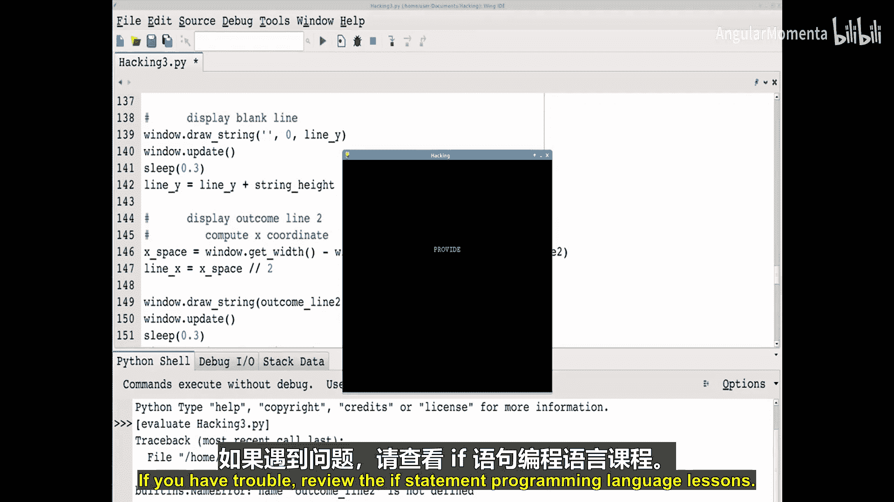

# 044：程序破解版本3

## 概述

在本节中，我们将学习如何为“程序破解”游戏的第三个版本添加注释，并准备使用Python的`if`语句来实现算法中的选择结构。我们将重点关注如何将算法步骤转化为代码注释，并为后续实现选择逻辑做好准备。

---

## 添加算法注释

上一节我们完成了算法设计。本节中，我们来看看如何将这些算法步骤转化为代码中的注释。

编程“破解版本3”的第一步，是添加与算法新步骤相对应的注释。

以下是需要添加的注释步骤：

*   我将为“选择菱形”添加一个占位注释。当你翻译算法并添加`if`语句的头部时，需要替换它。
*   我将使用“检查 guess 是否等于 password”作为“guess等于password菱形”的注释。当你添加`if`头部（例如 `if guess == hunting`）时，应删除此注释，因为它将变得多余。

---

## 实现选择结构

我们使用Python的`if`语句来实现选择结构。

*   算法中的“True（真）”框对应`if`子句的语句组。
*   算法中的“False（假）”框对应`else`子句的语句组。

你需要为“C成功步骤”创建一个注释，并为“Cate失败步骤”创建另一个注释。因为算法中的每个矩形都应在代码中有对应的注释。

---

## 准备结果消息

在接下来的活动中，你将使用选择结构来决定显示哪个结果消息。

为结果字符串使用良好的标识符名称。我将为你选择一个作为开始。

结果消息的第一行始终是玩家的猜测。第二行则根据猜测成功与否而不同：成功时为“exiting debug mode”，失败时为“login failure terminal locked”。

我们将第二行称为`outcome_line2`，因为这个名称足够通用，适用于两种情况。

在版本2中，直接显示字面字符串“login failure terminal locked”就足够了。但在这个版本中，必须通过引用`outcome_line2`这个标识符来显示合适的字符串。

我将更新代码以使用这个标识符。我会在计算其x坐标的语句和`draw_string`函数调用中，将字面量“login failure”替换为标识符`outcome_line2`。

现在，这段代码将显示`outcome_line2`所绑定的任何字符串。

请注意，如果我现在运行程序，将会产生错误，因为`outcome_line2`尚未被绑定。

---

## 后续步骤

在下一个活动中，你将创建`if`语句、绑定`outcome_line2`，并翻译算法中“显示结果”步骤的其余部分。

如果你遇到困难，请复习关于`if`语句的编程语言课程。

---

## 总结

本节课中，我们一起学习了如何将破解算法的步骤转化为代码注释，为Python选择结构（`if/else`）的实现做好了准备，并定义了用于显示不同结果消息的变量。我们为下一阶段实现完整的猜测逻辑奠定了基础。