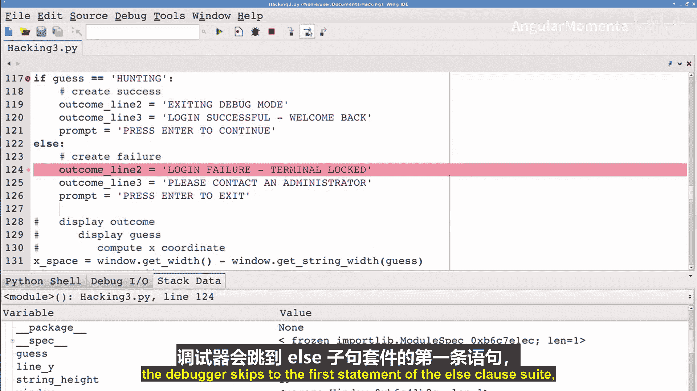
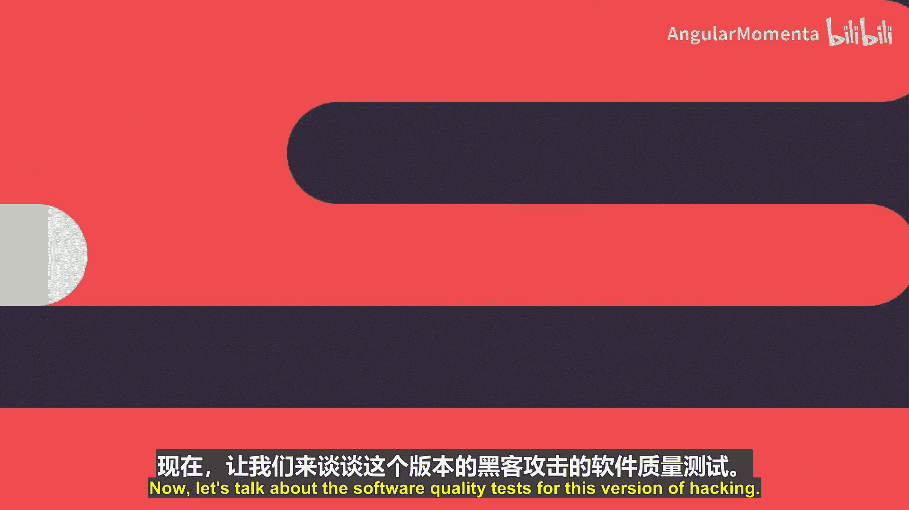
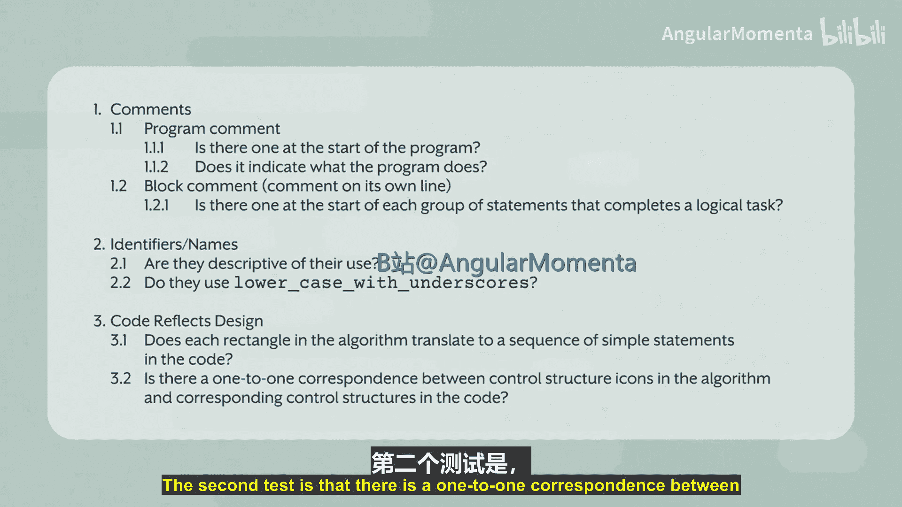

# 045：版本3代码回顾与软件质量测试

在本节课中，我们将回顾“黑客”游戏的第三个版本代码。我们将学习如何使用调试器来观察`if`语句的执行过程，并介绍一个新的软件质量测试概念——代码反映设计。

## 🎼 调试技术：使用断点

上一节我们讨论了程序的基本结构。本节中，我们来看看如何更高效地调试程序，特别是`if`语句。

程序底部的`if`语句是我们的重点。为了直接观察它的执行，我们可以使用一种新的调试技术：断点。我们可以在`if`语句旁添加一个断点，这样就不需要逐行执行代码来找到它。

断点是一个调试功能，它使调试器在指定的代码行暂停执行，并等待进一步的调试指令。这允许你无需跟踪每一行代码就能使用调试器。

在代码行号旁添加的红色圆点是一个视觉提示，表示此处有一个断点。

## 调试过程演示

现在，我将按下工具栏中的“运行到断点”按钮。这个操作会让程序正常执行，直到遇到一个断点或需要用户输入的语句。

程序会显示标题、密码列表和密码输入提示，然后暂停以允许我输入密码。在正常情况下，如果我输入密码，游戏会立即显示结果。

我将输入密码“hunting”。调试器会评估清屏操作，并在遇到`if`语句处的断点时停止。它暂停下来，让我决定下一步要做什么。

`if`语句将检查我的猜测是否等于秘密密码。请注意，在堆栈数据面板中，变量`guess`被绑定为“hunting”。

由于`guess`和“hunting”相等，当我按下“单步跳过”按钮时，下一个被高亮显示的语句是`if`子句中的`outcome_line2`赋值语句。

我再按两次“单步跳过”按钮，直到`prompt`赋值语句被高亮显示。此时，在堆栈数据面板中，`outcome_line2`和`outcome_line3`已作为标识符被添加到局部命名空间，并绑定到表示成功的字符串。

下一次我按下“单步跳过”按钮时，调试器不会高亮显示`else`子句，即使它在下一行。在一个`if`语句中，最多只会执行一个代码块。只要`if`语句的某个条件为真，与该条件关联的代码块就会被执行，所有其他条件和代码块都会被忽略。

所以，当我按下“单步跳过”按钮时，调试器完全跳过了`else`子句及其代码块，直接高亮显示了`x_space`赋值语句。

## 🔄 测试错误密码的情况

让我们通过追踪一个错误密码的输入过程，来看看我们基于情况分解的第二种情况。

我将用“停止”按钮结束当前的追踪，然后再次按下“运行到断点”按钮。这次，当程序提示输入密码时，我将输入一个错误的猜测。

`if`语句被高亮显示。在堆栈数据面板中，`guess`被绑定为我输入的错误密码。由于`guess`不等于“hunting”，条件语句的求值结果为`false`。

当我再次按下“单步跳过”按钮时，调试器会跳过`if`的代码块，直接跳转到`else`子句代码块的第一条语句。因为`else`不需要被求值，它的代码块会在条件为`false`时自动执行。

## 📐 软件质量测试：代码反映设计

现在，让我们讨论这个版本“黑客”游戏的软件质量测试。之前我们介绍了如何编写良好的注释和使用描述性的标识符。新的软件质量测试部分叫做“代码反映设计”。

代码反映设计有两个测试标准：

以下是第一个测试标准：
*   算法中的每个矩形框都能被翻译成代码中的一系列简单语句。

以下是第二个测试标准：
*   算法中的控制结构与代码中的控制结构存在一一对应关系。

算法控制结构与代码控制结构的一一对应关系意味着：算法中的每一个控制结构，在代码中都有且仅有一个对应的控制结构。

算法中的一个矩形框可以被翻译成多行代码，但算法中的一个菱形决策框在程序中总是被翻译成一行代码。

你的代码应该反映你的设计，这样在下一个版本中修改算法时，只需要翻译算法中发生改变的部分即可实现代码更新。

## 总结

本节课中，我们一起学习了如何使用断点调试技术来观察`if`语句的执行流程，理解了条件分支的执行逻辑。我们还介绍了“代码反映设计”这一重要的软件质量测试概念，它要求代码结构清晰对应算法设计，以便于未来的维护和更新。恭喜你完成了“黑客”游戏的第三个版本。