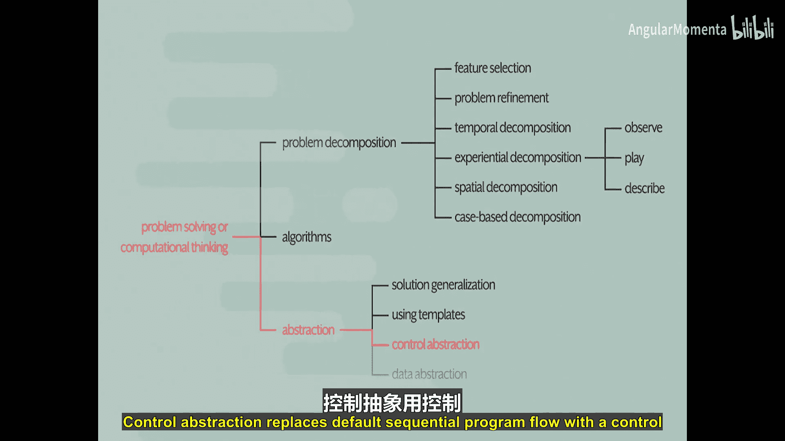
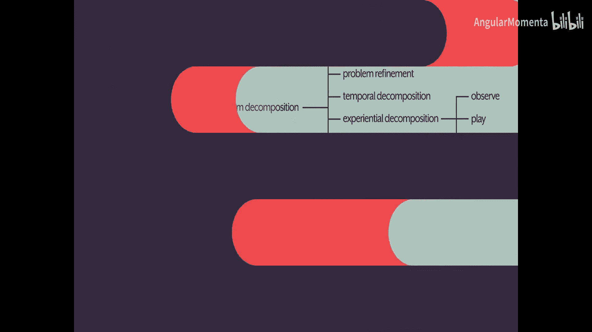

# 046：第4版黑客游戏解决方案问题


## 概述
在本节课中，我们将学习如何改进“黑客游戏”第3版代码的质量。我们将重点解决两个核心问题：重复代码和重复数据。通过引入**循环**控制结构和使用**标识符**，我们可以显著减少代码量，提高代码的可读性和可维护性。

---

## 重复代码问题与循环结构

上一节我们完成了游戏功能的开发，本节中我们来看看代码中存在的重复问题。

在“黑客游戏”第3版的解决方案代码中，存在大量重复的语句，用于显示标题、密码和结果消息。这些代码几乎完全相同，只是存在微小的差异。最初，通过复制粘贴来重用显示字符串的代码似乎很方便，但这导致了近200行的代码量。这违反了“不要重复自己”的软件开发原则。

通常，如果你发现自己编写了多次相同的代码语句，就应该修改程序，使公共语句只编写一次。

我们称这些连续相同或非常相似的语句为**相邻重复语句组**。在这个版本中，你将学习如何使用一种称为**重复控制结构**或**循环**的新结构来消除它们。

**循环**是一段代码语句序列，它们会被重复执行，直到满足特定条件为止。

使用重复控制结构可以使你的代码更短，从而更容易编写和阅读。在本版本中，你将使用这些控制结构，将近200行代码替换为少于90行。

使用重复控制结构来替换重复代码行是一种新的抽象形式，称为**控制抽象**。控制抽象用控制结构取代默认的顺序程序流程，以减少重复。

以下是循环结构的一个基本代码示例：
```python
for i in range(5):
    print(f"这是第 {i+1} 次显示")
```

---





## 重复数据问题与标识符

解决了代码重复问题后，我们再来看看数据重复的问题。

第二个需要改进的解决方案是消除重复数据。例如，字面量浮点数 `0.3` 在程序中重复出现了23次。这是一个问题，因为如果我想要更短的延迟，就需要修改23个独立的 `sleep` 函数调用中的参数。同样，如果我想要更改密码的X坐标，就需要修改13个不同的 `drawstring` 函数调用中的第二个参数。

虽然我可以使用查找和替换功能来一次性更改所有的 `sleep` 延迟，这很简单。但是，如果我尝试使用查找和替换来更改密码的X坐标（例如将 `0` 改为其他值），它不仅会更改13处 `drawstr` 调用，还会更改程序中其他36个地方的 `0`。

因此，我必须有一种方法来指定密码 `drawstring` 调用中的 `0` 的意图与其他36个 `0` 的意图不同。为了解决这个问题，我可以使用一个**标识符**来表示密码的X坐标，并将其绑定到 `0`。这样，要更改密码的X坐标，我只需要更改绑定它的那一个赋值语句。

通常，如果一个字面量出于相同目的被多次使用，就应该用一个标识符绑定它，以便可以在一个地方更改这个字面量。

你能在“黑客游戏”第3版代码中找到其他应该用标识符绑定的重复字面量吗？

---

## 版本4的变更与测试

由于你在本版本中所做的更改仅影响代码质量，因此不需要观察或试玩“黑客游戏”第4版。描述和测试计划也没有变化。

你刚刚在游戏创建过程中完成了五项任务，并且只用了短短几秒钟，恭喜你。

编码完成后，别忘了使用之前的测试计划来确保游戏功能仍然正确。

---


## 总结
本节课中我们一起学习了如何提升代码质量。我们通过引入**循环**结构解决了**重复代码**的问题，使代码更简洁。同时，我们通过使用**标识符**绑定重复使用的字面量，解决了**重复数据**的问题，提高了代码的可维护性。这些改进是软件工程中“不要重复自己”原则的具体实践。