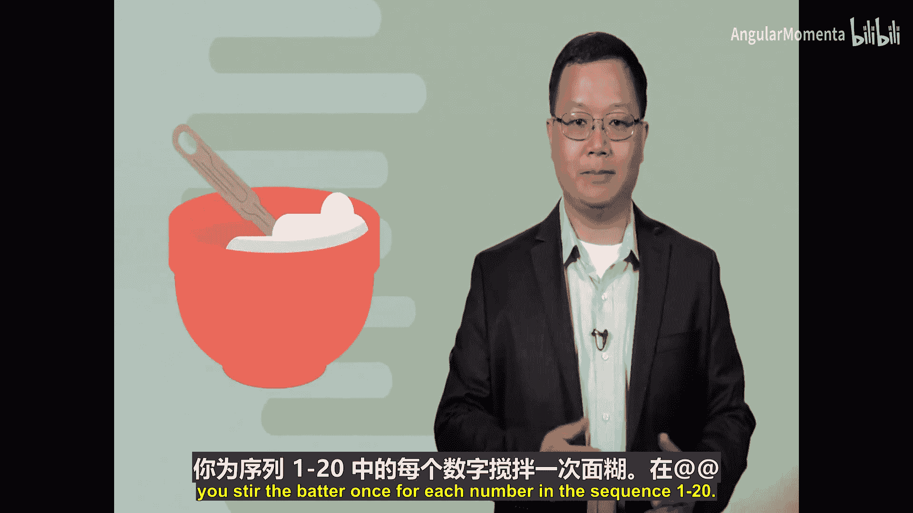

# 047：为黑客游戏版本4创建算法 🎮

在本节课中，我们将学习算法构建中的一个新概念：**确定重复**（或称确定迭代）。我们将了解它如何工作，并利用它来简化黑客游戏中的显示逻辑。

## 概述：什么是确定重复？

上一节我们介绍了控制结构的基本概念。本节中，我们来看看一种新的控制结构——**确定重复**。

控制结构决定了算法中的步骤何时执行。**确定重复**会将一个算法步骤（或一系列步骤）重复执行**特定的次数**。

由于步骤被重复执行，所以称为“重复”。“确定”意味着在重复开始之前，我们就已经知道需要重复多少次。

**公式：**
`重复执行 [步骤] [N] 次`

例如：
*   制作蛋糕时，食谱要求你搅拌面糊**20次**。这就是确定重复。
*   如果食谱要求你搅拌面糊**直到没有结块为止**，这就不是确定的，因为你不知道在停止搅拌前需要搅拌多少次。

可以将确定重复理解为：为序列中的**每一个项目**重复执行一个步骤。
*   你有一篮子洗好的衣服。**对于篮子里的每一件衬衫**，你都会把它收起来。
*   在搅拌蛋糕的例子中，你**对于序列1到20中的每一个数字**，都会搅拌一次面糊。

## 在算法构建器中表示确定重复

确定重复在算法构建器中由一个 **`for`图标**表示。

`for`图标中已经包含了单词 `for` 和 `in`。一个普通的矩形通过箭头连接到`for`图标。这个普通矩形中的步骤就是将要被重复执行的步骤。`for`图标则指明了这个步骤应该重复多少次。

为了完成`for`图标，你需要从词汇表中选择两个项目：
1.  **目标元素**：你想在重复步骤中使用的元素。在收衣服的例子中，就是你想收起来的“衬衫”。
2.  **序列**：包含目标元素的集合。在收衣服的例子中，就是“洗衣篮”。

完成后的`for`图标会显示为：`for [目标] in [序列]`。

例如，`for shirt in laundry_basket`。然后，你可以在下方的矩形中添加步骤 `put away shirt`。这个算法将为洗衣篮里的每一件衬衫执行“收好衬衫”这个步骤。每次重复时，都会使用序列中的下一个目标衬衫。

## 构建更复杂的重复序列

你可以扩展`for`图标下的普通矩形，以重复执行**一系列步骤**，而不仅仅是一个步骤。

例如，我可以将“收好衬衫”扩展为一个步骤序列：`拿起衬衫` -> `打开抽屉` -> `放入衬衫` -> `关上抽屉`。

你甚至可以在这个重复序列中加入更复杂的逻辑，比如添加一个**选择控制结构**，来判断每件衬衫是应该折叠还是熨烫。

## 在黑客游戏版本4中应用确定重复

现在，让我们将确定重复应用到黑客游戏的算法中。

在你之前的算法中，“显示结果”部分需要六个矩形，对应六行结果文本。我们将删除所有这六个矩形，改用确定重复。

以下是具体步骤：
1.  填写`for`图标：我们需要选择目标和序列。
    *   游戏需要显示每一行结果，所以**目标元素**是 `outcome_line`（结果行）。
    *   每一行结果都是完整结果的一部分，所以**序列**是 `outcome`（结果）。
    *   因此，`for`图标应填写为：`for outcome_line in outcome`。
2.  填写要重复的步骤：我们想要显示每一行结果。所以，在`for`图标下的矩形中，我们应该添加 `display` 和 `outcome_line`。但这里需要注意：结果行需要**在窗口中央**显示。因此，正确的步骤是添加 `display` 和 `centered outcome_line`。

**你的任务：**
请用确定重复控制结构，替换“显示标题”和“显示密码列表”的步骤。此外，在“显示密码列表”的面板中，请额外添加一个步骤，用于从列表中选择正确的密码。

## 总结

本节课中，我们一起学习了**确定重复（确定迭代）** 这一核心控制结构。我们了解到，它用于将某个步骤重复执行预先确定的次数，通常表示为“为序列中的每个项目执行某操作”。我们探讨了如何在算法构建器中使用`for`图标来实现它，并实践了如何用更简洁的确定重复逻辑，来重构黑客游戏中显示多行文本的算法。掌握这一概念，能让你写出更高效、更易读的代码。