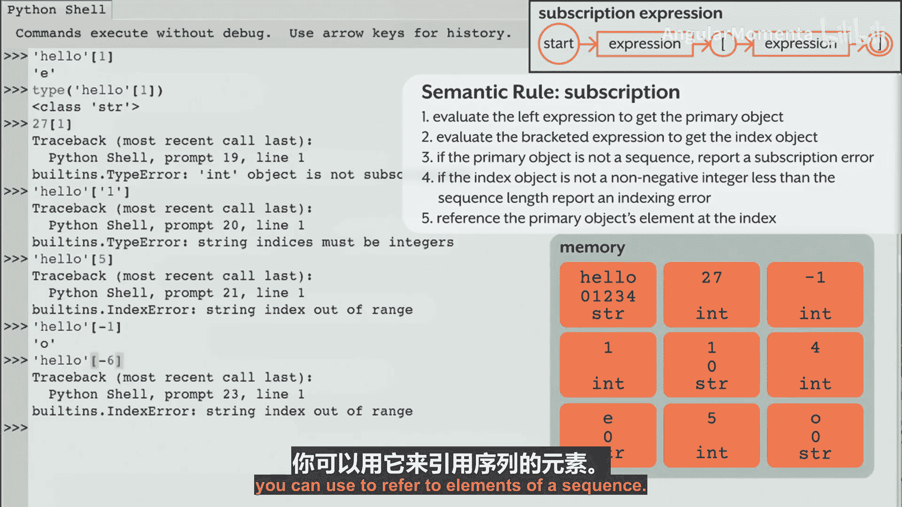

# 048：Python序列与下标索引 🎼


在本节课中，我们将学习Python中一个重要的概念——**序列类型**，以及如何通过**下标索引**来访问序列中的元素。

## 概述

序列是Python中一类特殊的数据类型，它代表一个**有限、有序**的元素集合。本节课我们将以字符串类型为例，详细介绍序列的特性，并学习如何使用下标索引表达式来获取序列中的特定元素。

## 什么是序列？

一个序列是一个**有限、有序**的元素组，其中每个元素都有一个介于0到（元素总数-1）之间的数字索引。

Python中没有名为“sequence”的单一类型。相反，“序列”是一个**类别**，它包含了多种不同的Python类型。Python的字符串类型（`str`）就是其中一种序列。

每个字符串都是一个由索引字符组成的有限有序组。例如，字符串对象 `"Hello"` 就是一个字符序列：
*   `H` 是索引为 0 的元素。
*   `e` 是索引为 1 的元素。
*   `l` 既是索引为 2 的元素，也是索引为 3 的元素。
*   `o` 是索引为 4 的元素。

**请记住，Python的索引总是从0开始，而不是从1开始。**

## 下标索引表达式

为了引用序列中的某个元素，我们可以使用一种新的Python表达式——**下标索引表达式**。它使用两个分隔符：左方括号 `[` 和右方括号 `]`。

Python的下标索引类似于数学中使用下标的方式。例如，要引用字符串 `"Hello"` 在索引1处的元素，可以使用以下表达式：

```python
"Hello"[1]
```

这个表达式读作“Hello下标1”。

在许多编程语言中，字符串的元素类型是 `char`（字符）。然而，**Python中没有`char`类型**。当我们使用下标索引引用字符串中的一个字符时，解释器返回的是一个**单元素的字符串对象**。

## 下标索引的语法与语义

以下是下标索引表达式的简化语法图：
`primary_expression [ index_expression ]`

其简化的语义规则如下：
1.  计算左侧表达式，得到**主对象**。
2.  计算括号内的表达式，得到**索引对象**。
3.  如果主对象**不是**一个序列，则报告“下标”错误。
4.  如果索引对象**不是**一个小于序列长度的非负整数，则报告“索引”错误。
5.  引用主对象在指定索引处的元素。

## 实例分析

上一节我们介绍了下标索引的规则，本节中我们通过几个例子来看看这些规则是如何应用的。

以下是几个正确与错误用例的分析：

**用例一：正确索引**
表达式：`"Hello"[1]`
1.  主对象是 `"Hello"`。
2.  索引对象是 `1`。
3.  `"Hello"` 是字符串类型，属于序列，无错误。
4.  整数 `1` 是非负整数，且小于字符串长度 `5`，无错误。
5.  返回索引 `1` 处的元素，即单元素字符串 `"e"`（注意不是索引0的 `"H"`）。

**用例二：对非序列对象使用下标（错误）**
表达式：`27[1]`
1.  主对象是 `27`。
2.  索引对象是 `1`。
3.  主对象是整数类型（`int`），**不是**序列。因此会报告语义类型错误：“‘int’ object is not subscriptable”，计算停止。

**用例三：索引不是整数（错误）**
表达式：`"Hello"["1"]`
1.  主对象是 `"Hello"`。
2.  索引对象是字符串 `"1"`。
3.  `"Hello"` 是序列，无错误。
4.  索引对象是字符串，**不是**整数。因此会报告语义类型错误：“string indices must be integers”，计算停止。

**用例四：索引越界（错误）**
表达式：`"Hello"[5]`
1.  主对象是 `"Hello"`。
2.  索引对象是 `5`。
3.  `"Hello"` 是序列，无错误。
4.  整数 `5` 是非负整数，但它**不小于**字符串长度 `5`（最大有效索引是4）。因此会报告语义索引错误：“string index out of range”，计算停止。

**索引必须严格小于序列长度的原因在于，序列的索引范围是从0到（序列长度 - 1）。**

## 负索引

在标准的语义规则中，步骤4指出解释器会对所有负整数报告索引错误。然而，Python内置的序列类型可以处理一些负索引。

例如，在表达式 `"Hello"[-1]` 中，返回的是最后一个元素 `"o"`。其原理是将负索引 `-1` 加上字符串长度 `5`，得到索引 `4`，然后返回该索引处的元素 `"o"`。

使用索引 `-n` 可以得到倒数第 `n` 个元素，这在某些情况下很有用。但是，如果使用的负索引绝对值过大，仍然会导致索引错误。例如，`"Hello"[-6]` 就是一个错误，因为 `"Hello"` 只有5个字符，不存在倒数第6个元素。

## 总结

本节课中我们一起学习了Python中的**序列类型**和**下标索引表达式**。
*   我们了解到序列（如字符串）是一个**有限、有序**的元素集合，可通过从0开始的数字索引访问。
*   我们掌握了使用 `序列对象[索引]` 这种语法来获取序列中的特定元素。
*   我们详细分析了下标索引的语义规则，并通过实例理解了正确使用索引以及常见错误（如对非序列下标、索引非整数、索引越界）的发生原因。
*   最后，我们还了解了Python支持使用**负索引**来方便地访问序列末尾的元素。



理解这些概念是有效处理字符串及其他序列数据的基础。