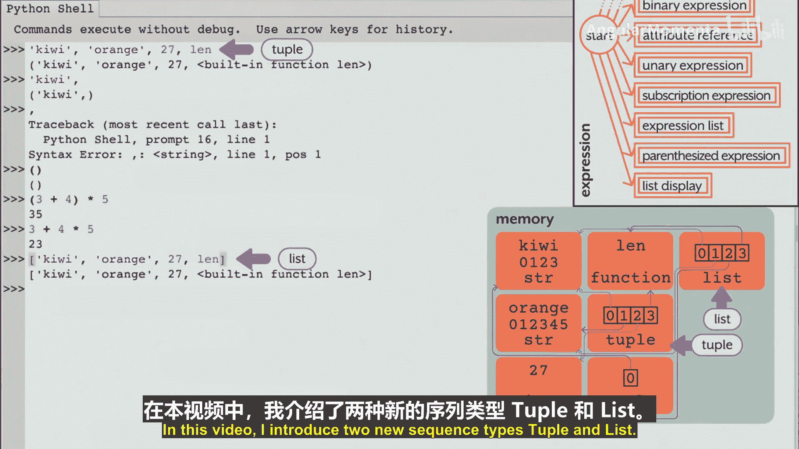

# 049：元组与列表类型 📚


在本节课中，我们将要学习Python中两种新的序列类型：**元组（Tuple）** 和**列表（List）**。同时，我们也会介绍一种新的表达式——**括号表达式（Parenthesized Expression）**。这些概念是构建更复杂数据结构的基础。

---

## 已掌握的序列类型：字符串

在开始之前，你已经使用过一种序列类型：**字符串（String）**。字符串的元素必须都是字符。

## 元组（Tuple）类型

元组是一种序列，其元素可以是**任意类型**。例如，一个元组可以包含字符串“kiwi”和“orange”、整数`27`以及函数`len`。

与字符串可以通过字面量（如`"hello"`）直接创建不同，**元组没有专用的字面量标记**来创建。

### 如何创建元组：表达式列表

我们使用一种称为**表达式列表（Expression List）**的结构来创建元组。表达式列表由多个用逗号分隔的表达式组成。

以下是一个创建包含“kiwi”、“orange”、`27`和`len`的元组的表达式列表：

```python
"kiwi", "orange", 27, len
```

现在，让我们更新表达式的语法图，使其包含表达式列表。

**表达式语法图（修订版）**:
```
expression ::= ... | expression_list
```

**表达式列表语法图**:
```
expression_list ::= expression ("," expression)* [","]
```

### 表达式列表的语义规则

表达式列表的语义规则如下：
1.  从左到右依次求值每个表达式，得到表达式对象。
2.  如果列表中没有逗号（即只有一个表达式），则结果对象就是该单个表达式对象。
3.  如果列表中有逗号，则结果对象是一个**元组**，其中包含所有求值后的表达式对象。

让我们应用这个规则来创建 `("kiwi", "orange", 27, len)` 这个元组：
*   **步骤1**：对四个表达式分别求值，得到四个对象：字符串“kiwi”、字符串“orange”、整数`27`和函数`len`。
*   **步骤2**：跳过，因为表达式列表中有逗号。
*   **步骤3**：创建一个包含这四个对象（“kiwi”、“orange”、`27`、`len`）的元组对象。

### 创建单元素元组和空元组

要创建只包含一个元素的元组，需要在单个表达式后加一个**尾随逗号**。例如：

```python
"kiwi",
```

其创建过程是：
*   **步骤1**：对单个表达式求值，得到字符串“kiwi”对象。
*   **步骤2**：跳过，因为表达式列表中有逗号。
*   **步骤3**：创建一个包含单个“kiwi”对象的元组。

如果尝试只用一个逗号来创建空元组，会导致语法错误。因此，我们需要另一种方法。

---

上一节我们介绍了如何使用表达式列表创建元组，但创建空元组需要不同的方法。本节中，我们来看看如何通过**括号表达式**来实现。

## 括号表达式（Parenthesized Expression）

我们将括号表达式添加到表达式的语法图中。

**表达式语法图（再次修订）**:
```
expression ::= ... | expression_list | parenthesized_expression
```

**括号表达式语法图**:
```
parenthesized_expression ::= "(" [expression_list] ")"
```

### 括号表达式的语义规则

括号表达式的语义规则是：
1.  如果括号内没有表达式列表，则结果对象是一个**空元组**。
2.  如果括号内有表达式列表，则对其求值，并将结果作为结果对象。

因此，我们可以使用一对空括号 `()` 来创建一个空元组。

除了创建元组，括号在Python中的主要作用与在数学中类似：**改变运算符的正常优先级**。在Python运算符优先级表中，括号位于最底部，意味着它们可以赋予任何运算最高的优先级。

例如，如果你想先执行加法再执行乘法，可以将加法运算符及其操作数放在括号内：

```python
(5 + 2) * 5  # 结果是 35
```

如果没有括号，表达式 `5 + 2 * 5` 将按照默认优先级（先乘除后加减）计算，结果为 `23` 而不是 `35`。

---

我们已经了解了元组序列类型和用于创建空元组的括号表达式。现在，让我们来看看另一种非常相似的序列类型——**列表（List）**。

## 列表（List）类型

列表与元组相似，其元素也可以是**任意类型**。例如，一个列表可以包含字符串“kiwi”和“orange”、整数`27`以及函数`len`。

与元组一样，**列表也没有专用的字面量标记**来创建。

### 如何创建列表：列表显示

创建列表使用一种称为**列表显示（List Display）**的表达式，它使用逗号作为分隔符，并用左右方括号 `[` 和 `]` 作为定界符。

以下是一个列表显示表达式，用于在内存中创建 `["kiwi", "orange", 27, len]` 这个列表：

```python
["kiwi", "orange", 27, len]
```

让我们再次更新表达式的语法图，使其包含列表显示。

**表达式语法图（最终修订版）**:
```
expression ::= ... | expression_list | parenthesized_expression | list_display
```

**列表显示简化语法图**:
```
list_display ::= "[" [expression_list] "]"
```

### 列表显示的语义规则

列表显示的简化语义规则是：
1.  如果方括号内没有表达式列表，则结果对象是一个**空列表** `[]`。
2.  如果方括号内有表达式列表，则对其求值，并返回一个按顺序包含所有这些对象的**列表对象**。

让我们将这个规则应用到 `["kiwi", "orange", 27, len]` 这个列表显示上：
*   **步骤1**：方括号内有表达式列表，因此结果对象不是空列表。
*   **步骤2**：对四个表达式求值，得到“kiwi”字符串、“orange”字符串、`27`整数和`len`函数对象。
*   **步骤3**：创建一个按顺序包含这四个元素的列表对象。

---

你可能会疑惑，为什么Python要有**元组**和**列表**这两种看起来如此相似（除了创建方式不同）的类型？这个问题的答案，我们将在下一节课中揭晓。

---

## 总结 🎯

在本节课中，我们一起学习了：
1.  **元组（Tuple）**：一种元素类型任意的序列，使用**表达式列表**（逗号分隔）创建，或用**括号表达式** `()` 创建空元组。
2.  **括号表达式**：主要作用是改变运算优先级，也可用于创建空元组 `()`。
3.  **列表（List）**：另一种元素类型任意的序列，使用**列表显示**（方括号 `[]` 包裹的表达式列表）创建。

核心创建方式总结如下：
*   **元组**：`item1, item2, ...` 或 `(item1, item2, ...)` 或 `()`
*   **列表**：`[item1, item2, ...]` 或 `[]`



理解这两种基本数据结构是进行有效Python编程的关键一步。