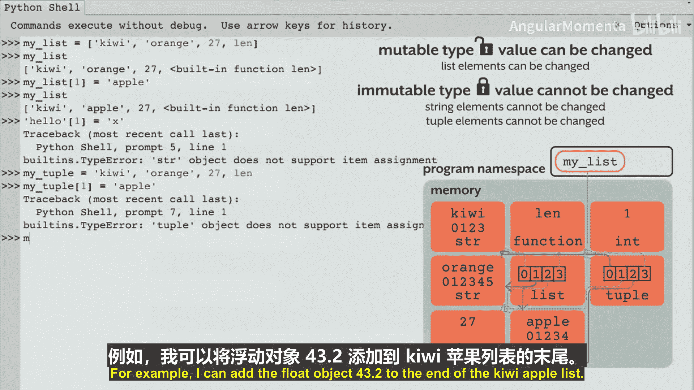

# 050：序列元素替换与可变性


在本节课中，我们将学习如何使用一种特殊的赋值语句来修改序列中的元素，并理解可变类型与不可变类型之间的核心区别。

## 序列元素的替换

上一节我们介绍了序列的基本概念和索引操作。本节中，我们来看看如何修改序列中的元素。

要修改序列中的元素，需要使用一种支持**下标表达式**作为目标的赋值语句。回顾一下普通赋值语句的语法，其目标通常是一个简单的标识符。

以下是包含下标表达式的赋值语句语法：

```python
target[expression] = expression
```

其执行语义如下：
1.  计算右侧表达式，得到结果对象。
2.  计算左侧表达式，得到主对象（即序列本身）。
3.  计算方括号内的表达式，得到索引对象。
4.  检查主对象是否为可变序列。
5.  检查索引是否有效。
6.  将序列中指定索引处的元素重新绑定为结果对象。

例如，我们可以修改列表中的一个元素。首先，创建一个列表并显示其原始内容。

```python
my_list = [‘kiwi‘, ‘orange‘, ‘banana‘, ‘pear‘]
print(my_list)  # 输出: [‘kiwi‘, ‘orange‘, ‘banana‘, ‘pear‘]
```

现在，使用赋值语句将索引1处的元素‘orange‘替换为‘apple‘。

```python
my_list[1] = ‘apple‘
```

应用上述语义规则：
1.  右侧表达式‘apple‘被求值。
2.  左侧表达式`my_list`被求值，得到列表对象。
3.  方括号内的表达式`1`被求值。
4.  主对象是列表，属于可变序列。
5.  索引`1`是有效索引。
6.  列表索引1处的元素被重新绑定为‘apple‘。

最后，显示修改后的列表以查看结果。

```python
print(my_list)  # 输出: [‘kiwi‘, ‘apple‘, ‘banana‘, ‘pear‘]
```

可以看到，列表索引1处的元素已成功从‘orange‘替换为‘apple‘。

## 可变类型与不可变类型

并非所有序列类型都允许修改其元素。例如，字符串的元素就不能被修改。列表允许修改元素，如我们刚才所做的。

以下是两种类型的关键定义：
*   **可变类型**：对象的值可以被改变的类型。**列表**是可变类型，因为可以通过替换、添加或删除元素来改变列表对象的值。
*   **不可变类型**：对象的值不能被改变的类型。**字符串**和**元组**是不可变类型。

例如，给定一个元组：

```python
my_tuple = (‘a‘, ‘b‘, ‘c‘)
```

如果尝试使用下标赋值来修改元组的元素，Python会报告类型错误。

```python
my_tuple[1] = ‘z‘  # 错误: ‘tuple‘ object does not support item assignment
```

字符串和元组不能添加、删除或替换元素。

## 向序列添加元素

`append`方法可用于向可变序列的末尾添加一个元素。该方法接收两个参数：第一个是特殊参数`self`（即序列本身），第二个是传递给方法的参数，即要添加到序列末尾的元素。

例如，我们可以向`my_list`列表的末尾添加一个浮点数`43.2`。



```python
my_list.append(43.2)
print(my_list)  # 输出: [‘kiwi‘, ‘apple‘, ‘banana‘, ‘pear‘, 43.2]
```

如果对元组使用`append`方法，操作会失败，因为不能对任何不可变类型应用`append`方法。

```python
my_tuple.append(‘d‘)  # 错误: ‘tuple‘ object has no attribute ‘append‘
```

元组和列表类型之间的唯一区别就是：元组是不可变的，而列表是可变的。此外，`int`（整数）、`float`（浮点数）和`bool`（布尔）类型也是不可变的。你不能改变这些类型对象的值。

## 总结

本节课中我们一起学习了如何使用支持下标表达式的赋值语句来修改序列（如列表）中的元素。我们详细区分了**可变类型**（如列表，其值可被修改）和**不可变类型**（如字符串、元组、整数、浮点数、布尔值，其值不可被修改）。理解这一区别对于有效且正确地操作Python中的数据结构至关重要。