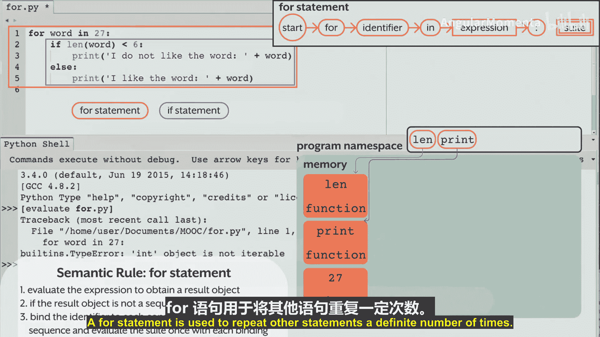

**Python编程与问题解决：06：for循环语句** 🚀


在本节课中，我们将学习一种新的语句——`for`语句，它通常被称为`for`循环。`for`循环用于将一组语句重复执行确定的次数。

---

### 概述

`for`语句常用于处理序列中的每个元素。序列可以是一个列表、字符串或其他可迭代对象。在许多情况下，我们需要对序列中的每个元素执行相同的操作，`for`循环为此提供了简洁的解决方案。

---

### `for`语句的基本结构

`for`语句是一种复合语句。其最简单的形式是将一个目标标识符依次绑定到序列的每个元素上。

以下是`for`语句的简化语法图：

```
for 目标标识符 in 表达式:
    语句组
```

它由以下部分组成：
*   **`for`**：关键字。
*   **目标标识符**：一个变量名。
*   **`in`**：关键字。
*   **表达式**：一个计算结果为序列对象的表达式。
*   **`:`**：冒号。
*   **语句组**：需要重复执行的代码块，其语法与`if`语句的语句组相同。

---

### `for`语句的执行语义

`for`语句的执行遵循以下步骤：

1.  **计算表达式**：对`in`后面的表达式进行求值，得到一个结果对象。
2.  **检查序列**：如果结果对象**不是**一个序列，则报告错误。
3.  **循环执行**：将**目标标识符**依次绑定到序列的每一个元素上，并针对每一次绑定，执行一次**语句组**。

---

### 示例程序分析

让我们通过一个具体的程序来理解`for`循环。这个程序分析一个给定的单词序列，并根据单词的长度打印出对每个单词的看法。

```python
word_list = ["Python", "chair", "Edmonton"]
for word in word_list:
    if len(word) < 6:
        print("I do not like the word " + word)
    else:
        print("I like the word " + word)
```

**程序执行过程如下：**

1.  **初始化**：变量`word_list`被绑定到一个包含三个字符串的列表对象 `["Python", "chair", "Edmonton"]`。
2.  **进入`for`循环**：
    *   **第一次迭代**：`word`被绑定到`"Python"`。`len("Python")`等于6，不小于6，因此`if`条件为假，执行`else`子句，打印 `"I like the word Python"`。
    *   **第二次迭代**：`word`被绑定到`"chair"`。`len("chair")`等于5，小于6，因此`if`条件为真，执行`if`子句，打印 `"I do not like the word chair"`。
    *   **第三次迭代**：`word`被绑定到`"Edmonton"`。`len("Edmonton")`等于8，不小于6，因此`if`条件为假，执行`else`子句，打印 `"I like the word Edmonton"`。
3.  **循环结束**：序列中的所有元素都已处理完毕，程序执行完毕。

---

### 错误示例

上一节我们看到了`for`循环如何正确工作。本节中我们来看看如果表达式的结果不是序列会发生什么。

如果我们错误地将一个整数作为`for`循环的序列，例如：

```python
for word in 27:  # 错误！27不是序列
    print(word)
```

根据`for`语句的语义：
1.  表达式`27`被求值，得到整数对象`27`。
2.  整数对象`27`不是一个序列，因此Python会报告一个错误，提示 `‘int‘ object is not iterable`（`int`对象不可迭代）。

**重要提示**：目前，我们只需确保`for`语句中`in`后面的表达式计算结果为序列对象（如列表、字符串）。虽然存在一些“可迭代”的非序列对象，但现阶段我们暂不深入讨论。

---

### 总结



本节课中我们一起学习了`for`语句。`for`循环是一种强大的工具，用于将一组操作重复执行确定的次数，特别适用于遍历序列中的每个元素。我们掌握了它的基本语法、执行语义，并通过实例和错误分析加深了理解。记住，`for`循环的核心是 **`for 变量 in 序列:`** 这个结构。