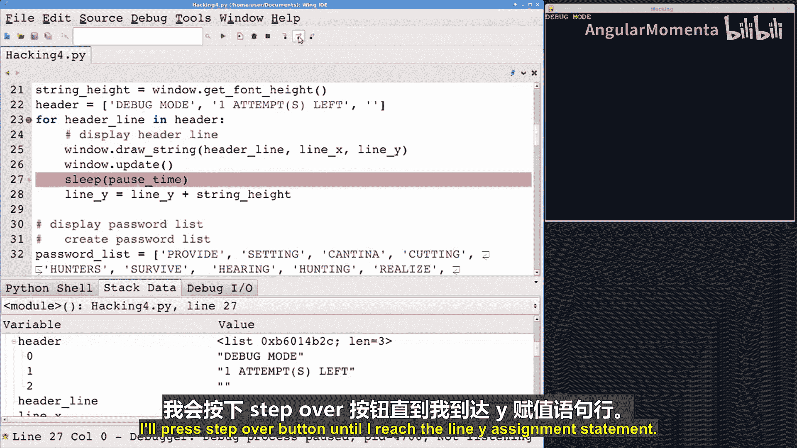
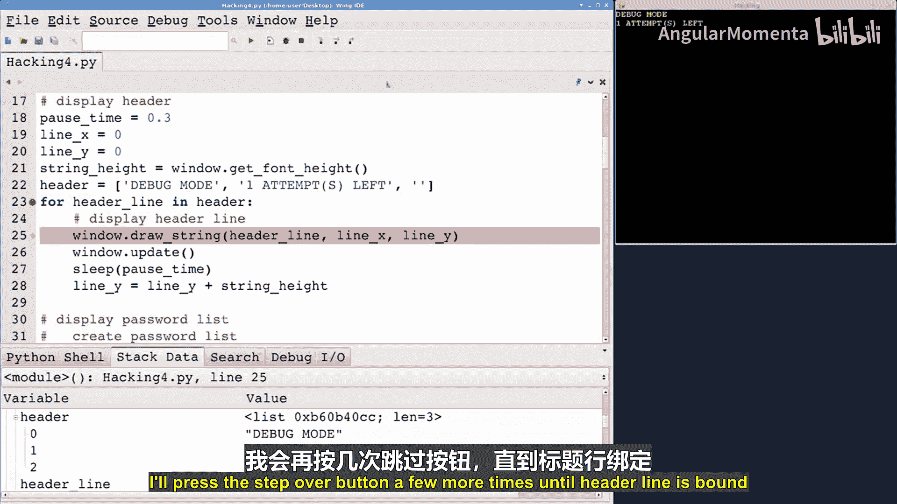
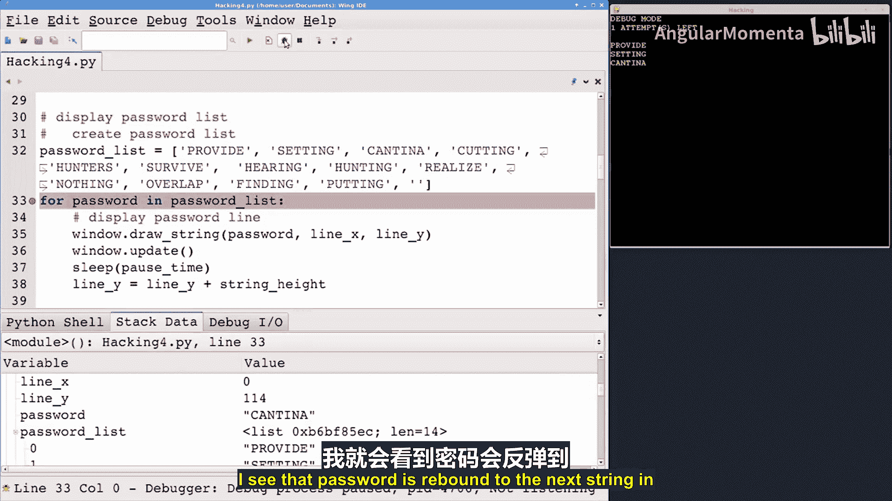

# 053：版本4代码回顾与软件质量测试 🧐


在本节课中，我们将回顾“黑客”游戏版本4的代码，并学习如何使用调试器追踪`for`循环语句。我们还将介绍两个新的软件质量测试：字面量测试和重复代码测试。

## 代码回顾：使用调试器追踪循环

上一节我们完成了版本4的算法设计，本节中我们来看看如何通过调试器来验证循环的工作流程。

首先，在显示标题的第一个`for`语句旁设置一个断点，然后按下调试按钮。

```python
# 设置断点的示例位置
for header_line in header:  # <-- 在此处设置断点
    # ... 显示标题的代码
```

游戏窗口会出现，但内容是空的。因为按下了调试按钮，调试器会在断点处暂停，并高亮显示`for`语句所在行。

按下“单步跳过”按钮，进入`for`语句，调试器会高亮显示将绘制第一个标题字符串的`draw_string`函数调用。



此时，在栈数据面板中，标识符`header_line`已被添加，并绑定到列表`header`的第一个元素`"DEBUG MODE"`。展开`header`列表，可以看到它包含三个元素：`"DEBUG MODE"`、`"1 ATTEMPT(S) LEFT"`和一个空字符串`""`。这证实列表已正确初始化，长度为3，且索引从0到2。


继续按“单步跳过”按钮，直到执行完`y`坐标的赋值语句，`"DEBUG MODE"`会显示在游戏窗口中。

当在`if`语句末尾按下“单步跳过”时，调试器会跳转到`if`之后的下一条语句。但在此处，按下按钮后，调试器会返回到`for`语句的顶部，并再次高亮`for header_line in header:`。这样，目标标识符`header_line`就可以被重新绑定到`header`列表的下一个元素。

再次按下“单步跳过”，栈数据中的`header_line`已更新为`"1 ATTEMPT(S) LEFT"`。调试器对于缓慢追踪循环、观察标识符如何变化非常有用。

继续按几次“单步跳过”，直到`header_line`被绑定到空字符串`""`，并且`y`赋值语句再次被高亮。



当再次按下“单步跳过”时，调试器会最后一次返回到`for`语句顶部。即使我们知道列表中没有更多元素了，解释器仍会检查列表中是否还有元素。再次按下按钮后，`for`语句块之后的第一行代码（用于创建密码列表）会被高亮。


## 循环追踪的快捷方式

接下来，我们在显示密码的第一个`for`语句处设置另一个断点，以展示循环追踪的一个便捷快捷方式。

当断点设置在循环的任意一行时，按下调试按钮会追踪一次完整的循环迭代，并停在包含断点的同一行。这使得快速追踪整个循环迭代变得容易。

按下调试按钮后，两个标识符被添加到栈数据中：`password`（当前绑定到`"PROVIDE"`）和`password_list`（绑定到一个长度为14的列表）。

多按几次调试按钮，可以看到`password`被重新绑定到列表中的下一个字符串，然后显示在窗口中。

关于使用追踪来理解`for`语句的内容就介绍到这里。

## 版本4的软件质量测试




接下来，我们讨论为此版本添加的两个软件质量测试。

### 1. 字面量测试

以下是字面量测试的要求：
*   每个具有共同意图的字面量（除了`0`、`1`、`2`、`-1`、`0.0`和空字符串`""`）在程序中应**恰好出现一次**。
*   允许使用标识符代替这些特殊值，但不是必须的。

例如，在我们的代码中，我们用标识符`line_x`替换了字面量`0`，使其意图更清晰。我们保留了用于计算一半距离的字面量`2`，因为除以2很常见。而`0`和`1`作为列表起始索引的常见用法通常不会被替换。

之前我们讨论过，如果不小心，查找和替换字面量可能会引入错误。我们也讨论了在整个程序中更改一个字面量的多个实例是多么繁琐。

在你的代码中，请确保为每个使用超过一次的字面量绑定了标识符。你的代码中，每个具有特定意图的字面量应该只包含一个实例。这使你的代码更短，并且在更改字面量值时更不容易出错。

### 2. 重复代码测试


重复测试确保相邻的重复语句组已被重复控制结构（如循环）替换。这使你的代码更短、更易读、更易修改。

对于此版本，你应该有三个`for`语句，它们替换了版本3代码中的三组相邻重复语句：
*   一个替换了标题显示。
*   一个替换了密码列表显示。
*   一个替换了结果消息显示。

同时，请确保你的代码反映了之前版本的软件质量测试：
*   程序和代码块应有注释。
*   你的标识符名称应具有描述性。
*   你的代码应反映新算法的设计。

恭喜，你完成了“黑客”游戏的版本4！

---


本节课中我们一起学习了如何使用调试器逐步追踪`for`循环的执行过程，以理解标识符的绑定和变化。我们还介绍了版本4需要通过的两种软件质量测试：**字面量测试**旨在减少重复字面量，提高代码可维护性；**重复代码测试**强制使用循环结构消除重复代码，使程序更简洁高效。确保你的代码满足这些要求，并为后续开发打下坚实基础。