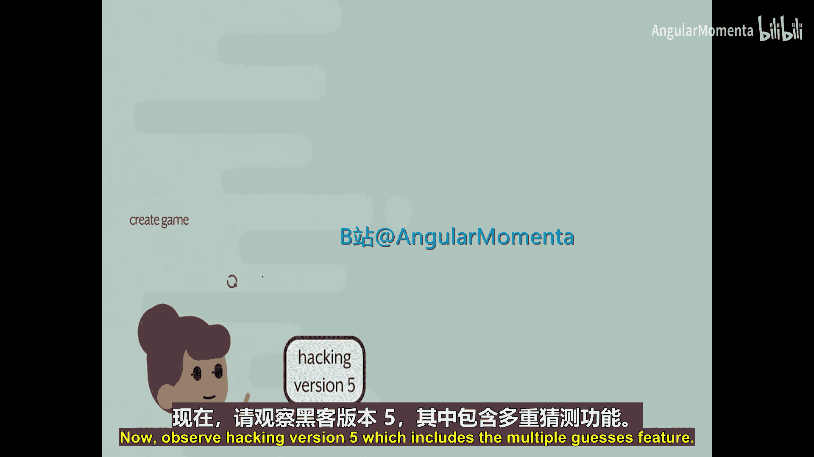

# 054：Hacking版本4的解决方案问题

在本节中，我们将分析Hacking游戏第4版中存在的解决方案问题，并探讨在第5版中如何通过引入新的控制结构和数据抽象技术来改进它们。

## 🎼 版本5的新特性概述

Hacking版本5将为游戏添加新功能。在编写代码之前，你需要创建一个描述、一个功能测试计划和一个算法。

首先，我们来讨论一下在这个版本中应该改进的解决方案问题。

## 版本4中的问题与改进方向

### 单一猜测的限制

在一个关于猜测密码的游戏中，只允许一次猜测是相当令人遗憾的。在版本5中，你将添加使用新的重复控制结构——`while`语句——来输入多个密码猜测的功能。

### 引入While循环

`while`语句是第二种循环类型，你将在课程的其余部分广泛使用它。它的作用与`for`循环类似，都是重复执行一系列步骤。

在之前的模块中，我们使用`for`循环来实现**确定次数循环**。回想一下，确定次数循环会遍历一个具有固定长度的显式序列的元素。`for`循环总是使用确定次数循环，因为它需要一个可迭代对象。

相比之下，`while`循环使用**不确定次数循环**，因为它使用一个条件而不是一个可迭代对象。只要其条件为真，`while`循环就会执行其步骤。你将在接下来的编程语言视频中了解更多关于`while`循环的知识。

确定次数循环和不确定次数循环都是**控制抽象**问题解决技术的例子。

### 重复描述与数据抽象

注意，你之前的描述包含了重复的属性，例如“它是绿色背景黑色文字”和“它使用小字体”。这是一个**重复自己**的例子，这会导致描述更长且更难修改。

相反，你应该将不同对象的共同属性分组在一起。例如，描述可以包含一个对象“每个文本对象”，来指代窗口中出现的所有文本。这个对象的属性将是“绿色背景黑色文字”和“使用小字体”。这样，这些共享属性就不需要为每个单独的显示对象进行描述。

将共同的对象属性分组到一个单元中，是一种新型抽象——**数据抽象**——的例子。

有多种方法可以对共同属性进行分组。我们已经使用数据抽象将单个对象的所有属性分组在一起，例如标题或结果的所有属性。这允许我们使用单个名称来描述、测试或引用整个标题或结果对象。

然而，当不同的对象具有共同属性时，我们也希望使用数据抽象来为这些共享属性赋予一个通用名称。例如，狗和猫有共同的属性，比如吃肉。因此，我们可以创建一个名为“食肉动物”的术语来包含这些共同属性。

由于所有显示对象共享它们的颜色和字体大小，我们在描述中引入“每个文本对象”作为一个显式的公共对象。这样，我们就可以将共享的颜色和字体属性移动到这个单一的公共对象中。

现在，观察包含了多次猜测功能的Hacking版本5。

## 总结

在本节中，我们一起学习了Hacking游戏第4版解决方案中的两个主要问题：单一猜测的限制和描述中的重复。我们探讨了如何通过引入`while`循环来实现不确定次数循环，从而允许多次猜测。同时，我们学习了数据抽象的概念，通过将共同属性（如颜色和字体）分组到“每个文本对象”这样的抽象单元中，可以使描述更简洁、更易于维护。这些改进为版本5的开发奠定了基础。